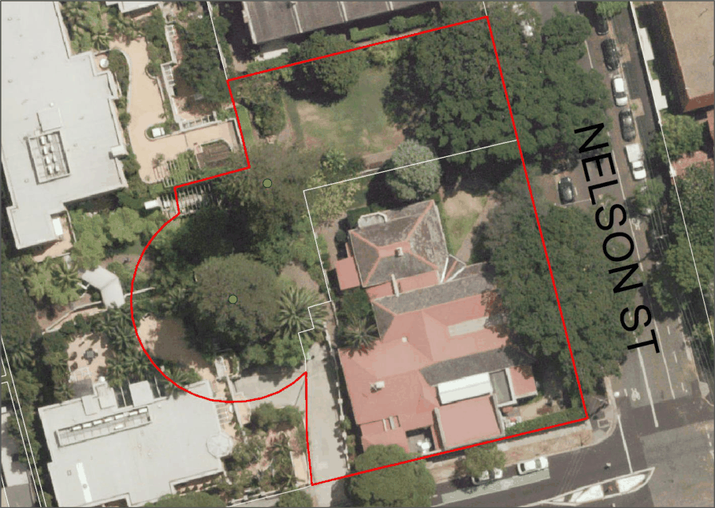

#### G6.3 Development controls

The following controls apply to any development on the site. In the design of any new buildings on the site, attention is to be given to the following controls.

#### G6.3.1 The siting of development

#### Objectives

O1 To ensure aural and visual privacy for development on the subject site and the surrounding development.

O2 To ensure sunlight and daylight access for development on the site and neighbouring land.

O3 To promote a building scale and form which is compatible with the surrounding development.

O4 To ensure compatibility with the character of the streetscape.

O5 To integrate new development which does not dominate the scale of Brougham and its garden setting and is in sympathy with the curtilage established.

#### Controls

Development and the building curtilage

Development should be sited outside the building curtilage established for Brougham and the mature garden setting, which includes two Norfolk Island Pines that are listed as heritage items in Woollahra LEP 2014. The curtilage is identified in Figure 2 below. The western boundary of the curtilage is based on the tree preservation zones for the Norfolk Island Pines, minus the built form at the north-western corner.

Development to Wallis Street

Development to Wallis Street should be suitably sited and articulated and continue the building lines and proportions of the adjoining development.

The minimum setback to Wallis Street from any point on the development should be 2m from the property boundary.

A minimum setback of 6m from the west and north-west boundaries of the site is required for all development.

In designing the development the applicant should have regard to both the heritage significance of properties along the Woods Avenue boundary and the residential amenity of the neighbouring property. The applicant should demonstrate that setbacks to all boundaries have taken into account the setbacks of adjoining properties and the amenity of the neighbourhood.

FIGURE 2  Building curtilage The curtilage for the building and its landscape setting for Brougham, at 4A Nelson Street and 118 Wallis Street

> [Picture on page 10: a picture, saved as a picture (images/chapter-g6-4a-nelson-street-and-118-wallis-street-woollahra-page-10-3.gif, 150 dpi).]

#### G6.3.2 Height

#### Objectives

O1 To retain access to mid-winter sunshine on-site and to all neighbouring properties.

O2 To maintain aural and visual privacy on the subject site and the surrounding development.

O3 To ensure compatibility with the scale and the built form of the surrounding development to encourage a cohesive skyline.

O4 To maintain a street facade of human scale.

O5 To permit variations in building height to ensure compatibility with Brougham and the surrounding neighbourhood.

#### Controls

The height and roof pitch of new development should be consistent with the surrounding height and roofline of neighbouring development, particularly where new development fronts Wallis Street.

Development should be proportioned and stepped back in height from the street to achieve a human scale at street level and to continue the building lines established by adjoining development to introduce some scaled rhythm to the streetscape.

All new development should be the result of careful analysis of surrounding buildings and sympathetic interpretation of their design elements and the heritage significance of Brougham and the adjoining properties. Where development extends towards Brougham, the building height should be suitably scaled to relate to the height of Brougham. In this respect development should be stepped upwards in height back from Brougham.

The design of all external walls must take into account the wall height of adjoining buildings and apply suitable setbacks to the building to respect the built form of the surrounding development and amenity.

#### G6.3.3 Building form

#### Objectives

O1 To require that any new development or work is compatible with the design, scale, form and character of Brougham and its garden setting and surrounding development.

O2 To ensure that new development does not significantly conceal the form and features of Brougham and its garden setting.

O3 To protect and enhance the streetscape amenity.

O4 To promote a high standard of building design and energy efficiency.

#### Controls

New development must take into account the style, scale, location, use of balconies or verandahs and the proportions of the facades as they relate to the historical significance and architectural features of Brougham and the heritage significance of all the buildings which adjoin the site on the south-western side of Wallis Street.

A design approach which is sympathetic rather than purely imitative is required.

New development should ensure that the existing character and nature of the street remains intact and introduces some scaled rhythm to the streetscape.

All external walls which face Brougham are to ensure that a sympathetic building form in terms of height and dimension is achieved. Furthermore, any development which faces Brougham must relate to and enhance the landscape setting established by the curtilage.

Any walls which directly face Brougham should be suitably designed and landscaped to blend and soften their appearance and such walls should be stepped back and proportioned in height to relate to the external wall height of Brougham and to respect the heritage significance of Brougham and its setting.

All external development components including garages, ancillary structures as well as side and rear facades should exhibit unity of building form and architectural detailing.

#### G6.3.4 Open space and landscaping

#### Objectives

O1 To ensure the retention and enhancement of the mature 19th century gardens and setting of Brougham because of their heritage significance and to achieve the following:

a) the creation of a buffer between Brougham and the proposed development;

b) the provision of a reasonable level of privacy for all users of the site; and

c) the provision of a landscaped setting that could act as a link to integrate Brougham and new development.

O2 To ensure the provision of outdoor areas which are adequately sized, proportioned and located, for the use and enjoyment of the occupants of Brougham and the new development.

O3 To promote the streetscape amenity.

O4 To ensure the significant enhancement and retention of perimeter trees to screen and soften the impact of new development on adjoining properties.

O5 To retain all significant trees on site.

O6 To maintain sunlight and daylight penetration on the subject land and adjoining properties.

#### Controls

C1 The 19th century mature gardens in the centre of the site should be retained as a focus and enhanced to provide an appropriate setting to link and formalise the space between Brougham and new development.

C2 A landscaped buffer must be established between all new development on site and Brougham and its garden setting. All hard surfaces (except those already in existence) must be incorporated into a landscape setting.

C3 The two Norfolk Island Pines and the Camphor Laurel Tree (as identified in Section 6.2.1 of this chapter) are to be retained.  The mature gardens are also to be retained and may be added to subject to a detailed heritage landscaping plan being approved by Council.

C4 All significant trees should be retained on site.

C5 Suitable landscaping shall be introduced on site to soften all solid walls which directly face Brougham.

C6 Where it is determined that a tree is to be removed, it must be replaced with a suitable tree to the satisfaction of Council's Tree Officer.

C7 A landscape Heritage Management Plan and Impact Statement for the overall Building Curtilage heritage garden is to be submitted with any development application proposing landscaping works.

Notes:

i) Applicants should consult Council's Tree Officer prior to formulating a landscape plan for the site.

ii) A detailed tree survey is required and a full appraisal of the present condition of the trees and the likely impact of future development on all trees. All trees listed as significant must be retained and protected during construction. A qualified arborist must thoroughly inspect all trees (including all trees listed as significant) to determine the health and stability/safety for retention in the long term. In order to retain trees in a stable and healthy manner, it is generally required (except where determined by a tree surgeon) that no excavation take place within the dripline or canopy spread of the trees. However, it must be recognised that for trees such as Norfolk Island Pines that the tree roots would be expected to substantially exceed the dripline of the trees in order to stabilise the tree. Further, no change in levels would be acceptable above the existing ground level at the trees root system.

iii) The row of immature Camphor Laurel trees on the Woods Avenue boundary are required to be inspected by an arborist to determine whether their long term retention is viable. Where it is determined that a tree is to be removed, it must be replaced with a suitable tree to the satisfaction of Council's Tree Officer. Selective and gradual removal of trees is preferred in order to minimise loss of amenity to the properties in Woods Avenue. Replacement species shall be of a super-advanced plant stock (minimum 100 litre container).

#### G6.3.5 Pedestrian access

#### Objectives

O1 To provide a formal and historical link between Brougham and the curtilage;

O2 To restore the setting and curtilage of Brougham and recognise opportunities to do so;

O3 To enhance the use and enjoyment of Brougham by restoring the access to the traditional garden setting for recreational purposes;

O4 To ensure that pedestrian access is suitability located, landscaped and designed in context with the heritage items; and

O5 To provide those people entitled to access Brougham, safe and adequate access to all parts of the Brougham curtilage;

O6 To recognise the distinction between the visual curtilage and the area used for recreation;

O7 To maintain the landscape and the garden setting with the traditional balance of vegetation and open areas.

#### Controls

C1 Pedestrian access should be maintained from Brougham [Lot 3 DP 1150167] to all parts of the traditional Brougham curtilage.

C2 Pedestrian access should be designed to formally link Brougham and the curtilage and be suitably landscaped.

C3 Access to area C in DP 1009223 for recreational purposes to be restored for the benefit of Brougham.

C4 The inventory sheet for Brougham to guide future development.
