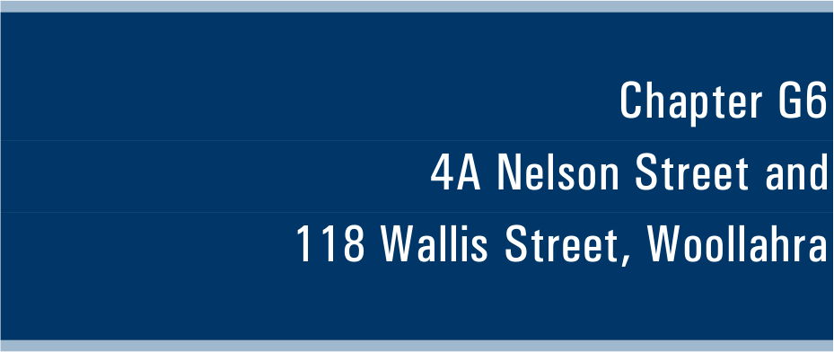

# Woollahra Development Control Plan 2015 - Chapter G6 4A Nelson Street and 118 Wallis Street, Woollahra

> This chapter is split into 4 section file(s), one per numbered heading, in the order they appear in the PDF.

Source PDF: [chapter_g6_4a_nelson_street_and_118_wallis_street.pdf](https://planfortomorrow.sharepoint.com/sites/Planfortomorrow/Shared%20Documents/00%20NSW-Planning-Resources/dcp/woollahra-development-control-plan-2015/chapter-g6-4a-nelson-street-and-118-wallis-street-woollahra/chapter_g6_4a_nelson_street_and_118_wallis_street.pdf)

> [Picture on page 1: a picture, saved as a picture (images/chapter-g6-4a-nelson-street-and-118-wallis-street-woollahra-page-1-1.gif, 150 dpi).]

### Chapter G6

4A Nelson Street and

## 118 Wallis Street, Woollahra

### Part G  Site-Specific Controls

### CHAPTER G6 APPROVED ON 27 APRIL 2015 AND COMMENCED ON 23 MAY 2015

<!-- sections -->
## Sections

1. [G6 4A Nelson Street and 118 Wallis Street, Woollahra](01-g6-4a-nelson-street-and-118-wallis-street.md)
2. [G6.1 Introduction](02-g6-1-introduction.md)
3. [G6.2 Heritage conservation for Brougham and its gardens](03-g6-2-heritage-conservation-for-brougham-and.md)
4. [G6.3 Development controls](04-g6-3-development-controls.md)
