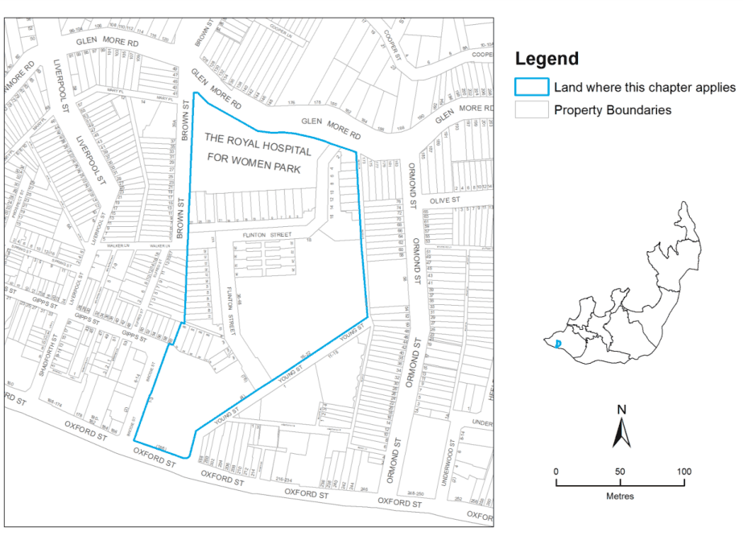

#### G7.1 Introduction

#### G7.1.1 Background

This chapter applies to land in Paddington previously occupied by the Royal Hospital for Women. The hospital played a major part in the history of Paddington, and its site together with certain buildings and structures form important elements of the Paddington conservation area. The hospital closed in the mid 1990s and the owners of the property, the Benevolent Society, sought the rezoning of the site to allow for redevelopment.

In November 1995, Council rezoned the site to a combination of residential, commercial and open space zones.  Council then adopted a development control plan (DCP) for the site, which commenced on 24 January 1997.  That DCP identified street dimensions, building siting, building setbacks, materials, building configuration, fences, parking, energy efficiency, heritage conservation and landscaping.   The site was redeveloped consistent with the intent of the rezoning and the DCP.

Recognising that the site is largely developed, this chapter only reflects the following parts of the original site specific DCP that may be relevant to further development on the site, such as additions and alterations: master siting plan; context statement and urban design principles; heritage standards; architectural standards; built form guidelines; and landscape management plan.

#### G7.1.2 Land where this chapter applies

This chapter applies to various lots in Paddington as identified on the map at Figure 1.

The lots are: SP 64257 (1-3 Brodie Street and 4 Young Street), Lot 56 & 57 SP 87117, SP 64558  (8, 16-22 Young Street, 18 and 36-48 Flinton Street), SP 64396 (62-74 Gipps Street), Lot 1-7 DP 1019806 (62 -74 Gipps Street), SP 65254 (20-34 Flinton Street), SP 65255 (1-27 Flinton Street), Lot 1-14  DP 1026156 (1 -27 Flinton Street), Lot 1–8 DP 1026153 (20-32 Flinton Street), Lot 1- 13 DP 1024561 and SP 65095 (29-53 Flinton Street), Lot 2 DP 1029153 (27A Flinton Street), Lot 1-8 DP 1049074 (2-16 Flinton Street), SP 69697 (2-16 Flinton Street) and Lot 8 DP 106623 (2 Flinton Street).

FIGURE 1  Subject sites

> [Picture on page 6: a picture, saved as a picture (images/chapter-g7-former-royal-women-s-hospital-paddington-page-6-2.gif, 150 dpi).]

#### G7.1.3 Development to which this chapter applies

This chapter applies to development requiring consent under Woollahra Local Environmental Plan 2014 (Woollahra LEP 2014).

Given that the site has been largely redeveloped, it is likely that development would generally involve only additions and alterations.

#### G7.1.4 Objectives

The objectives of this chapter are:

O1 To ensure a high quality of development and compatible relationship between development on the site and development on adjoining properties.

O2 To conserve items of heritage significance.

O3 To achieve a high quality of public spaces.

#### G7.1.5 Relationship to other parts of the DCP

This chapter is to be read in conjunction with the other parts of the DCP that are relevant to the development proposal, including: Part C: Chapter C1 Paddington Heritage Conservation Area Part E: General Controls for All Development – this part contains chapters on Parking and Access, Stormwater and Flood Risk Management, Tree Management, Contaminated Land, Waste Management, Sustainability, Signage and Adaptable Housing.

In the event of any inconsistency between this chapter and the other chapters, this chapter prevails.
