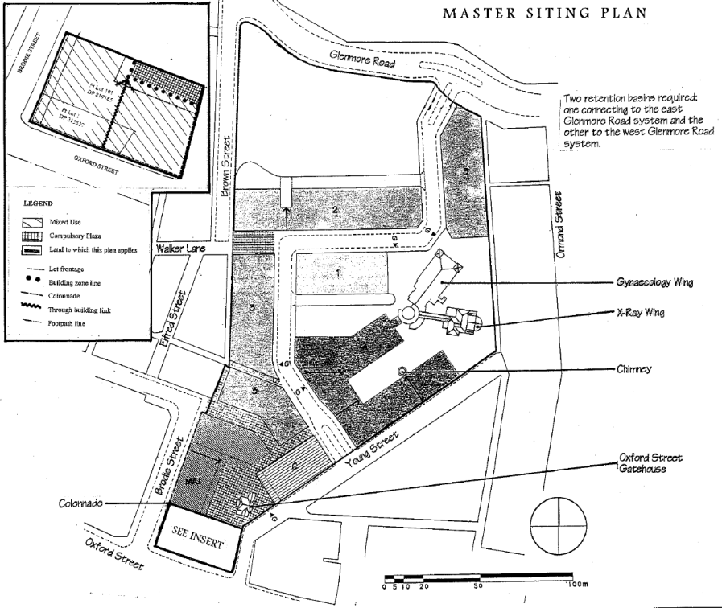

#### G7.2 Master siting plan

The master siting plan shows the location of building types, public open space and roadways.

The location of these should not be altered unless there is a need to reduce or avoid adverse environmental impact or unless it can be demonstrated that environmental and conservation benefits for development and areas on the site and for development and areas outside the site will be achieved.

> [Picture on page 8: a picture, saved as a picture (images/chapter-g7-former-royal-women-s-hospital-paddington-page-8-7.gif, 150 dpi).]
