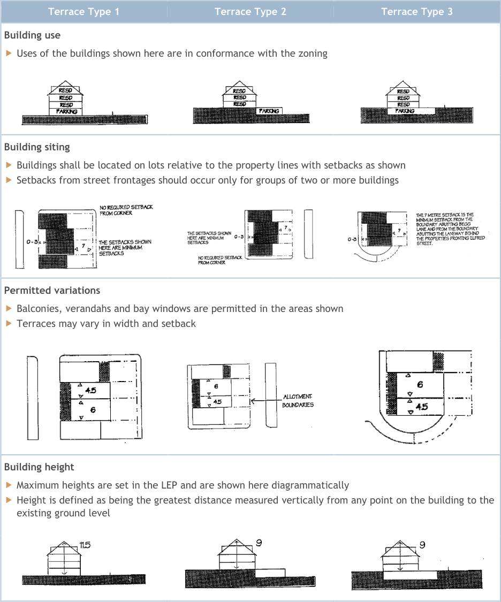
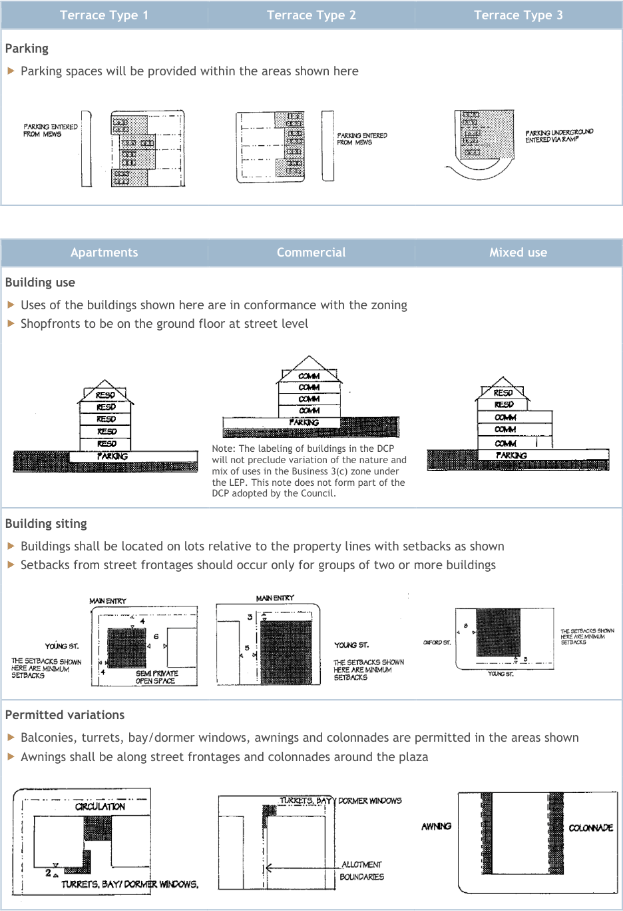
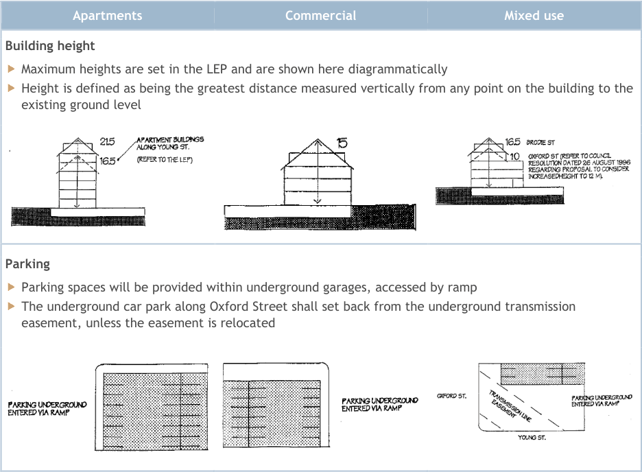

#### G7.5 Built form guidelines

All measurements are in metres unless stated otherwise.

> [Picture on page 13: a picture, saved as a picture (images/chapter-g7-former-royal-women-s-hospital-paddington-page-13-3.gif, 150 dpi).]
> [Picture text on page 13 is stored in the PDF without readable letters (no character map), so it could not be copied; see the original PDF.]
> Words printed on the picture (title and legend, copied from the PDF):
> Terrace Type 1
> Terrace Type 2
> Terrace Type 3
> Building use
> Uses of the buildings shown here are in conformance with the zoning
> Building siting
> Buildings shall be located on lots relative to the property lines with setbacks as shown
> Setbacks from street frontages should occur only for groups of two or more buildings
> Permitted variations
> Balconies, verandahs and bay windows are permitted in the areas shown
> Terraces may vary in width and setback
> Building height
> Maximum heights are set in the LEP and are shown here diagrammatically
> Height is defined as being the greatest distance measured vertically from any point on the building to the
> existing ground level

> [Picture on page 14: a picture, saved as a picture (images/chapter-g7-former-royal-women-s-hospital-paddington-page-14-1.gif, 150 dpi).]
> [Picture text on page 14 is stored in the PDF without readable letters (no character map), so it could not be copied; see the original PDF.]
> Words printed on the picture (title and legend, copied from the PDF):
> Terrace Type 1
> Terrace Type 2
> Terrace Type 3
> Parking
> Parking spaces will be provided within the areas shown here

> Words printed on the picture (title and legend, copied from the PDF):
> Uses of the buildings shown here are in conformance with the zoning
> Shopfronts to be on the ground floor at street level
> Note: The labeling of buildings in the DCP
> will not preclude variation of the nature and
> mix of uses in the Business 3(c) zone under
> the LEP. This note does not form part of the
> DCP adopted by the Council.
> Buildings shall be located on lots relative to the property lines with setbacks as shown
> Setbacks from street frontages should occur only for groups of two or more buildings
> Balconies, turrets, bay/dormer windows, awnings and colonnades are permitted in the areas shown
> Awnings shall be along street frontages and colonnades around the plaza

> [Picture on page 15: a picture, saved as a picture (images/chapter-g7-former-royal-women-s-hospital-paddington-page-15-1.gif, 150 dpi).]
> [Picture text on page 15 is stored in the PDF without readable letters (no character map), so it could not be copied; see the original PDF.]
> Words printed on the picture (title and legend, copied from the PDF):
> Apartments
> Commercial
> Mixed use
> Building height
> Maximum heights are set in the LEP and are shown here diagrammatically
> Height is defined as being the greatest distance measured vertically from any point on the building to the
> existing ground level
> Parking
> Parking spaces will be provided within underground garages, accessed by ramp
> The underground car park along Oxford Street shall set back from the underground transmission
> easement, unless the easement is relocated
