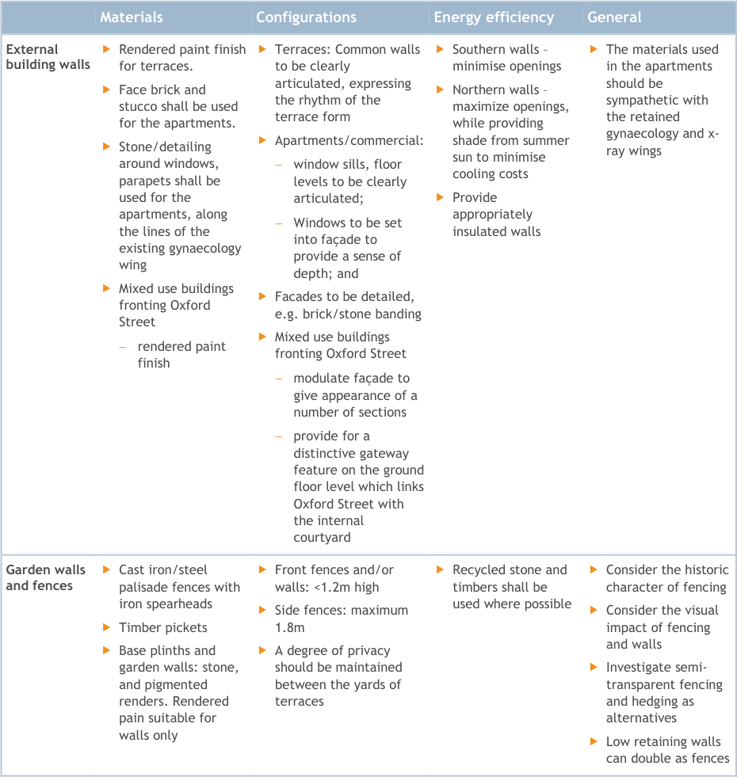
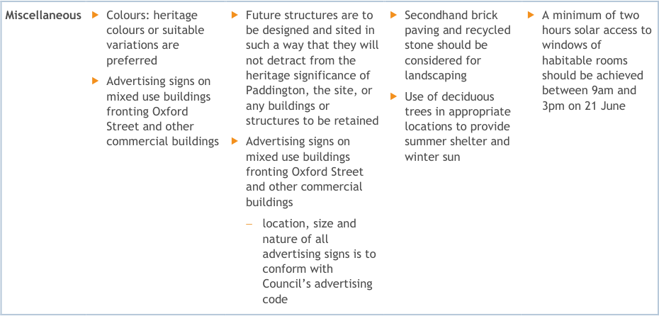

#### G7.6 Architectural standards

> [Picture on page 16: a map, saved as a picture (images/chapter-g7-former-royal-women-s-hospital-paddington-page-16-2.gif, 150 dpi); the street names and other small labels are on the picture.]
> [Picture text on page 16 is stored in the PDF without readable letters (no character map), so it could not be copied; see the original PDF.]
> Words printed on the picture (title and legend, copied from the PDF):
> Configurations Energy efficiency General
> Rendered paint finish Terraces: Common walls Southern walls – The materials used
> building walls for terraces.
> Face brick and
> Northern walls –
> to be clearly
> the rhythm of the
> stucco shall be used
> for the apartments.
> in the apartments
> gynaecology and x-
> window sills, floor
> shade from summer
> sun to minimise
> levels to be clearly
> Windows to be set
> parapets shall be
> used for the
> the lines of the
> into façade to
> provide a sense of
> Mixed use buildings
> Facades to be detailed,
> e.g. brick/stone banding
> Mixed use buildings
> fronting Oxford Street
> modulate façade to
> give appearance of a
> number of sections
> provide for a
> feature on the ground
> floor level which links
> Oxford Street with
> Cast iron/steel Front fences and/or Recycled stone and Consider the historic
> walls: <1.2m high
> character of fencing
> palisade fences with
> timbers shall be
> used where possible
> Side fences: maximum
> Consider the visual
> impact of fencing
> Base plinths and A degree of privacy
> should be maintained
> between the yards of
> and hedging as
> garden walls: stone,
> pain suitable for
> Low retaining walls
> can double as fences

> [Picture text on page 17 is stored in the PDF without readable letters (no character map), so it could not be copied; see the original PDF.]

| Balconies, | Balcony railings to be | Balconies to be clearly | Balconies to face |  |
|---|---|---|---|---|
| verandahs, | sympathetic with | expressed | north where possible |  |
| etc. | fencing Appropriate decorative timberwork important Curved roof form for balconies is an important element within Paddington Traditional steel or timber posted awnings on the commercial/mixed use buildings | Bay windows may be used in place of balconies in apartments and commercial buildings, or end terraces Turrets permitted centrally or in corners of apartment or commercial buildings Mixed use buildings fronting Oxford Street: modulate façade to give appearance of number of sections provide for a distinctive gateway feature on the ground floor level which links Oxford Street with the internal courtyard |  |  |
| Roofs and | Corrugated | Terraces may have | Collection of rain | Roof forms should |
| gutters | iron/Colorbond (especially for verandahs etc.), slate or imitation slate Important roof elements in Paddington include ornate gables and finials, as well as parapets and chimneys Gutters, flashing and fascias shall be used for the Paddington urban conservation area | either a parapet and roof or pitched roof of approx. Apartments and commercial buildings may use hipped roof forms of approx. Appropriately proportioned dormer windows permitted in all building types Quad, half round or ogee gutter profiles suitable, but not modern profiles such as fascia gutters. Downpipes to be of circular section | water for watering gardens, especially around the apartments Possible recycling of grey water | relate to those traditionally found in Paddington, as well as surrounding buildings Use of roof space is desirable Opposite windows in apartments should be staggered so as not to face each other, to preserve privacy |
| Windows and | The following are | size, location and | Suitable shading | Appropriate acoustic |
| doors | permitted: painted timber (preferred)/ aluminium (only where sufficient depth and width to frame and glazing elements; clear glass; and leadlight in doors, or small feature windows | proportion should relate to those found in Paddington on traditional buildings Vertical emphasis | devices should be used where possible to suit | treatment with respect to construction materials and openings in buildings shall be determined in accordance with Australian Standards AS 2107 and AS 3671. |

> [Picture on page 18: a map, saved as a picture (images/chapter-g7-former-royal-women-s-hospital-paddington-page-18-1.gif, 150 dpi); the street names and other small labels are on the picture.]
> [Picture text on page 18 is stored in the PDF without readable letters (no character map), so it could not be copied; see the original PDF.]
> Words printed on the picture (title and legend, copied from the PDF):
> Miscellaneous  Colours: heritage Future structures are to Secondhand brick A minimum of two
> colours or suitable
> paving and recycled
> stone should be
> Advertising signs on
> Use of deciduous
> hours solar access to
> should be achieved
> between 9am and
> 3pm on 21 June
> be designed and sited in
> such a way that they will
> not detract from the
> heritage significance of
> Paddington, the site, or
> any buildings or
> structures to be retained
> mixed use buildings
> Street and other
> commercial buildings Advertising signs on
> trees in appropriate
> locations to provide
> summer shelter and
> mixed use buildings
> fronting Oxford Street
> and other commercial
> location, size and
> nature of all
> advertising signs is to
