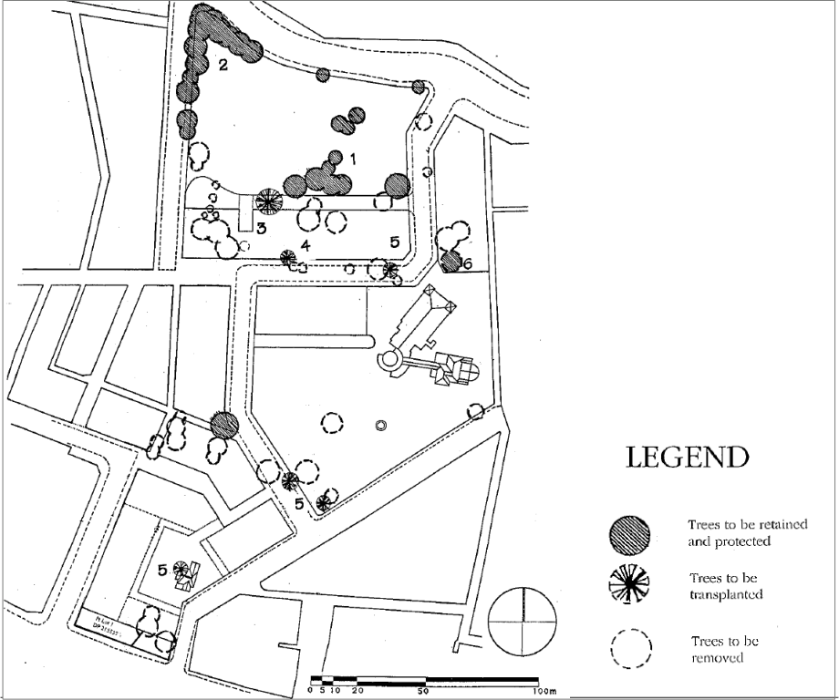

#### G7.7 Landscape management plan

This landscape management plan outlines how the existing landscape is to be managed when the site is redeveloped.

1\. Cluster of existing trees to be retained, including: Cinnamonum camphora; Cedrus deodora; Ficus sp; Bauhinia sp; and Eucalyptus sp.

2\. Cluster of Camphor Laurels to be retained. Long term replanting will need to be undertaken.

3\. Canary Island Date Palm to be transplanted.

4\. Bangalow Palm to be transplanted.

5\. Butia Palm to be transplanted.

6\. London Plane Tree to be retained.

> [Picture on page 19: a picture, saved as a picture (images/chapter-g7-former-royal-women-s-hospital-paddington-page-19-15.gif, 150 dpi).]
