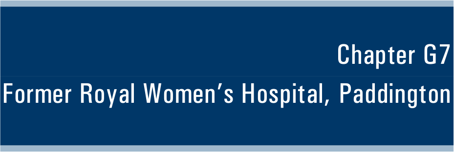

# Woollahra Development Control Plan 2015 - Chapter G7 Former Royal Women’s Hospital, Paddington

> This chapter is split into 8 section file(s), one per numbered heading, in the order they appear in the PDF.

Source PDF: [chapter_g7_former_royal_womens_hospital.pdf](chapter_g7_former_royal_womens_hospital.pdf)

> [Picture on page 1: a picture, saved as a picture (images/chapter-g7-former-royal-women-s-hospital-paddington-page-1-1.gif, 150 dpi).]

### Chapter G7

### Former Royal Women’s Hospital, Paddington

### Part G  Site-Specific Controls

### CHAPTER G7 APPROVED ON 27 APRIL 2015 AND COMMENCED ON 23 MAY 2015

<!-- sections -->
## Sections

1. [G7 Former Royal Women’s Hospital, Paddington](01-g7-former-royal-women-s-hospital-paddington.md)
2. [G7.1 Introduction](02-g7-1-introduction.md)
3. [G7.2 Master siting plan](03-g7-2-master-siting-plan.md)
4. [G7.3 Oxford Street frontage](04-g7-3-oxford-street-frontage.md)
5. [G7.4 Heritage standards](05-g7-4-heritage-standards.md)
6. [G7.5 Built form guidelines](06-g7-5-built-form-guidelines.md)
7. [G7.6 Architectural standards](07-g7-6-architectural-standards.md)
8. [G7.7 Landscape management plan](08-g7-7-landscape-management-plan.md)
