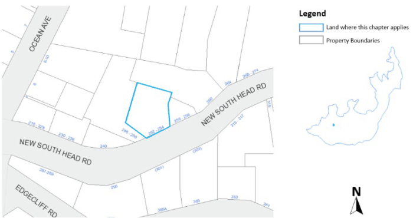

#### G8.1 Introduction

#### G8.1.1 Background

Land at 252-254 New South Head Road, Double Bay, is zoned R3 Medium Density Residential under the Woollahra Local Environmental Plan 2014 (Woollahra LEP 2014). The site is approximately 100m from the Edgecliff Commercial Centre and about 200m from the Double Bay Centre. The site is immediately surrounded by residential flat buildings of heights varying between three to seven storeys. A visually prominent Jacaranda tree is located on the south-east corner of the site adjacent to the New South Head Road frontage.

The site was subject to a planning proposal that increased the height of buildings standard to 22m and the floor space ratio standard to 2.6:1. Woollahra Local Environmental Plan 2014 (Amendment No. 30) also introduced Clause 4.3C that allows an exception to the height of buildings standard and provides a secondary height of buildings standard of RL45.90m. Clause 6.8 also requires a site-specific DCP to be prepared before any consent is granted on the site.

A secondary height of buildings standard of not more than RL 45.90m applies if the building is within 11m of —

(a) The southern boundary of the land, adjoining the driveway of SP 4585, 248–250 New South Head Road, or

(b) The south-eastern boundary of the land, adjoining New South Head Road.

This chapter includes additional provisions to address adverse environmental and other amenity impacts that could result from development benefitting from the greater height and floor space permitted.

#### G8.1.2 Land where this chapter applies

This site specific chapter applies to the land identified on the map at Figure 1 (the site). The land comprises 252-254 New South Head Road, being legally described as SP 11702.

#### FIGURE 1  The site

> [Picture on page 5: a picture, saved as a picture (images/chapter-g8-252-254-new-south-head-road-double-bay-page-5-26.gif, 150 dpi).]

#### G8.1.3 Development to which this chapter applies

This chapter applies to development requiring consent under the Woollahra Local Environmental Plan 2014.

#### G8.1.4 Objectives

The objectives of this chapter are to ensure that development on the site:

O1 Reflects the desired future character for the site and its neighbourhood.

O2 Has a scale, bulk and design that is compatible with nearby development and the streetscape, particularly in terms of the number of storeys and distribution of height.

O3 Promotes environmental amenity on the site and surrounding properties

O4 Does not unreasonably compromise the amenity of nearby residences having particular regard to overshadowing, visual and acoustic privacy, and view sharing.

O5 Minimises traffic and parking impacts on New South Head Road and surrounding streets.

O6 Provides a diversity of dwelling sizes.

O7 Supports the retention of tree canopy and the planting of vegetation screening.

#### G8.1.5 Relationship to other parts of the DCP

This chapter is to be read in conjunction with other relevant parts of the DCP, including:

Part B: Chapter B1.1.3 Double Bay Precinct;

Part B: Chapter B3 General Development Controls; and

Part E: General Controls for All Development – this part contains chapters on Parking and Access, Stormwater and Flood Risk Management, Tree Management, Contaminated Land, Waste Management, Sustainability, Signage and Adaptable Housing.

In the event of any inconsistency between this site specific chapter and the other chapters, this chapter prevails.
