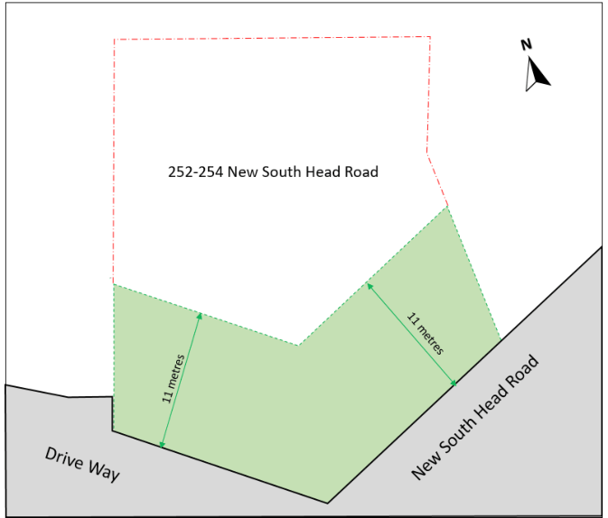
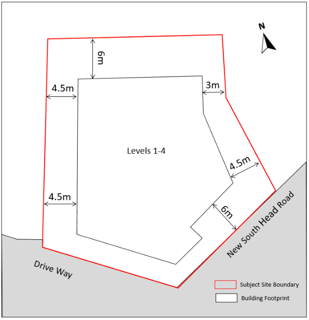
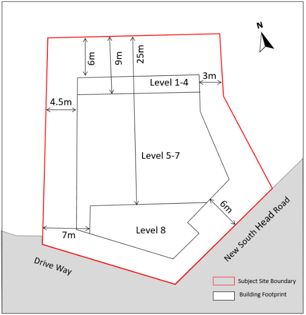

#### G8.2 Development Controls

#### G8.2.1 Desired future character

#### Objectives

O1 To facilitate a built form that is consistent with the desired future character of the site and surrounding area.

#### Controls

C1 Development on the site must align with the following:

• A building of no more than eight storeys;

• A street wall height that is part four/part five storeys at the New South Head frontage;

• Compatibility with the streetscape, in terms of height transition and tree canopy coverage;

• A diverse range of apartment sizes;

• Articulated facades that contribute to the visual interest of the building and the character of the local area;

• A pedestrian entry from the New South Head Road frontage; and

• No more than one vehicle crossover off New South Head Road.

Note: The desired future character for the Double Bay residential neighbourhood is described in Chapter B1.1.3 of the Woollahra DCP 2014.

#### G8.2.2 Built form and façade articulation

#### Objectives

O1 To ensure the built form is compatible in height, bulk and design with the site, adjoining development and the streetscape.

02 To encourage variation in building height and setbacks to reduce the apparent bulk of any building.

03 To ensure a transition downwards in building height as the landform slopes from Ocean Avenue towards Double Bay.

04 To ensure built form has an address to the street, provides activation and surveillance, and enhances pedestrian safety.

#### Controls

C1 Any building on the site must be no higher than eight storeys at its maximum, and no more than five storeys above the level of the New South Head Road frontage (refer to Figure 2).

C2 Notwithstanding C1, the building height on the New South Head Road elevation must be varied so that it presents a maximum of four storeys adjacent to 256 New South Head Road.

C3 The building height must be articulated across the development to break down visual bulk and respond to site topography.

C4 Any building must be setback from site boundaries by the minimum amount shown in Figures 3A and 3B.

Note: Storey is defined in the Woollahra DCP 2015 as below: storey means a space within a building that is situated between one floor level and the floor level next above, or if there is no floor above, the ceiling or roof above, but does not include—

(a) a space that contains only a lift shaft, stairway or meter room, or

(b) a mezzanine, or

(c) an attic.

Additionally, the total number of storeys is to be measured using a section view across the site (i.e. not the number visible from a given frontage like New South Head Road).

#### FIGURE 2 Secondary height control area (Clause 4.3C of the Woollahra LEP 2014)

> [Picture on page 8: a picture, saved as a picture (images/chapter-g8-252-254-new-south-head-road-double-bay-page-8-21.gif, 150 dpi).]

#### FIGURE 3A Minimum setbacks - storeys ground to four

> [Picture on page 9: a picture, saved as a picture (images/chapter-g8-252-254-new-south-head-road-double-bay-page-9-2.gif, 150 dpi).]

#### FIGURE 3B Minimum setbacks - storeys five to eight

> [Picture on page 9: a picture, saved as a picture (images/chapter-g8-252-254-new-south-head-road-double-bay-page-9-4.gif, 150 dpi).]

#### G8.2.3 Environmental impacts

#### Objectives

01 To protect the amenity of nearby dwellings, having particular regard to visual and acoustic privacy.

02 To minimise overshadowing resulting from development on the site.

03 To minimise wind impacts on pedestrians in the public domain and occupants of the site and surrounding properties.

#### Controls

C1 Balconies, terraces and windows of habitable rooms must not face the side setbacks or towards the driveway of 248 – 250 New South Head Road.

C2 Balconies, terraces and windows of habitable rooms must be located only on north elevations or the elevation facing New South Head Road, and are to have solid screening walls for the full height and width.

C3 An Environmental Wind Assessment must be provided to demonstrate acceptable pedestrian level wind conditions on and around the site. The assessment is to be prepared by a suitably qualified wind engineer, and include modelling of the detailed design and appropriate ameliorations for negative effects from impacts such as high pressure on entry doors and potential for internal flow issues, high winds on roof terraces and balconies, Helmholtz resonance, and local wind conditions for stationary activities.

C4 Any development must minimise overshadowing to habitable rooms and private open space serving dwellings on the site and in surrounding properties, consistent with requirements of the Apartment Design Guide.

C5 Any building must be designed to reasonably preserve view sharing corridors, consistent with the principles in Tenacity Consulting v Warringah Council [2004] NSWLEC 140.

#### G8.2.4 Apartment mix

#### Objectives

O1 To encourage a range of dwelling sizes within residential development on the site.

O2 To provide a mix of dwellings to cater for the needs of the existing and future resident population, and to encourage a diverse population.

#### Controls

C1 Any development on the site is to achieve the apartment mix outlined in Table 1:

#### Table 1 Apartment Mix

| Apartment Type | Maximum |
|---|---|
| Studio | 20% |
| 1 Bed | 30% |
| 2 Bed | 50% |
| 3 Bed or more | 10% |

Note: The above maximums may be varied on a merit basis if affordable housing is being provided on the site.

#### G8.2.5 Deep soil landscaped area

#### Objectives

O1 To provide deep soil landscaped area to support existing trees and substantial new plantings, enhance residential amenity, provide communal open space and reinforce streetscape character.

02 To ensure the long-term health of the existing Jacaranda tree and existing palms.

O3 To enable screen planting for visual privacy along the side and rear boundaries.

#### Controls

C1 A minimum of 25% of the site area must comprise deep soil landscaping, with minimum dimensions of 3m in any direction and no overhang from any building.

C2 The existing Jacaranda tree adjoining the south-east boundary with New South Head Road must be retained and protected in accordance with AS4970 ‘Protection of trees on development sites’, with adequate deep soil to ensure its long term health.

C3 Screen planting must be provided along the full extent of the rear boundary, and where possible along the side boundaries.

C4 Any proposed works must be located outside of the drip line of trees on adjoining properties, which are to be protected in accordance with AS4970 ‘Protection of trees on development sites’.

C5 An Arboricultural Impact Assessment must be provided with any development application. It must be prepared by a qualified Level 5 Consulting Arborist and in line with AS4970 ‘Protection of trees on development sites’, Woollahra Municipal Council DA guide and industry best practice. The assessment must clearly indicate trees to be retained and to be removed, and include recommendations and methodologies to mitigate any impact on trees to be retained and a Tree Protection Plan and Specification.

#### G8.2.6 Vehicular access

#### Objectives

O1 To address potential road safety issues that could occur due to landform and proximity of the main intersection at Ocean Avenue.

O2 To ensure safe vehicular access and minimise potential conflict with eastbound traffic on New South Head Road.

#### Controls

C1 Any vehicular traffic must move using a left in/left out (LILO) motion only.

C2 Driveway design must ensure access/egress to and from the site uses the kerbside lane only, with no encroachment into the second lane from the kerb.

C3 A Traffic and Parking Report is to be provided with any application to redevelop the site. It must provide sufficient detail to justify any new vehicular crossover to New South Head Road, and in doing so must demonstrate that other options have been explored. It also must address the safety risk concerning the site’s proximity to the crest of New South Head Road at Ocean Avenue.

#### G8.2.7 Car parking

#### Objectives

O1 To minimise car parking due to site constraints and its location close to public transport.

#### Controls

C1 A minimum of six car parking spaces must be provided on the site, with two of these being dedicated car share spaces.

C2 Prior to lodging a development application, the applicant must negotiate a car share agreement for the dedicated car share spaces. The applicant must include a letter from a commercial car share operator confirming their intention to place the car share vehicles within the development.

C3 Nominated commercial car share spaces must be placed in publicly accessible locations within the development.

#### G 8.2. 8 Site facilities

#### Objectives

O1     To ensure that essential infrastructure and other site facilities are addressed at the DA stage so that these facilities are accessible and functional, but do not detract from the streetscape character, adversely impact upon the amenity of adjoining residential dwellings, reduce the required deep soil landscaped area at the New South Head Road frontage, or threaten the long term health of the existing Jacaranda tree within the site.

O2     To ensure any required substation is not visible from the street.

#### Controls

C1 A chamber substation must be provided instead of a kiosk substation.

C2 Any screening or enclosure to conceal the substation is to be visually unobtrusive, particularly having regard to the location, materials/treatment, height and size of the substation and its enclosure.

C3 The substation should be installed outside of the mature growth root zone of any trees to be retained, or proposed to planted, to prevent roots tangling and damaging underground cables to the substation.

Notes:

• A kiosk substation is a totally enclosed, free-standing, self-contained substation not designed for bodily entry and which is generally operated from door openings.

• A chamber substation is a chamber which is dry and completely isolated from the remainder of the building with walls, floor, ceiling and doors that meets minimum fire resistance levels. Chamber substations make take the form of surface chamber substations, elevated chamber substations, upper-level chamber substations and basement chamber substations.

• At the DA stage the applicant should demonstrate that they have engaged with Ausgrid and have a network capacity assessment undertaken for their proposed development.

• Where a substation is required, the substation should be identified on the DA plans and addressed in the SEPP 65 Design Verification Statement (also see Apartment Design Guide Objective 3C-2 Amenity of the public domain is retained and enhanced).

• The DCP requirements for substations apply in addition to the Ausgrid Network Standards.

• The substation is to be identified on the DA plans. The need to modify an existing consent to install a substation should be avoided, and is an approach not supported by Council. Section 4.55 modification applications for substations will need to demonstrate compliance with the DCP including requirements for setbacks, deep soil landscaped area, and tree retention.

• A dedicated access way/easement through the site to the substation may need to be provided in accordance with the requirements of the energy authority and Council.
