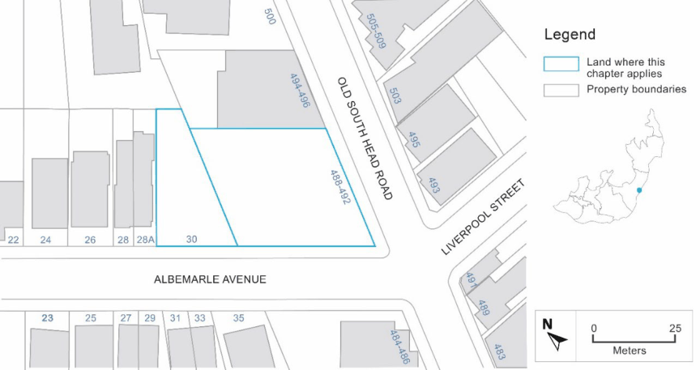

#### G8.1 Introduction

#### G8.1.1 Background

This chapter of Woollahra DCP addresses land at 488-492 Old South Head Road and 30 Albemarle Avenue, Rose Bay, if developed together. This land is proposed to be redeveloped for a 4-storey mixed use development containing a supermarket, residential apartments, and parking including direct-to-boot dedicated car spaces.

Land at 488-492 Old South Head Road is located at the southern end of the Rose Bay South centre, it is zoned MU1 Mixed Use in Woollahra Local Environmental Plan 2014 (Woollahra LEP

2014\) and is the site of a former Caltex service station which has been decommissioned.

Land at 30 Albemarle Avenue is zoned R2 Low Density Residential and contains a single storey dwelling house. To the north-west, it adjoins a semi-detached dwelling known as 28A Albemarle Avenue, Rose Bay being Lot 1 DP 204141.

The land was subject to a planning proposal that amends the Woollahra LEP 2014 to:

Insert a new clause in Schedule 1 Additional permitted uses to permit “retail premises” at 30 Albemarle Avenue, provided it is part of a shop top housing development at 488-492 Old South Head Road.

Insert a new clause in Part 6 Additional local provisions that applies only if 488-492 Old South Head Road and 30 Albemarle Avenue are developed together, and that allows:

o

A maximum Gross Floor Area (GFA) of 3,720m² on 488-492 Old South Head Road and 480m² on 30 Albemarle Avenue.

o

An increased Height of Building development standard from 9.5m to 14.5m on 30 Albemarle Avenue, Rose Bay.

This chapter includes provisions to establish additional controls to guide redevelopment on the land having regard to the context, including addressing building design, street activation, setbacks, landscaping, privacy and the maximum non-residential gross floor area that may be achieved on the site.

#### G8.1.2 Land where this chapter applies

This site specific chapter applies to the land identified on the map at Figure 1 (the site). The land comprises 488-492 Old South Head Road (Lot 1 DP 1009799) and 30 Albemarle Avenue (Lot 30 Sec B DP4567), Rose Bay.

The plan applies only if both lots are developed together.

> [Picture on page 5: a picture, saved as a picture (images/chapter-g9-488-492-old-south-head-road-and-30-albemarle-aven-page-5-1.gif, 150 dpi).]

FIGURE 1  The site

#### G8.1.3 Development to which this chapter applies

This chapter applies to development requiring consent under the Woollahra Local Environmental Plan 2014.

#### G8.1.4 Objectives

The objectives of this chapter are to ensure that development on the site:

O1 Supports growth of the Rose Bay South centre through provision of a new supermarket and new dwellings.

O2 To positively contribute to the architectural design and character in the Rose Bay South centre.

O3 Provides active frontages to Old South Head Road and Albemarle Avenue.

O4 Incorporates a high standard of landscape design to encourage urban greening, contribute to the streetscape, and soften the visual impact of the built form.

O5 Has a scale, bulk and design that respects the adjoining and nearby residences and the low scale streetscape character of Albemarle Avenue, particularly in terms of the building setback, articulation and transition of building height.

O6 Does not unreasonably compromise the amenity of adjoining and nearby residences having regard to visual and acoustic privacy, landscape setting, and separation between the building and 28A Albemarle Avenue.

O7 Minimises traffic and parking impacts on Old South Head Road, Albemarle Avenue and surrounding streets.

#### G8.1.5 Relationship to other parts of the DCP

This chapter is to be read in conjunction with other relevant parts of the DCP, including:

Part D: Chapter D2 Mixed Use Centres (Rose Bay South)

Part D: Chapter D3 General Controls for Neighbourhood and Mixed Use Centres

Part E: General Controls for All Development – this part contains chapters on Parking and Access, Stormwater and Flood Risk Management, Tree Management, Contaminated Land, Waste Management, Sustainability, Signage and Adaptable Housing.

In the event of an inconsistency between this site-specific chapter and the other chapters, this chapter prevails. Note: Where land at 488-492 Old South Head Road and 30 Albemarle Avenue are developed together, Chapter B1 Residential Precincts and Chapter B3 General Development Controls do not apply.
