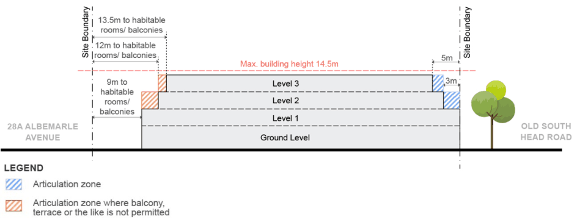
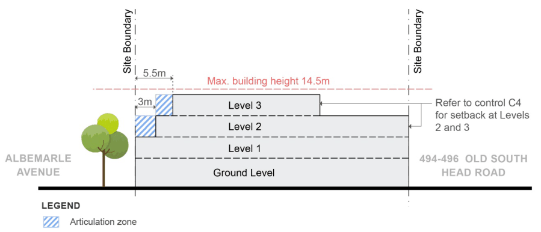
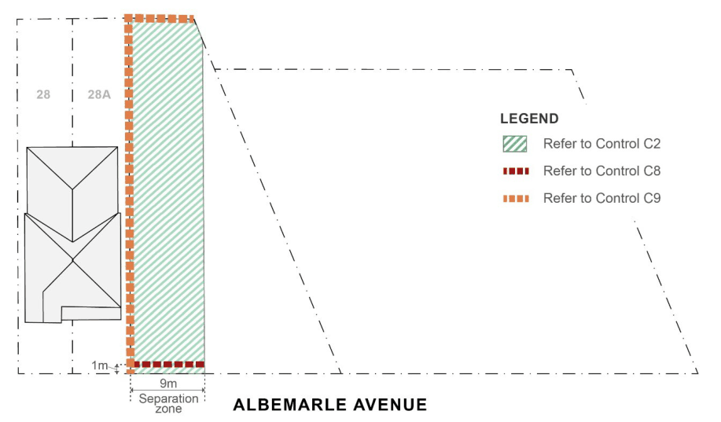

#### G8.2 Development Controls

#### G8.2.1 Desired future character

#### Objectives

O1 To facilitate a built form that is consistent with the desired future character of the site and surrounding area.

#### Controls

C1 Development on the site must align with the following:

• A building of no more than four storeys;

• Active street frontages along Old South Head Road and Albemarle Avenue;

• Articulated facades that contribute to the visual interest of the building and the character of the local area;

• Respect the landscape character and low scale residential character of Albemarle Avenue, by providing building setbacks, height transition and a landscape setting;

• Planting and a deep soil zone to soften its interface with the adjoining residential uses on Albemarle Avenue;

• A diverse range of apartment sizes comprising of Studio/1 Bedroom, 2 Bedroom, and 3 or more Bedroom dwellings;

• A single residential entry from the Albemarle Avenue frontage only; and

• No vehicular access from Old South Head Road.

Note: The desired future character of the Rose Bay South centre is described in Part D: Chapter

D2 of the Woollahra DCP 2015.

#### G8.2.2 Built form

#### Objectives

O1 To provide a built form that is well defined and of a scale that creates a coherent street wall to Old South Head Road, and suitably addresses its prominent corner site position.

O2 To use building setbacks and articulation to reduce the apparent bulk of the building.

O3 To incorporate high quality façade design and finishes.

O4 To establish setbacks to reduce overlooking and building bulk.

O5 To provide a separation zone between the building and 28A Albemarle Avenue.

O6 To enable deep soil planting in the setbacks and ensure deep soil landscaped area is achieved.

O7 To provide for attractive and comfortable pedestrian areas while retaining important street trees.

#### Controls

C1 Development is a maximum four storeys.

C2 The building design is to be a high quality contemporary structure, and may include defined horizontal and vertical elements, façade arches and curved edges to reduce perceived building bulk and contribute to the architectural quality and aesthetic of the building.

C3 The minimum setbacks from Old South Head Road and Albemarle Avenue are:

• At Ground Level and Level 1 – 0m from the street boundary.

• At Level 2 – 0m from the street boundary with a minimum 3m articulation zone from the street boundary.

• At Level 3 - 3m from the street boundary with a minimum 2m articulation zone from Old South Head Road and 2.5m articulation zone from Albemarle Avenue.

The articulation zone is to be occupied by balconies, planter boxes, terrace landscaping and weather protection/awnings only. Weather protection/awnings, if any, must not increase building bulk and the prominence of the two upper levels.

Refer to Figures 2 and 3 for setbacks and articulation zone.

C4 The minimum setbacks from the building at 494-496 Old South Head Road (SP 75026) are:

• At Ground Level and Level 1 – 0m from the north-western boundary.

• At Level 2 -o

0m from the north-western boundary where a blank wall adjoins MU1 mixed use zoned land. o

10m between habitable rooms/balconies and non-habitable rooms.

• At Level 3 – o

7m between non-habitable rooms. o

10m between habitable rooms/balconies and non-habitable rooms. o

13m between habitable rooms/balconies.

Refer to Figure 3 for setbacks.

C5 The minimum setbacks from the north-western boundary that adjoins 28A Albemarle Avenue (Lot 1 DP 204141) are:

• At Ground Level and Level 1 – 9m to the building.

• At Level 2 – 9m to the building and 12m to any habitable rooms/balconies.

• At Level 3 – 12m to the building and 13.5m to any habitable rooms/balconies.

The articulation zone is to be occupied by planter boxes, terrace landscaping, and weather protection/awnings only. Balconies, terraces or the like are not permitted in this articulation zone.

Weather protection/awnings, if any, must not increase building bulk and the prominence of the two upper levels.

Refer to Figure 2 for setbacks and articulation zone.

C6 Basement walls and any piling (or similar structural elements) must be setback at least 8m from the north-western boundary that adjoins 28A Albemarle Avenue.

A variation to the 8m setback may be considered to accommodate underground plant and services, but only if the minimum consolidated deep soil landscaped area and tree canopy cover specified in Section G8.2.5 Separation zone and landscaping is achieved.

C7 Awnings are provided along Old South Head Road and Albemarle Avenue retail frontages. The awnings are to be designed and installed to retain and protect street trees.

C8 Wet weather protection is to be provided at entrances.

> [Picture on page 9: a picture, saved as a picture (images/chapter-g9-488-492-old-south-head-road-and-30-albemarle-aven-page-9-28.gif, 150 dpi).]

FIGURE 2 Old South Head Road and north-western setbacks

> [Picture on page 10: a picture, saved as a picture (images/chapter-g9-488-492-old-south-head-road-and-30-albemarle-aven-page-10-1.gif, 150 dpi).]

FIGURE 3 Albemarle Avenue and north-eastern setbacks

#### G8.2.3 Uses

#### Objectives

O1 To provide an appropriate mix of residential and non-residential land uses that reinforce the mixed use character of the Rose Bay South centre.

O2 To facilitate a supermarket that meets the day-to-day goods and services needs of the local community.

O3 To establish a limit on the non-residential floor space to ensure commercial activities do not have unacceptable traffic or other environmental impacts.

O4 To achieve a minimum dwelling yield to contribute to housing growth

O5 To promote housing choice through providing a mix of unit dwelling sizes with different numbers of bedrooms.

O6 To achieve good levels of residential amenity for residents and neighbours.

#### Controls

C1 No more than 2,400m2 of the gross floor area of the development is used for non-residential uses.

C2 The residential component of the development achieves a minimum dwelling yield of 10 apartments and comprises a mix of Studio/1 Bedroom, 2 Bedroom, and 3 or more Bedroom dwellings.

C3 Residential uses are located on the upper levels and achieve a high degree of amenity in accordance with the Housing SEPP Chapter 4 and the Apartment Design Guide.

#### G8.2.4 Ground level active frontage

#### Objectives

O1 To facilitate development that is compatible with the desired future character of Rose Bay South centre and respects the landscape and low scale residential character of Albemarle Avenue.

O2 To reinforce the site’s prominent corner location.

O3 To ensure the built form design elements and uses improve street level activation along Old South Head Road as a primary frontage and enhance the quality of the site’s presentation to Albemarle Avenue.

O4    To restrict trolley usage to inside the supermarket and its car park.

#### Controls

C1 At the ground floor, the building is designed for retail uses on the primary street frontage including key corner location of Old South Head Road and Albemarle Avenue.

C2 Active frontages are provided to Old South Head Road and Albemarle Avenue, through uses such as shopfronts and building entries.

C3 Separate entrances are provided to the residential and commercial uses. Access to the residential component is from Albemarle Avenue.

C4 The building façade must be designed to contribute to the street and remains highly transparent and activated. It must not present blank walls onto streets.

C5 Where shopping trolleys are provided, install trolley wheel locking system at all exit points of the supermarket and car park.

C6 A development application must be accompanied by a Trolley Management Plan which details the proposed containment system for retaining trolleys on site, and the method for identifying/branding, tracking and collecting abandoned trolleys.

#### G8.2.5 Separation zone and landscaping

#### Objectives

O1 To protect the amenity of the adjoining R2 Low Density Residential land at 28A Albemarle Avenue.

O2 To avoid an unreasonable sense of enclosure by providing an appropriate separation zone between the building and 28A Albemarle Avenue.

O3 To require a green landscaped separation zone between 28A Albemarle Avenue and the new building.

O4 To incorporate deep soil landscaping within the separation zone to:

• maximise opportunities for screen planting to enhance the amenity of the surrounding residential area,

• contribute to the leafy setting of the residential streetscape along Albemarle Avenue, and

• contribute to urban greening and enhancing tree canopy cover within the locality.

O5 To ensure that the separation zone is a safe environment by promoting crime prevention through environmental design (CPTED).

O6   To ensure fences and walls contribute positively to the Albemarle Avenue streetscape and adjacent residential dwellings.

O7 To integrate planting to the façade of the building to enhance the appearance, amenity and energy efficiency of the building.

O8 To provide for on-site stormwater absorption.

#### Controls

C1 A minimum 9m wide separation zone is provided from the north-western boundary.

C2 The separation zone establishes a landscaped setting consisting of canopy trees and other established plantings and specifically provides:

• a deep soil landscaped area which is: o

at least 10% of the total site area, and o

designed to provide a consolidated area with a minimum width of 8m, measured from the north-western boundary;

• tree canopy area that is at least 10% of the total site area, and at least half of the total tree canopy area on the site is contributed to by canopy tree/s which are to be planted on the site;

• screen planting along the full length of the boundary that directly adjoins 28A Albemarle Avenue; and

• a mix of dense hedge and feature planting, shrubs and trees that help soften and screen the development interface with the adjacent residential dwelling.

Refer to Figure 4.

Notes:

Tree canopy area includes all trees above 3 metres in height and spread.  A canopy tree is a tree that attains a minimum height of 8m and minimum crown diameter of 8 metres at maturity, and is planted in a deep soil landscaped area with a minimum dimension of 4m.

Plantings over underground structures must have sufficient soil depth to allow sustainable planting.

C3 Building design incorporates opportunities for planting on structures and within the facade. Design solutions may include green roofs, green walls and planter boxes.

C4 Landscaping is provided within the communal open space.

C5 Landscaping and other planting includes drought tolerant Australian native plants.

C6 Street level landscaping is provided along Old South Head Road and Albemarle Avenue.

C7 The separation zone provides opportunities for active and passive surveillance, and incorporates the CPTED principles into design including provision of lighting and CCTV.

C8 The separation zone is designed and secured by fencing to restrict public access. Fences and gates are:

• 1.8m in height;

• take the form of palisade style fencing; and

• 1m from the front boundary, to provide for screen planting forward of the fence line to conceal the fence and contribute to the landscape setting.

C9 The side and rear fences do not exceed 1.8m in height.

C10 The design and materials of fences and gates are compatible with the building.

> [Picture on page 13: a picture, saved as a picture (images/chapter-g9-488-492-old-south-head-road-and-30-albemarle-aven-page-13-14.gif, 150 dpi).]

FIGURE 4 Separation zone, deep soil landscaped area and fences

#### G8.2.6 Vehicular access and servicing

#### Objectives

O1 To ensure the safe and efficient movement of vehicles within, entering and leaving the site.

O2 To maximise pedestrian safety and amenity.

O3 To provide servicing entry and egress points on the site which minimise disruption to the surrounding road networks.

O4 To minimise the visual, acoustic and other amenity impacts of the parking, loading and servicing facilities on the surrounding properties and public domain.

O5 To provide sufficient accessible and safe public and private car parking for development on the site.

O6 To provide continuous active retail street frontages and protect street trees along Old South Head Road.

#### Controls

C1 Development complies with the provisions in Part E of the DCP, Chapter E1 Parking and Access. The parking multiplier for non-residential uses applies to the whole development site including 30 Albemarle Avenue, Rose Bay.

C2 Access to on-site car parking and servicing facilities is provided off Albemarle Avenue. No vehicular access is permitted off Old South Head Road.

C3 Vehicle access points and building entrances must be separate and clearly defined to avoid pedestrian and vehicular conflicts.

C4 Car parking, loading and driveway areas are designed to minimise disruption to pedestrian movement, safety and amenity.

C5 All bicycle parking is located within the building to avoid visual clutter within the streetscape. No such parking is permitted within the separation zone.

C6 The loading dock must be fully enclosed with a door and is no larger than the dimensions required for functional operation.

C7 Automated doors for car parking, loading areas and loading docks are designed to provide effective noise reduction. The use of these facilities must not give rise to noise which exceed 5dB(A) above the background sound level when measured at the façade of the nearest residential property. Note: Conditions of consent may restrict the operation of the loading dock to specified hours.

C8 A development application must be accompanied by a Traffic and Parking Report and a Car Parking, Loading and Services Plan of Management which assess potential traffic and safety impacts including consideration of truck movements to the site, timed parking limits, off-street loading and servicing arrangements, pedestrian safety and traffic calming measures. Note: The provisions in Part E of the DCP, Chapter E5 Waste Management apply.

C9 A development application must be accompanied by an Acoustic Report which assesses noise impacts associated with the operation of the loading docks and service areas, having particular regard to the anticipated volume and frequency of deliveries and waste collections associated with the development.

Note: Conditions of consent may restrict the operation of the loading and servicing facilities to specified hours.

#### G8.2.7 Site facilities

#### Objectives

O1 To ensure that site facilities are accessible and functional, and do not have a negative impact on the streetscape or amenity of adjoining residential dwellings.

O2 To avoid locating mechanical plant equipment on the rooftop.

O3 To ensure any required substation is not visible from the street.

#### Controls

C1 Mechanical plant equipment is located and designed to maintain and protect the visual and acoustic amenity of the adjoining residential properties.

C2 If an electricity substation is required, the substation is to be provided as a basement chamber substation.

C3 All plant and equipment must be concealed from the exterior and not detract from the streetscape.

#### G8.2.8 Ecologically sustainable development

#### Objectives

O1 To contribute to ecologically sustainable development, including net positive carbon emissions.

#### Controls

C1 The building achieves a minimum a 4 Green Star design and as-built rating. Notes: The provisions in Part E of the DCP, Chapter E6 Sustainability also apply.
