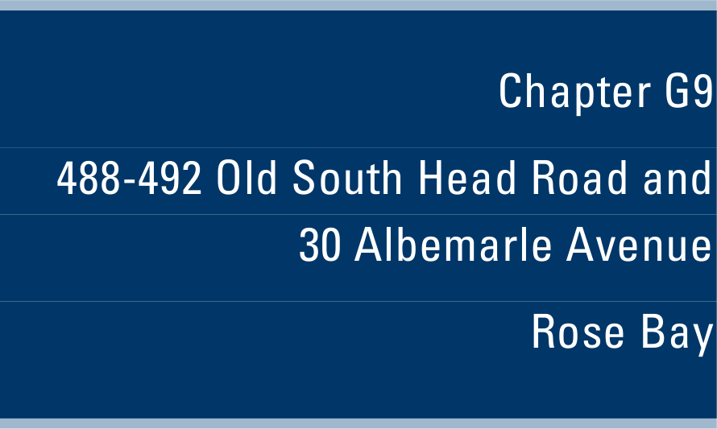

# Woollahra Development Control Plan 2015 - Chapter G9 488-492 Old South Head Road and 30 Albemarle Avenue Rose Bay

> This chapter is split into 3 section file(s), one per numbered heading, in the order they appear in the PDF.

Source PDF: [chapter-g9-488-492-old-south-head-road-30-albemarle-avenue.pdf](https://planfortomorrow.sharepoint.com/sites/Planfortomorrow/Shared%20Documents/00%20NSW-Planning-Resources/dcp/woollahra-development-control-plan-2015/chapter-g9-488-492-old-south-head-road-and-30-albemarle-avenu/chapter-g9-488-492-old-south-head-road-30-albemarle-avenue.pdf)

> [Picture on page 1: a picture, saved as a picture (images/chapter-g9-488-492-old-south-head-road-and-30-albemarle-aven-page-1-1.gif, 150 dpi).]

### Chapter G9

488-492 Old South Head Road and

<!-- sections -->
## Sections

1. [G9 488-492 Old South Head Road and 30 Albemarle Avenue, Rose Bay](01-g9-488-492-old-south-head-road-and-30.md)
2. [G8.1 Introduction](02-g8-1-introduction.md)
3. [G8.2 Development Controls](03-g8-2-development-controls.md)
