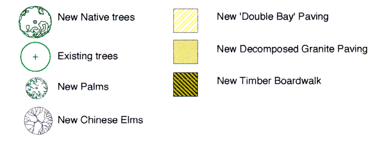
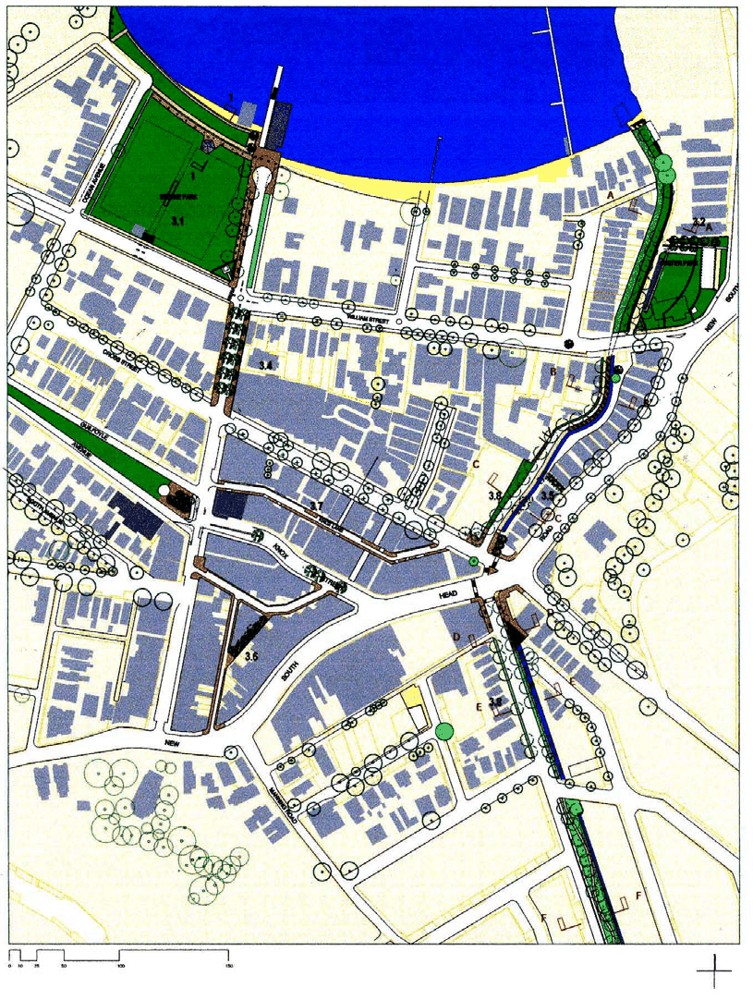

### 3.0 Outline plan of urban projects

### 3.1 Steyne Park

### 3.2 Foster Park

### 3.3 Guilfoyle Avenue

### 3.4 Bay Street extension

### 3.5 Steps at New South Head Road / Cross Lane

### 3.6 Gumtree, Goldman Lanes & Short Street

### 3.7 Knox Lane

### 3.8 Jamberoo Creek Linear Park

#### 3.8.1 Jamberoo Creek – existing conditions

#### 3.8.2 Sherbrooke Avenue

#### 3.8.3 Jamberoo Lane / Cross Lane

#### 3.8.4 Kiaora Road

#### 3.8.5 Kiaora Road (at Forest Road)

### 3.9 Other public spaces

### 3.10 Community Centres

#### 3.10.1 Kiaora Lane Community Centre

#### 3.10.2 Jamberoo Lane Community Centre

#### 3.10.3 Foster Park Community Centre

### Key

> [Picture on page 13: a picture, saved as a picture (images/double-bay-centre-public-improvements-plan-page-13-24.gif, 150 dpi).]

#### 3.0

OUTLINE PLAN OF URBAN PROJECTS

> [Picture on page 14: a picture, saved as a picture (images/double-bay-centre-public-improvements-plan-page-14-4.gif, 150 dpi).]
