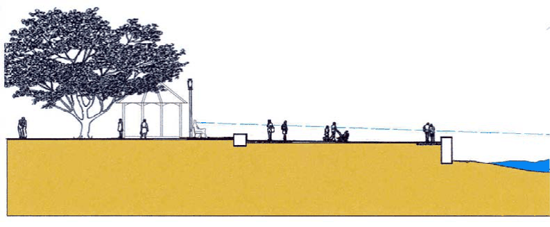
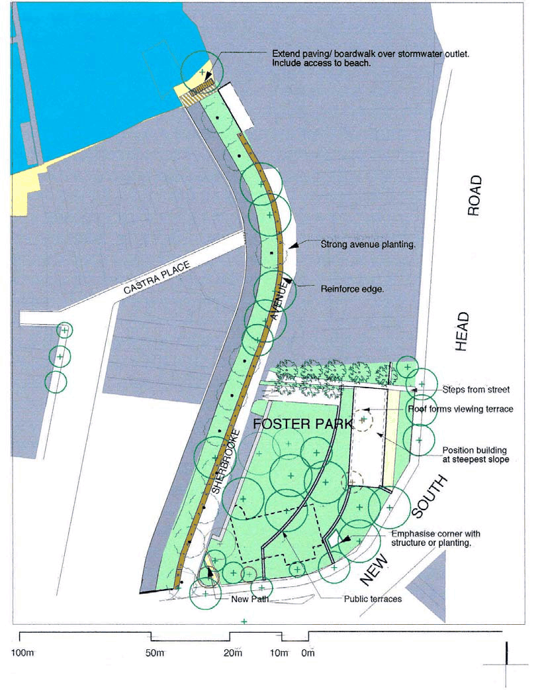

### 3.1 Steyne Park

ƒ Create foreshore promenade to improve links to harbour edge. ƒ New shelter with potential for multi use, including kiosk. ƒ Improve street lighting along park edge of Bay Street. ƒ Relocate turning circle at the end of Bay Street to reinforce space at waters edge. ƒ Create seating area under trees. ƒ Upgrade paving.

## SECTION 1 – 1 AT

STEYNE PARK

> [Picture on page 16: a picture, saved as a picture (images/double-bay-centre-public-improvements-plan-page-16-3.gif, 150 dpi).]

Section 1  -  1 at Steyne Park ƒ Broad path at level of playing field and rotunda gives views to bay. ƒ Childrens playground moved next to rotunda under shade of existing trees. ƒ Improve direct connection between beach and across park by establishing a promenade next to sea wall. ƒ Level change defines spatially the promenade area and the playing fields. ƒ Construct bus shelter on William Street as part of existing public facility structure.

#### 3.2

FOSTER PARK

> [Picture on page 17: a picture, saved as a picture (images/double-bay-centre-public-improvements-plan-page-17-3.gif, 150 dpi).]
