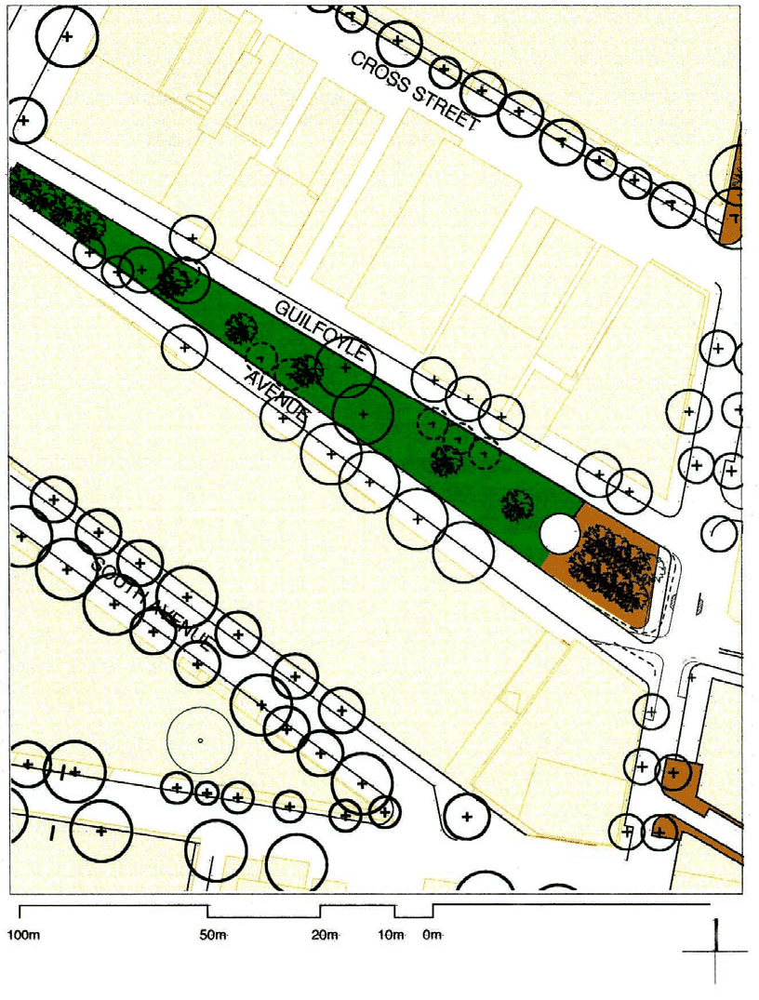

### 3.2 Foster Park

ƒ Utilise unmanageable and underused landscape area to relocate and upgrade community facilities. ƒ Retain open space under trees as recreation area. ƒ Terrace bank to create a series of landscape spaces associated with building use. ƒ Widen lane to accommodate parking on one side. ƒ Provide parking under building.

#### 3.3

GUILFOYLE AVENUE

> [Picture on page 18: a picture, saved as a picture (images/double-bay-centre-public-improvements-plan-page-18-3.gif, 150 dpi).]
