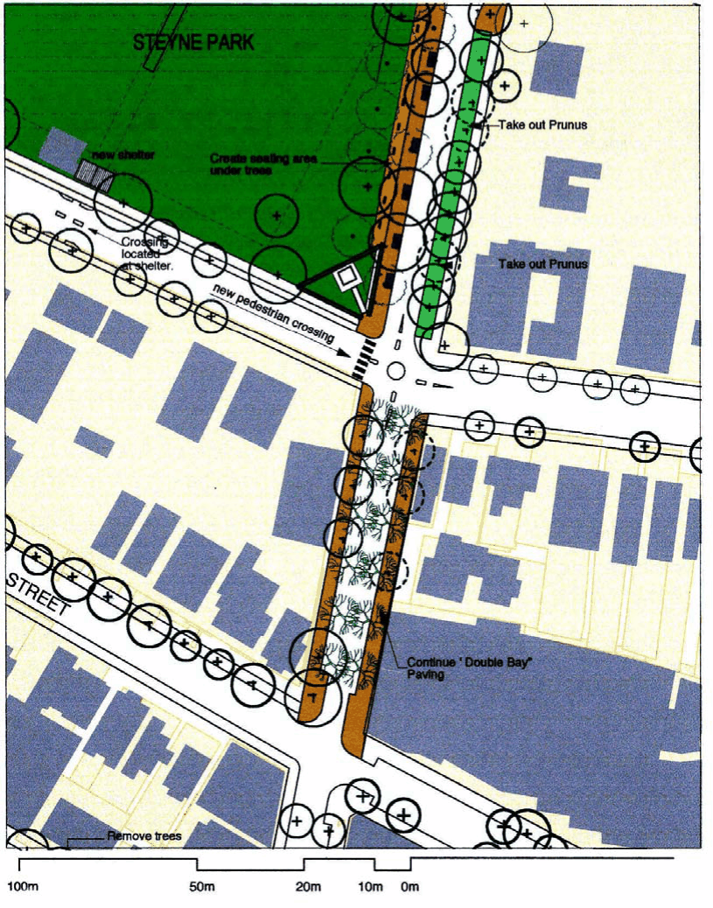

### 3.3 Guilfoyle Avenue

ƒ Remove overmature Agonis and Crack Willow to improve spatial quality and maintain sight lines. ƒ Retain existing Weeping Willows to keep existing character. ƒ Complete Avenue of Washingtonia Palms in keeping with original concept. ƒ Improve geometry of carrigeway entrance to align with Knox Street. Reduce entrance to 4.0m. ƒ Extend footpath on Bay Street at Guilfoyle Park. Locate new pedestrian crossover ramps here. ƒ Improve lighting.

#### 3.4

BAY STREET EXTENSION

> [Picture on page 19: a picture, saved as a picture (images/double-bay-centre-public-improvements-plan-page-19-4.gif, 150 dpi).]
