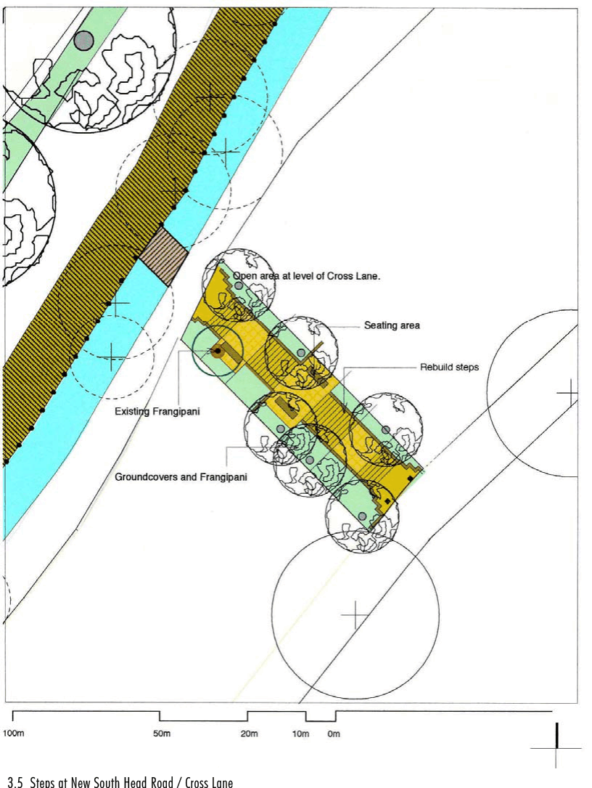
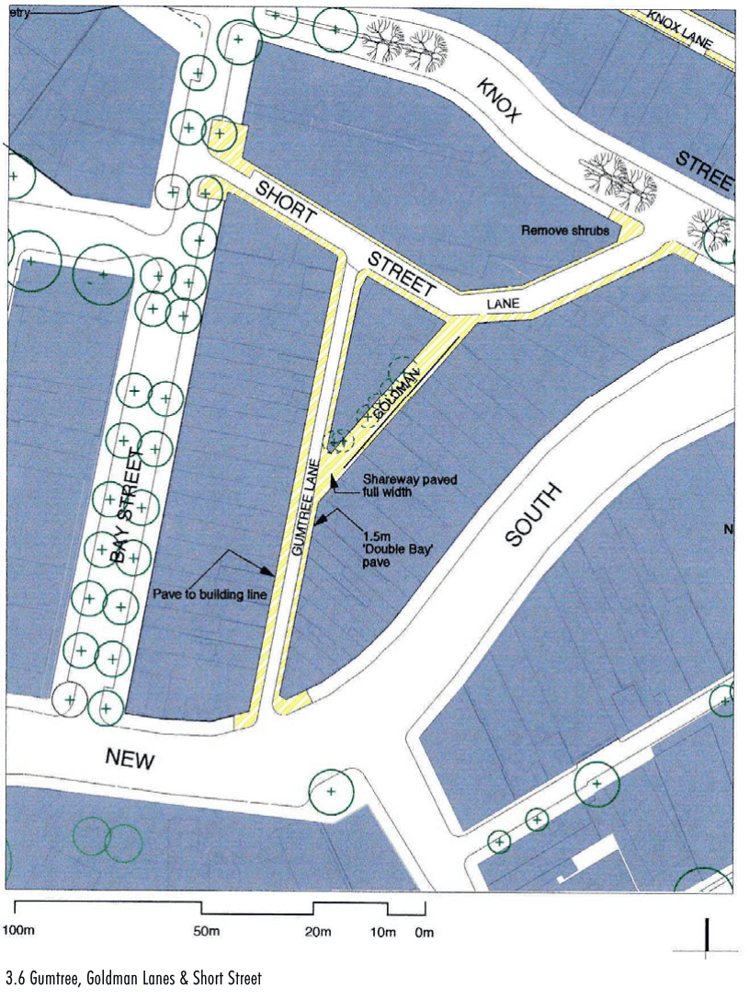
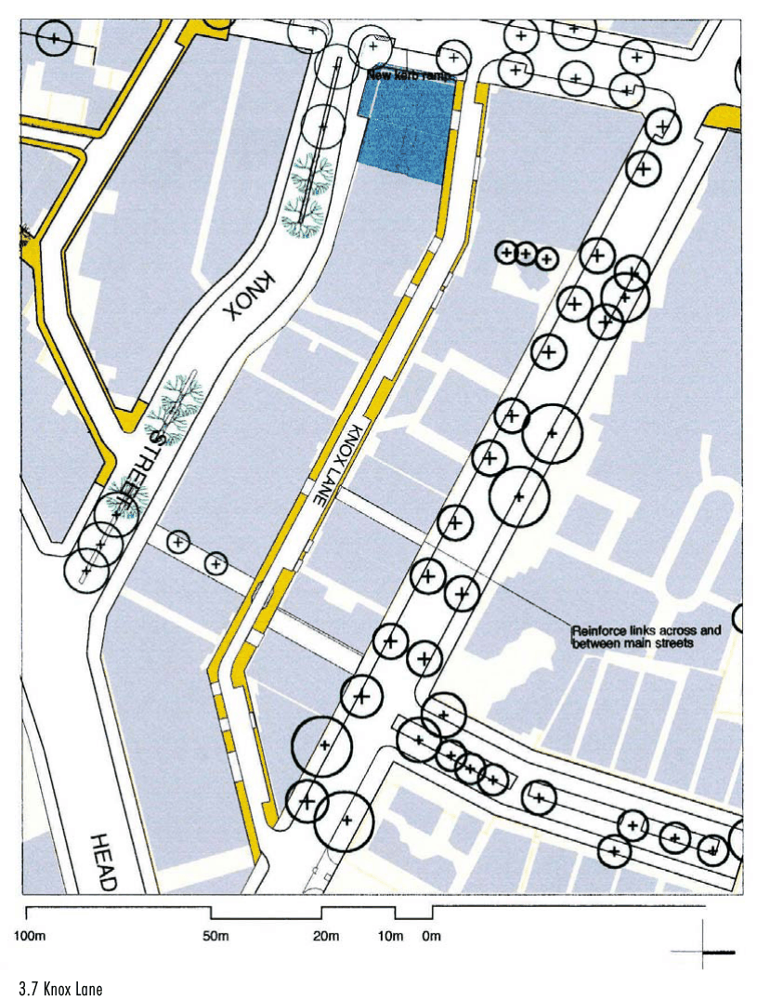
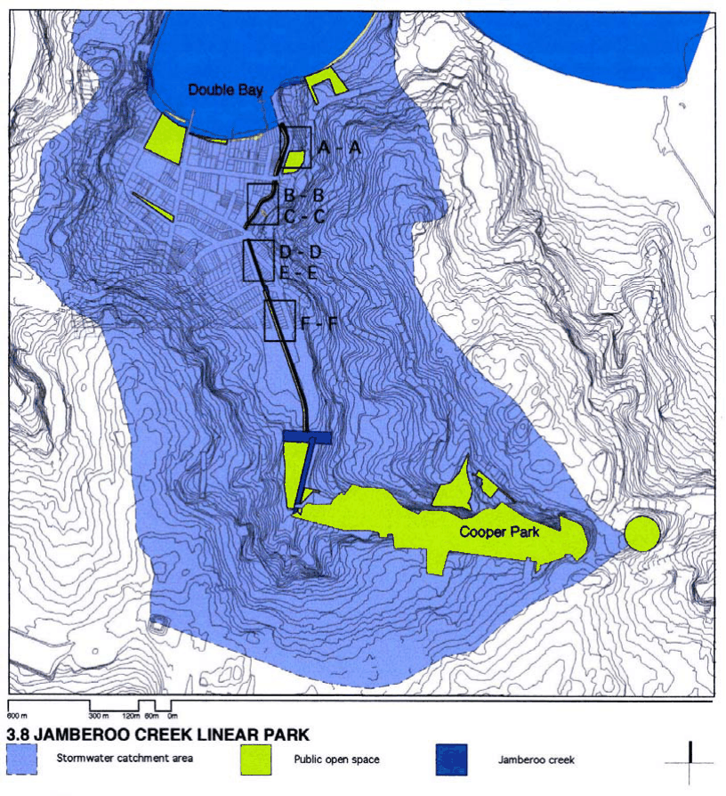

### 3.4  Bay Street extension

ƒ Improve connection between the Bay and the Centre and enhance urban character along Bay Street by extending paving treatment and kerb extensions. ƒ Improve kerb geometry and pedestrian refuges at the corner of William Street. ƒ Improve lighting on the park side approach to the Wharf. ƒ Remove 3 impeded Jacarandas on eastern footpath. ƒ Continue planting of Ulmus parvifolia in carriageway. ƒ Take out low growing Prunus sp. on eastern side of Bay Street.

#### 3.5

STEPS AT NEW SOUTH HEAD ROAD / CROSS LANE

> [Picture on page 20: a picture, saved as a picture (images/double-bay-centre-public-improvements-plan-page-20-5.gif, 150 dpi).]
> Words printed on the picture (title and legend, copied from the PDF):
> 3.5  Steps at New South Head Road / Cross Lane

ƒ Replace narrow zigzag stairway with wide and straight steps to improve legibility and visibility. ƒ Improve planting using clear stemmed tress with low colourful planting under, to upgrade image and enhance personal security. ƒ Provide a resting place with seats and a drinking fountain. ƒ Create a pedestrian refuge area at base of stairs, with good sight lines to Cross Lane.

#### 3.6

GUMTREE, GOLDMAN LANES & SHORT STREET

> [Picture on page 21: a picture, saved as a picture (images/double-bay-centre-public-improvements-plan-page-21-5.gif, 150 dpi).]
> Words printed on the picture (title and legend, copied from the PDF):
> 3.6 Gumtree, Goldman Lanes & Short Street

ƒ Remove shrubs and garden beds to improve visibility. ƒ Provide a continuous footpath on eastern side of Gumtree Lane 1.5m wide. ƒ Provide continuous footpath on southern side of Short Street 2m wide. ƒ Create a Shareway along Goldman Lane. ƒ Realign kerbs to be parallel to building lane to reinforce space established by built form. ƒ Repave footpaths in paving to suit ‘Double Bay‘ set.

#### 3.7

KNOX LANE

> [Picture on page 22: a picture, saved as a picture (images/double-bay-centre-public-improvements-plan-page-22-3.gif, 150 dpi).]
> Words printed on the picture (title and legend, copied from the PDF):
> 3.7 Knox Lane

ƒ Provide a 2.4m wide continuous footpath on the southern boundary. ƒ A continuous footpath of 1.1m on the northern boundary, with widened pavements to 3.4m in non-parking areas. ƒ Encourage retail and commercial uses to face the lane. ƒ Fall the road pavement to a central gutter along the line of the parking bay. ƒ Provide the possibility to close the street from vehicular traffic with removable bollards. ƒ Repave footpaths in paving to suit “Double Bay” set.

#### 3.8

JAMBEROO CREEK LINEAR PARK

> [Picture on page 23: a picture, saved as a picture (images/double-bay-centre-public-improvements-plan-page-23-4.gif, 150 dpi).]
