### 3.8 Jamberoo Creek Linear Park

ƒ A system of open and closed concrete stormwater channels, owned by Sydney Water, runs from Cooper Park to the Bay, along the approximate line of the former Jamberoo Creek. The following urban projects describe a preliminary conceptual approach to improving water quality and better integrating channels into streets and parks. All these proposals are subject to further design, including hydraulic studies, to be undertaken in conjunction with Sydney Water. ƒ To better utilise the existing infrastructure corridor as a potential resource to increase the quality of open space available to the centre. ƒ To create a linear park connecting Cooper Park to the waterfront. ƒ To improve the image of the corridor and combine landscape treatment with water quality improvement measures to increase public awareness of stormwater issues. ƒ Wherever possible, use natural processes to improve water quality, to supplement the structural systems in place for filtration and sediment removal. ƒ To meet all Sydney Water requirements necessary to protect the structural integrity of drains, ensure public safety and minimise flooding.

#### 3.8.1

JAMBEROO CREEK EXISTING CONDITIONS

Sherbrooke Avenue ƒ The exposed lid of the major channel forms a wide concrete path, the second channel is covered with a grass bank. ƒ The path provides pedestrian access to the rear of the residential properties. ƒ An intermittent avenue of Liquidamber runs beside Sherbrooke Avenue. Trees are interspersed with shrubby growth and weeds, which blocks view and creates unkempt appearance. ƒ A chain mesh fence restricts vehicle and pedestrian access to the rear of the houses. ƒ A fenced floodway runs under William Street.

Jamberoo Lane ƒ The exposed lid of the major channel is flanked by chain mesh fences, and in some places, dense planting of Casuarina. ƒ A very narrow footpath runs along Jamberoo Lane. ƒ The space is degraded and gloomy, and lacks visibility and pedestrian amenity.

Kiaora Road ƒ The channel is open, except for a small part of the corner of New South Head Road, which is covered with a boardwalk. ƒ The exposed channel is fenced with welded mesh, and lined with shrubby growth, trees and weeds which screen views of the channel and buildings behind. ƒ A wide grass verge runs beside the channel in the south eastern sections of Kiaora Road.

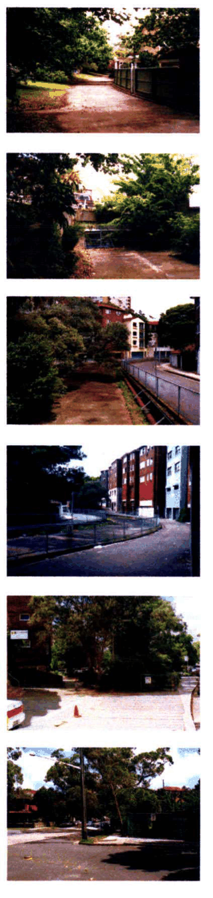

> [Picture on page 24: a picture, saved as a picture (images/double-bay-centre-public-improvements-plan-page-24-30.gif, 150 dpi).]

#### 3.8.2

SHERBROOKE AVENUE

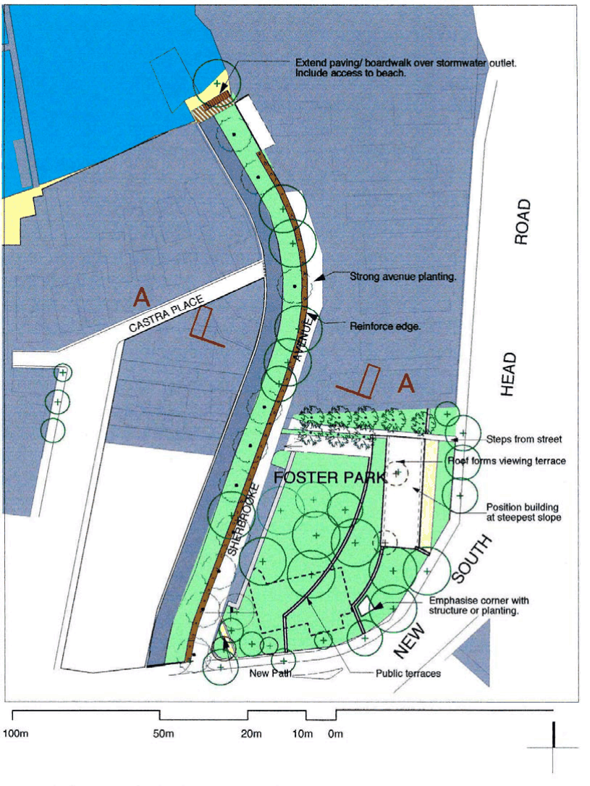

> [Picture on page 25: a picture, saved as a picture (images/double-bay-centre-public-improvements-plan-page-25-4.gif, 150 dpi).]

#### 3.8.2  Sherbrooke Avenue

ƒ Extend walkway out over beach and stormwater outlet to improve connection to the bay. ƒ Replace existing planting over time to create a strong edge of trees that reinforce the curve.

SECTION A  - A

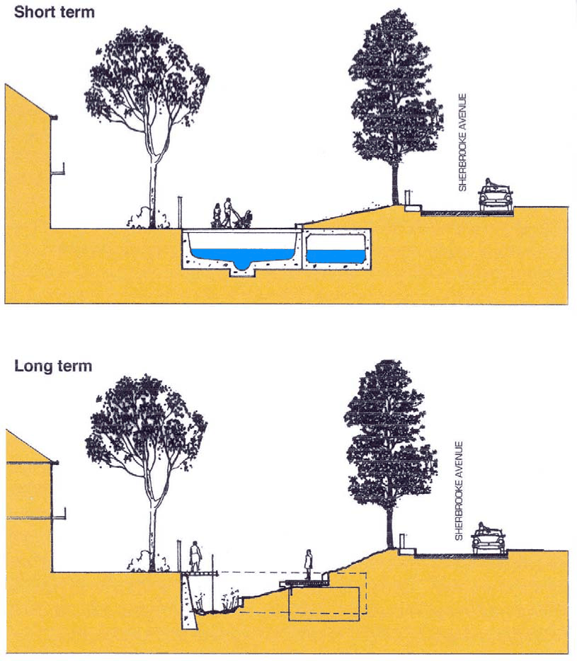

> [Picture on page 26: a picture, saved as a picture (images/double-bay-centre-public-improvements-plan-page-26-2.gif, 150 dpi).]

#### Section A  -  A Short term

ƒ Retain the existing lid of channel, use as path for pedestrian / cycle link. ƒ Remove shrubby growth and weeds to upgrade image and improve visibility. ƒ Provide a strong edge to both sides of grass verge, and replace fence with bollards to improve pedestrian accessibility.

#### Long term

ƒ Replace concrete channels with a soft system which responds to tidal flow, and which allows for natural infiltration and filtering of stormwater. This would rely on a considerable reduction in volumes of runoff from sources upstream. ƒ Allow for pedestrian access to rear of houses. ƒ Provide a mid level pedestrian path connecting to a jetty at the bay.

#### 3.8.3

JAMBEROO LANE / CROSS LANE

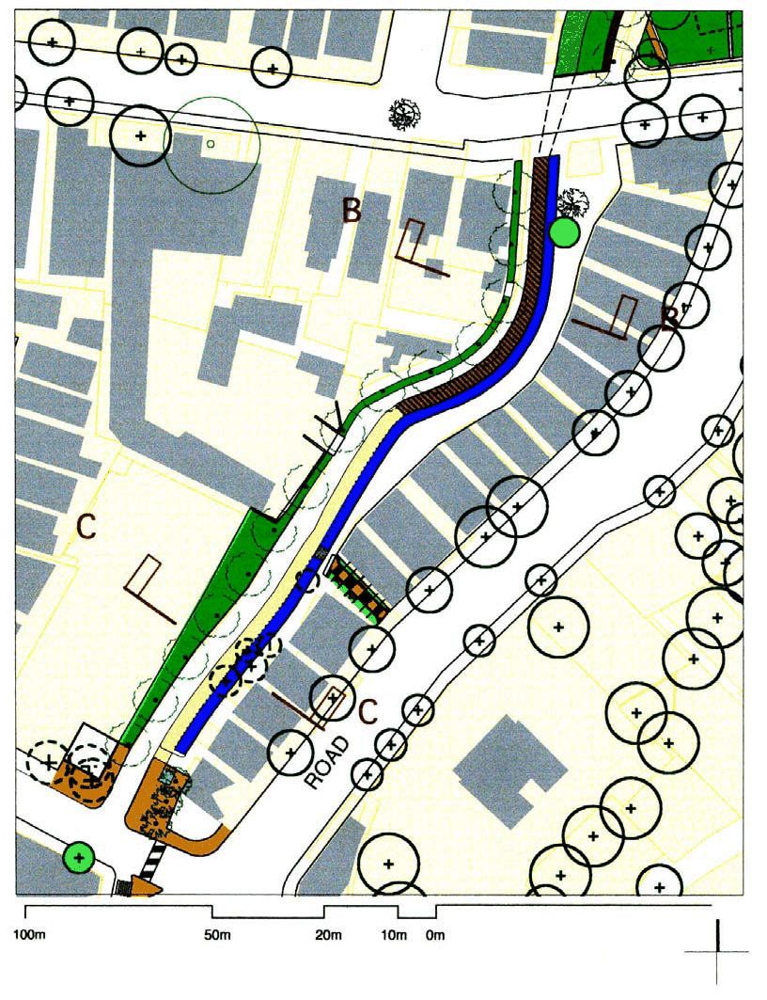

> [Picture on page 27: a picture, saved as a picture (images/double-bay-centre-public-improvements-plan-page-27-4.gif, 150 dpi).]

#### 3.8.3 Jambaroo Lane / Cross Street

ƒ Provide a pedestrian path between lanes. ƒ Open up stormwater channel to create a water feature, with low flow macrophyte treatment capability. ƒ Improve pedestrian lighting and safety. ƒ Define Jamberoo Lane with street planting.

SECTION B  - B

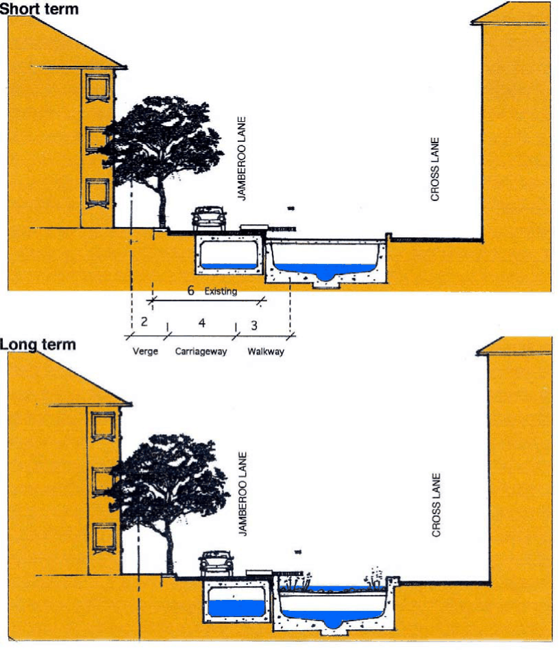

> [Picture on page 28: a picture, saved as a picture (images/double-bay-centre-public-improvements-plan-page-28-2.gif, 150 dpi).]

#### Section B  -  B Short term

ƒ Reduce width of carriageway (Jamberoo Lane) to:

- create central walkway / cycleway as part of Jamberoo Creek corridor.

- allow street tree planting in the verge, to emphasise curve of lane, and enhance urban image.

ƒ Replace chain mesh fence and improve existing edges. ƒ Reinforce the urbanity of the space through the use of appropriate details, finishes and furniture.  Walkway delineated in concrete / timber to avoid vehicle conflict. ƒ Tree planting to comply with Sydney Water requirements.

#### Long term

ƒ Expose  low flow stormwater in a shallow channel to:

- add a measure of water treatment, through aeration and macrophyte beds.

- provide an engaging urban feature which enhances awareness of the water system.

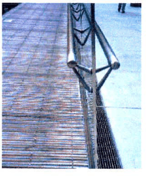

> [Picture on page 28: a picture, saved as a picture (images/double-bay-centre-public-improvements-plan-page-28-17.gif, 150 dpi).]

SECTION C – C

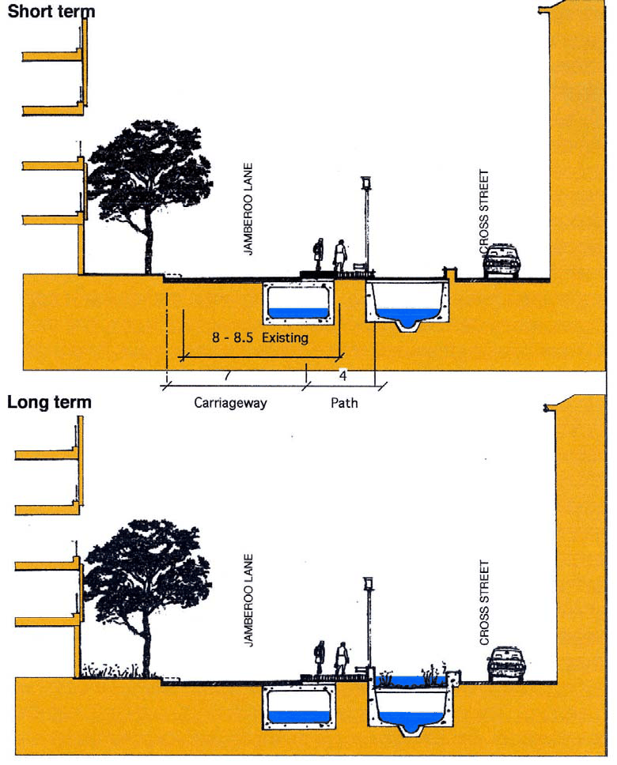

> [Picture on page 29: a picture, saved as a picture (images/double-bay-centre-public-improvements-plan-page-29-2.gif, 150 dpi).]

#### Section C  -  C Short term

ƒ Reduce width of carriageway (Jamberoo Lane) to:

- create central walkway / cycleway as part of Jamberoo Creek corridor.

- allow street tree planting in the verge, to emphasise curve of the lane, and enhance urban image. ƒ Replace chain mesh fence and improve existing kerbs and edges. ƒ Reinforce the urbanity of the space through the use of appropriate details, finishes and furniture. ƒ Tree planting to comply with Sydney Water requirements.

#### Long term

ƒ Expose low flow stormwater in a shallow channel to:

- add a measure of water treatment, through aeration and macrophyte beds.

- provide an engaging urban feature which enhances awareness of the water system.

#### 3.8.4

KIAORA ROAD

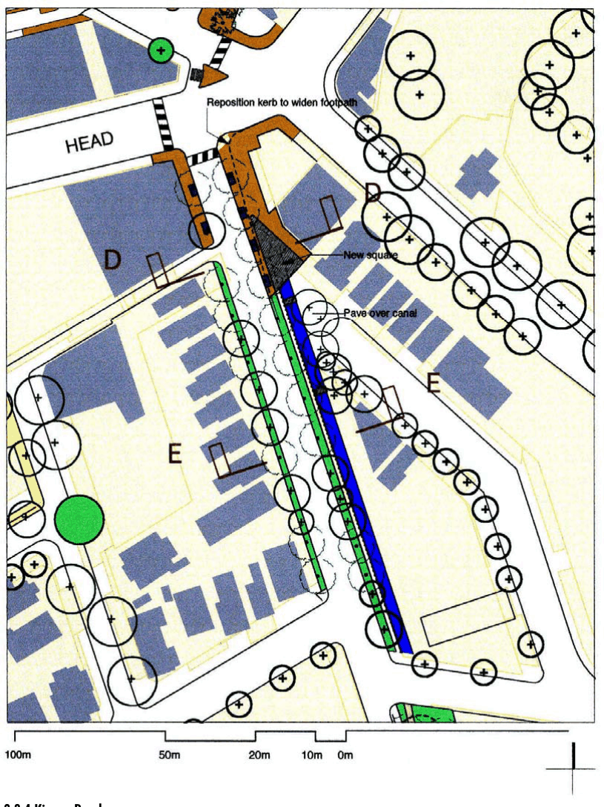

> [Picture on page 30: a picture, saved as a picture (images/double-bay-centre-public-improvements-plan-page-30-3.gif, 150 dpi).]

#### 3.8.4 Kiaora Road

ƒ New pedestrian island and pedestrian crossing at the corner of New South Head Road and Cross Street to improve pedestrian safety at 5-way intersection and facilitate connection of link between Cooper Park and Double Bay. ƒ Reduce width of carriageway to accommodate tree planting and footpath widening. ƒ Reinforce existing planting of Eucalyptus botryoides. ƒ Define new square outside Jewish Hall by covering over stormwater channel. Upgrade area with timber paving and Double Bay set. ƒ Upgrade image of stormwater channel.

SECTION D - D KIAORA ROAD

SECTION E - E

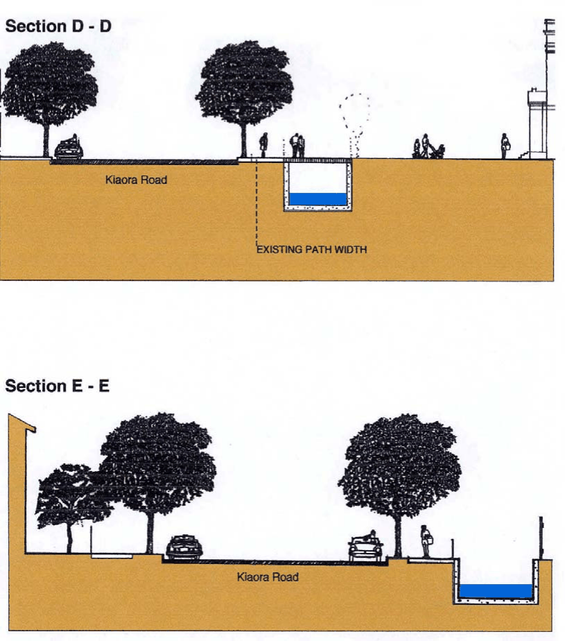

> [Picture on page 31: a picture, saved as a picture (images/double-bay-centre-public-improvements-plan-page-31-4.gif, 150 dpi).]

Section D  –  D at Kiaora Road ƒ Widen footpath adjacent to Post Office in Kiaora Road. ƒ Cover the channel and remove fences and vegetation to create a small square adjacent to the Jewish Hall. ƒ Upgrade paving and furniture consistent with quality throughout the centre.

Section E – E

#### ƒ Remove the shrubby vegetation and replace mesh fences with a barrier

that meets the quality of urban finishes throughout the centre, to better integrate the channel into the urban environment.

#### ƒ Complete the line of street trees.

#### ƒ Locate path adjacent to fence.

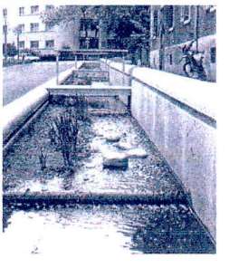

> [Picture on page 31: a picture, saved as a picture (images/double-bay-centre-public-improvements-plan-page-31-17.gif, 150 dpi).]

#### 3.8.5

KIAORA ROAD (AT FOREST ROAD)

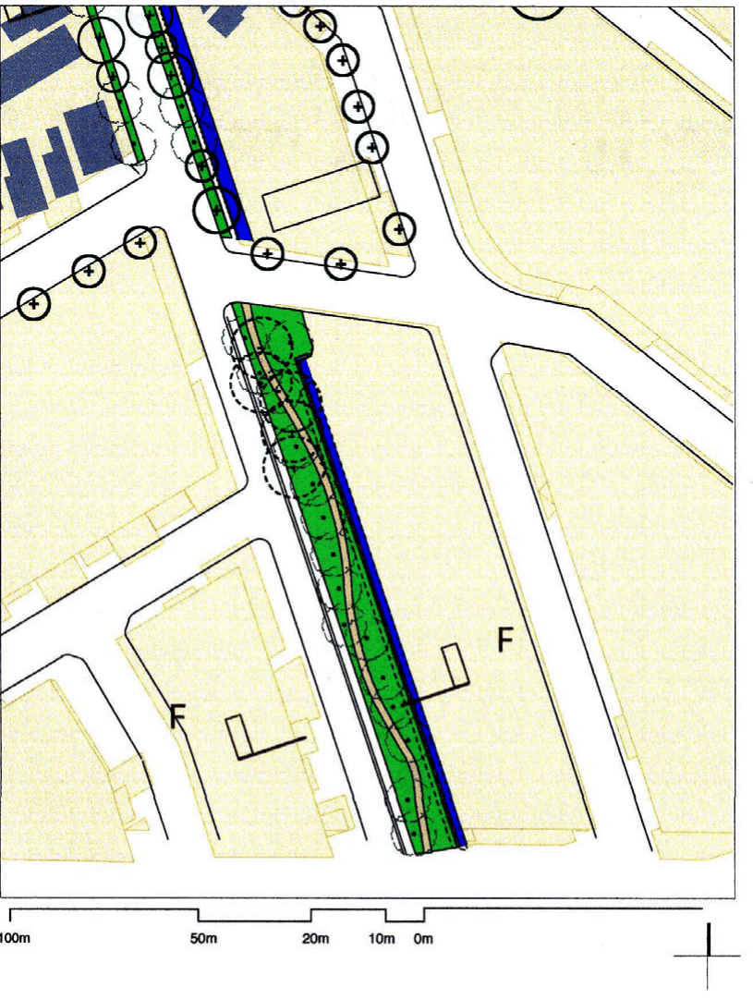

> [Picture on page 32: a picture, saved as a picture (images/double-bay-centre-public-improvements-plan-page-32-4.gif, 150 dpi).]

#### 3.8.5 Kiaora Road (at Forest Road)

ƒ Create a ‘soft’ stormwater system that contributes to improvement in water quality and provides passive recreational space.

SECTION F - F AT KIAORA ROAD

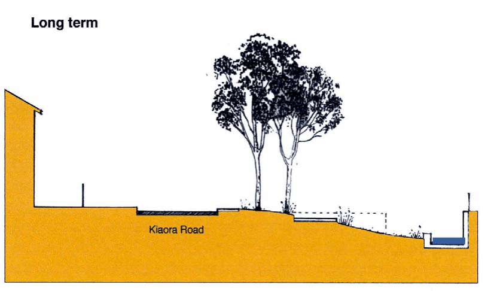

> [Picture on page 33: a picture, saved as a picture (images/double-bay-centre-public-improvements-plan-page-33-3.gif, 150 dpi).]

#### Section  F  -  F at Kiaora Road

ƒ Remove the concrete channel and replace with a ‘soft’ system, which contributes to water quality through infiltration, aeration and macrophyte beds. ƒ The corridor becomes a wide green space, used for recreation with a pedestrian and cycle park linking to Cooper Park. ƒ Flood flows are contained within the green corridor. ƒ Landscape is suburban in character, with large trees and open green spaces.

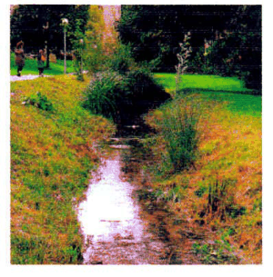

> [Picture on page 33: a picture, saved as a picture (images/double-bay-centre-public-improvements-plan-page-33-13.gif, 150 dpi).]

#### 3.9

OTHER PUBLIC SPACES

#### Kiaora Lane

Upgrade Lane in conjunction with development of council car park sites, to match the principles standard and finishes of the Knox Street Lane. Incorporate a square associated with the new community centre.

#### Knox Street

Extend median and tree planting. Median should act as a pedestrian refuge and should have a paved surface.

#### New South Head Road

New South Head Road in the centre has a strong urban character, defined by the built edge. Awnings prevent successful street tree planting on both sides, and traffic volume restricts the use of extended kerbs or planting in the parking lane.

The Development Control Plan recommends measures to accentuate the street geometry, to enhance urban character.

Further measures to emphasise the pedestrian zone and to upgrade the existing image are:

provide roadway / pedestrian lighting with a distinctive design, in a regular setout along the street edge.

reverse the current paving matrix, to reduce the need for cleaning. replace the existing planter boxes with boxes of a more robust, simpler design, to suit the colour of the paving. Mature vegetation to the north and south of the centre creates a strong contrast with the centre, and visually contains the urban area. These stands of vegetation should be protected in the long term, and street tree planting encouraged in these areas.

#### 3.10

COMMUNITY CENTRES At present there is only one community room within the Double Bay Centre. During the

course of the study, the need for a community facility as well as a gathering place for young people in the Centre, were identified.

The existing community room is leased from the Sir Stamford Hotel. It has inadequate access and visibility from the street, for a public facility. Given the significant landholdings of Woollahra Council in Double Bay there is potential to provide additional public facilities, while improving the public image of the council’s properties. This study has identified several projects, which realise this potential.

#### 3.10.1 Kiaora Lane Community Centre

#### Objectives

| O1 | Provide a focus for the Double Bay Centre on the southern side of New South Head Road. |
|---|---|
| O2 | Formalise pedestrian movement through the Centre from Guilfoyle Park along Knox Street and through a new arcade to a public facility. |

#### Strategies

S1 A Community Centre with access to a public square.

S2 Provide a ground floor community meeting room of min 100m2, a small gathering room of 20m2 and an accessible public toilet.

S3 The small gathering room at ground level could operate as a drop in centre for younger people having an intimate scale and basic self serve facilities ie make your own tea/coffee.

#### 3.10.2 Jamberoo Lane Community Centre

#### Objectives

O1 Improve the street address of the Cross Street Carpark, to Cross Street and the five ways intersection.

O2 Improve access to and security within the carpark, by introducing additional uses.

#### Strategies

S1 A multi level community centre addressing Cross Street and Jamberoo Lane. This could involve adapting one corner of the existing Cross Street Park and extend up to the roof level.

S2 Address a public square at the end of Jamberoo and Cross Lanes (in proximity to Jamberoo Linear Park).

S3 Provide sporting facilities (ie. aerobics, weights, gym) on numerous levels and an accessible public toilet.

S4 Provide a small gathering room possibly at roof level. This could operate as a centre for older people.

#### 3.10.3 Foster Park Community Centre

#### Objectives

O1 Improve the address, connection and useability of Foster Park.

O2 Provide a new community building which maximises the site potential particularly its outlook and topography.

#### Strategies

S1 Reinstate as a minimum the existing floor area, and the level of existing services: Baby Health Centre, Local History Library, and Child Care Centre.

S2 Establish a connection between the building and the landscape (ie. topography, established trees) to create outdoor rooms and gathering places, such as. viewing terrace, play ground.

S3 Ideally these connections should integrate with an external stair connecting New South Head Road to Sherbrooke Avenue.

S4 Provide accessible public toilets.

S5 Provide a safe vehicular drop-off and pick-up area as well as some limited stay parking.

### Traffic and parking

## PART 4 4.1

FORMULATION OF

#### 4.1.1 Recommended traffic strategy

MANAGEMENT STRATEGY

#### Strategies

In order to address the existing and anticipated problems within the Double Bay Centre the following improvements:     (illustrated in Figure 7 Major Recommended Improvements)

S1 Provide a median in New South Head Road opposite Bay Street to prohibit the right turning movement to and from Bay Street.

S2 Introduce a right turning arrow for vehicles turning from New South Head Road into Bellevue Road (completed since).

S3 Provide line marking and sign posting at the intersection of Bay street, Knox Street and Guilfoyle Avenue, so it is treated as a cross intersection rather than two T- Junctions.

S4 Provide better signage at the Greenoakes and Ocean Avenue roundabout.

S5 Consider banning the right turn movement from New South Head road into Kiaora Road during the afternoon peak periods in conjunction with the redevelopment of Kiaora Lane car park.

#### 4.1.2 Recommended parking strategy

#### Strategies

S1 The following measures are recommended for implementation in the short term:

The following parking rates, be adopted to cater for all future commercial demands:

#### Parking spaces per 100 m2 (GFA)

| Requirements | Retail | Office/Personal Services/Financial |
|---|---|---|
| Spaces Short Stay : Long Stay Parking % | 3.5 60:40 | 2.0 15:85 |

S2 Convert of all existing short-stay spaces in Henrietta Street (34), Cooper Avenue (36), South Avenue (22) and Guilfoyle Avenue (50 spaces) to long-stay spaces together with the installation of parking metres. The fees should be such as to be equal or more than those charged in the Cross Street parking facility. Vehicles of local residents displaying a Double Bay parking permit should be exempt.

S3 Install parking meters in all remaining on-street short and long stay spaces. Vehicles of local residents displaying a Double Bay parking permit should be exempt.

S4 Implement an appropriate sign posting scheme to facilitate access to and from the parking facilities within the Centre.

S5 Provide line marking of street parking spaces where required.

S6 Adopt a parking strategy that allows between 65 and 75 percent of spaces necessary for private development to be provided by contribution-in-lieu, in order to fund a parking structure of about 360 spaces on the existing council car park located in Kiaora Lane.

Part 4 – Traffic and Parking

S7 Allow the payment of a cash contribution-in-lieu of on site parking being constrained by site or access constraints.

S8 Negotiate with developers of major sites west of New South Head Road for the provision of additional on-site spaces in conjunction with their development to accommodate spaces required through Section 94 contributions.

#### 4.1.3 Recommended pedestrian strategy

#### Strategies

S1 Provide of a flushed pedestrian threshold in Goldman Lane north of Short Street.

S2 Provide of footpaths along laneways particularly in Knox Lane.

S3 Formalise pedestrian crossing points across Knox Lane at the arcades by providing flushed thresholds.

S4 Install a kerb ramp on the south corner of Guilfoyle Avenue and Bay Street.

S5 Provide of a kerb ramp on the median strip on the exit to the car park east of Transvaal Avenue.

#### 4.1.4 Recommended public transport improvements

#### Strategies

S1 Increase the waiting area for intending passengers to reduce congestion outside the supermarket.

S2 Increase sheltered area for intending bus passengers.

S3 Provide a pedestrian crossing on the western approach of the roundabout in William Street at Bay Street.

S4 Discuss with State Transit improvements to integration between bus and ferry services such as time tabling and the bus stop location.

S5 Investigate the provision of an additional shelter to the wharf precinct, linking the buses in William Street.

S6 Provide time tabling information in commercial centre for bus, rail and ferry services.

S7 Provide information in the commercial centre mapping the different locations of bus, rail, ferry and taxi services.

S8 Provide better lighting on the wharf approaches along Steyne Park.

Part 4  -Traffic and Parking

### Stormwater strategy

## PART 5

The Double Bay Centre occupies the low point of an extensive stormwater catchment. Stormwater runoff from the catchment is conveyed along Coopers Creek, which originates as a steep sided gully in the upper reaches of Cooper Park. From there the creek flows under Lough Playing Fields, where it enters a trunk drainage channel at Kiaora Road. The drainage line is an open concrete channel at Kiaora Road, which splits into a double covered system leading from New South Road to the Bay. The trunk drainage system is maintained by Sydney Water.

The catchment was included in the recently completed Port Jackson South Stormwater Management Plan, which addresses the issue of stormwater quality. The issues identified for the Double Bay catchment were concerned with accumulation and sediment resulting in foul odours at the outlets and pollution of runoff with litter and dog faeces. Recommendations arising from the Management Plan are largely for structural interventions at points along the existing channel to reduce sediment and litter.

The public domain improvements proposed for the trunk drainage line aim to build on the intentions of the Management Plan for improving water quality. Equally, improvements to the drainage system should make a positive contribution to the public domain, in terms of recreational potential and visual amenity.

Proposals for public domain improvements are preliminary only, as no formal hydrologic or hydraulic study has been carried out to assess the existing system and the level of flooding. It is recommended that a catchment study be undertaken to:

#### ƒ document 100 yr flood levels for development control around the town centre.

ƒ investigate the viability of proposed drainage channel improvement works,

#### with respect to stormwater volumes and flooding.

#### ƒ provide catchment management options directed at improving water quality

#### for the catchment and to improve flood protection for the community.

Improvements to the existing channel system will require a multidisciplinary investigation and design approach, involving hydraulic, geotechnical, and structural as well as urban design and landscape considerations. The outcomes of such an approach should be: ƒ a drainage system which is physically and visually integrated into the fabric of the public domain. ƒ improvement to water quality in the catchment and the harbour. ƒ an increase in open space in Double Bay Centre.

#### ƒ mitigation of flood risk.

Part 5– Stormwater Strategy

### Streetscape design manual

## PART 6 6.1

STREET FURNITURE

Woollahra Council has adopted a range of street furniture for use throughout the Double Bay Centre. Most elements have been specifically designed for inclusion in the Double Bay Centre; their exclusive use in existing and future works is important to maintain an integrated streetscape.

Seats, lights and bins should be positioned outside the main pedestrian flow, with enough room to move between elements.

Preferred width of unimpeded footpath is 2.5 metres.

NB - Shop drawings are held by Council.

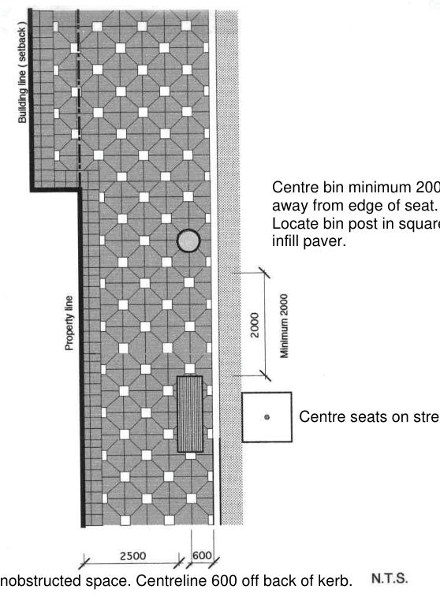

> [Picture on page 41: a picture, saved as a picture (images/double-bay-centre-public-improvements-plan-page-41-13.gif, 150 dpi).]
> Words printed on the picture (title and legend, copied from the PDF):
> Centre bin minimum 2000
> away from edge of seat.
> Locate bin post in square
> infill paver.
> Centre seats on street tree.
> 2500 min. unobstructed space. Centreline 600 off back of kerb.

#### 6.1.1 Double Bay seat

| Type | “Double Bay Fabricated Seat”. |
|---|---|
| Supplier | Zebra Landscape Furniture Pty. Ltd. |
| Colour | Steel frame, Dark ferrodore finish. Timber inserts treated with a natural oil finish. Use Feast Watson “Woodshield” . On new inserts recoat within the first 3 months, then once every 12 months. Do not varnish as this leads to reduced life. |
| Location | Streets, generally one seat every 60 - 100m and at bus stops. Not suitable for use along the waterfront. NB - Shop drawings held by Council. |

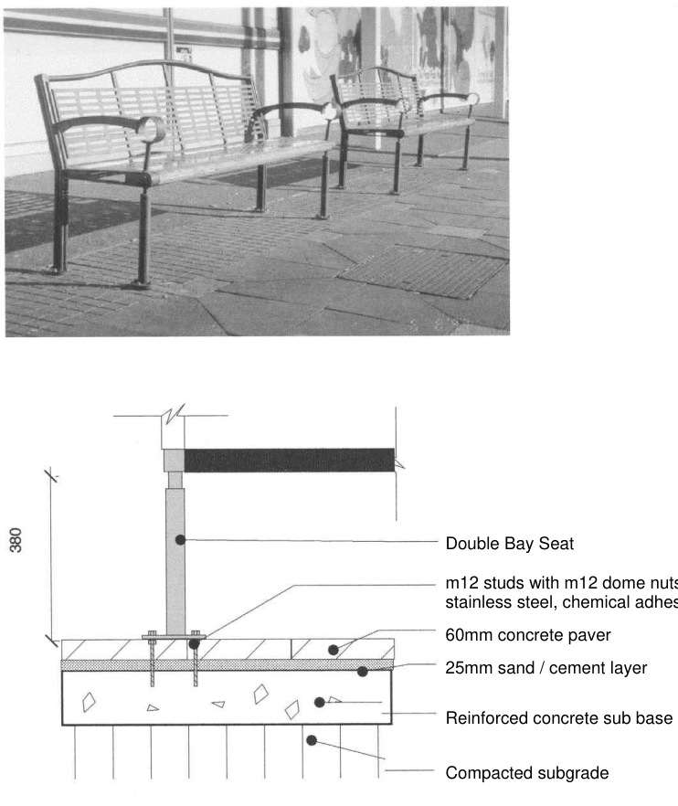

> [Picture on page 42: a picture, saved as a picture (images/double-bay-centre-public-improvements-plan-page-42-3.gif, 150 dpi).]
> Words printed on the picture (title and legend, copied from the PDF):
> Double Bay Seat
> m12 studs with m12 dome nuts in 316
> stainless steel, chemical adhesives
> 60mm concrete paver
> 25mm sand / cement layer
> Reinforced concrete sub base
> Compacted subgrade

#### 6.1.2 Planter box

#### Type

Steel tube.

Supplier Zebra Landscape Furniture Pty.Ltd.

Colour Existing Black frame, with British Racing Green insert.

If repainting occurs during the life of the planter, repaint to reflect the finish of the standard range of furniture: - Dark ferrodore finish frame with black insert.

Location Should be kept to a minimum, used in areas where street tree planting is

not possible, but which also have an intimate scale. These planters are currently used in Knox Street only and should be confined to this area in the long term.

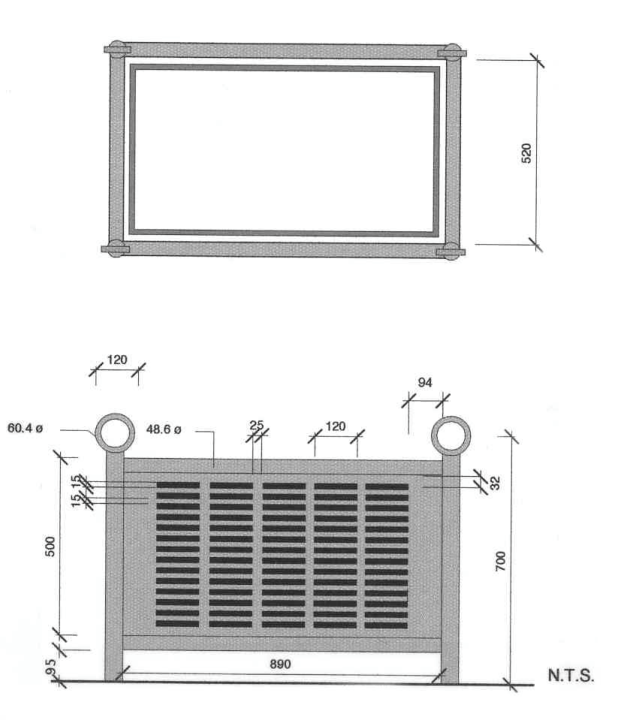

> [Picture on page 43: a picture, saved as a picture (images/double-bay-centre-public-improvements-plan-page-43-13.gif, 150 dpi).]

#### 6.1.3 Planter box

| Type | Off form concrete trough. |
|---|---|
| Supplier | Jolly Rogers Concrete Products Pty. Ltd. |
| Colour | Integral colour – Medium Grey. |
| Location | Use to supercede existing troughs along New South Head Road, where street tree planting is not possible. To be used in this location only. Centre 600mm off back of kerb, in line with other street furniture. |

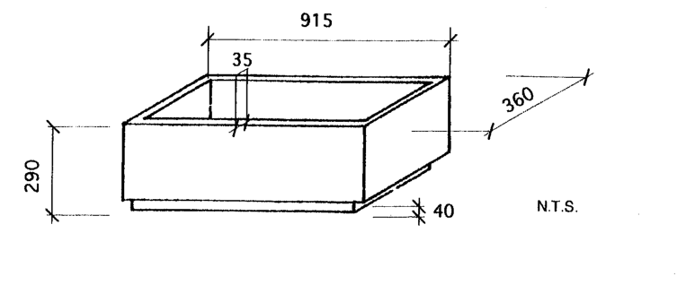

> [Picture on page 44: a picture, saved as a picture (images/double-bay-centre-public-improvements-plan-page-44-3.gif, 150 dpi).]

#### 6.1.4 Pole light

#### Type

Luminaire – “Double Bay Sphere”.

Poles - G.M. Pole to replace the current pole, which is incompatible with the luminaire fitting.

Supplier Luminaire - Sylvania Lighting.

Pole – Grahame  W. Vaughan Pty. Ltd is the NSW distrubutor.

Colour Luminaire – frosted globe with dark Ferrodore finish to frame

Pole - dark Ferrodore finish

Location Presently located along New South Head Road, Cross, Knox and Bay

Streets, Goldman Lane, Gumtree Lane Gilbraith Walk, Steyne Park and recent works in Guilfoyle Park.

Used in future works to continue Guilfoyle Park and extension of streetscape works in Bay Street between Cross Street and the waterfront.

Position where awnings are absent.  Poles are spaced approximately 8 metres apart, fixed in the centre of square pavers in the “Double Bay Set.”

To prevent the presently shaky join between luminaire and pole, it is essential that the recommended lubrication barrier is used on the hex screws that attach the luminaire to the pole. Alternatively a stainless steel helicoil thread for attaching will help reduce the electrolytic corrosion.

These tasks can be carried out as part of the regular maintenance

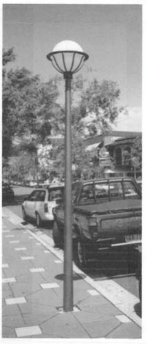

> [Picture on page 45: a picture, saved as a picture (images/double-bay-centre-public-improvements-plan-page-45-22.gif, 150 dpi).]

programme.

NB - Shop drawings held by Council.

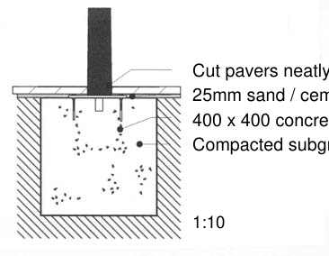

> [Picture on page 45: a picture, saved as a picture (images/double-bay-centre-public-improvements-plan-page-45-25.gif, 150 dpi).]
> Words printed on the picture (title and legend, copied from the PDF):
> 25mm sand / cement bed
> 400 x 400 concrete footing
> Compacted subgrade
> 1:10

Cut pavers neatly around base of lightpole.

#### 6.1.5 Bollard

| Type | “Double Bay” fabricated steel bollard. |
|---|---|
| Supplier | Bay Steel Pty. Ltd. |
| Colour | Dark ferrodore finish. |
| Location | Where barriers to vehicular movement are required and where fences, walls and kerbs are not appropriate. Currently located in Cross and Bay Streets. NB - Shop drawings held by Council. |

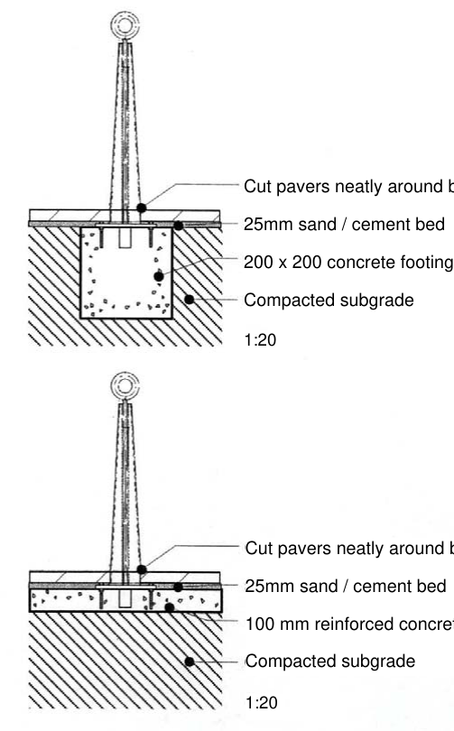

> [Picture on page 46: a picture, saved as a picture (images/double-bay-centre-public-improvements-plan-page-46-3.gif, 150 dpi).]
> Words printed on the picture (title and legend, copied from the PDF):
> Cut pavers neatly around base of bollard
> 25mm sand / cement bed
> 200 x 200 concrete footing
> Compacted subgrade
> 1:20
> Cut pavers neatly around base of bollard
> 25mm sand / cement bed
> 100 mm reinforced concrete base
> Compacted subgrade
> 1:20

#### 6.1.6 Cast metal tree grate

| Type | Radial Cast Steel Grate. |
|---|---|
| Supplier | Zebra Landscape Furniture Pty. Ltd. |
| Colour | Untreated finish. |
| Location | Location sporadically on street corners on Bay and Cross Street. The practice of planting street trees in the pavement is being phased out in Double Bay, with planting in the parking lane becoming standard practice. The use of grates is not necessary in the parking lane. NB - Shop drawings for the tree grate are unobtainable. |

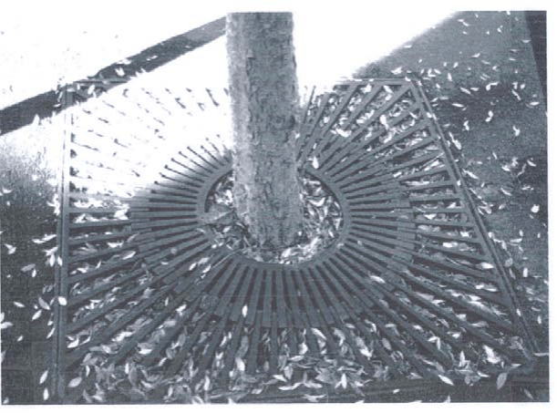

> [Picture on page 47: a picture, saved as a picture (images/double-bay-centre-public-improvements-plan-page-47-3.gif, 150 dpi).]

#### 6.1.7 Timber tree guard

| Type | Hardwood timber. |
|---|---|
| Supplier | Constructed in situ as necessary. |
| Colour | Finished in exterior timber acrylic, light grey. |
| Location | Along streets where trees are to be planted in the parking lane, such as Bay Street extension. Guards should be installed as a temporary measure, to protect the tree until it is well established. |

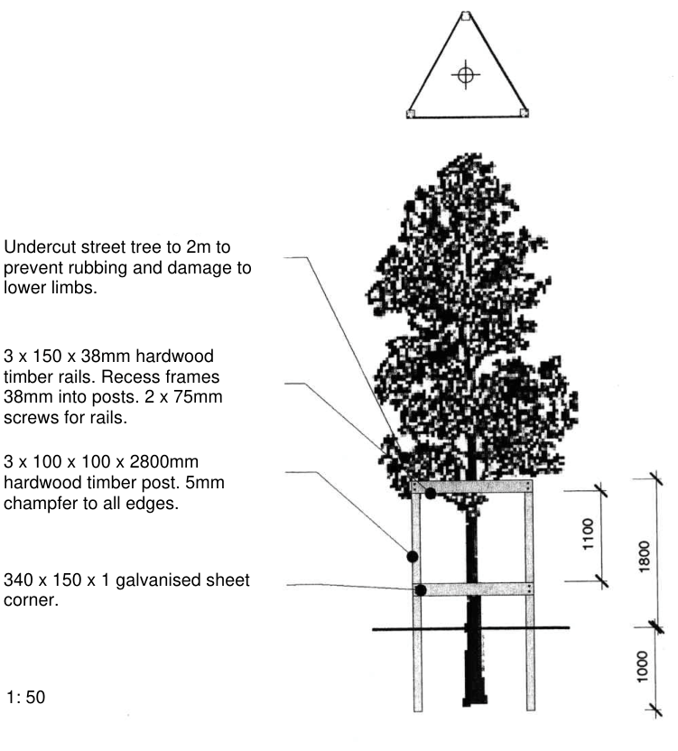

> [Picture on page 48: a picture, saved as a picture (images/double-bay-centre-public-improvements-plan-page-48-3.gif, 150 dpi).]
> Words printed on the picture (title and legend, copied from the PDF):
> Undercut street tree to 2m to
> prevent rubbing and damage to
> lower limbs.
> 3 x 150 x 38mm hardwood
> timber rails. Recess frames
> 38mm into posts. 2 x 75mm
> screws for rails.
> 3 x 100 x 100 x 2800mm
> hardwood timber post. 5mm
> champfer to all edges.
> 340 x 150 x 1 galvanised sheet
> corner.
> 1: 50

#### 6.2

PAVING

A strong and consistent paving design with attention to detail has been established in the Double Bay Centre.

Future paving works should aim to rectify difficult footpath level changes, correct uneven pavements and create a smooth, continuous and even pedestrian surface with a single nominal slope from shop front to kerb.

Presently the Double Bay paving set extends to the edge of the property line only. Where the built edge occurs beyond the boundary, a section of different paving may occur. In the interest of continuity and an integrated image, the Double Bay set should extend in all cases to the built edge.

Presently an Urbanstone concrete paver with a grid of 100mm squares embossed –type 3- is used to resolve differences in dimension at edges to avoid cutting pavers. These pavers are now no longer manufactured as standard and can be reproduced but only if it is feasible by ordering a large run.

A better alternative in this situation may be a larger concrete paver, such as a 300mm square. This unit is less liable to cracking and provides more flexibility when cutting into the building line.

In future work it is imperative to maintain the practice of using whole pavers only for the Double Bay Set, with no cutting in as far as possible.

Existing pavements in some areas have been damaged by vehicles and tree roots. New paving should have a concrete base course. The base course of areas likely to carry vehicular traffic should be reinforced.

Generally the paving pattern consists of a matrix of Urbanstone Double Bay Set in gunmetal grey, with lighter inserts. This is reversed along New South Head Road, with a matrix of white Urbanstone pavers with a gunmetal insert. This pattern requires more frequent cleaning. It is suggested that the paving be replaced with the standard paving pattern.

The extension of streetscape works to include lanes should continue the use the Double Bay Set, but in a simplified pattern. The recommendation is to use a 300 x 300m square pavers only in these areas. For ease of cleaning, the dominant colour should be Urbanstone Gunmetal Grey.

Pavers in lanes should be 60mm thick to take vehicle loads.

The following pavers are the standard range developed for use throughout the centre.

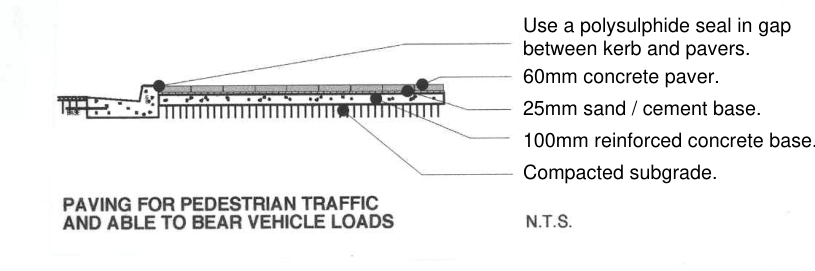

> [Picture on page 49: a picture, saved as a picture (images/double-bay-centre-public-improvements-plan-page-49-34.gif, 150 dpi).]
> Words printed on the picture (title and legend, copied from the PDF):
> Use a polysulphide seal in gap
> between kerb and pavers.
> 60mm concrete paver.
> 25mm sand / cement base.
> 100mm reinforced concrete base.
> Compacted subgrade.

The following pavers are the standard range developed for use throughout the centre.

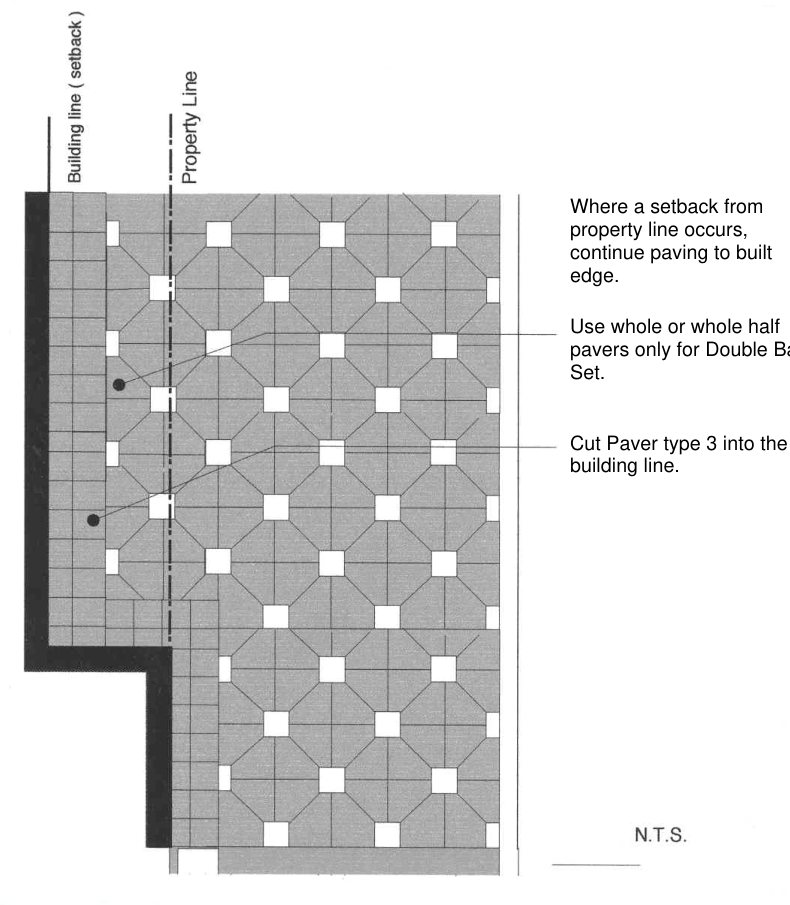

> [Picture on page 50: a picture, saved as a picture (images/double-bay-centre-public-improvements-plan-page-50-2.gif, 150 dpi).]
> Words printed on the picture (title and legend, copied from the PDF):
> Where a setback from
> property line occurs,
> continue paving to built
> edge.
> Use whole or whole half
> pavers only for Double Bay
> Set.
> Cut Paver type 3 into the
> building line.

The following pavers are the standard range developed for use throughout the centre.

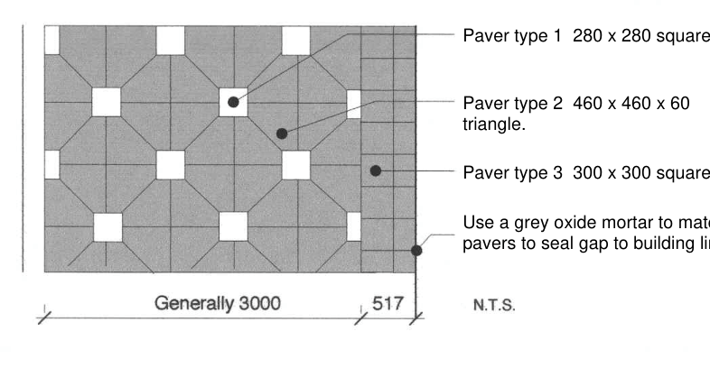

> [Picture on page 51: a picture, saved as a picture (images/double-bay-centre-public-improvements-plan-page-51-2.gif, 150 dpi).]
> Words printed on the picture (title and legend, copied from the PDF):
> Paver type 1  280 x 280 square.
> Paver type 2  460 x 460 x 60
> triangle.
> Paver type 3  300 x 300 square.
> Use a grey oxide mortar to match
> pavers to seal gap to building line.

#### 6.2.1 Pavers

The following pavers are the standard reange developed for use throughout the centre.

|  | Description | Colour | Location |
|---|---|---|---|
| Type 1 Type 2 Type 3 Type 4 Type 5 Type 6 | Concrete Paver “Double Bay Set” 280 x 280 x 40 square, shot blast finish. Supplied by Urbanstone Concrete Paver “Double Bay Set “ 460 x 460 x 40 triangle, shot blast finish, Supplied by Urbanstone Urbanstone Concrete Paver Pedestrian Crossovers 300 x 300 Arcade paving 300 x 300 Brick to match existing | White Gunmetal Gunmetal Gunmetal Gunmetal | Footpaths generally Footpaths generally Footpaths as infill along the building line Pedestrian kerb crossovers. Arcades and lanes Transvaal Avenue |

#### 6.2.2 Pavement Details

Detail new paving at corners, tree holes, pits, covers, posts and boxes to ensure neat joining and maintain a continuous smooth paving surface.

Reduce the intrusion of service covers in the pavement as far as possible by infill paving surfaces of larger covers to match surrounding paving, and by minimising or avoiding concrete surrounds to covers.

Establish throughout the Double Bay commercial centre a smooth, non-slip, durable and even pedestrian footpath surface with a single nominal slope from shop front to kerb. Comply with Australian Standards for accessibility, safety, and slip resistance (friction coefficient).

The following access covers are suitable for infilling and may be used to replace existing covers which cannot be altered.

Infill with mortar if necessary.

ACO Polycrete single and multi part access covers. Heavy gauge steel frames.

2379L Stormwater pit covers.

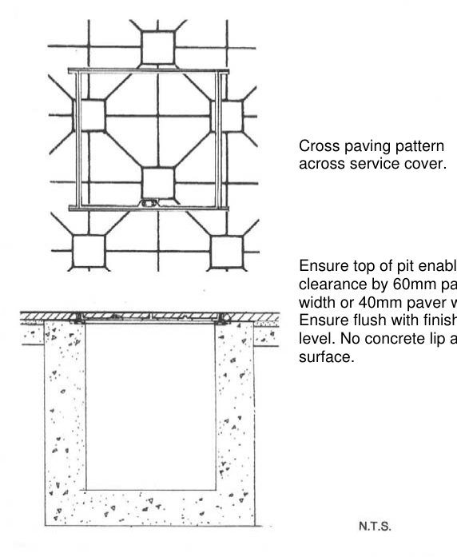

> [Picture on page 52: a picture, saved as a picture (images/double-bay-centre-public-improvements-plan-page-52-16.gif, 150 dpi).]
> Words printed on the picture (title and legend, copied from the PDF):
> Cross paving pattern
> across service cover.
> Ensure top of pit enables
> clearance by 60mm paver
> width or 40mm paver width.
> Ensure flush with finished
> level. No concrete lip at
> surface.

Where possible fix street furniture within the white infill paver in the Double Bay pattern. Remove concrete collar at base of light poles, as this is a pedestrian safety hazard. Replace by cutting white infill paver neatly around pole and flush with finished ground level. Infill gap with polysulphide seal.

Where street furniture cannot be fixed on the infill paver, cut pavers neatly around intrusions (such as posts) in the paving. Infill the gap with polysulphide sealant coloured to suit the paving.

Detail paving carefully at corners, kerb ramps and intersections. Each change of direction in paving should be detailed before construction.

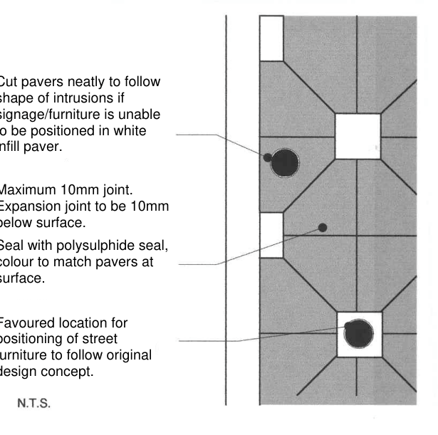

> [Picture on page 53: a map, saved as a picture (images/double-bay-centre-public-improvements-plan-page-53-10.gif, 150 dpi); the street names and other small labels are on the picture.]
> Words printed on the picture (title and legend, copied from the PDF):
> Cut pavers neatly to follow
> shape of intrusions if
> signage/furniture is unable
> to be positioned in white
> Maximum 10mm joint.
> Expansion joint to be 10mm
> Seal with polysulphide seal,
> colour to match pavers at
> Favoured location for
> positioning of street
> furniture to follow original

#### 6.3

URBAN GEOMETRY

A well-designed urban geometry was established by the original streetscape scheme. A consistent geometry for kerblines, medians and pedestrian refuges emphasises the dominant geometry created by built edges and reinforces the urbanity of the pedestrian environment.

This established geometry should be adopted in the design of extensions to existing streetscape works, and in the design of lanes. Integrate the needs of the disabled with those of traffic, paving and urban furnishings; marker strips, ramps etc should not only respond functionally, but be part of the overall image.

Provide a pavement surface that is consistently graded both along and across the pedestrian route. Avoid sharp changes in level and crossfalls greater than 1:40. Design to best practice rather than to minimum standards.

Kerbs should provide a clear separation between the pedestrian space and traffic. If bollards are used as a barrier, they should not dominate the streetscape or obstruct pedestrian flow.

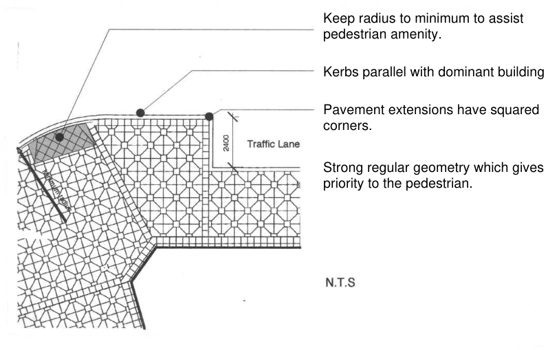

> [Picture on page 54: a picture, saved as a picture (images/double-bay-centre-public-improvements-plan-page-54-15.gif, 150 dpi).]
> Words printed on the picture (title and legend, copied from the PDF):
> Keep radius to minimum to assist
> pedestrian amenity.
> Kerbs parallel with dominant building line.
> Pavement extensions have squared
> corners.
> Strong regular geometry which gives
> priority to the pedestrian.

Position kerb ramps along the direction of travel. Ramps should ideally be at 90 degrees to the roadway, although where this is not possible, such as at radius corners, some compromise must be made.

Pedestrian kerb ramps should have a contrast in luminance to general paving. Paving contrasts, and any change in texture should be used to represent a change in the pedestrian environment for partially sighted users. Pavers on kerb ramps should have a textured non-slip surface.

Design corners and intersections to suit pedestrian comfort and safety. Use of minimum radii at corners will enhance pedestrian convenience and safety.

Pedestrian crossings should be clearly defined with zebra stripes. Avoid ambiguity.

Pram ramps shall comply with the relevant Australian Standard for disabled access. Ramps to be installed with 1800mm width (wherever possible) and ideally have a slope no greater than 1 in 12 (up to 1 in 8) to allow ease of movement for pedestrians, people in wheelchairs, people with prams or trolleys and the visually impaired.

Ensure paving on pedestrian ramp contrast with

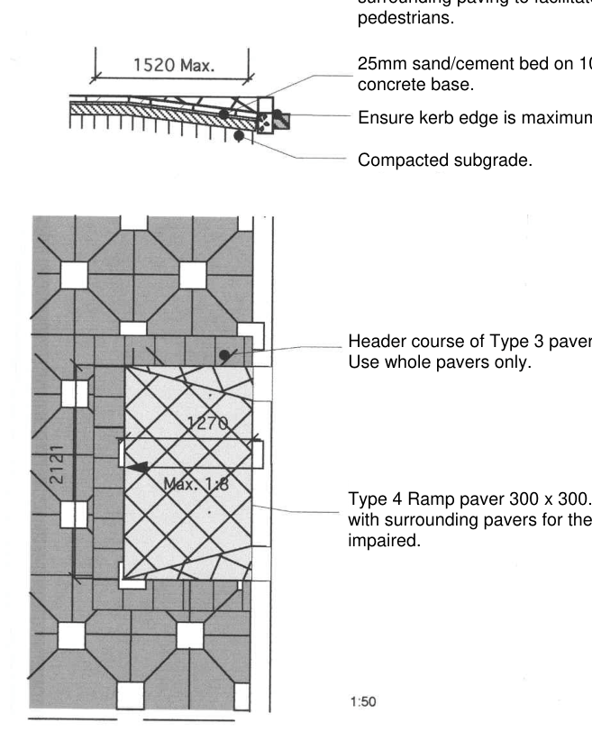

> [Picture on page 55: a picture, saved as a picture (images/double-bay-centre-public-improvements-plan-page-55-16.gif, 150 dpi).]
> Words printed on the picture (title and legend, copied from the PDF):
> pedestrians.
> 25mm sand/cement bed on 100mm reinforced
> concrete base.
> Compacted subgrade.
> Header course of Type 3 paver 300 x 300.
> Use whole pavers only.
> Type 4 Ramp paver 300 x 300. Contrasts
> with surrounding pavers for the visually
> impaired.

surrounding paving to facilitate vision impaired

Ensure kerb edge is maximum 20mm above road.

#### 6.4

STREET TREES

#### 6.4.1 Engineered Soil Solutions

Recent research into the performance of trees in urban situations has lead to the development of specialised planting details, which seek to provide maximum air, water and nutrients to the root zone of trees in pavements. Ideally, approximately 5 cubic metres of growing medium should be provided for each tree. In situations such as streets and squares, where the surface area of the tree hole must be limited, the use of a zone of structural soil around the root zone may be beneficial to the long-term health of the tree.

‘Structural Soil’ is a permeable subgrade which provides a base for paved areas surrounding tree pits, but allows penetration of air and soil to the root zone. The soil mix is a combination of four parts of aggregate to one part of filler soil (50/ 50 sandy loam and Dolorite blend).

The base between the paved surface and structural soil will vary with paving type. Insitu concrete paving may be laid directly over the structural soil subgrade.

Asphalt and unit paving over structural soil will require a base of graded aggregate to prevent the passage of fines into the structural soil subgrade. Geofabric should be used along the edges of the structural soil pit

Typical Structural Soil Mixes are listed below:

Structural Soil 40mm.     (where depth of excavation is greater than than 120mm)

80%  40mm basalt aggregate. 20% Filler Soil ( 1 part Screened Menangle Sandy Loam ). Additives of fertilizers and trace elements.

Structural Soil 20mm.     (where depth of mix is less than 120mm)

75%  20mm basalt aggregate. 25% Filler Soil ( 1 part Screened Menangle Sandy Loam ). Additives of fertilizers and trace elements.

#### 6.4.2 Planting detail – Engineered soil solutions

Typical planting detail for trees in paved areas. Australian Standard 2223 specifies a Soil Mix A, which is an imported soil with a high organic content. This is suitable for back filling the top 300mm of the planting hole. Soil mix B is the excavated site soil, mixed with sand suitable for the lower 1500mm of the planting hole.

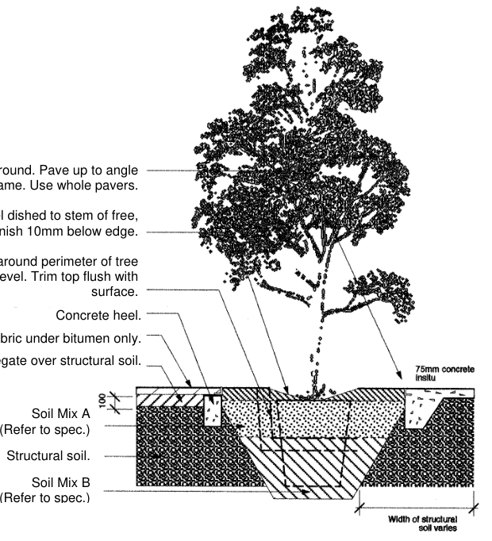

> [Picture on page 57: a picture, saved as a picture (images/double-bay-centre-public-improvements-plan-page-57-6.gif, 150 dpi).]
> Words printed on the picture (title and legend, copied from the PDF):
> frame. Use whole pavers.
> lightly rolled, finish 10mm below edge.
> surface.
> Concrete heel.
> Soil Mix A
> (Refer to spec.)
> Structural soil.
> Soil Mix B
> (Refer to spec.)

#### Topsoil mix A

| Site soil 20% |  |
|---|---|
| Medium sand | 70% |
| Lime | 0% |
| Compost | 10% |
| Fertiliser | Controlled release fertiliser. |

#### Topsoil mix B

| Site soil | 20% |
|---|---|
| Medium sand | 80% |
| Lime | 0.5% per cubic metre. |

Angle frame tree hole surround. Pave up to angle

100mm crushed river gravel dished to stem of free,

100mm slotted PVC pipe around perimeter of tree hole 400mm below surface level. Trim top flush with

Pavers/bitumen. Use geofabric under bitumen only. 100mm graded aggregate over structural soil.

#### 6.4.3 Street tree planting

The planting concept for the streetscape improvements of 1989 established a cohesive pattern that attempted to unify the streetscapes of the commercial centre. Prior to this, many of the street trees were patchy and often inappropriate to the situation.

Presently many of the large trees such as the Hills Figs and Camphor Laurels are planted in the footpath, which are being phased out. The original planting of the streets surrounding the commercial centre have a successful tree planting, however supplementing of trees that have died or are overmature needs to take place.

The Chinese Elms that were planted in Cross and Bay Streets have set a strong pattern that provides the correct scale for the street and do not damage the pavement. Many of these have been planted in the parking lane, freeing pedestrian space.

The proposed Urban Projects will supplement the existing planting surrounding the commercial centre, and to extend the planting concepts of the original streetscape concepts. For the Jamberoo Creek corridor, the planting will make a reference to the change in ecological type that existed before clearing by Europeans. These changes in ecotype would begin at Bellevue Park, through Cooper Park all the way to the harbour at Double Bay.

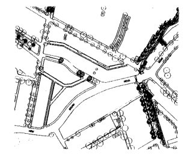

> [Picture on page 58: a picture, saved as a picture (images/double-bay-centre-public-improvements-plan-page-58-17.gif, 150 dpi).]

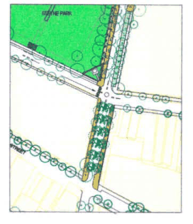

> [Picture on page 58: a picture, saved as a picture (images/double-bay-centre-public-improvements-plan-page-58-18.gif, 150 dpi).]

#### New South Head Road

As existing, no trees in commercial centre under awnings. Reinforce planting to southeast and north west of the commercial centre. This will strengthen the sense of arrival and departure through the centre.

#### Ocean Avenue

Reinforce existing planting of Brushbox (Lophostemon conferta), along Steyne Park, between parking spaces.

#### William Street

Retain Brushbox (Lophostemon conferta ), supplements as needed.

#### Bay Street

Extend planting of Chinese Elms (Ulmus parvifolia), to William Street. Under cut to 2 metres to maintain sightlines. Use Brushbox (Lophostemon conferta), on oval edge to reinforce existing. Remove Cherry trees and shrubs from northern side to restore sightlines. Retain Jacaranda and existing Canary Island Palms (Phoenix canariensis). Supplement with more Canary Island Palms to create a strong edge with views to bay.

#### Guilfoyle Avenue

Remove overmature Willow Myrtle (Agonis flexuosa) and Crack Willow (Salix fragilis). Retain Weeping Willow (Salix babalonica) to keep existing character. Extend planting of Cotton Palms (Washingtonia robusta), to complete original design intent, along the length of Guilfoyle Avenue.

#### Cross Street

Retain and supplement avenue of Chinese Elms (Ulmus parvifolia).

#### Transvaal Avenue

Retain existing street tree planting.

#### Knox Street

Extend median planting of Oriental Plane Trees (Platanus orientalis ‘ Digitata’). Remove Mock Orange (Murraya panicula) Hedge at the corner of Goldman Lane to improve useable space and maintain sightlines.

#### Jamberoo Lane

Remove Swamp Oaks (Casuarina glauca) to improve spatial definition and appearance of lane. Replace with single avenue of Tuckeroo (Cupaniopsis anacardioides) to emphasise curve in road and reflect on indigenous condition. Undercut to 2 metres and develop single trunk.

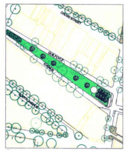

> [Picture on page 59: a picture, saved as a picture (images/double-bay-centre-public-improvements-plan-page-59-24.gif, 150 dpi).]

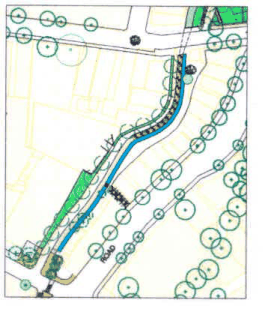

> [Picture on page 59: a picture, saved as a picture (images/double-bay-centre-public-improvements-plan-page-59-25.gif, 150 dpi).]

#### Kiaora Road

Consolidate existing avenue of Bangalays (Eucalyptus botrioides) between Court Road and New South Head Road. Where the verge widens after Court Road a woodland planting of Sydney Red Gums (Angophora costata) and Forest Red Gum (Eucalyptus tereticornis). This association would make reference to the indigenous forest type.

#### Sherbrooke Avenue

Replace existing Liquidambers (Liquidamber styraciflua) over time. Replace with single avenue of Paperbarks (Melaleuca quinquinervia) to be indicative of indigenous ecological type. Undercut to 2 metres and develop single trunk.

#### Kiaora Lane

Remove unhealthy Tallowwoods (Eucalyptus microcorys), retain English Oak (Quercus robur).

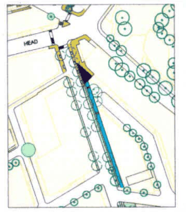

> [Picture on page 60: a picture, saved as a picture (images/double-bay-centre-public-improvements-plan-page-60-18.gif, 150 dpi).]

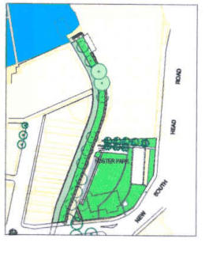

> [Picture on page 60: a picture, saved as a picture (images/double-bay-centre-public-improvements-plan-page-60-19.gif, 150 dpi).]
