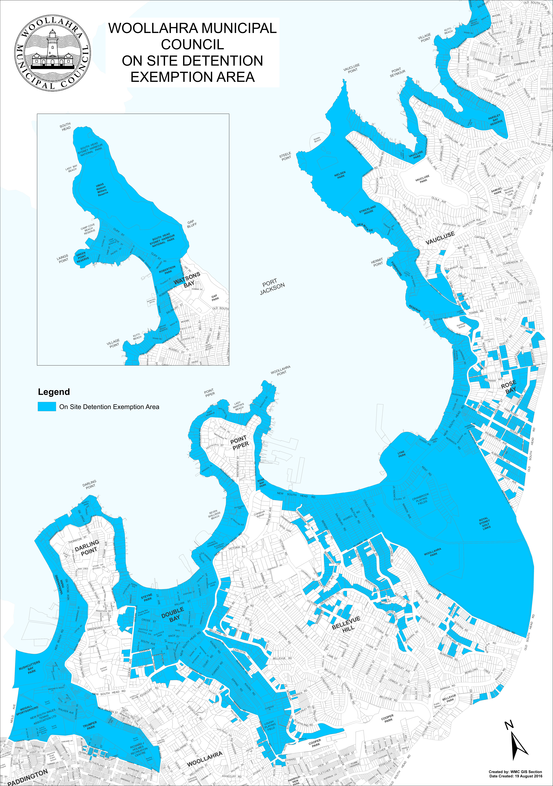

# Woollahra Development Control Plan 2015 - On site detention (OSD) of stormwater exemption area map

Source PDF: [on_site_detention_exemption_area_map.pdf](https://planfortomorrow.sharepoint.com/sites/Planfortomorrow/Shared%20Documents/00%20NSW-Planning-Resources/dcp/woollahra-development-control-plan-2015/supporting-guides/on-site-detention-osd-of-stormwater-exemption-area/on_site_detention_exemption_area_map.pdf)

#### PARK

MUNICIPAL

BATHS

> [Picture on page 1: a map, saved as a picture (images/on-site-detention-osd-of-stormwater-exemption-area-page-1-4.gif, 150 dpi); the street names and other small labels are on the picture.]
> Words printed on the picture (title and legend, copied from the PDF):
> BEACH  AVE BELL
> GEORGES RD R
> VILLAGE   HIGH   RD
> VILLAGE   LOWER   RD
> NEW   SOUTH   HEAD   RD
> OLD        SOUTH        HEAD        RD
> CA VAUCLUSE    RD
> CAPTAIN   PIPERS   RD
> BAYVIEW   HILL   RD
> BEACH  AVE BELL
> NEW    SOUTH    HEAD    RD
> WOLSELEY  RD O
> OLD        SOUTH        HEAD        RD
> NEW     SOUTH     HEAD     RD
> NEW    SOUTH   HEAD    RD
> NEW   BEACH   RD
> OLD    SOUTH     HEAD     RD
> PINE HILL AVE
> NEW SOUTH   HEAD   RD
> BELLEVUE  PARK  RD
> NEW SOUTH WALES
> FIG TREE LA
> OLD    SOUTH     HEAD     RD
> LA ADELAIDE   ST

HOPETOU

### WOOLLAHRA MUNICIPAL

#### VILLAGE

#### POINT

### COUNCIL

### ON SITE DETENTION

#### VAUCLUSE

#### POINT

### SMAN

#### POINT

#### SEYMOUR

### OUNCIL

### EXEMPTION AREA

#### LIG

#### PARSLEY

#### RESERVE

#### SOUTH

#### HEAD

SOUTH   HEAD   RD

#### VAUCLUSE

#### STEELE

#### PARK

#### POINT

#### NIELSEN

#### PARK

#### VAUCLUSE

#### PARK

#### HMAS

#### Watson

#### SAMUEL

#### Military

#### PARK

#### Reserve

#### STRICKLAND

#### HOUSE

#### GAP

#### BLUFF

#### SOUTH  HEAD

#### SYDNEY  HARBOUR

### VAUCLUSE

#### NATIONAL   PARK

#### GREEN

#### LAINGS

#### POINT

#### RESERVE

#### POINT

#### HERMIT

#### POINT

#### ROBERTSON

#### PARK

### WATSONS

### BAY

### PORT

### JACKSON

#### PARK

#### RESERVE

#### VILLAGE

#### POINT

#### POINT

#### VAUCLUSE

#### POINT

#### POINT

#### SEYMOUR

### ROSE

#### POINT

### BAY

#### PIPER

#### WOOLLAHRA

### Legend

### On Site Detention Exemption Area

### H POINT

### PIPER

#### LYNE

#### PARK

#### ROSE

#### DARLING

#### PARK

#### POINT

#### ROYAL

#### SYDNEY

#### GOLF

#### LINKS

### DARLING

#### WOOLLAHRA

#### PARK

### POINT

#### PARK

#### YARRANABBE

#### STEYNE

#### PARK

### DOUBLE

### BAY

### BELLEVUE

### HILL

#### RUSHCUTTERS

#### BAY

#### PARK

#### BELLEVUE

#### PARK

#### WEIGALL

#### SPORTSGROUND

#### COOPER

#### PARK

#### TRUMPER

#### PARK

GOSBELL

#### COOPER

BELL  ST

#### PARK

LA

### ±

### WOOLLAHRA

ST

### Created by: WMC GIS Section

COOPER    ST

### Date Created: 19 August 2016

#### HARBOUR-

#### VIEW

COOPER LA

#### PARK

ST

RESERVE

### PADDINGTON

LA

Y RD

XFORD

WHITE

LA

UFFOLK

FORTH

ADELAID

ABETH

ST UN

JUNCTION

A

HARBOUR VIEW L

GROS

HOLDSW

HARKNE

LA OUN

HARKNESS

DYSON

RD

MORE

LA

MAG

RING     LA

N

ST

CHESTER

ST

EY

WIND

E

G

L

WINDSOR    ST

NELS

HARGRAVE    ST
