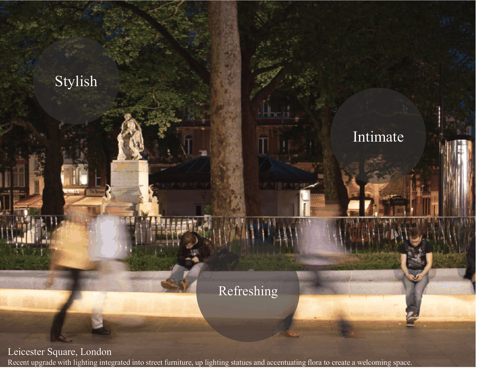

## 2	 Executive Summary

Stylish, Intimate, Refreshing This Strategy and Plan makes

recommendations for how future lighting

projects are to be developed and delivered

to create a cohesive night-time experience

within the Double Bay precinct. It

provides guidelines for new lighting

infrastructure projects and strategies that

will enhance visitor experiences and

support creativity in the community.

> [Picture on page 5: a picture, saved as a picture (images/public-domain-lighting-strategy-page-5-12.gif, 150 dpi).]

### Stylish

### Intimate

To achieve this, both functional and

creative lighting overlays have been

developed; these are to be the basis of

future lighting projects. In compiling

this document a number of sites within

the precinct have been identified as pilot

projects, and some priorities have also

been targeted for consideration of more

immediate lighting interventions. Double Bay is a stylish bay side village

that at night-time is defined by its dining

and social economy, along with a blend

of natural landscaping and architectural

features. A post-top lantern redesign is

recommended in this report. It is expected

that this new signature will play a

significant role enhancing the prestige and

unique character of Double Bay. The public domain lighting strategy has

been developed to create a distinctive

and elegant night-time experience and

to complement the natural beauty of the

area. This strategy has been developed

over nine months and included key

stakeholder workshops and meetings.

### Refreshing

This process has been informed by and

developed to support the Double Bay

Place Plan 2014 and is consistent with

the principles of place-making in order to

maximise Double Bay’s distinctive brand.

### Leicester Square, London

Recent upgrade with lighting integrated into street furniture, up lighting statues and accentuating flora to create a welcoming space.
