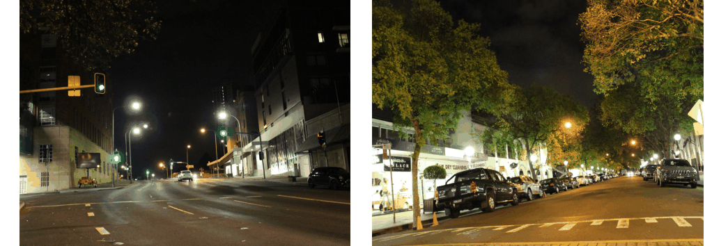
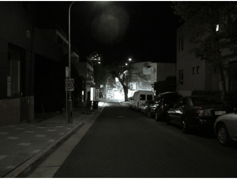
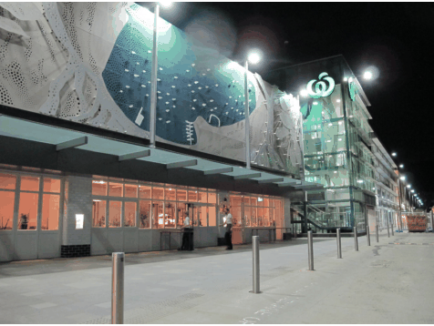
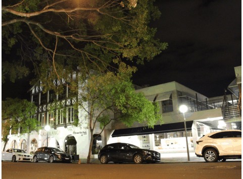
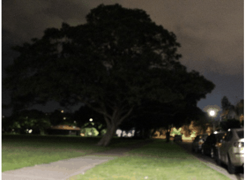
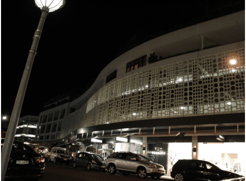
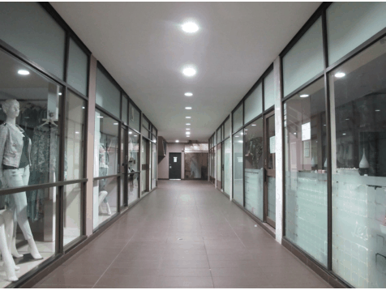
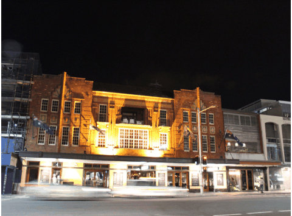

## 3	 Key Understandings

### This section identifies and outlines

background knowledge and the

### existing conditions of Double Bay.

### These have been used to inform

### the key objectives for the Double

### Bay business area.

The design process for this strategy began

with a NightSeeing™ program held as

part of the Future Cities program. The

workshop, and a series of site visits,

identified the key understandings of the

current night-time conditions, the desires

of a range of stakeholders, and a number

of objectives for future illumination

projects.

Key Understandings

• Transport links are dark, unsafe

and unintuitive

• Identify the town centre as Knox St,

the car park or Guilfoyle Ave

• Post-top lanterns are bright and glary

• Cars don’t change speed as they drive

through Double Bay

• Lack of lighting hierarchy to guide

sight-lines through the streets

> [Picture on page 6: a picture, saved as a picture (images/public-domain-lighting-strategy-page-6-27.gif, 150 dpi).]

New South Head Road

> [Picture on page 6: a picture, saved as a picture (images/public-domain-lighting-strategy-page-6-29.gif, 150 dpi).]

Cross Street

> [Picture on page 6: a picture, saved as a picture (images/public-domain-lighting-strategy-page-6-31.gif, 150 dpi).]

Kiora Lane

> [Picture on page 6: a picture, saved as a picture (images/public-domain-lighting-strategy-page-6-33.gif, 150 dpi).]

Kiora Lane

> [Picture on page 6: a picture, saved as a picture (images/public-domain-lighting-strategy-page-6-35.gif, 150 dpi).]

Ground level lighting only

Pathway to Ferry

> [Picture on page 6: a picture, saved as a picture (images/public-domain-lighting-strategy-page-6-38.gif, 150 dpi).]

Know Street

> [Picture on page 6: a picture, saved as a picture (images/public-domain-lighting-strategy-page-6-40.gif, 150 dpi).]

Arcade

> [Picture on page 6: a picture, saved as a picture (images/public-domain-lighting-strategy-page-6-42.gif, 150 dpi).]

Heritage lighting
