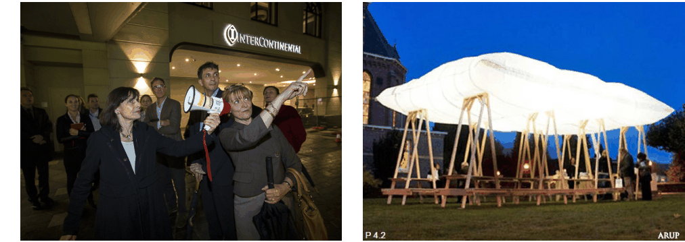
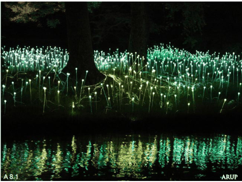
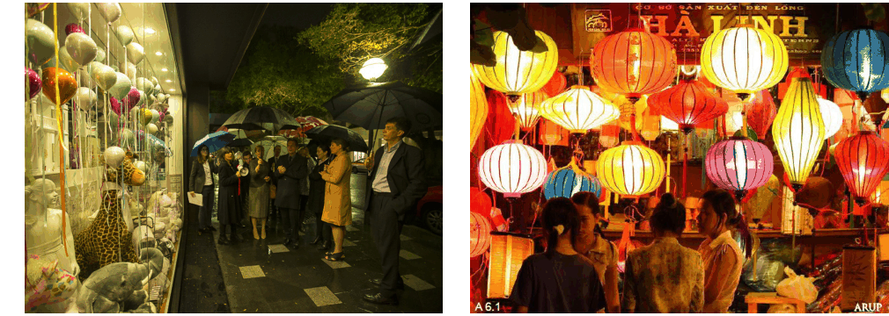
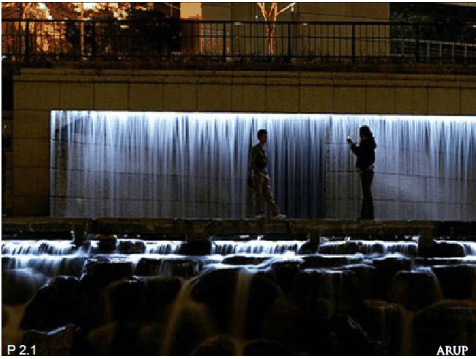
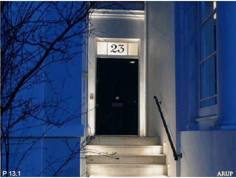
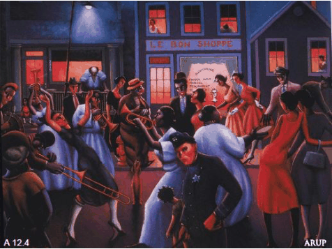
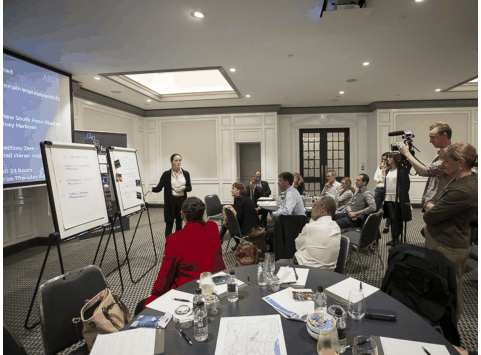

## 4	 Key Objectives

### This section outlines the desires

### and goals for the Double Bay

### business area and all future

### lighting projects.

The images to the right include those

that were chosen by participants in the

NightSeeing™ workshop. These represent

the collective aspirations for Double Bay

at night. Following this Arup worked with

stakeholders, and consultants within the

client team, to identify and agree these

key objectives.

Key Objectives

• Develop distinctive gateways from

land and water

• Build on the bay’s natural beauty

• Connect Guilfoyle Ave to the centre

• Activate streets with footpath dining

and attractive, vibrant displays

• Creating a distinctive and elegant

after dark ambience in the public

domain of Double Bay

> [Picture on page 7: a picture, saved as a picture (images/public-domain-lighting-strategy-page-7-25.gif, 150 dpi).]

> [Picture on page 7: a picture, saved as a picture (images/public-domain-lighting-strategy-page-7-26.gif, 150 dpi).]

> [Picture on page 7: a picture, saved as a picture (images/public-domain-lighting-strategy-page-7-27.gif, 150 dpi).]

> [Picture on page 7: a picture, saved as a picture (images/public-domain-lighting-strategy-page-7-28.gif, 150 dpi).]

> [Picture on page 7: a picture, saved as a picture (images/public-domain-lighting-strategy-page-7-29.gif, 150 dpi).]

> [Picture on page 7: a picture, saved as a picture (images/public-domain-lighting-strategy-page-7-30.gif, 150 dpi).]

> [Picture on page 7: a picture, saved as a picture (images/public-domain-lighting-strategy-page-7-31.gif, 150 dpi).]
