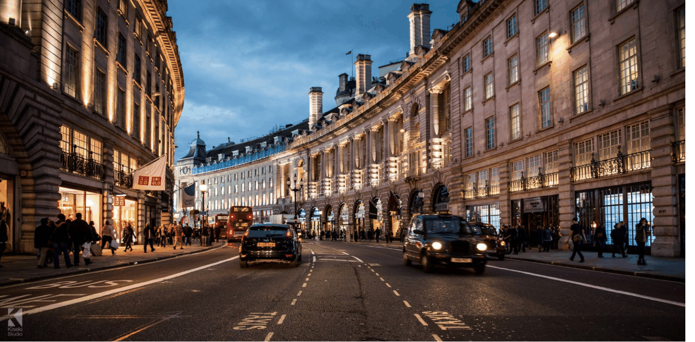
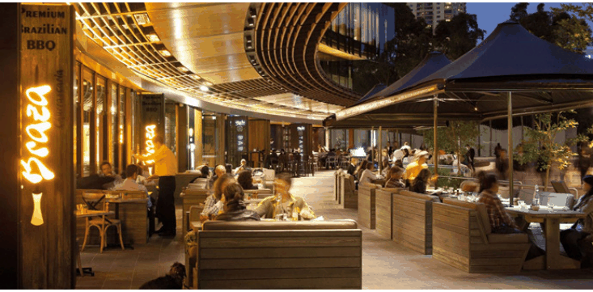
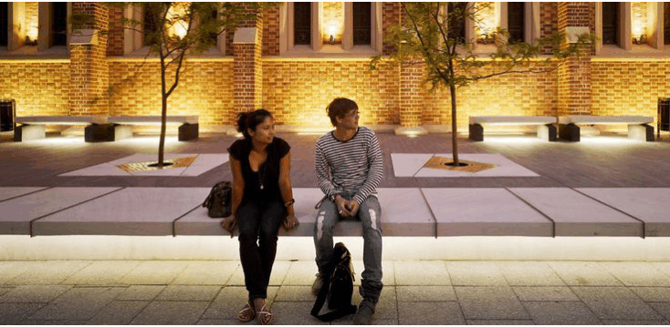
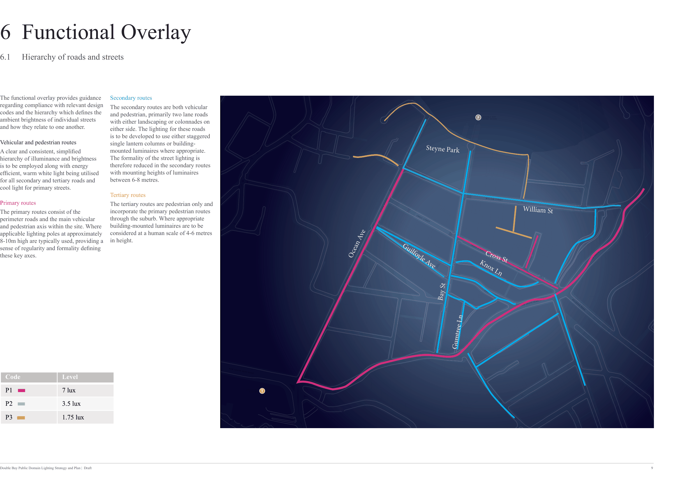

## 5	 Lighting Vision

### ‘Stylish is the very centre, defined

by the lanterns. Refreshing is a

### layer of soft light - something like

a breeze. Intimate is strolling with

### a friend from the walkways into

### the centre’  Leni Schwendinger Arup, Leader Nighttime Design

To meet the key understandings and

objectives the design principles below

have been developed.

Design Principles

• Accentuate gateways from land into

the centre and from water into the

suburb

• Design iconic and distinct lanterns

• Vertical lighting to heritage and

notable buildings

• Uplighting to trees and central

islands to accentuate central nodes

and gathering spaces through light,

after dark

• Create nodes along axis street by

accenting trees and furniture

• Integrate smart lighting and controls

for precinct scene setting

> [Picture on page 8: a picture, saved as a picture (images/public-domain-lighting-strategy-page-8-26.gif, 150 dpi).]

Vertical illuminatine to facades above ground retail

> [Picture on page 8: a picture, saved as a picture (images/public-domain-lighting-strategy-page-8-28.gif, 150 dpi).]

Variable lighting temperatures for dinning and pedestrian traffic

> [Picture on page 8: a picture, saved as a picture (images/public-domain-lighting-strategy-page-8-30.gif, 150 dpi).]

Lighting incorporated into furniture

> [Picture on page 9: a map, saved as a picture (images/public-domain-lighting-strategy-page-9-1.gif, 150 dpi); the street names and other small labels are on the picture.]
> Words printed on the picture (title and legend, copied from the PDF):
> mounted luminaires where appropriate.
> between 6-8 metres.
> these key axes.
> S TAT ION
> OCEAN AV ENUE
> OCEAN AV ENUE
> OCEAN AV ENUE
> B AY STREET
> B AY STREET
> B AY STREET
> OCEAN AV ENUE
