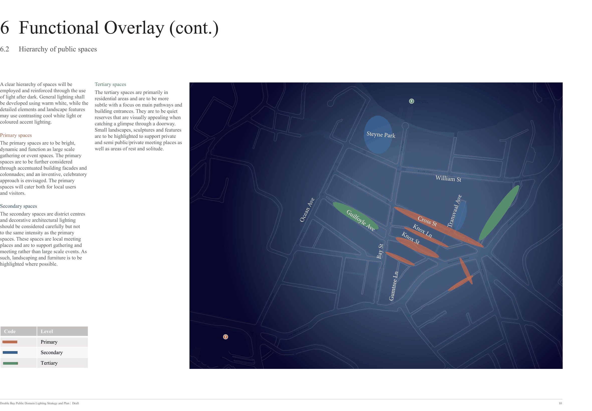

## 6	 Functional Overlay

### 6.1 Hierarchy of roads and streets

The functional overlay provides guidance

regarding compliance with relevant design

codes and the hierarchy which defines the

ambient brightness of individual streets

and how they relate to one another.

Secondary routes

The secondary routes are both vehicular

and pedestrian, primarily two lane roads

with either landscaping or colonnades on

either side. The lighting for these roads

is to be developed to use either staggered

single lantern columns or building-

The formality of the street lighting is

therefore reduced in the secondary routes

with mounting heights of luminaires

Vehicular and pedestrian routes

A clear and consistent, simplified

hierarchy of illuminance and brightness

is to be employed along with energy

efficient, warm white light being utilised

for all secondary and tertiary roads and

cool light for primary streets.

Tertiary routes

The tertiary routes are pedestrian only and

incorporate the primary pedestrian routes

through the suburb. Where appropriate

building-mounted luminaires are to be

considered at a human scale of 4-6 metres

Primary routes

The primary routes consist of the

perimeter roads and the main vehicular

and pedestrian axis within the site. Where

applicable lighting poles at approximately

8-10m high are typically used, providing a

sense of regularity and formality defining

#### Code

#### Level

#### Ocean Ave

#### Steyne Park

#### Cross St

#### Guilfoyle Ave

#### Knox Ln

#### Bay St

#### Gumtree Ln

#### William St

> [Picture on page 10: a map, saved as a picture (images/public-domain-lighting-strategy-page-10-1.gif, 150 dpi); the street names and other small labels are on the picture.]
> Words printed on the picture (title and legend, copied from the PDF):
> coloured accent lighting.
> and decorative architectural lighting
> highlighted where possible.
> S TAT ION
> OCEAN AV ENUE
> OCEAN AV ENUE
> OCEAN AV ENUE
> B AY STREET
> B AY STREET
> B AY STREET
> OCEAN AV ENUE
