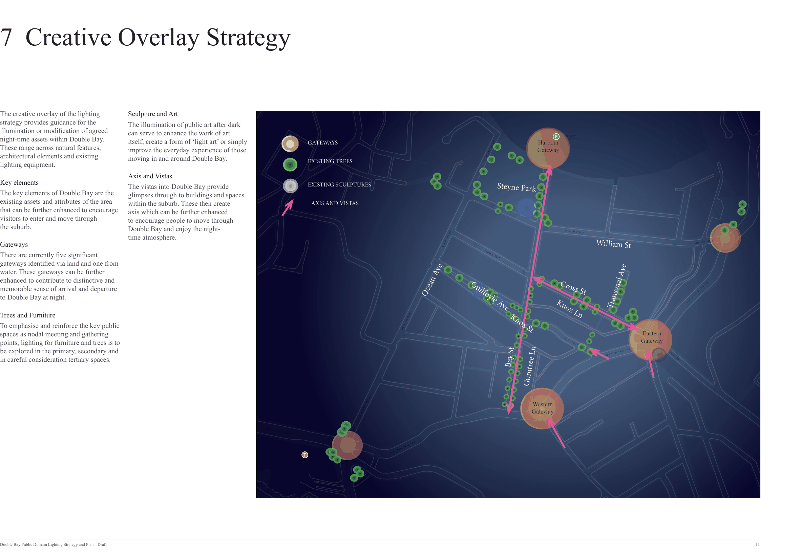

## 6	 Functional Overlay (cont.)

### 6.2 Hierarchy of public spaces

A clear hierarchy of spaces will be

employed and reinforced through the use

of light after dark. General lighting shall

be developed using warm white, while the

detailed elements and landscape features

may use contrasting cool white light or

Tertiary spaces

The tertiary spaces are primarily in

residential areas and are to be more

subtle with a focus on main pathways and

building entrances. They are to be quiet

reserves that are visually appealing when

catching a glimpse through a doorway.

Small landscapes, sculptures and features

are to be highlighted to support private

and semi public/private meeting places as

well as areas of rest and solitude.

Primary spaces

The primary spaces are to be bright,

dynamic and function as large scale

gathering or event spaces. The primary

spaces are to be further considered

through accentuated building facades and

colonnades; and an inventive, celebratory

approach is envisaged. The primary

spaces will cater both for local users

Secondary spaces

The secondary spaces are district centres

should be considered carefully but not

to the same intensity as the primary

spaces. These spaces are local meeting

places and are to support gathering and

meeting rather than large scale events. As

such, landscaping and furniture is to be

#### Code

#### Level

#### Ocean Ave

#### Steyne Park

#### William St

#### Cross St Transvaal Ave

#### Guilfoyle Ave

#### Knox Ln

#### Knox St

#### Bay St

#### Gumtree Ln

> [Picture on page 11: a map, saved as a picture (images/public-domain-lighting-strategy-page-11-1.gif, 150 dpi); the street names and other small labels are on the picture.]
> Words printed on the picture (title and legend, copied from the PDF):
> architectural elements and existing
> S TAT ION
> AXIS AND VISTAS
> OCEAN AV ENUE
> OCEAN AV ENUE
> OCEAN AV ENUE
> B AY STREET
> B AY STREET
> B AY STREET
> OCEAN AV ENUE
