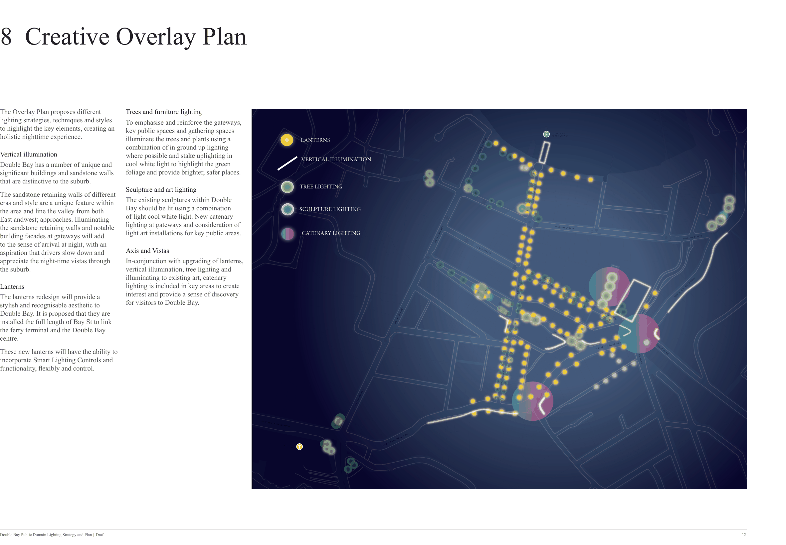

## 7	 Creative Overlay Strategy

The creative overlay of the lighting

strategy provides guidance for the

illumination or modification of agreed

night-time assets within Double Bay.

These range across natural features,

Key elements

The key elements of Double Bay are the

existing assets and attributes of the area

that can be further enhanced to encourage

visitors to enter and move through

Gateways

There are currently five significant

gateways identified via land and one from

water. These gateways can be further

enhanced to contribute to distinctive and

memorable sense of arrival and departure

to Double Bay at night.

Trees and Furniture

To emphasise and reinforce the key public

spaces as nodal meeting and gathering

points, lighting for furniture and trees is to

be explored in the primary, secondary and

in careful consideration tertiary spaces.

Sculpture and Art

The illumination of public art after dark

can serve to enhance the work of art

itself, create a form of ‘light art’ or simply

improve the everyday experience of those

moving in and around Double Bay.

Axis and Vistas

The vistas into Double Bay provide

glimpses through to buildings and spaces

within the suburb. These then create

axis which can be further enhanced

to encourage people to move through

Double Bay and enjoy the night-

#### Ocean Ave

#### Steyne Park

#### Cross St

#### Guilfoyle Ave

#### Knox Ln

#### Knox St Bay St

#### Gumtree Ln

#### William St Transvaal Ave

> [Picture on page 12: a map, saved as a picture (images/public-domain-lighting-strategy-page-12-1.gif, 150 dpi); the street names and other small labels are on the picture.]
> Words printed on the picture (title and legend, copied from the PDF):
> holistic nighttime experience.
> East andwest; approaches. Illuminating
> functionality, flexibly and control.
> S TAT ION
> OCEAN AV ENUE
> OCEAN AV ENUE
> OCEAN AV ENUE
> B AY STREET
> OCEAN AV ENUE
> B AY STREET
> B AY STREET
