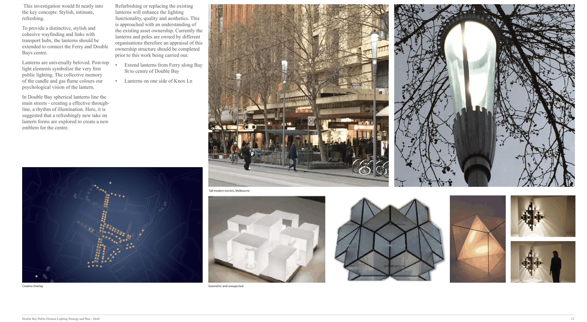
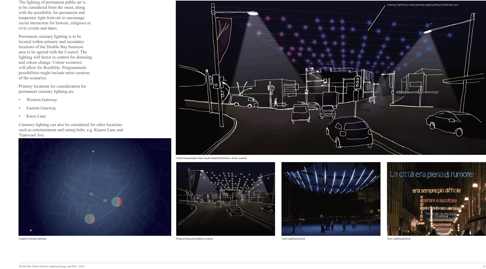
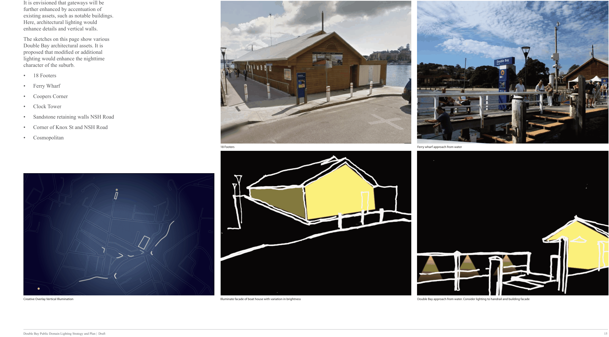
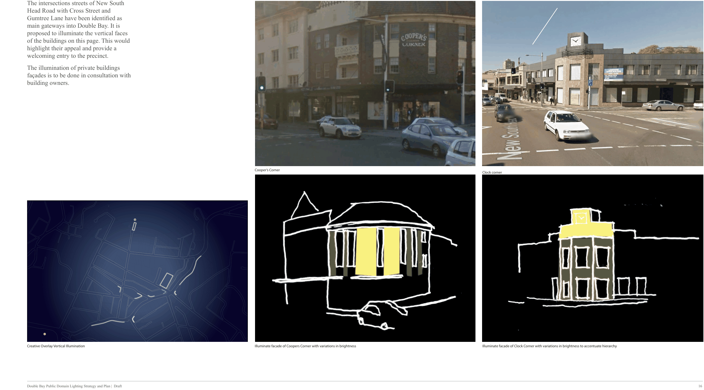
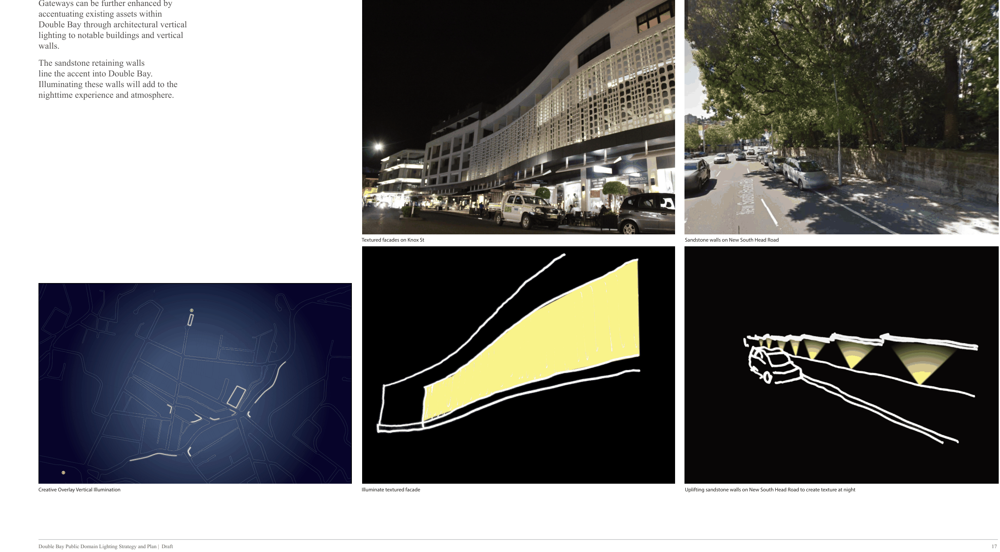
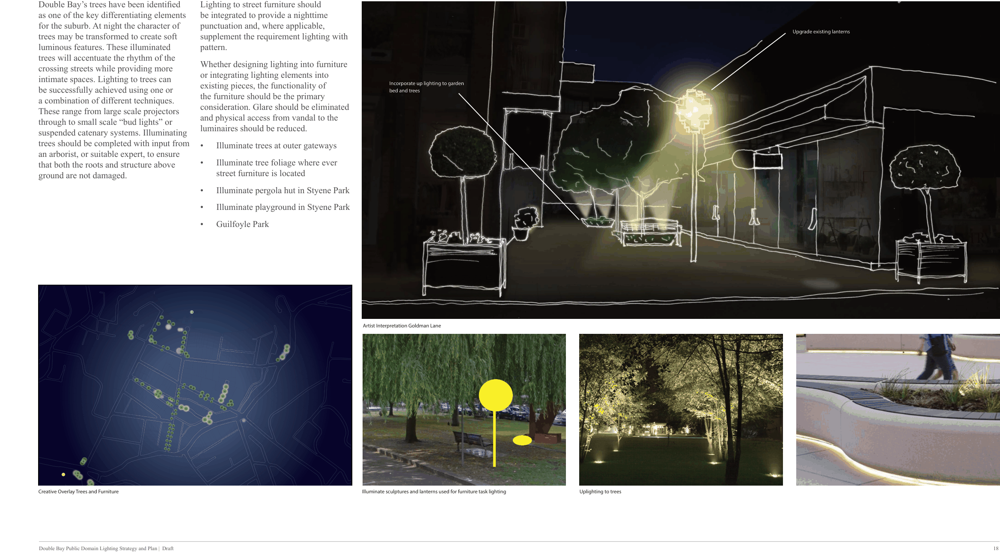
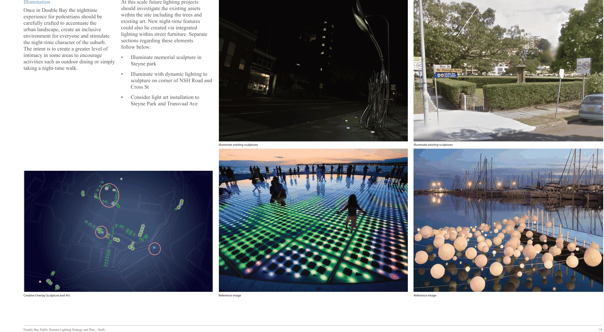
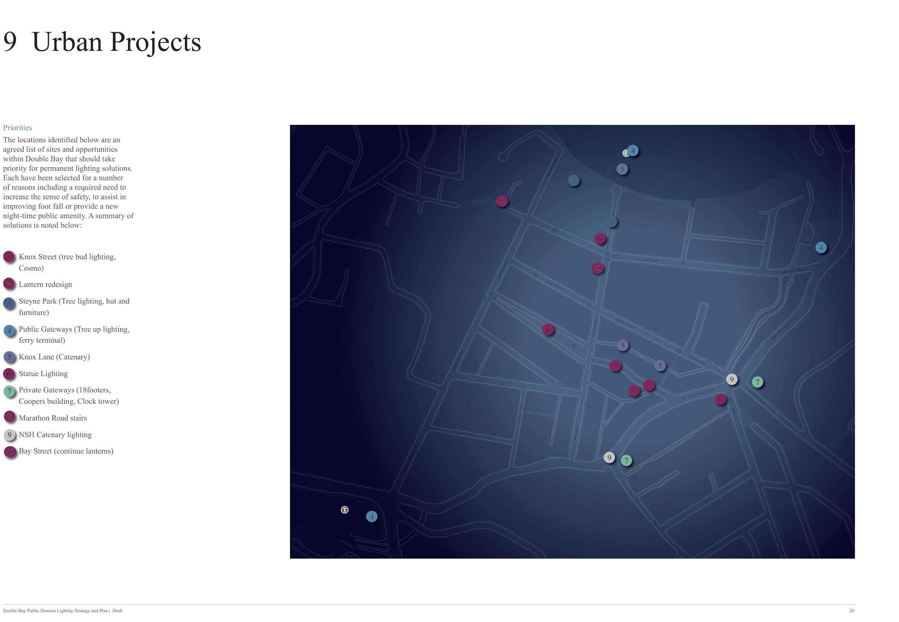

## 8	 Creative Overlay Plan

The Overlay Plan proposes different

lighting strategies, techniques and styles

to highlight the key elements, creating an

Vertical illumination

Double Bay has a number of unique and

significant buildings and sandstone walls

that are distinctive to the suburb. The sandstone retaining walls of different

eras and style are a unique feature within

the area and line the valley from both

the sandstone retaining walls and notable

building facades at gateways will add

to the sense of arrival at night, with an

aspiration that drivers slow down and

appreciate the night-time vistas through

Lanterns

The lanterns redesign will provide a

stylish and recognisable aesthetic to

Double Bay. It is proposed that they are

installed the full length of Bay St to link

the ferry terminal and the Double Bay

centre.

These new lanterns will have the ability to

incorporate Smart Lighting Controls and

Trees and furniture lighting To emphasise and reinforce the gateways,

key public spaces and gathering spaces

illuminate the trees and plants using a

combination of in ground up lighting

where possible and stake uplighting in

cool white light to highlight the green

foliage and provide brighter, safer places.

Sculpture and art lighting The existing sculptures within Double

Bay should be lit using a combination

of light cool white light. New catenary

lighting at gateways and consideration of

light art installations for key public areas.

Axis and Vistas

In-conjunction with upgrading of lanterns,

vertical illumination, tree lighting and

illuminating to existing art, catenary

lighting is included in key areas to create

interest and provide a sense of discovery

for visitors to Double Bay.

### 8.1	 Lanterns

> [Picture on page 13: a map, saved as a picture (images/public-domain-lighting-strategy-page-13-2.gif, 150 dpi); the street names and other small labels are on the picture.]
> Words printed on the picture (title and legend, copied from the PDF):
> emblem for the centre.
> Tall modern torches, Melbourne
> B AY STREET
> B AY STREET
> B AY STREET
> OCEAN AV ENUE
> OCEAN AV ENUE
> OCEAN AV ENUE
> OCEAN AV ENUE
> S TAT ION
> Geometric and unexpected

This investigation would fit neatly into

the key concepts: Stylish, intimate,

refreshing. To provide a distinctive, stylish and

cohesive wayfinding and links with

transport hubs, the lanterns should be

extended to connect the Ferry and Double

Bays centre.

Refurbishing or replacing the existing

lanterns will enhance the lighting

functionality, quality and aesthetics. This

is approached with an understanding of

the existing asset ownership. Currently the

lanterns and poles are owned by different

organisations therefore an appraisal of this

ownership structure should be completed

prior to this work being carried our.

• Extend lanterns from Ferry along Bay

St to centre of Double Bay

• Lanterns on one side of Knox Ln

Lanterns are universally beloved. Post-top

light elements symbolize the very first

public lighting. The collective memory

of the candle and gas flame colours our

psychological vision of the lantern. In Double Bay spherical lanterns line the

main streets - creating a effective through-

line, a rhythm of illumination. Here, it is

suggested that a refreshingly new take on

lantern forms are explored to create a new

### 8.2	 Catenary Lighting

> [Picture on page 14: a map, saved as a picture (images/public-domain-lighting-strategy-page-14-2.gif, 150 dpi); the street names and other small labels are on the picture.]
> Words printed on the picture (title and legend, copied from the PDF):
> B AY STREET
> B AY STREET
> B AY STREET
> OCEAN AV ENUE
> OCEAN AV ENUE
> OCEAN AV ENUE
> OCEAN AV ENUE
> S TAT ION
> Creative Overlay Gateway
> Artist Interpretation New South Head Rd festival or artist curation
> Programming and ability to colour
> Turin Lighting festival
> Catenary lighting to main gateways approaching Double Bay cent
> Turin Lighting festival

The lighting of permanent public art is

to be considered from the onset, along

with the possibility for permanent and

temporary light festivals to encourage

social interaction for historic, religious or

civic events and dates.

Permanent catenary lighting is to be

located within primary and secondary

locations of the Double Bay business

area to be agreed with the Council. The

lighting will factor in control for dimming

and colour change. Colour scenarios

will allow for flexibility. Programmatic

possibilities might include artist curation

of the scenarios.

Primary locations for consideration for

permanent catenary lighting are

• Western Gateway

• Eastern Gateway

• Knox Lane

Catenary lighting can also be considered for other locations

such as entertainment and eating hubs, e.g. Kiaora Lane and

### 8.3	 Vertical Illumination

It is envisioned that gateways will be

further enhanced by accentuation of

existing assets, such as notable buildings.

Here, architectural lighting would

enhance details and vertical walls. The sketches on this page show various

Double Bay architectural assets. It is

proposed that modified or additional

lighting would enhance the nighttime

character of the suburb.

• 18 Footers

• Ferry Wharf

• Coopers Corner

• Clock Tower

• Sandstone retaining walls NSH Road

• Corner of Knox St and NSH Road

• Cosmopolitan

> [Picture on page 15: a picture, saved as a picture (images/public-domain-lighting-strategy-page-15-19.gif, 150 dpi).]

> Words printed on the picture (title and legend, copied from the PDF):
> B AY STREET
> B AY STREET
> B AY STREET
> OCEAN AV ENUE
> OCEAN AV ENUE
> OCEAN AV ENUE
> OCEAN AV ENUE
> S TAT ION
> Creative Overlay Vertical Illumination
> Illuminate facade of boat house with variation in brightness
> Double Bay approach from water. Consider lighting to handrail and building facade

18 Footers

Ferry wharf approach from water

### 8.3	 Vertical Illumination (cont.)

> [Picture on page 16: a picture, saved as a picture (images/public-domain-lighting-strategy-page-16-2.gif, 150 dpi).]

The intersections streets of New South

Head Road with Cross Street and

Gumtree Lane have been identified as

main gateways into Double Bay. It is

proposed to illuminate the vertical faces

of the buildings on this page. This would

highlight their appeal and provide a

welcoming entry to the precinct. The illumination of private buildings

façades is to be done in consultation with

building owners.

> Words printed on the picture (title and legend, copied from the PDF):
> B AY STREET
> B AY STREET
> B AY STREET
> OCEAN AV ENUE
> OCEAN AV ENUE
> OCEAN AV ENUE
> OCEAN AV ENUE
> S TAT ION
> Creative Overlay Vertical Illumination
> Illuminate facade of Coopers Corner with variations in brightness
> Illuminate facade of Clock Corner with variations in brightness to accentuate hierarchy

Cooper’s Corner

Clock corner

### 8.3	 Vertical Illumination (cont.)

> [Picture on page 17: a picture, saved as a picture (images/public-domain-lighting-strategy-page-17-2.gif, 150 dpi).]

Gateways can be further enhanced by

accentuating existing assets within

Double Bay through architectural vertical

lighting to notable buildings and vertical

walls.

The sandstone retaining walls

line the accent into Double Bay.

Illuminating these walls will add to the

nighttime experience and atmosphere.

> Words printed on the picture (title and legend, copied from the PDF):
> S TAT ION
> OCEAN AV ENUE
> OCEAN AV ENUE
> OCEAN AV ENUE
> Creative Overlay Vertical Illumination
> B AY STREET
> B AY STREET
> B AY STREET
> OCEAN AV ENUE
> Illuminate textured facade
> Uplifting sandstone walls on New South Head Road to create texture at night

Textured facades on Knox St

Sandstone walls on New South Head Road

### 8.4	 Furniture and Trees

> [Picture on page 18: a map, saved as a picture (images/public-domain-lighting-strategy-page-18-2.gif, 150 dpi); the street names and other small labels are on the picture.]
> Words printed on the picture (title and legend, copied from the PDF):
> Upgrade existing lanterns
> punctuation and, where applicable,
> Incorporate up lighting to garden
> bed and trees
> street furniture is located
> luminous features. These illuminated
> suspended catenary systems. Illuminating
> ground are not damaged.
> Artist Interpretation Goldman Lane
> B AY STREET
> B AY STREET
> B AY STREET
> OCEAN AV ENUE
> OCEAN AV ENUE
> OCEAN AV ENUE
> OCEAN AV ENUE
> S TAT ION
> Creative Overlay Trees and Furniture
> Illuminate sculptures and lanterns used for furniture task lighting
> Uplighting to trees

Lighting to street furniture should

be integrated to provide a nighttime

supplement the requirement lighting with

pattern. Whether designing lighting into furniture

or integrating lighting elements into

existing pieces, the functionality of

the furniture should be the primary

consideration. Glare should be eliminated

and physical access from vandal to the

luminaires should be reduced.

• Illuminate trees at outer gateways

• Illuminate tree foliage where ever

Double Bay’s trees have been identified

as one of the key differentiating elements

for the suburb. At night the character of

trees may be transformed to create soft

trees will accentuate the rhythm of the

crossing streets while providing more

intimate spaces. Lighting to trees can

be successfully achieved using one or

a combination of different techniques.

These range from large scale projectors

through to small scale “bud lights” or

trees should be completed with input from

an arborist, or suitable expert, to ensure

that both the roots and structure above

• Illuminate pergola hut in Styene Park

• Illuminate playground in Styene Park

• Guilfoyle Park

### 8.5	 Public Art

> [Picture on page 19: a map, saved as a picture (images/public-domain-lighting-strategy-page-19-2.gif, 150 dpi); the street names and other small labels are on the picture.]
> Words printed on the picture (title and legend, copied from the PDF):
> sections regarding these elements
> taking a night-time walk.
> Illuminate existing sculptures
> Illuminate existing sculptures
> B AY STREET
> B AY STREET
> B AY STREET
> OCEAN AV ENUE
> OCEAN AV ENUE
> OCEAN AV ENUE
> OCEAN AV ENUE
> S TAT ION
> Creative Overlay Sculpture and Art

At this scale future lighting projects

should investigate the existing assets

within the site including the trees and

existing art. New night-time features

could also be created via integrated

lighting within street furniture. Separate

follow below:

• Illuminate memorial sculpture in

Illumination Once in Double Bay the nighttime

experience for pedestrians should be

carefully crafted to accentuate the

urban landscape, create an inclusive

environment for everyone and stimulate

the night-time character of the suburb.

The intent is to create a greater level of

intimacy in some areas to encourage

activities such as outdoor dining or simply

• Illuminate with dynamic lighting to

sculpture on corner of NSH Road and

• Consider light art installation to

Steyne Park and Transvaal Ave

> [Picture on page 20: a map, saved as a picture (images/public-domain-lighting-strategy-page-20-1.gif, 150 dpi); the street names and other small labels are on the picture.]
> Words printed on the picture (title and legend, copied from the PDF):
> solutions is noted below:
> 2 Lantern redesign
> Knox Lane (Catenary)
> 7 Private Gateways (18footers,
> Coopers building, Clock tower)
> 8 Marathon Road stairs
> NSH Catenary lighting
> Bay Street (continue lanterns)
> S TAT ION
> OCEAN AV ENUE
> OCEAN AV ENUE
> OCEAN AV ENUE
> B AY STREET
> OCEAN AV ENUE
> B AY STREET
> B AY STREET
