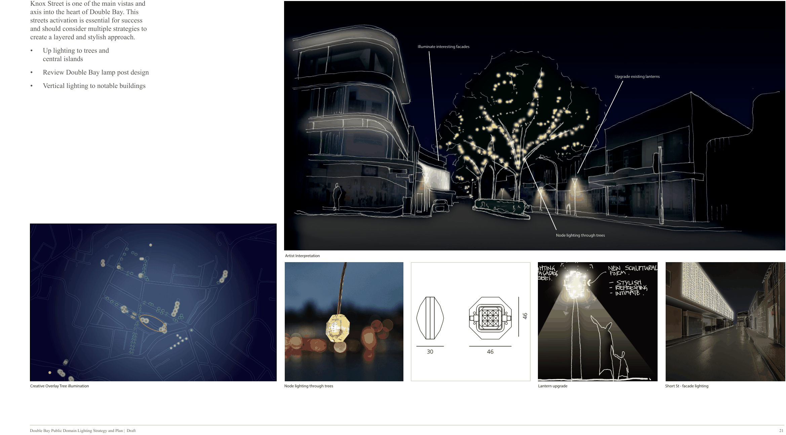
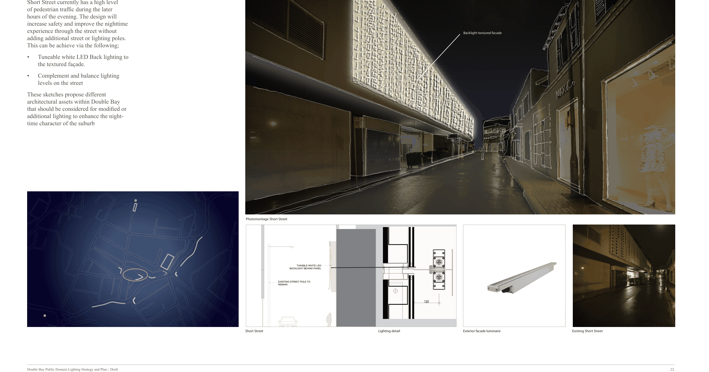
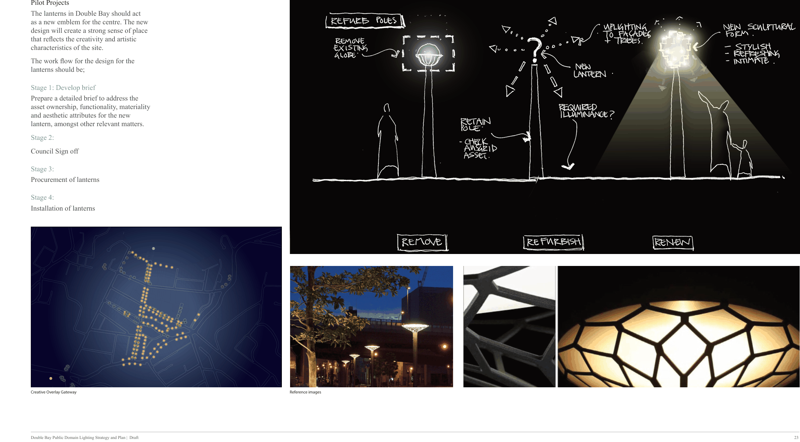
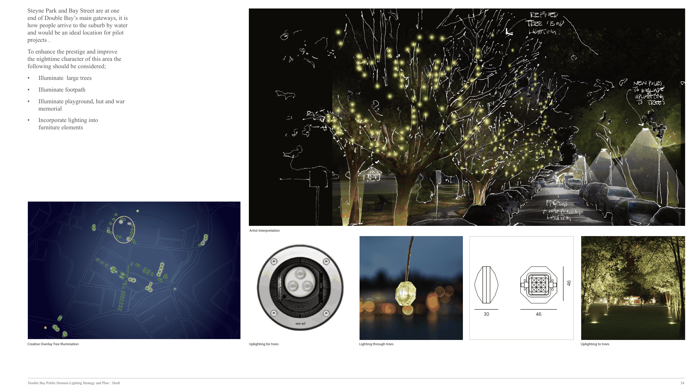
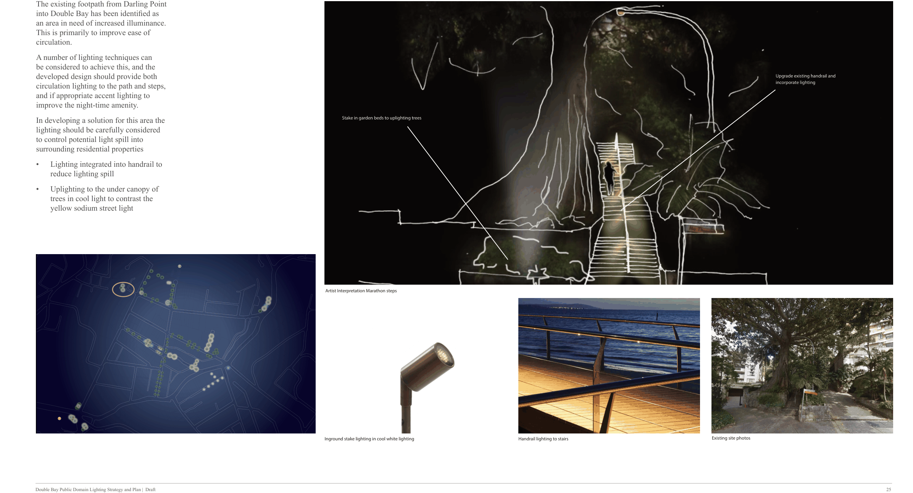
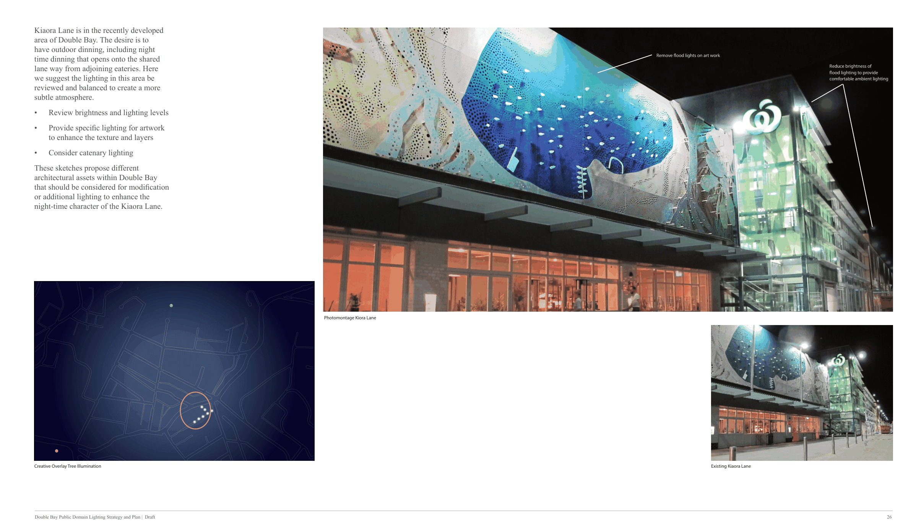
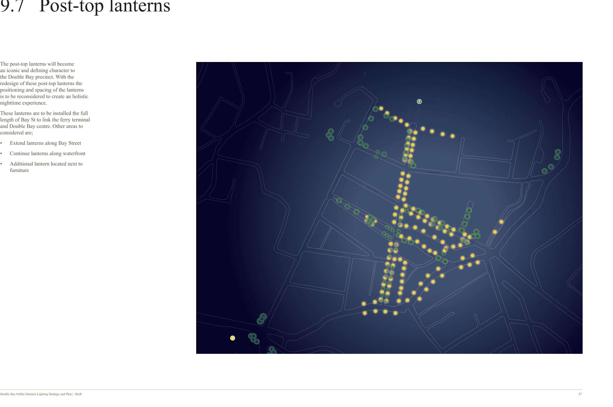
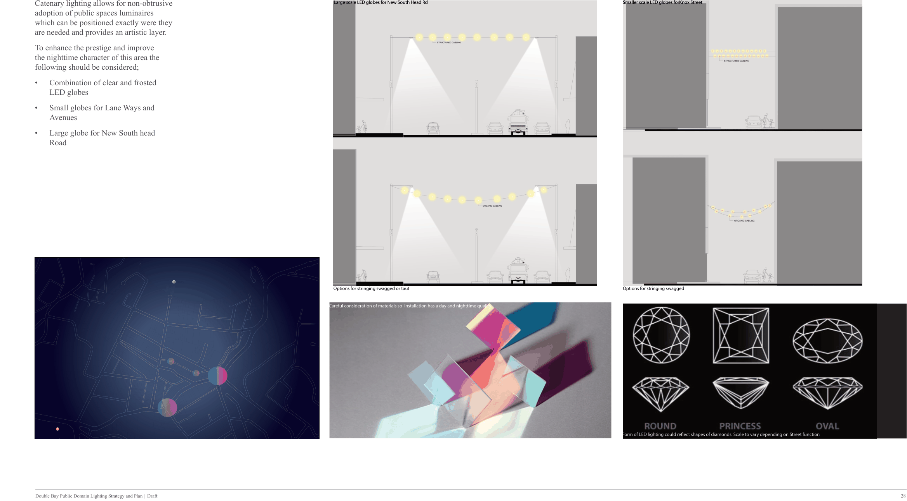

## 9	 Urban Projects

Priorities

The locations identified below are an

agreed list of sites and opportunities

within Double Bay that should take

priority for permanent lighting solutions.

Each have been selected for a number

of reasons including a required need to

increase the sense of safety, to assist in

improving foot fall or provide a new

night-time public amenity. A summary of

1 Knox Street (tree bud lighting,

Steyne Park (Tree lighting, hut and furniture)

4 Public Gateways (Tree up lighting,

N

### 9.1	 Knox Street

> [Picture on page 21: a map, saved as a picture (images/public-domain-lighting-strategy-page-21-2.gif, 150 dpi); the street names and other small labels are on the picture.]
> Words printed on the picture (title and legend, copied from the PDF):
> S TAT ION
> OCEAN AV ENUE
> OCEAN AV ENUE
> OCEAN AV ENUE
> Creative Overlay Tree illumination
> B AY STREET
> B AY STREET
> B AY STREET
> OCEAN AV ENUE
> Node lighting through trees
> Illuminate interesting facades
> Node lighting through trees
> Upgrade existing lanterns
> Short St - facade lighting

Knox Street is one of the main vistas and

axis into the heart of Double Bay. This

streets activation is essential for success

and should consider multiple strategies to

create a layered and stylish approach. Up lighting to trees and

•

central islands

Review Double Bay lamp post design Vertical lighting to notable buildings

### 9.2	 Short Street

> [Picture on page 22: a map, saved as a picture (images/public-domain-lighting-strategy-page-22-2.gif, 150 dpi); the street names and other small labels are on the picture.]
> Words printed on the picture (title and legend, copied from the PDF):
> the textured façade.
> levels on the street
> These sketches propose different
> B AY STREET
> B AY STREET
> B AY STREET
> OCEAN AV ENUE
> OCEAN AV ENUE
> OCEAN AV ENUE
> OCEAN AV ENUE
> S TAT ION
> Photomontage Short Street
> Backlight textured facade
> Exterior facade luminaire
> Existing Short Street

Short Street currently has a high level

of pedestrian traffic during the later

hours of the evening. The design will

increase safety and improve the nighttime

experience through the street without

adding additional street or lighting poles.

This can be achieve via the following;

• Tuneable white LED Back lighting to

• Complement and balance lighting

architectural assets within Double Bay

that should be considered for modified or

additional lighting to enhance the night-

time character of the suburb

### 9.3	 Lantern Design

> [Picture on page 23: a map, saved as a picture (images/public-domain-lighting-strategy-page-23-2.gif, 150 dpi); the street names and other small labels are on the picture.]
> Words printed on the picture (title and legend, copied from the PDF):
> lanterns should be;
> asset ownership, functionality, materiality
> Procurement of lanterns
> Installation of lanterns
> B AY STREET
> B AY STREET
> B AY STREET
> OCEAN AV ENUE
> OCEAN AV ENUE
> OCEAN AV ENUE
> OCEAN AV ENUE
> S TAT ION
> Creative Overlay Gateway

Pilot Projects The lanterns in Double Bay should act

as a new emblem for the centre. The new

design will create a strong sense of place

that reflects the creativity and artistic

characteristics of the site. The work flow for the design for the

Stage 1: Develop brief Prepare a detailed brief to address the

and aesthetic attributes for the new

lantern, amongst other relevant matters. Stage 2: Council Sign off

### 9.4	 Steyne Park

> [Picture on page 24: a map, saved as a picture (images/public-domain-lighting-strategy-page-24-2.gif, 150 dpi); the street names and other small labels are on the picture.]
> Words printed on the picture (title and legend, copied from the PDF):
> • Incorporate lighting into
> B AY STREET
> B AY STREET
> B AY STREET
> OCEAN AV ENUE
> OCEAN AV ENUE
> OCEAN AV ENUE
> OCEAN AV ENUE
> S TAT ION
> Creative Overlay Tree Illumination
> Uplighting for trees
> Uplighting to trees
> Lighting through trees

Steyne Park and Bay Street are at one

end of Double Bay’s main gateways, it is

how people arrive to the suburb by water

and would be an ideal location for pilot

projects . To enhance the prestige and improve

the nighttime character of this area the

following should be considered;

• Illuminate  large trees

• Illuminate footpath

• Illuminate playground, hut and war

### 9.5	 Marathon Rd steps

> [Picture on page 25: a map, saved as a picture (images/public-domain-lighting-strategy-page-25-2.gif, 150 dpi); the street names and other small labels are on the picture.]
> Words printed on the picture (title and legend, copied from the PDF):
> reduce lighting spill
> yellow sodium street light
> B AY STREET
> B AY STREET
> B AY STREET
> OCEAN AV ENUE
> OCEAN AV ENUE
> OCEAN AV ENUE
> OCEAN AV ENUE
> S TAT ION
> Stake in garden beds to uplighting trees
> Artist Interpretation Marathon steps
> Inground stake lighting in cool white lighting
> Handrail lighting to stairs
> Upgrade existing handrail and
> Existing site photos

The existing footpath from Darling Point

into Double Bay has been identified as

an area in need of increased illuminance.

This is primarily to improve ease of

circulation.

A number of lighting techniques can

be considered to achieve this, and the

developed design should provide both

circulation lighting to the path and steps,

and if appropriate accent lighting to

improve the night-time amenity.

In developing a solution for this area the

lighting should be carefully considered

to control potential light spill into

surrounding residential properties

• Lighting integrated into handrail to

• Uplighting to the under canopy of

trees in cool light to contrast the

### 9.6	 Kiaora Lane

> [Picture on page 26: a map, saved as a picture (images/public-domain-lighting-strategy-page-26-2.gif, 150 dpi); the street names and other small labels are on the picture.]
> Words printed on the picture (title and legend, copied from the PDF):
> • Consider catenary lighting
> These sketches propose different
> B AY STREET
> B AY STREET
> B AY STREET
> OCEAN AV ENUE
> OCEAN AV ENUE
> OCEAN AV ENUE
> OCEAN AV ENUE
> S TAT ION
> Creative Overlay Tree Illumination
> Remove flood lights on art work
> Reduce brightness of
> flood lighting to provide
> comfortable ambient lighting
> Photomontage Kiora Lane
> Existing Kiaora Lane

Kiaora Lane is in the recently developed

area of Double Bay. The desire is to

have outdoor dinning, including night

time dinning that opens onto the shared

lane way from adjoining eateries. Here

we suggest the lighting in this area be

reviewed and balanced to create a more

subtle atmosphere.

• Review brightness and lighting levels

• Provide specific lighting for artwork

to enhance the texture and layers

architectural assets within Double Bay

that should be considered for modification

or additional lighting to enhance the

night-time character of the Kiaora Lane.

### 9.7	 Post-top lanterns

> [Picture on page 27: a map, saved as a picture (images/public-domain-lighting-strategy-page-27-2.gif, 150 dpi); the street names and other small labels are on the picture.]
> Words printed on the picture (title and legend, copied from the PDF):
> S TAT ION
> OCEAN AV ENUE
> OCEAN AV ENUE
> OCEAN AV ENUE
> B AY STREET
> OCEAN AV ENUE
> B AY STREET
> B AY STREET
> Extend Lanterns on bay Street from centre to link the ferry

The post-top lanterns will become

an iconic and defining character to

the Double Bay precinct. With the

redesign of these post-top lanterns the

positioning and spacing of the lanterns

is to be reconsidered to create an holistic

nighttime experience.

These lanterns are to be installed the full

length of Bay St to link the ferry terminal

and Double Bay centre. Other areas to

considered are;

• Extend lanterns along Bay Street

• Continue lanterns along waterfront

• Additional lantern located next to

### 9.8	 Catenary lighting

> [Picture on page 28: a map, saved as a picture (images/public-domain-lighting-strategy-page-28-2.gif, 150 dpi); the street names and other small labels are on the picture.]
> Words printed on the picture (title and legend, copied from the PDF):
> B AY STREET
> B AY STREET
> B AY STREET
> OCEAN AV ENUE
> OCEAN AV ENUE
> OCEAN AV ENUE
> OCEAN AV ENUE
> S TAT ION
> Large scale LED globes for New South Head Rd
> Large scale LED globes for New South Head Rd
> Options for stringing swagged or taut
> Careful consideration of materials so  installation has a day and nighttime quality
> Smaller scale LED globes forKnox Street
> Options for stringing swagged
> Form of LED lighting could reflect shapes of diamonds. Scale to vary depending on Street function

Catenary lighting allows for non-obtrusive

adoption of public spaces luminaires

which can be positioned exactly were they

are needed and provides an artistic layer. To enhance the prestige and improve

the nighttime character of this area the

following should be considered;

• Combination of clear and frosted

• Small globes for Lane Ways and

• Large globe for New South head
