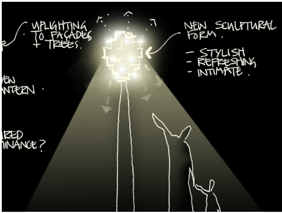
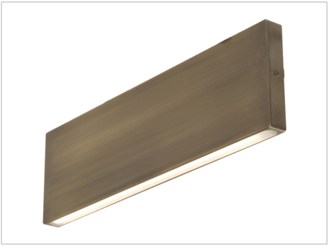
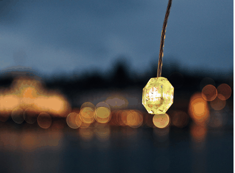
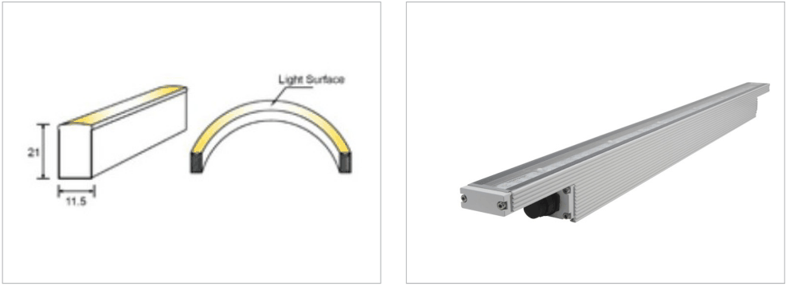
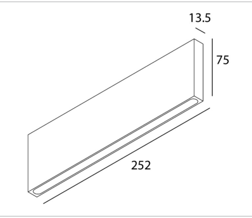
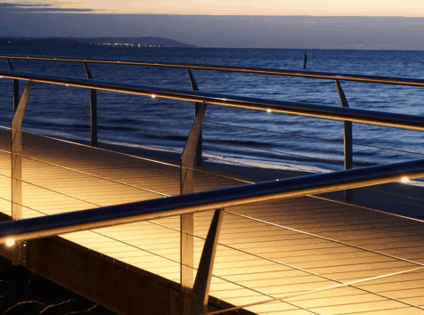
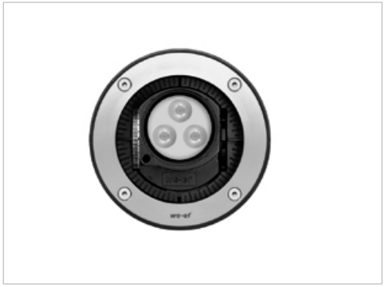

## 10	 Suite of luminaires

> [Picture on page 29: a picture, saved as a picture (images/public-domain-lighting-strategy-page-29-2.gif, 150 dpi).]

Lanterns

> [Picture on page 29: a picture, saved as a picture (images/public-domain-lighting-strategy-page-29-4.gif, 150 dpi).]

Exterior flexible lighting for furniture

Exterior facade luminare

Slim wall lighting to sandstone retaining wall up and down

> [Picture on page 29: a picture, saved as a picture (images/public-domain-lighting-strategy-page-29-8.gif, 150 dpi).]

Bud lighting to trees

> [Picture on page 29: a picture, saved as a picture (images/public-domain-lighting-strategy-page-29-10.gif, 150 dpi).]

> [Picture on page 29: a picture, saved as a picture (images/public-domain-lighting-strategy-page-29-11.gif, 150 dpi).]

Node lighting to trees canopies

Ingroup stake lighting

> [Picture on page 29: a picture, saved as a picture (images/public-domain-lighting-strategy-page-29-14.gif, 150 dpi).]

Handrail lighting

Handrail lighting

> [Picture on page 29: a picture, saved as a picture (images/public-domain-lighting-strategy-page-29-17.gif, 150 dpi).]

Recessed inground uplighting
