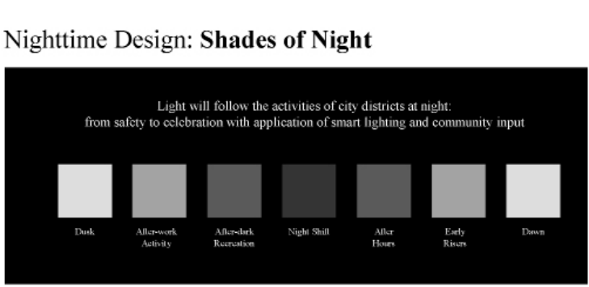

## 11	 Lighting and Controls

Output of programmed control systems

designed with community involvement

include;

• Expanded public space activity

• More “eyes on the street”

• Natural surveillance by

tenants themselves

• Pride of night-time place

• More physical exercise

Typically outdoor lighting in the urban

environment is controlled in one of two

ways. Firstly photoelectric sensors are

often mounted individually to luminaires,

these automatically sense the available

day light and switch the luminaire or

luminaires on when daylight is reduced

to a predetermined level. Alternatively

luminaires may be linked to an automated

time clock controlling luminaires at

preprogram times based on dawn, sunset

or other activities.

• Expanded opportunity for

social interaction

• Energy savings attributed

to adaptive lighting control

With the advent of greater information

and connectivity residing within

luminaires and lighting equipment,

new possibilities are being developed

of integrating with other spheres

of technology. Controls and decision making with

regards to the functionality and

effectiveness of exterior site lighting will

help promote and realise Double Bay’s

commitment to new levels of public

engagement, experiences and vibrancy. The design of the lighting scheme for

Double Bay should explore possibilities to

understand how best this approach could

benefit the community and council.

> [Picture on page 30: a picture, saved as a picture (images/public-domain-lighting-strategy-page-30-43.gif, 150 dpi).]

> [Picture on page 30: a picture, saved as a picture (images/public-domain-lighting-strategy-page-30-44.gif, 150 dpi).]
