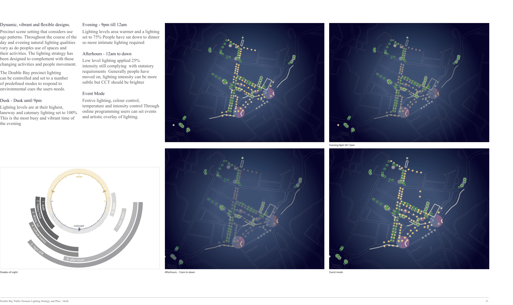

## 12	 Precinct Scene Setting

> [Picture on page 31: a map, saved as a picture (images/public-domain-lighting-strategy-page-31-2.gif, 150 dpi); the street names and other small labels are on the picture.]
> Words printed on the picture (title and legend, copied from the PDF):
> Shades of night
> OCEAN AV ENUE
> requirements  Generally people have
> OCEAN AV ENUE
> Festive lighting, colour control,
> OCEAN AV ENUE
> S TAT ION
> OCEAN AV ENUE
> OCEAN AV ENUE
> OCEAN AV ENUE
> S TAT ION
> Afterhours - 12am to dawn
> B AY STREET
> B AY STREET
> B AY STREET
> OCEAN AV ENUE
> B AY STREET
> B AY STREET
> B AY STREET
> OCEAN AV ENUE
> OCEAN AV ENUE
> OCEAN AV ENUE
> OCEAN AV ENUE
> S TAT ION
> Evening 9pm till 12am
> OCEAN AV ENUE
> OCEAN AV ENUE
> OCEAN AV ENUE
> S TAT ION
> B AY STREET
> B AY STREET
> B AY STREET
> OCEAN AV ENUE
> B AY STREET
> B AY STREET
> B AY STREET
> OCEAN AV ENUE

Dynamic, vibrant and flexible designs. Precinct scene setting that considers use

age patterns. Throughout the course of the

day and evening natural lighting qualities

vary as do peoples use of spaces and

their activities. The lighting strategy has

been designed to complement with these

changing activities and people movement. The Double Bay precinct lighting

can be controlled and set to a number

of predefined modes to respond to

environmental cues the users needs.

Dusk - Dusk until 9pm

Lighting levels are at their highest,

laneway and catenary lighting set to 100%

This is the most busy and vibrant time of

Evening - 9pm till 12am

Lighting levels area warmer and a lighting

set to 75% People have sat down to dinner

so more intimate lighting required

Afterhours - 12am to dawn

Low level lighting applied 25%

intensity still complying  with statutory

moved on, lighting intensity can be more

subtle but CCT should be brighter

temperature and intensity control Through

online programming users can set events

and artistic overlay of lighting.
