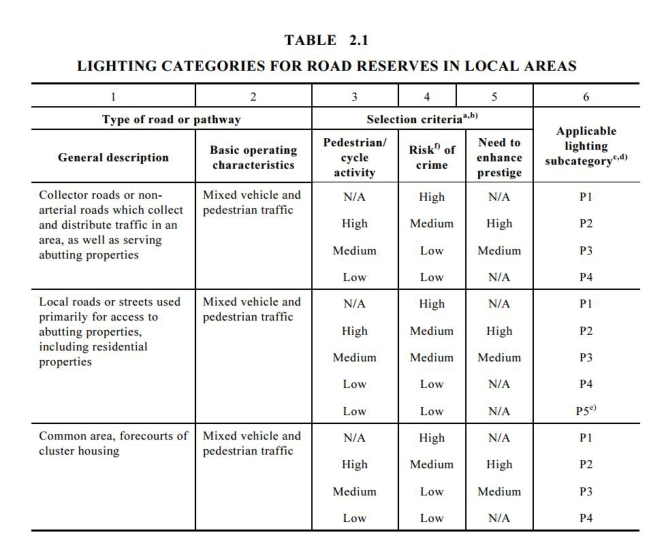
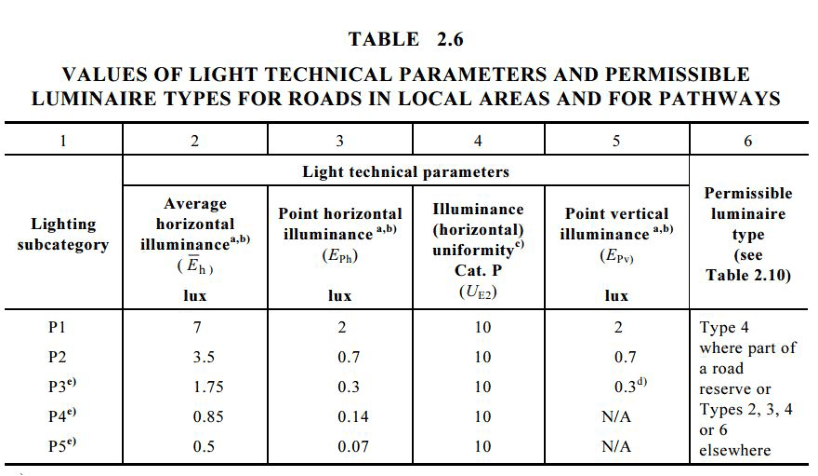

## 13	 Technical Guidance

AS1158 Outdoor lighting The categories highlighted have been

selected based upon the client briefing,

subsequent workshops and project

developments. The range has been used

to differentiate between the various

spaces shown to provide a hierarchy of

brightness. These assumptions should be

used within the following lighting design

stages and clarified through that process.

AS/NZS 1158 Lighting for roads and

public spaces Lighting for roads and public spaces set,

helps design, manufacture and install

road lighting for the safer use of roads by

pedestrians and vehicles

AS/NZS 4282 Control of the obtrusive

effects of outdoor lighting Sets limits to which an exterior lighting

installation can reach in regards to

the level of potential ‘spill light’ an

installation may create brightness of

luminaires and its impact on adjacent

residential properties and road users.

> [Picture on page 32: a picture, saved as a picture (images/public-domain-lighting-strategy-page-32-26.gif, 150 dpi).]

> [Picture on page 32: a picture, saved as a picture (images/public-domain-lighting-strategy-page-32-27.gif, 150 dpi).]
