#### C1 Implementation Strategy 107

#### PART D — APPENDIX

#### PART A

#### OVERVIEW & BACKGROUND

### Executive Summary

The centre can continue to grow and

### evolve with a complexity and richness

### unique to Sydney.

This strategy has identified

nine precincts in and around

Double Bay for the purposes

of dealing with specific issues

and recommending improve-

ments. The aim is that these

individual projects, across the nine

precincts will combine to improve the

legibility, connectivity, liveability and the

ongoing economic success of the whole

of Double Bay.

This strategy aims to examine the

existing strengths of the centre, identify

the challenges and opportunities, and

propose some overarching ideas that

will create a better connected, stronger

centre, that can continue to grow and

change to suit the local community,

workers, shoppers, children and other

visitors to the centre and surrounding

attractors in Double Bay. The strategy

builds on the existing successful public

domain framework and urban palette

of the ‘Double Bay Suite’, whilst retaining

and refining certain elements and rec-

ommending locations for improvements

and additions to the public domain

where possible.

#### This Double Bay Centre Public Do-

main Strategy is set into two parts:

#### Part A: Overview and Background

#### Part B: Urban Projects and Details

Precincts 1–3 are referred to as

Gateway Precincts, as they are the

main approaches to the Double Bay

Centre, by road and by water. The entry

experiences of descending by road, or

arriving by water are particularly signifi-

cant as they set Double Bay apart from

other places in Sydney. Within these

gateway precincts there are a number of

opportunities identified, from which a

variety of projects are recommended.

#### Gateway Opportunities

•	Strengthen gateway experiences to

enhance the sense of arrival into the

Double Bay Centre.

•	Improve the presence and sense of

connection to Sydney Harbour by

creating a more active and visible

link from the Harbour Precinct and

Ferry Wharf leading to the commercial

centre along Bay Street to complement

the primary east–west movement axis

along New South Head Road.

•	Better link the adjacent civic and open

space precincts to the centre including

Guilfoyle Park, Jamberoo Creek, Steyne

Park, Foster Park and the Redleaf Civic

Precinct.

•	Improve access to the centre for walk-

ing, cycling and public

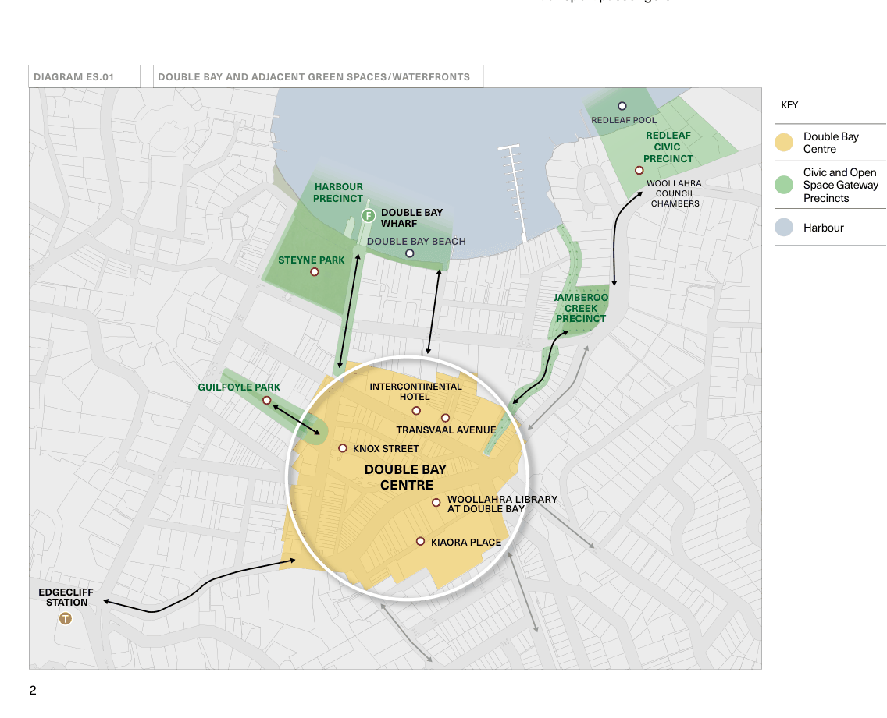

> [Picture on page 4: a picture, saved as a picture (images/public-domain-strategy-page-4-69.gif, 150 dpi).]
> Words printed on the picture (title and legend, copied from the PDF):
> DIAGRAM ES.01 DOUBLE BAY AND ADJACENT GREEN SPACES/WATERFRONTS
> KEY
> REDLEAF POOL
> REDLEAF
> Double Bay
> Centre
> CIVIC
> PRECINCT
> WOOLLAHRA
> HARBOUR
> PRECINCT
> Civic and Open
> Space Gateway
> Precincts
> COUNCIL
> CHAMBERS
> DOUBLE BAY
> WHARF
> Harbour
> DOUBLE BAY BEACH
> STEYNE PARK
> JAMBEROO
> CREEK
> PRECINCT
> \* * * * * * * * * * * *
> \* * * * * * * * * * * *
> \* * * * * * * * * * * *
> \* * * * * * * * * * * *
> \* * * * * * * * * * * *
> \* * * * * * * * * * * *
> \* * * * * * * * * * * *
> \* * * * * * * * * * * *
> \* * * * * * * * * * * *
> \* * * * * * * * * * * *
> \* * * * * * * * * * * *
> \* * * * * * * * * * * *
> \* * * * * * * * * * * *
> \* * * * * * * * * * * *
> \* * * * * * * * * * * *
> \* * * * * * * * * * * *
> \* * * * * * * * * * * *
> INTERCONTINENTAL
> GUILFOYLE PARK
> HOTEL
> TRANSVAAL AVENUE
> KNOX STREET
> \* * * * * * * * * * * *
> \* * * * * * * * * * * *
> \* * * * * * * * * * * *
> \* * * * * * * * * * * *
> \* * * * * * * * * * * *
> \* * * * * * * * * * * *
> \* * * * * * * * * * * *
> \* * * * * * * * * * * *
> \* * * * * * * * * * * *
> \* * * * * * * * * * * *
> \* * * * * * * * * * * *
> \* * * * * * * * * * * *
> \* * * * * * * * * * * *
> \* * * * * * * * * * * *
> \* * * * * * * * * * * *
> \* * * * * * * * * * * *
> \* * * * * * * * * * * *
> DOUBLE BAY
> CENTRE
> WOOLLAHRA LIBRARY
> AT DOUBLE BAY
> KIAORA PLACE
> EDGECLIFF
> STATION

transport passengers.

#### PART A

#### OVERVIEW & BACKGROUND

•	Improve the interface between build-

ings and the public domain of the street

to increase amenity.

•	Upgrade lighting of the public domain

and individual buildings.

the nearby Cross Street Car Park site.

The wide range of places and spaces

are fundamental to making Double Bay

an attractive centre, and this strategy

recommends ways to improve many of

the places, and how they connect.

Precinct 9 is the northern section

of Jamberoo Creek, which has been

a covered stormwater drain for many

years, linking through to Foster Park and

Sydney Harbour.

#### Opportunities on Jamberoo Creek

•	Potential as a new important environ-

mentally renewed open public space

adjacent to the centre.

•	Upgrade pedestrian paths and lighting

along the creek alignment.

•	Reveal and celebrate the creek line and

improve the connection to upstream

Precincts 4–8 are component parts

of the Double Bay Centre which have

different atmospheres that form the

richness, diversity and complexity in

the centre. Across these precincts

there are three ‘main street’ retail

environments—Bay Street, Knox

Street and Cross Street. There are

three important laneway environments

within the centre—Kiaora Place, Knox

Lane and Gumtree Lane, which are

currently developed and activated to

different extents, but all provide im-

portant opportunities for activation in

more intimate urban spaces. There are

three popular public gathering spaces;

Guilfoyle Park Plaza the public space

at the widening of Kiaora Place, and

the hub at the intersection of Cross

Street and Transvaal Avenue, which

could be further enhanced and con-

nected to a new public space associat-

ed with the potential redevelopment to

#### Opportunities in the Centre

•	Strengthen retailing through strategic

improvements to the public domain.

•	Upgrade existing public spaces and

create new spaces that provide a range

of experiences for different users and

visitors—particularly encouraging

outdoor activities.

•	Increase the legibility of the centre by

improving connections and wayfinding

within the centre.

•	Provide a new retail and hospital-

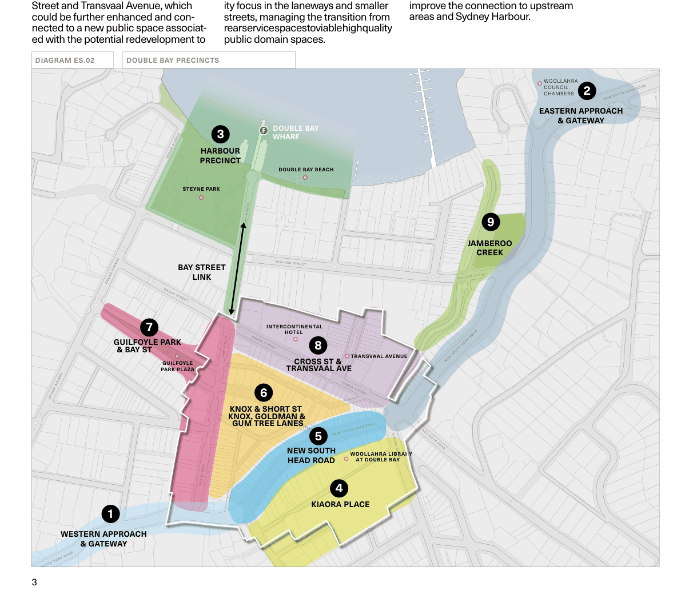

> [Picture on page 5: a map, saved as a picture (images/public-domain-strategy-page-5-62.gif, 150 dpi); the street names and other small labels are on the picture.]
> Words printed on the picture (title and legend, copied from the PDF):
> areas and Sydney Harbour.
> DIAGRAM ES.02 DOUBLE BAY PRECINCTS
> DOUBLE BAY BEACH
> B AY STREET
> & BAY ST
> CROSS ST &
> KNOX & SHORT ST
> KNOX, GOLDMAN &
> GUM TREE LANES
> NEW SOUTH WOOLLAHRA LIBRARY
> AT DOUBLE BAY
> B AY STREET
> B AY STREET

ity focus in the laneways and smaller

streets, managing the transition from

rear service spaces to viable high quality

public domain spaces.

#### CHAMBERS 2 NEWSOUTHHEADROAD

#### 3

#### 9

#### 8

#### 7

#### 6

#### 5

#### 4

OCEANAVENUE

#### 1

#### PART A

#### OVERVIEW & BACKGROUND

### Introduction

Double Bay is a unique, self–contained village, located

adjacent to Sydney Harbour and surrounded by the lush

hills of Woollahra and Bellevue Hill to the south, and Darling

Point and Point Piper to the west and east. This quintessential

Sydney setting, combined with a variety of scales of streets,

lanes and arcades, and a robust urban design palette of

materials, street furniture and street trees set up Double Bay as

one of Sydney’s premier centres.

#### History

Double Bay is located on New South Head Road, 3.5 km east

of the City of Sydney, and 8 km west of South Head, the entry

to Sydney Harbour, and the location of South Head signal

station, built in 1790 as a marker for arriving ships. The original

road between Sydney and the signal station and Macquarie

Lighthouse on South Head Road, was built along the ridge on

what we now call Old South Head Road and Oxford Street and

was completed in 1811. A new road was built in 1831, which followed the Aboriginal

track called Maroo, running along the contours closer to the

harbour, requiring a number of bridges across a number of lo-

cal creeks and inlets . This new road became New South Head

Road, and provided access to significant residential lands. By

1909 a tram ran the length of New South Head Road from the

city to Watsons Bay.

The fine grained nature of the centre, made up of many

smaller lots with a mix of land owners and businesses has been

an important part of the historic success of the centre, and will

continue to contribute to its popularity in the future. The role

of local, district and specialised shopping centres has changed

in recent times. The rise of the internet, the development of

online stores, delivery services, an increased availability of

international brands and the expansion of the major shopping

centre at Bondi Junction has shifted demand and consequent-

ly changed the role of retail centres in the Eastern Suburbs

of Sydney. Double Bay has seen its own redevelopment, and

consequently the way people use the centre continues to

adjust to this changing retail landscape. The public domain in

and around the centre needs to adapt and change to cater for

new types of retail and services and attract a new generation

of retailers and customers in order to adjust in the face of new

competition and be ready to take advantage of these new

opportunities.

Double Bay is named for the unique double formation of the

bay between Point Piper and Darling Point. The eastern part

of the bay, called Blackburn Cove, is the home of Redleaf Pool

(Murray Rose Pool), one of the best known and loved harbour

swimming enclosures in Sydney. A small point separates

Blackburn Cove from the western part of the ‘double bay’. Resi-

dential properties built on the waters edge at the point restrict

public access along the waterfront between the Steyne Park,

the Ferry Wharf and the Redleaf Pool.

Double Bay —Mid 19th Century

Double Bay is one of the few significant centres in Sydney

located in a valley, on relatively flat land and close to the

harbour. The flatter topography of the valley allowed the

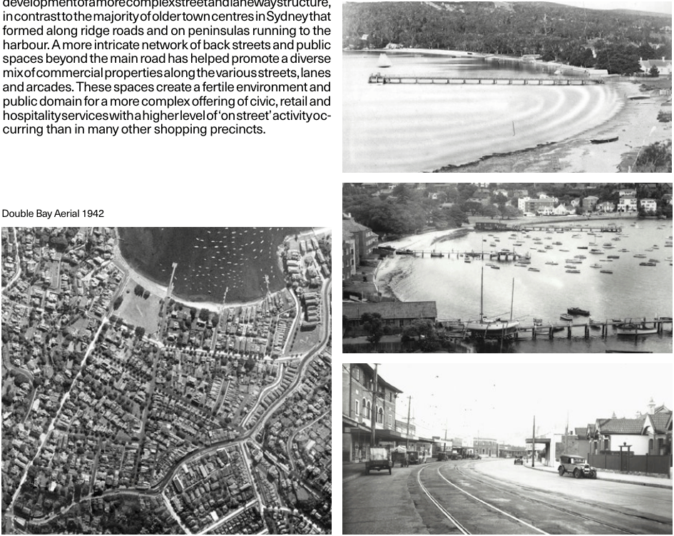

> [Picture on page 6: a picture, saved as a picture (images/public-domain-strategy-page-6-60.gif, 150 dpi).]
> Words printed on the picture (title and legend, copied from the PDF):
> Double Bay Aerial 1942

development of a more complex street and laneway structure,

in contrast to the majority of older town centres in Sydney that

formed along ridge roads and on peninsulas running to the

harbour. A more intricate network of back streets and public

spaces beyond the main road has helped promote a diverse

mix of commercial properties along the various streets, lanes

and arcades. These spaces create a fertile environment and

public domain for a more complex offering of civic, retail and

hospitality services with a higher level of ‘on street’ activity oc-

curring than in many other shopping precincts.

Double Bay —Mid 20th Century

New South Head Road tram line —Early 20th Century

#### PART A

#### OVERVIEW & BACKGROUND

The Ferry Wharf sits only a few hundred metres from the heart

of Double Bay and remains an important strategic opportunity

for improving access and attracting more people to the centre.

A direct ferry takes only 15 to 20 minutes to reach Double Bay

Wharf from Sydney’s CBD at Circular Quay. Double Bay is often

not considered as being directly connected to the harbour in

the way that the Manly and Watsons Bay centres are con-

nected to ferry wharfs, the ferry system, the wider harbour and

other attractions and centres on it.

#### Double Bay Today

Today, Double Bay is the most significant centre in terms of

size and diversity along New South Head Road. It provides

a wide range of retail, hospitality and services, and has over

2,000 people working in the centre. The nearby centre of

Edgecliff has a train station on the Illawarra (T3) Line, although

there is a significant topographic difference between the Dou-

ble Bay and Edgecliff Centres. As a result Double Bay Centre

is better serviced in public transport terms by bus and ferry

than by rail. The topography creates a significant physical and

psychological barrier between Double Bay and the nearby sta-

tion, although it is only 700 m from the heart of the Double Bay

Centre at Knox Street. This disconnection, and ways to reduce

its impact, are examined in this strategy.

Double Bay Centre has a number of great streets, lanes,

arcades and public spaces that work together to provide a

range of pleasant urban experiences for users. These can be

further upgraded through better articulated connections and

ongoing public domain and civic improvements. The high

street shopping, outdoor dining and network of public spaces,

laneways and parks all contribute to the urban character of the

village and it’s ambient atmosphere.

### An outdoor neighbourhood

### for an outdoor city.

The centre of Double Bay itself sits somewhat removed

from the waterfront, and is bisected by New South Head

Road, which carries over 40,000 cars per day and is a

significant arterial route. The major redevelopment and

upgrade work along Kiaora Place has increased signif-

icantly amenity and activity in the southern side of the cen-

tre, provided more car parking, and improved the overall

retail offering of Double Bay. However it has exacerbated

the split nature of the centre that is divided by the busy

four laned New South Head Road.

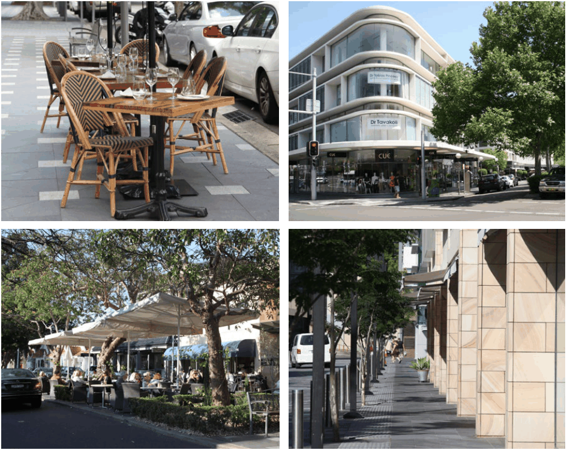

> [Picture on page 7: a picture, saved as a picture (images/public-domain-strategy-page-7-46.gif, 150 dpi).]

### Defining Double Bay

### •	 Unique natural village

### environment in a harbour

### setting.

•	 Well serviced centre with a

wide range of services,

### fashion, retail and hospitality

### •	 Memorable and defined public

### domain used on streets.

### •	 Popular outdoor dining

### location with 500 street seats.

•	 Finegrain network of streets,

lanes and 20 arcades and

### links.

•	 Variety of public meeting and

### gathering spaces.

### •	 Close to CBD and accessible

### by ferry, train and bus.

### Key moves for the future

### •	 Maintain a strong emphasis

### on outdoor spaces, outdoor

activities, street life and the

### pedestrian experience.

### •	 Refocus and rebalance

### the centre with upgraded

### streetscapes, laneways, public

### spaces and lighting.

•	 Boost the centre with a

richer cultural and urban life,

### better linking retail and urban

### experiences.

•	 Upgrade laneways and

### Knox Street and Knox Lane

### core area to increase active

### frontages.

### •	 Activate and enhance Kiaora

Place as a key public space in

### the centre.

### •	 Provide a range of smart urban

spaces in and around the

### centre that cater to all ages.

•	 Better link the centre to the

### harbour, train station

### and civic assets at Redleaf.

### •	 Work with residents, traders

### and owners to enact change.

### Part A / Overview & Background

#### PART A

#### OVERVIEW & BACKGROUND

### A1.01

### A stylish bayside

### village in a valley

richer mix of spaces, uses and users—in

a stronger hierarchy of street and lane

types and arcades.

The Watsons Bay and Rose Bay

(F7 Ferry) stops at Double Bay, however it

isn’t particularly evident from the wharf

that there is a significant centre nearby

— let alone one with a reputation for

high–end local designer fashion, great

coffee, food and hospitality — displaying

some of the best qualities of Sydney in

an intimate urban environment.

Many of the well known centres in

#### Sydney are located on ridge lines

and usually run along a busy main

road or high streets set on the

ridge. Examples include Oxford

#### Street, Bondi Junction, King Street

in Newtown, Glebe Point Road

and Military Road in Mosman and

#### Willoughby Road in Crows Nest.

Double Bay sits near to sea level,

very close to the harbour, giving

it attributes unlike many other

commercial activity centres of

similar size in Sydney.

There are opportunities to expand the

reach and catchment of Double Bay as

a diverse tourist destination, as well as

improving the centre for residents and

visitors within the local catchment.

This structural urban legacy suggests

Double Bay should look towards other

similar centres for inspiration as to what

other elements, facilities and spaces

could be added to the centre, such as

the better connected active harbour

front of Manly which is a significant

transport hub and tourist destination,

attracting national and international visi-

tors. Watsons Bay also has strong tourism

based ferry based visitation, which helps

drive a food and beverage economy

there, but it lacks a supporting depth

of retail services, scale and activity to

provide a broader shopping and tourist

experience. Visiting Double Bay should become an

important part of the Sydney Harbour

tourism experience.

Double Bay is a relatively unique centre,

in that it is the largest full service, mixed

use centre by area located directly

adjacent to Sydney Harbour, apart from

Manly which is arguably as much an

ocean front centre as it is a harbourside

one. Like Manly, Double Bay has the ben-

efit of a fine web of streets, unlike ridge

based centres which generally follow a

linear traffic corridor along a main route

rather than spreading out perpendicular

to the main street. A networked web

provides a much more efficient street

system with more active frontage and

sets up the opportunities that allows a

Double Bay, by positioning itself as a

‘stylish bayside village’ could increase

visitation by offering visitors a real and

urbane ‘Sydney experience’ with a cul-

tural, hospitality and retail mix.

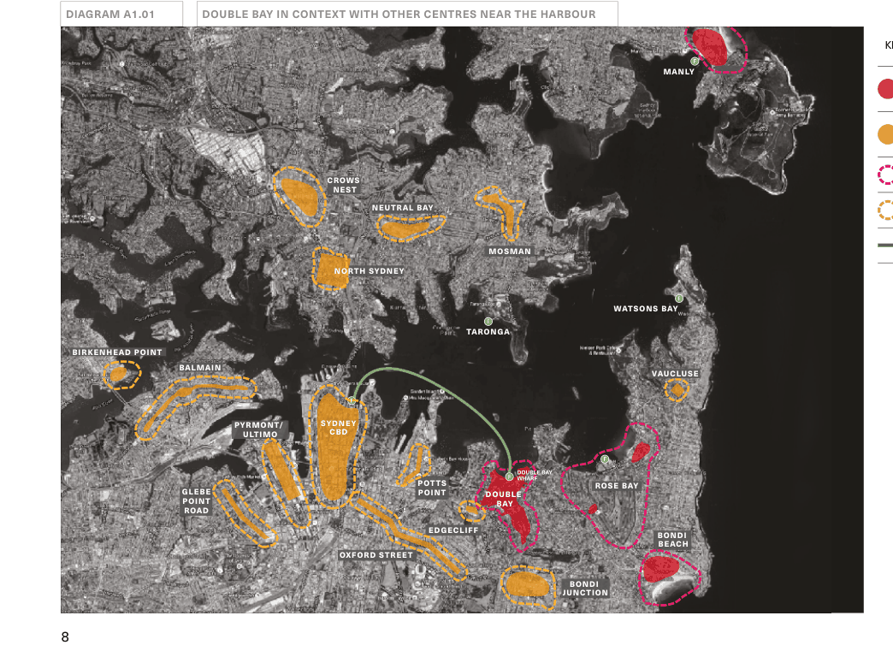

> [Picture on page 10: a map, saved as a picture (images/public-domain-strategy-page-10-76.gif, 150 dpi); the street names and other small labels are on the picture.]
> Words printed on the picture (title and legend, copied from the PDF):
> LARGE TOWN CENTRES
> SITUATED ON RIDGE
> KEY DOUBLE BAY
> SITUATED ON RIDGE
> DIAGRAM A1.01 DOUBLE BAY IN CONTEXT WITH OTHER CENTRES NEAR THE HARBOUR

CENTRE LOCATIONS

KEY

Valley/Flat Centre

Ridge /Hill Centre

Valley

Ridge/Hill

F7 Ferry

#### PART A

#### OVERVIEW & BACKGROUND

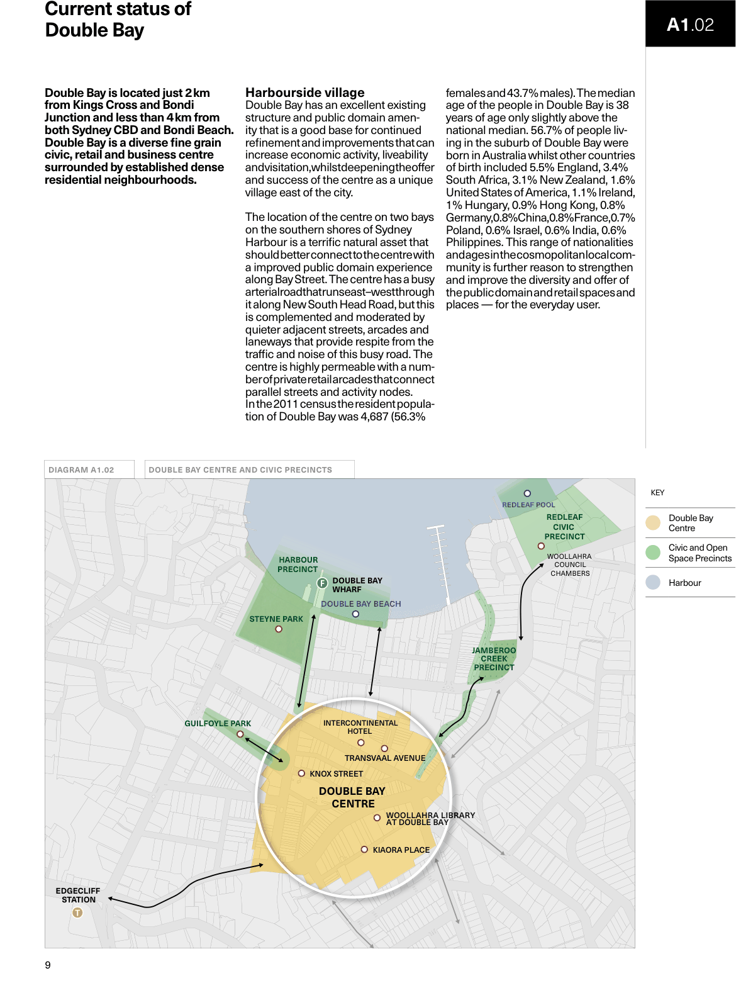

> [Picture on page 11: a picture, saved as a picture (images/public-domain-strategy-page-11-3.gif, 150 dpi).]
> Words printed on the picture (title and legend, copied from the PDF):
> DIAGRAM A1.02 DOUBLE BAY CENTRE AND CIVIC PRECINCTS
> KEY
> REDLEAF POOL
> REDLEAF
> Double Bay
> Centre
> CIVIC
> PRECINCT
> WOOLLAHRA
> Civic and Open
> Space Precincts
> HARBOUR
> PRECINCT
> COUNCIL
> CHAMBERS
> Harbour
> DOUBLE BAY
> WHARF
> DOUBLE BAY BEACH
> STEYNE PARK
> JAMBEROO
> CREEK
> PRECINCT
> \* * * * * * * * * * * *
> \* * * * * * * * * * * *
> \* * * * * * * * * * * *
> \* * * * * * * * * * * *
> \* * * * * * * * * * * *
> \* * * * * * * * * * * *
> \* * * * * * * * * * * *
> \* * * * * * * * * * * *
> \* * * * * * * * * * * *
> \* * * * * * * * * * * *
> \* * * * * * * * * * * *
> \* * * * * * * * * * * *
> \* * * * * * * * * * * *
> \* * * * * * * * * * * *
> \* * * * * * * * * * * *
> \* * * * * * * * * * * *
> \* * * * * * * * * * * *
> INTERCONTINENTAL
> GUILFOYLE PARK
> HOTEL
> TRANSVAAL AVENUE
> KNOX STREET
> \* * * * * * * * * * * *
> \* * * * * * * * * * * *
> \* * * * * * * * * * * *
> \* * * * * * * * * * * *
> \* * * * * * * * * * * *
> \* * * * * * * * * * * *
> \* * * * * * * * * * * *
> \* * * * * * * * * * * *
> \* * * * * * * * * * * *
> \* * * * * * * * * * * *
> \* * * * * * * * * * * *
> \* * * * * * * * * * * *
> \* * * * * * * * * * * *
> \* * * * * * * * * * * *
> \* * * * * * * * * * * *
> \* * * * * * * * * * * *
> \* * * * * * * * * * * *
> DOUBLE BAY
> CENTRE
> WOOLLAHRA LIBRARY
> AT DOUBLE BAY
> KIAORA PLACE
> EDGECLIFF
> STATION

### A1.02

Current status of

### Double Bay

#### Double Bay is located just 2 km

from Kings Cross and Bondi

#### Junction and less than 4 km from

both Sydney CBD and Bondi Beach.

#### Double Bay is a diverse fine grain

civic, retail and business centre

surrounded by established dense

residential neighbourhoods.

#### Harbourside village

Double Bay has an excellent existing

structure and public domain amen-

ity that is a good base for continued

refinement and improvements that can

increase economic activity, liveability

and visitation, whilst deepening the offer

and success of the centre as a unique

village east of the city.

females and 43.7% males). The median

age of the people in Double Bay is 38

years of age only slightly above the

national median. 56.7% of people liv-

ing in the suburb of Double Bay were

born in Australia whilst other countries

of birth included 5.5% England, 3.4%

South Africa, 3.1% New Zealand, 1.6%

United States of America, 1.1% Ireland,

1% Hungary, 0.9% Hong Kong, 0.8%

Germany, 0.8% China, 0.8% France, 0.7%

Poland, 0.6% Israel, 0.6% India, 0.6%

Philippines. This range of nationalities

and ages in the cosmopolitan local com-

munity is further reason to strengthen

and improve the diversity and offer of

the public domain and retail spaces and

places ­— for the everyday user.

The location of the centre on two bays

on the southern shores of Sydney

Harbour is a terrific natural asset that

should better connect to the centre with

a improved public domain experience

along Bay Street. The centre has a busy

arterial road that runs east–west through

it along New South Head Road, but this

is complemented and moderated by

quieter adjacent streets, arcades and

laneways that provide respite from the

traffic and noise of this busy road. The

centre is highly permeable with a num-

ber of private retail arcades that connect

parallel streets and activity nodes.

In the 2011 census the resident popula-

tion of Double Bay was 4,687 (56.3%

#### PART A

#### OVERVIEW & BACKGROUND

### Double Bay will thrive if it focuses on pe-

### destrian life with bustling footpaths, great

### shops and high quality urban spaces.

#### Kiaora Lands

The Kiaora Lands redevelopment to the south side

of New South Head Road between Kiaora Road and

Manning Road has a supermarket, library, specialty

retail, food outlets and major car park. The upgraded

Kiaora Place has added life and activity to the southern

precinct of the centre. Additional north–south

movement and links across New South Head Road are

enhanced and activity is further stimulated across the

whole centre.

1	 Woollahra Library at Double Bay, Kiaora Place 2	 MUD Ceramics, Kiaora Place

The transformation of the site and Kiaora Place re–

energised the centre with new unique businesses

choosing to locate in the development and adjacent

private owners already looking to further invest in

upgrades that front on to this new pedestrian space.

The precedent set by Kiaora Place is to be followed

by other laneway upgrades in the centre including a

renewed focus on upgrading Knox Lane. Double Bay

can build on its strength as a traditional outdoor high

street  centre with active laneways and a wide variety

of unique businesses—as a real and attractive retail

and entertainment alternative to other mainstream

internalised suburban shopping malls.

3	 Kiaora Place public domain upgrade

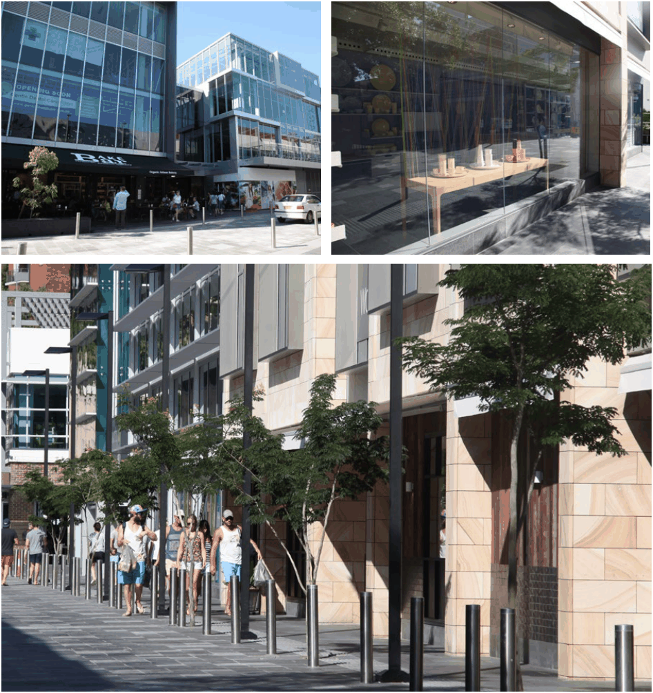

> [Picture on page 12: a picture, saved as a picture (images/public-domain-strategy-page-12-36.gif, 150 dpi).]

1

2

3

#### PART A

#### OVERVIEW & BACKGROUND

### A1.03

### Double Bay and its

### role in the Eastern

### Suburbs of Sydney

#### Double Bay is Sydney’s

#### Stylish Bayside Village

traditional precincts of Kings Cross,

Oxford Street and the CBD to local cen-

tres such as Double Bay.

retailers (Myer, David Jones, Kmart)

and major supermarkets has managed

to shift retail patterns, patronage and

hierarchy of the surrounding neighbour-

hoods and centres—including Double

Bay.

Changes in tourism are also changing

the spatial economics of cities, where

new companies such as AirBnB are

driving demand for more local experi-

ences by enabling visitors to stay in

local private homes and apartments.

This in turn has visitors seeking out

more authentic experiences, stores,

local food and unique activities. Double

Bay’s shifting fortunes and it’s location in

eastern Sydney means it is well placed

to take advantage of these cultural and

economic shifts.

This major shift led to a number of

concerns around the future of Double

Bay and how to compete with the larger

and more comprehensive ‘full service’

centres. Since the early 2000s a number

of changes have occurred in the retail

and hospitality sectors of Sydney. Online

retail has also changed how, where and

when people shop. Globalisation is ena-

bling international designers and high

volume retailers to more easily compete

with local traders, increasing pressure on

local shops and boutiques.

Double Bay has a long and varied his-

tory as a local centre. Fifty years ago, in

the 1960s it was one of the first places

in Sydney to feature ‘exotic European

food’, which could be eaten in cafés with

outdoor ‘alfresco’ seating, with what we

now consider ‘real coffee’ — espresso.

This is now the norm across Australia as

we embraced our multicultural customs

and cuisines. High end boutiques sold

European clothing and apparel, which

added to the unique offering. The centre

grew into ‘the’ place to see and be seen

by the wealthy and the ‘in-crowd’ of

Sydney, reaching something of a peak in

the 1980s.

The existing street structure provides a

range of retail and social opportunities

within the strong hierarchy of roads,

streets, arcades and lanes. It is very ac-

cessible from Sydney CBD by ferry, bus

and train and has great tree lined streets

that are—in contrast to competing

internalised malls—open to the air, in

a unique harbourside setting. By improv-

ing the connections to the harbour and

parks, strengthening the legibility and

connectivity of the streets and lanes,

particularly the connection across New

South Head Road, updating some of

the key public spaces and places and

helping small scale, fine grain businesses

engage and trade out onto the streets

and lanes, Double Bay can achieve the

desired position as Sydney’s leading vi-

brant, contemporary and stylish bayside

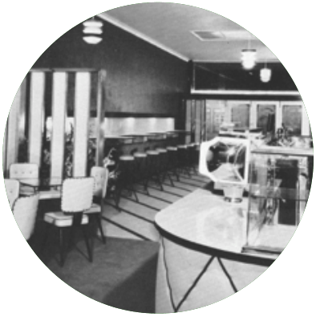

> [Picture on page 13: a picture, saved as a picture (images/public-domain-strategy-page-13-80.gif, 150 dpi).]

village.

As the food and beverage, and particu-

larly ‘real coffee’ scene spread across

Sydney in the 1990s, Double Bay

became less unique and needed to

compete more directly with other places.

Oxford Street in Paddington evolved into

a major designer destination for small

to medium sized stores selling local and

international designer clothing around

Paddington Markets. Bondi Junction

remained relatively down at heel with

unattractive streetscapes and dated

department stores and arcades until

Westfield Bondi Junction mall opened

in 2003, revamping and expanding

an existing run down site with almost

450 shops over 100,000 m2. Westfield

attracted many of the designer clothing

stores from Oxford Street and Sydney’s

CBD to Bondi Junction, when combined

with a large collection of convenience

retail, cinemas, major and big box

Hospitality has also changed with the

rise of small bars providing an alternative

to once dominant pubs, with an associ-

ated rise in preference for small scale

cafés, restaurants and shops—often in

out–of–the–way locations that add an

extra layer of interest and intrigue. Dou-

ble Bay has an extensive secondary lane-

way and arcade network, with a large

number of out–of–the–way spaces and

retail stores. Some of these are not well

utilised and could be improved, possibly

with the support of Council programs or

third party organisations specialising in

engagement with small scale operators.

This would help strengthen and deepen

the diversity of retail and hospitality

on offer in the centre, and provide a

stronger contrast to Bondi Junction and

CBD shopping malls.

Lock–out laws applying to night life

districts have also dispersed the demand

for late opening premises away from the

### Double Bay started to swing in the 1960s.

It was one of the first places to feature international cuisine,

### chic boutiques and cafés with alfresco tables.

#### PART A

#### TRANSPORT & MOVEMENT

### A1.04

### Public Domain

Structure Plan for

### Double Bay

The structure of the Double Bay Centre

is based on elements connecting to and

running from the New South Head Road

spine, which is a busy retail strip despite

the significant adjacent traffic volumes.

The curves and alignment of New

South Head Road sets up a cranked grid

geometry, that creates a triangulation of

the three local and calmed ‘high street’

retail environments to the north of New

South Head Road—along Bay, Knox and

Cross Streets. Bay Street being the crucial

north–south link that directly connects

New South Head Road to the ferry wharf

and harbour.

There are four natural gathering spaces

in the centre; at Steyne Park and the Har-

bour Precinct, at Guilfoyle Park and Bay

Street, at Transvaal and Cross Streets, and

the new Kiaora Plaza. These urban nodes

could be reinforced and expanded in

their role as public spaces, with Guilfoyle

Park Plaza already used for farmers’

markets and other civic events. Potential

for a new gathering space also exists on

Cross Street at Jamberoo Lane at the car

park redevelopment. The green spaces

around the centre are important and

could be improved to varying degrees,

as could the gateway precincts leading

to the centre from the surrounding

peninsulas, hills and harbour.

These main streets are connected

to a series of lanes and arcades.

Three main laneways; Kiaora,

Knox and Gumtree Lanes create a

secondary layer of activity and means

of pedestrian movement through

the centre. Kiaora Place is a well

activated, high amenity lane, whilst

Knox and Gumtree Lanes could

potentially be similarly interesting

and important spaces for the centre

if improvements are made to both

the public domain and built form.

These spaces are connected through

a significant permeable network

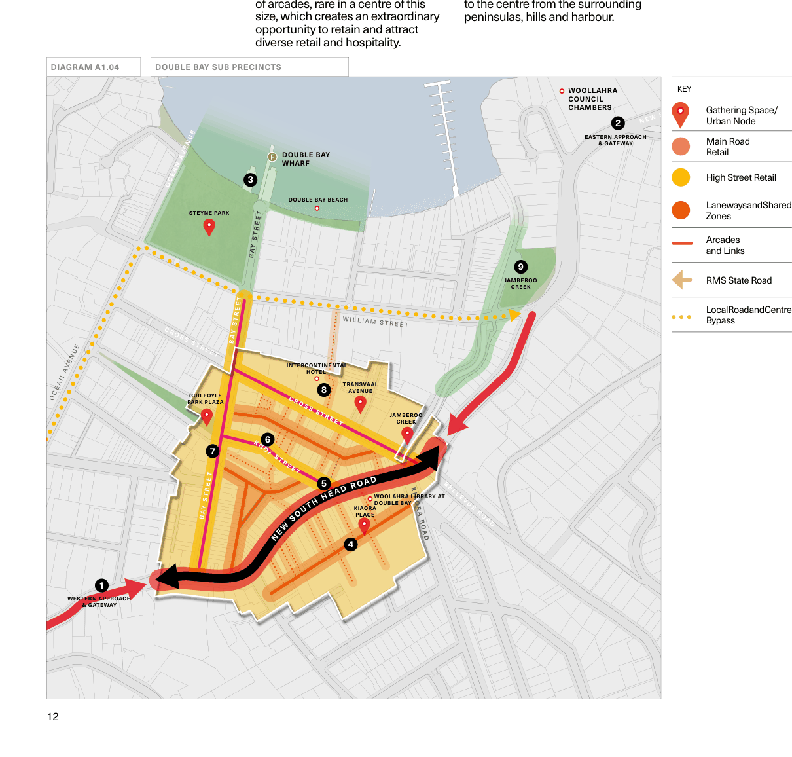

> [Picture on page 14: a map, saved as a picture (images/public-domain-strategy-page-14-54.gif, 150 dpi); the street names and other small labels are on the picture.]
> Words printed on the picture (title and legend, copied from the PDF):
> DIAGRAM A1.04 DOUBLE BAY SUB PRECINCTS
> High Street Retail
> DOUBLE BAY BEACH
> Laneways and Shared
> RMS State Road
> Local Road and Centre
> 5 R O
> WOOLAHRA LIBRARY AT
> B AY STREET
> B AY STREET
> B AY STREET

of arcades, rare in a centre of this

size, which creates an extraordinary

opportunity to retain and attract

diverse retail and hospitality.

#### ENUE

#### PART A

#### OVERVIEW & BACKGROUND

### A1.05

### Review of existing

### documents relating

### to Double Bay

Public Domain Lighting Strategy 2016,

and any recommendations relating to

lighting design and installation must

be consistent with the Arup lighting

strategy.

as they were since that report, as a

validation of the importance of a well

researched, thorough and strategic

approach to the long term planning of

the urban amenity and public domain of

Double Bay.

#### As part of this study, a range

of strategies, codes and policy

documents were reviewed. There

are aspects of many of these which

remain relevant and provide an

important historical backdrop to the

approach and recommendations

made in this Public Domain

#### Strategy.

Other documents reviewed reflect to

some extent the changing approaches

to design and management of the public

domain, and where appropriate previous

work and recommendations from this

suite of documents will be referenced to

identify the continuity, or lack of continu-

ity, in the approach to strengthening the

amenity and appeal of the Double Bay

Centre.

The 2002 Double Bay Centre Urban

Design Study and accompanying

Public Domain Improvements Plan,

prepared by a consultant team lead

by Hill Thalis stood out as a document

that was particularly insightful, and

many of the recommendations remain

valid, and align well with the approach

and strategic intent of this strategy.

#### Rerence documents

•	­Double Bay Centre Urban Design Study, 2002

•	 Double Bay Centre: Public Domain Improve-ments Plan, 2002

•	 Double Bay LEP, 2014

•	 ­Woollahra: Street Tree Master Plan, 2014

•	 Policy and Procedures for Footway Restaurants

•	 Woollahra Council Precinct Plans

•	 Double Bay Place Plan, 2014

•	 Double Bay 40 km/h High Pedestrian Activ-ity Area Traffic and Pedestrian Study, 2014

•	 Double Bay Economic Feasibility Study, 2015

•	 Double Bay DCP, 2015

•	 Public Domain Lighting Strategy, 2016

The Public Domain Lighting Strategy

2016 (prepared by Arup) was adopted

by Council on 27 June 2016. This strategy

should be read in conjunction with the

We refer to these in each specific project

where recommendations remain largely

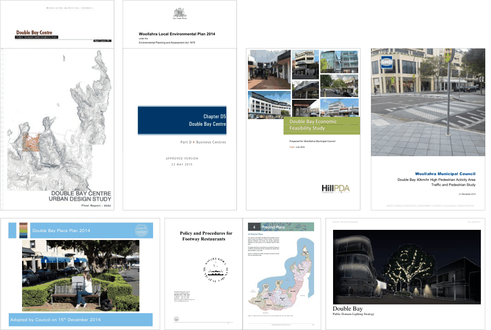

> [Picture on page 15: a picture, saved as a picture (images/public-domain-strategy-page-15-69.gif, 150 dpi).]
> [Picture text on page 15 is stored in the PDF without readable letters (no character map), so it could not be copied; see the original PDF.]
> Words printed on the picture (title and legend, copied from the PDF):
> New South Wales
> Woollahra Local Environmental Plan 2014
> under the
> Environmental Planning and Assessment Act 1979
> Status information
> Currency of version
> Current version for 15 July 2015 to date (generated 22 July 2015 at 12:23).
> Legislation on the NSW legislation website is usually updated within 3 working days.
> Provisions in force
> All the provisions displayed in this version of the legislation have commenced. For commencement and
> other details see the Historical notes.
> Chapter D5
> Double Bay Centre
> Double Bay Economic
> Feasibility Study
> This version of the legislation is compiled and maintained in a database of legislation by the Parliamentary Counsel’s Office and published
> on the NSW legislation website.
> (2015 No 20)
> Prepared for Woollahra Municipal Council
> Part D  Business Centres
> Final – July 2015
> APPROVED VERSION
> 23 MAY 2015
> Woollahra Municipal Council
> Double Bay 40km/hr High Pedestrian Activity Area
> Traffic and Pedestrian Study
> 21 November 2014
> Double Bay  |  Public Domain Lighting Strategy
> Arup  |  December 2015
> 4 Precinct Plans
> Double Bay Place Plan 2014
> 4.0 Precinct Plans
> Policy and Procedures for
> Footway Restaurants
> This section of the Street Tree Master Plan provides the main
> guide for future tree planting in Council’s streets. The precinct
> approach addresses local issues and provides appropriate
> treatments for each precinct on an individual street by street
> basis.
> The design objectives for each precinct are outlined, the precinct
> conditions are described and the nominated tree species have
> been provided for every street. Watsons
> Bay
> the Local Government Area.
> Vaucluse
> Port
> Jackson
> Point
> Piper
> Darling
> Point
> Rose Bay
> City
> of Sydney Double
> Bay Waverley
> Bellevue
> Edgecliff Hill
> Paddington
> Woollahra Municipal Council
> 536 New South Head Road
> DOUBLE BAY  NSW  2028
> Telephone:   (02) 9391 7000
> Facsimile:    (02) 9391 7044
> Email: records@woollahra.nsw.gov.au
> www.woollahra.nsw.gov.au
> Woollahra
> Randwick
> Double Bay
> Public Domain Lighting Strategy
> Page 1 of 36
> Adopted by Council on 15th December 2014
> 4-1
> © Woollahra Street Tree Master Plan 2014

Figure 4.1 indicates the location and extent of precincts across

Figure 4.1- Map of the Precincts that have been used throughout the Street Tree Master Plan

#### PART A

#### TRANSPORT & MOVEMENT

### A2.01

### Arriving and moving

### through Double Bay

There is a regular pattern of open and

canopied streets, green space, sand-

stone, cutting and retaining walls along

this route. Residential apartments and

houses line both the east and west ap-

proaches to Double Bay.

#### The journey along New South

#### Head Road from the city gives

the experience of Sydney, with

topography, open parks with large

mature trees, water and harbour

views and moving in and out of

urban centres of different scales

and typologies at ridges, valleys

and the associated ascents and

descents.

On arrival to Double Bay Centre the road

flattens and is flanked either side of the

road with moderately scaled commercial

properties with awnings and kerb side

parking.

### Double Bay is discovered along the rolling rises

### and falls of New South Head Road, between

### harbour glimpses, filtered sunlight through

### giant fig trees and sandstone cuttings.

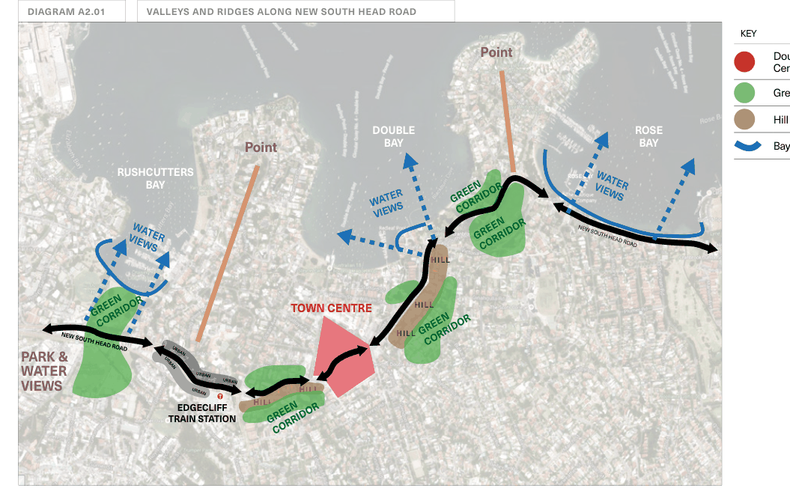

> [Picture on page 16: a map, saved as a picture (images/public-domain-strategy-page-16-31.gif, 150 dpi); the street names and other small labels are on the picture.]
> Words printed on the picture (title and legend, copied from the PDF):
> DIAGRAM A2.01 VALLEYS AND RIDGES ALONG NEW SOUTH HEAD ROAD
> NEW SOUTH HEAD ROAD
> NEW SOUTH HEAD ROAD

#### Point

Double Bay Centre

Green corridor

#### Point

#### PARK &

#### WATER

#### VIEWS

#### PART A

#### TRANSPORT & MOVEMENT

1	 Moreton Bay Figs and Palm Trees on New South Head Road, Rushcutters Bay 2	 New South Head Road, Rushcutters Bay 3	 Eucalypt canopy on New South Head Road, Double Bay eastern approach

1

2

3

4	 Open views

Rushcutters Bay Park 5	 New South Head Road, Double Bay eastern approach 6	 New South Head Road, Double Bay western approach

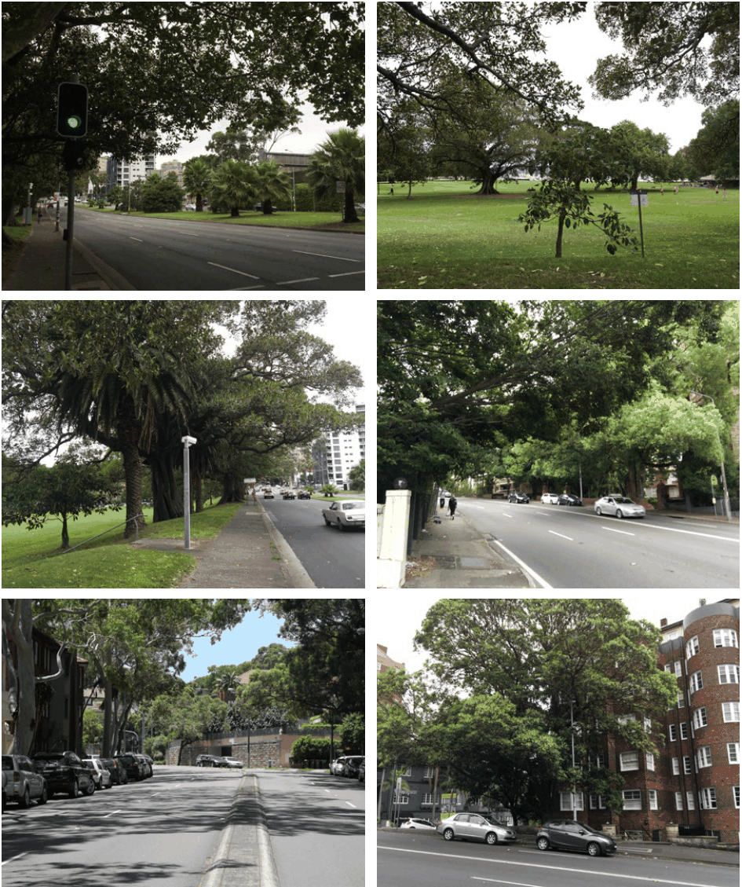

> [Picture on page 17: a picture, saved as a picture (images/public-domain-strategy-page-17-26.gif, 150 dpi).]

4

5

6

#### PART A

#### TRANSPORT & MOVEMENT

### A2.02

### Arrival points

and gateways to

### Double Bay

#### Wayshowing

“a consist-ent use and organisation of definite sensory cues from the external envi-ronment” —Kevin Lynch

#### Gateways

Generally topography and landscape

are the predominant gateways to the

Double Bay Centre. The gateway and

entry locations along New South Head

Road are generally dominated by traffic

movements, and lack urban amenity or

real address. The Double Bay Wharf and

Steyne Park area provide an attractive

and low key point of arrival from the

harbour, but is the least used of the five

point of arrivals.

Double Bay has entry points on the

east and west ridge approaches,

and three gateways within the

centre. There is a strong sense of

arrival or transition to the centre

afforded by the topography, tree

canopy, harbour and landscape.

#### These gateways and thresholds

can be improved with relatively

simple measures including

footpath widening, repaving,

planting, street trees, lighting and

wayfinding.

Wayshowing is the act of making a location navi-gable through the creation of an identifiable, understandable, memorable and accessible urban environment.

#### Recommendations

and Opportunities

•	Reduction in the impact of traffic at

key gateway intersections, reduced

vehicle speeds and the addition of

planting, trees and wayfinding signage

to improve pedestrian priority and

increase the attractiveness of walking

and cycling.

•	Increased urban amenity through

streetscape design, reduced vehicle

speeds and ‘wayshowing’ can increase

non–vehicle travel to and from the

centre from the local area and major

transport nodes.

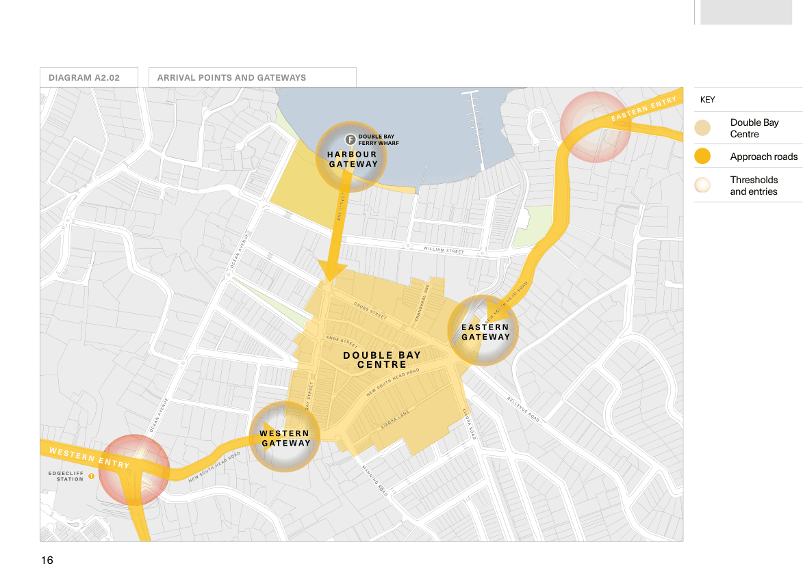

> [Picture on page 18: a map, saved as a picture (images/public-domain-strategy-page-18-66.gif, 150 dpi); the street names and other small labels are on the picture.]
> Words printed on the picture (title and legend, copied from the PDF):
> DIAGRAM A2.02 ARRIVAL POINTS AND GATEWAYS
> G AT E W AY
> CROSSSTREET TRANSVAALAVE NEWSOUTHHEADROAD
> G AT E W AY
> B AY STREET
> B AY STREET
> G AT E W AY
> \* * * * * * * * *
> \* * * * * * * * *
> \* * * * * * * * *
> \* * * * * * * * *
> \* * * * * * * * *
> \* * * * * * * * *
> \* * * * * * * * *
> \* * * * * * * * *
> \* * * * * * * * *
> \* * * * * * * * *
> \* * * * * * * * *
> S TAT ION

#### PART A

1

2

3

#### TRANSPORT & MOVEMENT

1	 Harbour arrival 2	 West entry at Ocean Street/Ocean Avenue, Edgecliff 3	 Eastern approach along New South Head Road east of centre

4	 New South Head Road at Bay Street 5	 Bellevue Road descent to New South Head Road 6	 New South Head Road west of centre

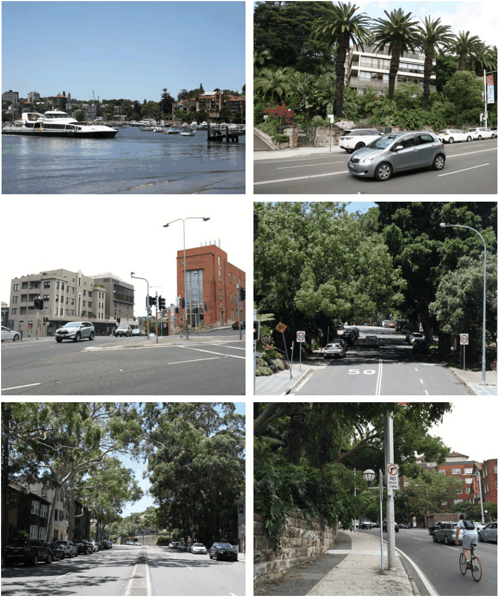

> [Picture on page 19: a picture, saved as a picture (images/public-domain-strategy-page-19-21.gif, 150 dpi).]

4

5

6

#### PART A

#### TRANSPORT & MOVEMENT

### A2.03

### Active and Public

### Transport Access

#### Public Transport

Double Bay is well serviced by a range of

regular public transport services includ-

ing buses, F7 ferries, T3 trains at Edgecliff

Station (500 m to the west) and tourist

services such as the Explorer buses on

New South Head Road and charter

ferries at Double Bay Wharf. Increased

public transport patronage increases

pedestrianisation and reduces demand

for the already limited on and off street

parking, whilst also reducing vehicle

movements and congestion within the

centre.

#### Active Transport

With wide upgraded streets walking is

an attractive option in the centre— but

the amenity of footpaths in surrounding

areas leading to the centre need to be

improved to encourage local trips on

foot. Minimal infrastructure is provided

for cyclists, with some lane marking,

signage and some bike racks available

at the Ferry Wharf. Shared paths (cycle/

pedestrian), dedicated bike lanes

and additional bicycle racks are to be

installed where possible across the

centre. Secure bike parking space should

be allocated in undercover car parking

locations and at major public transport

nodes.

#### Recommendations

and Opportunities

•	Unnecessary car trips to and within the

centre are to be reduced by encour-

aging access by active and public

transport due to the limited number

of on–street and off–street vehicle

parking bays.

•	Walking is to be the preferred mode

of transport within the centre and

pedestrian priority should be foremost

in the design of footpaths, crossings

and public spaces.

(See B5.08).

•	Walking, public transport and cycling

to be supported by clear and legible

wayfinding systems.

(See B5.02)

•	Provide more cycling facilities within

the centre, on streets and public places

and parks including bike racks and

secure bike storage areas.

### Public transport, walking and cycling are all good

for centres and increase urban amenity and

### foot traffic to shops, arcades and laneways.

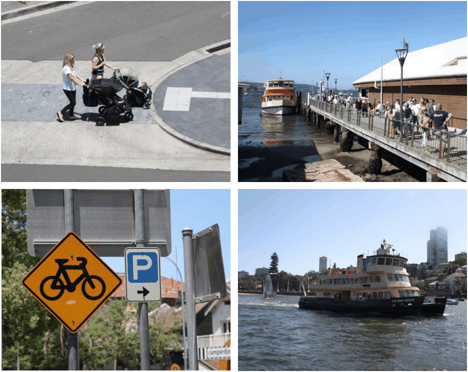

> [Picture on page 20: a picture, saved as a picture (images/public-domain-strategy-page-20-62.gif, 150 dpi).]

1

3 1	 Pedestrian Priority measures on Cross Street and Knox Lane 2	 Signage on William and Bay Streets 3	 Private ferries and water taxis at Double Bay Ferry Wharf 4	 F7 Ferry, Double Bay to Circular Quay, Rose Bay and Watsons Bay

2

4

#### PART A

#### TRANSPORT & MOVEMENT

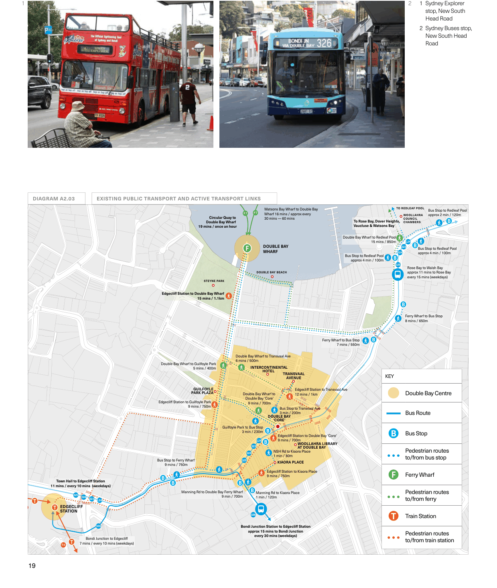

> [Picture on page 21: a map, saved as a picture (images/public-domain-strategy-page-21-3.gif, 150 dpi); the street names and other small labels are on the picture.]
> Words printed on the picture (title and legend, copied from the PDF):
> 2 1	 Sydney Explorer
> stop, New South
> 2	 Sydney Buses stop,
> New South Head
> DIAGRAM A2.03 EXISTING PUBLIC TRANSPORT AND ACTIVE TRANSPORT LINKS
> TO REDLEAF POOL
> Bus Stop to Redleaf Pool
> approx 2 min / 120m
> Watsons Bay Wharf to Double Bay
> Wharf 16 mins / approx every
> 30 mins — 60 mins
> To Rose Bay, Dover Heights,
> Vaucluse & Watsons Bay
> Circular Quay to
> Double Bay Wharf
> 19 mins / once an hour
> Double Bay Wharf to Redleaf Pool
> 15 mins / 850m
> Bus Stop to Redleaf Pool
> approx 4 min / 100m
> Bus Stop to Redleaf Pool
> approx 4 min / 100m
> DOUBLE BAY BEACH
> Rose Bay to Walsh Bay
> approx 11 mins to Rose Bay
> every 15 mins (weekdays)
> Edgecliff Station to Double Bay Wharf
> 15 mins / 1.1km B AY STREET
> Ferry Wharf to Bus Stop
> 8 mins / 650m
> Ferry Wharf to Bus Stop
> 7 mins / 550m
> Double Bay Wharf to Transvaal Ave
> 6 mins / 500m
> Double Bay Wharf to Guilfoyle Park
> 5 mins / 400m
> PARK PLAZA Double Bay Wharf to
> Edgecliff Station to Transvaal Ave
> 12 mins / 1km
> Double Bay Centre
> Double Bay ‘Core’
> Edgecliff Station to Guilfoyle Park 9 mins / 700m CROSSSTREET
> 9 mins / 750m
> Bus Stop to Transvaal Ave
> 3 min / 200m
> KNOXSTREET DOUBLE BAY
> Guilfoyle Park to Bus Stop
> 3 min / 230m
> Edgecliff Station to Double Bay ‘Core’
> 9 mins / 700m
> AT DOUBLE BAY
> B AY STREET
> B AY STREET
> NSH Rd to Kiaora Place
> 1 min / 80m
> to/from bus stop
> Bus Stop to Ferry Wharf
> 9 mins / 750m
> Edgecliff Station to Kiaora Place
> 9 mins / 750m
> Town Hall to Edgecliff Station
> 11 mins / every 10 mins  (weekdays)
> 9 min / 700m
> Manning Rd to Kiaora Place
> 1 min / 120m
> Manning Rd to Double Bay Ferry Wharf
> Bondi Junction Station to Edgecliff Station
> approx 15 mins to Bondi Junction
> every 30 mins (weekdays)
> to/from train station
> Bondi Junction to Edgecliff
> 7 mins / every 10 mins (weekdays)

#### PART A

#### TRANSPORT & MOVEMENT

### A2.04

### Private transport

### and parking

Private motor vehicle remains the most

commonly used means of getting to

Double Bay. Once parked in Double

Bay walking is the easiest way to move

around within the centre due to the

compact size of the core area as every

part of the centre is within five minutes

walk (450 m). Greater pedestrian priority

at intersections and side street crossings

is desirable to slow traffic and improve

amenity and safety for pedestrians, shop-

pers, outdoor diners and visitors.

#### Recommendations

and Opportunities

•	Maintain existing car parking levels in

the Centre and discourage additional

large car parking stations.

•	Increase the number of car share pods

and vehicles within Double Bay.

•	Provide adequate on–street and

off–street parking for motorbikes and

scooters.

•	Use smart parking technology and

signage to better manage traffic and

parking access and information.

As of March 2016 there were eight

GoGet car share vehicles in and around

the Double Bay Centre including two

available in the Cross Street Car Park.

Given the density of the residential

neighbourhoods around the centre

and the number of businesses within

the centre, it would be expected that

car share demand will increase over

time. New developments should be

encouraged to include car share spaces

or pods within new car parking areas and

additional spaces made available within

existing car parks.

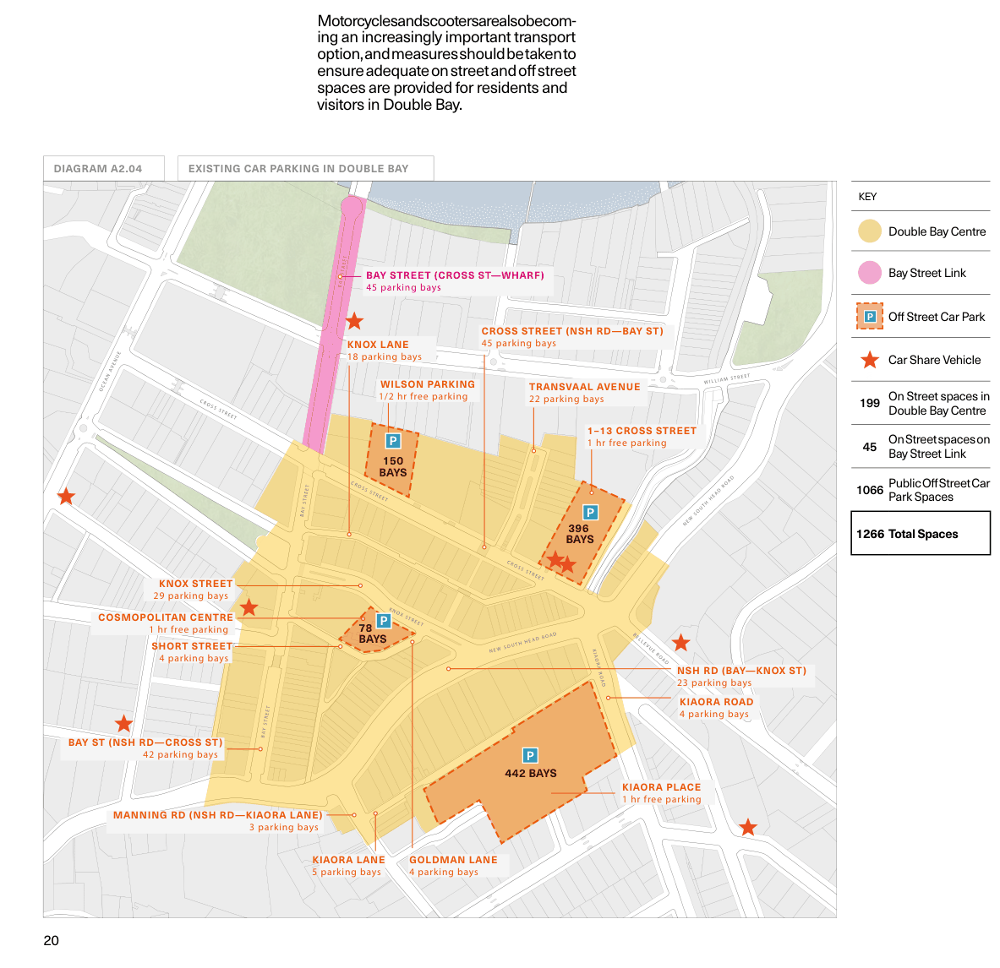

> [Picture on page 22: a map, saved as a picture (images/public-domain-strategy-page-22-45.gif, 150 dpi); the street names and other small labels are on the picture.]
> Words printed on the picture (title and legend, copied from the PDF):
> DIAGRAM A2.04 EXISTING CAR PARKING IN DOUBLE BAY
> Double Bay Centre
> Bay Street Link
> B AY STREET
> BAY STREET (CROSS ST—WHARF)
> 45 parking bays
> P Off Street Car Park
> CROSS STREET (NSH RD—BAY ST)
> 45 parking bays
> 18 parking bays
> Car Share Vehicle
> 1/2 hr free parking
> 22 parking bays
> 199 On Street spaces in
> Double Bay Centre
> 1–13 CROSS STREET
> 1 hr free parking
> On Street spaces on
> Bay Street Link
> 1066 Public Off Street Car
> 1266 Total Spaces
> 29 parking bays
> 1 hr free parking
> 4 parking bays
> NSH RD (BAY—KNOX ST)
> 23 parking bays
> 4 parking bays
> B AY STREET
> B AY STREET
> BAY ST (NSH RD—CROSS ST)
> 42 parking bays
> 1 hr free parking
> MANNING RD (NSH RD—KIAORA LANE)
> 3 parking bays
> 5 parking bays
> 4 parking bays

#### EASTERN

Motorcycles and scooters are also becom-

ing an increasingly important transport

option, and measures should be taken to

ensure adequate on street and off street

spaces are provided for residents and

visitors in Double Bay.

#### PART A

#### TRANSPORT & MOVEMENT

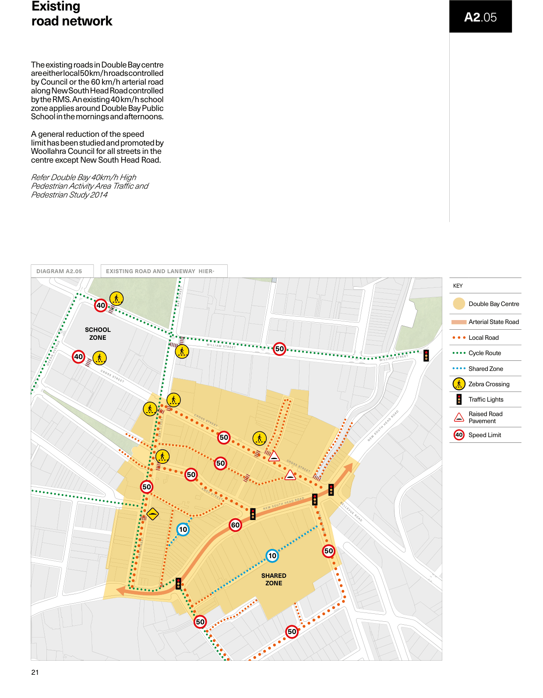

> [Picture on page 23: a map, saved as a picture (images/public-domain-strategy-page-23-3.gif, 150 dpi); the street names and other small labels are on the picture.]
> Words printed on the picture (title and legend, copied from the PDF):
> DIAGRAM A2.05 EXISTING ROAD AND LANEWAY  HIER-
> B AY STREET
> B AY STREET
> B AY STREET
> Double Bay Centre
> Arterial State Road
> 40 Speed Limit

### Existing

### road network

The existing roads in Double Bay centre

are either local 50 km/h roads controlled

by Council or the 60 km/h arterial road

along New South Head Road controlled

by the RMS. An existing 40 km/h school

zone applies around Double Bay Public

School in the mornings and afternoons.

A general reduction of the speed

limit has been studied and promoted by

Woollahra Council for all streets in the

centre except New South Head Road.

Refer Double Bay 40km/h High

Pedestrian Activity Area Traffic and

Pedestrian Study 2014

### A2.05

#### EAST

#### PART A

#### TRANSPORT & MOVEMENT

### A2.06

Future street and

### laneway network

### Making the human, street level experience

### the most important traffic management

strategy is key to an active, vibrant and

### healthy place.

A general reduction of the speed

limit on local roads to 40 km/h is

recommended to improve pedestrian

and cycle priority, amenity and safety

in the centre. A 40 km/h zone should

also be considered for New South

Head Road between Cross Street

and Bay Street. Further speed limit

reductions should be sought to allow

for new 10 km/h Shared Zones in

Kiaora Place, Knox Lane, Gumtree

Lane, Short Street and Goldman Lane,

to encourage pedestrian and kerbside

activity on the quieter and narrower

streets and lanes in the Double Bay

Centre.

Recommendations and

#### Opportunities

•	Minimise traffic movements within the

Double Bay Centre.

•	Expand the number of small streets

and laneways with 10 km/h shared

zones to improve amenity and

pedestrianisation.

•	Lower traffic speeds to 40 km/h on all

streets north of New South Head Road

including Ocean and William Streets.

•	Work with RMS to reduce traffic speeds

on New South Head Road between

William and Henrietta St.

•	Investigate opportunities for additional

pedestrian crossings and refuge islands

where appropriate within the centre.

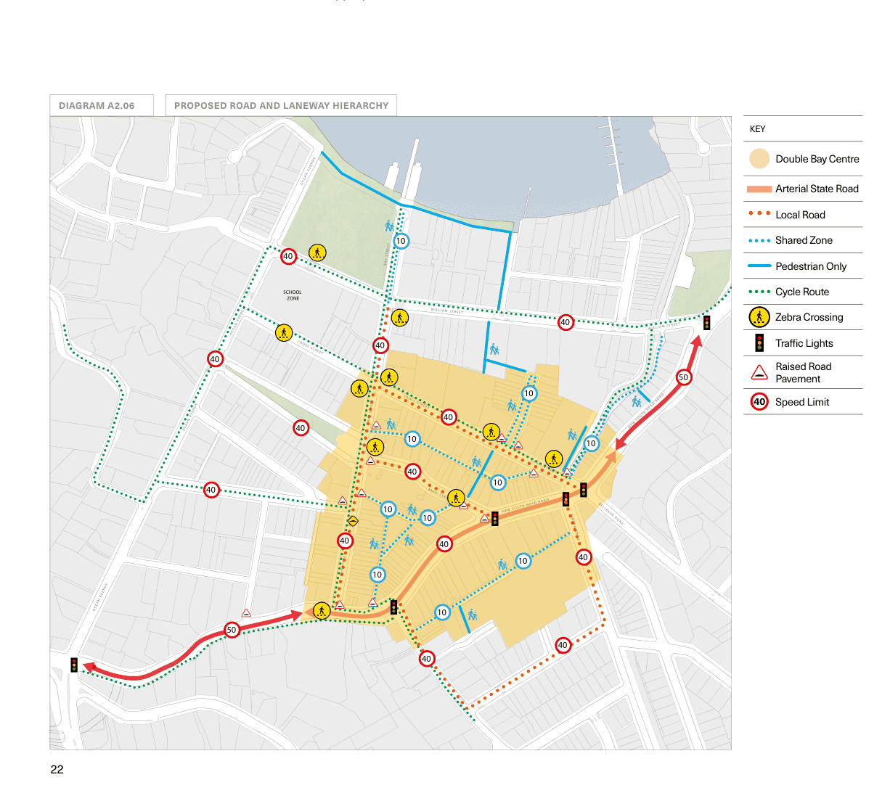

> [Picture on page 24: a map, saved as a picture (images/public-domain-strategy-page-24-43.gif, 150 dpi); the street names and other small labels are on the picture.]
> Words printed on the picture (title and legend, copied from the PDF):
> DIAGRAM A2.06 PROPOSED ROAD AND LANEWAY HIERARCHY
> Double Bay Centre
> Arterial State Road
> B AY STREET
> 40 Speed Limit
> B AY STREET
> B AY STREET

### Part B / Urban Projects & Details

#### THE CENTRE

#### KEY CONCEPT

#### WHAT TO DO

### B1.01

### The Centre

### Knox Street

### and Knox Lane

### Core Upgrade

#### Upgrade Knox Street as a central out-

door dining, café and shopping area linking Guilfoyle Park and New South

#### Head Road through to the south pre-

cinct and Kiaora Place. Upgrade the parallel Knox Lane as a new intimate retail and hospitality laneway, with a target of 80% active shop frontage.

1\.	Improve pedestrian priority on Knox Street at Bay Street, Goldman Lane and New South Head Road intersections.

2\.	Increase outdoor dining areas on new footpath extensions.

3\.	Upgrade Knox Lane to the Kiaora Place standard as a 'shared zone' retail and hospitality lane.

#### At the heart of Double Bay, Knox

#### Street has long been identified

as quintessential part of the

village appeal with boutique

shopping, hotels, cafés and a

concentration of outdoor dining

activity. Upgrading Knox Street and

#### Knox Lane to strengthen the core

that links Guilfoyle Park to New

#### South Head Road and through

to the library, Kiaora Place and

the retail activity to the south of

the centre is a key priority for the

centre. Improving connectivity

to laneways and arcades that link

through to Knox Street is important

for orientation within the centre

and for the success of business in

these secondary spaces.

#### Conditions and Issues

Knox Street is currently in good

condition, however entrances to

side streets, laneways and arcades

need improvement. There is a central

traffic island and tree planting at the

intersections of Bay Street and New

South Head Road. The busy intersection

of Knox Street and New South Head

Road is the main link to retail in the

southern precinct of the centre. Some

parts of the footpath are cluttered

constrained by excessive outdoor

seating, windbreaks and planters. Knox

Lane still operates primarily as service

access point for the rear of properties

on Cross Street and Knox Street, with

existing retail clustering around the

Goldman Lane closure at the eastern

end.

•	Upgrade Knox Street footpath paving

from concrete pavers to stone.

•	Additional public and cafe outdoor

seating on widened footpath, locations

to be considered on Knox Street and

Knox Lane.

•	Redesign road paving thresholds, tree

planting, central island design, thresh-

olds to side streets and lanes.

•	Design for pedestrian priority at the

intersections of Knox Street with Bay

Street and New South Head Road with

a potential scramble crossing.

•	Upgrade lighting in Knox Street and

Knox Lane to illuminate trees and

building façades where possible, con-

sistent with the lighting strategy.

•	Upgrade Knox Lane to the same

standard as Kiaora Place, encourag-

ing new activities and more active

frontages on the street that comple-

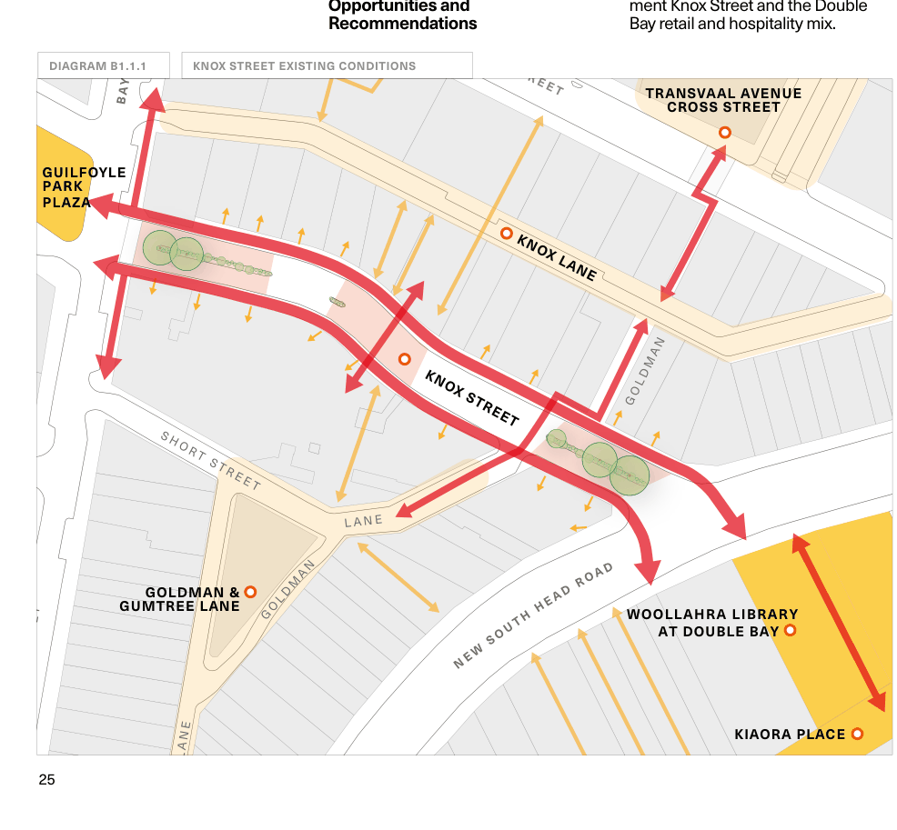

> [Picture on page 27: a map, saved as a picture (images/public-domain-strategy-page-27-85.gif, 150 dpi); the street names and other small labels are on the picture.]
> Words printed on the picture (title and legend, copied from the PDF):
> DIAGRAM B1.1.1 KNOX STREET EXISTING CONDITIONS
> CROSSSTREET TRANSVAAL AVENUE
> AT DOUBLE BAY
> B AY STREET
> B AY STREET

ment Knox Street and the Double

Bay retail and hospitality mix.

Opportunities and

#### Recommendations

#### KEY ELEMENTS

— Upgrade Knox Lane — New footpath widening — Extra outdoor dining — Improve laneway con-nections — New lighting — Upgrade planting and traffic island areas ­— Greener streets and more street trees

KEY

Primary link

Secondary link

Retail Entrances

Arcade Links

Existing Trees

#### THE CENTRE

### Knox Street

### Upgrade

Vehicle movements and kerbside

parking of vehicles tends to dominate

the streetscape at the expense of

pedestrians and optimum outdoor

dining experiences. Although vehicle

movements are slow, the bend in the

roadway and the lack of mid block

crossing points makes pedestrian

movements difficult especially for older,

disabled and younger pedestrians.

#### Conditions and Issues

Knox Street is a 180 metre long high

street with a mix of retail, hospitality,

hotel and office frontages running

between New South Head Road and Bay

Street. There are a total of eight existing

arcades and laneways that connect

Knox Lane through to Knox Lane and

Short Street, including the Cosmopolitan

Centre arcades. Knox Street is the last

street still paved in original concrete

pavers which are at the end of their life

and require replacement to match Cross

and Bay Streets.

•	Improve the amenity and quality

of outdoor dining areas with better

furniture (potentially one style for the

street), and reduce the number of wind

breaks, umbrellas, heaters and planters

on the footpath.

•	Trial 'parklet' style seating areas in

the short term, with a preference

for permanent solutions to outdoor

dining over temporary.

•	Encourage new awnings to existing

frontages without footpath cover.

•	The built form scale of the street has

good access to sunlight which will

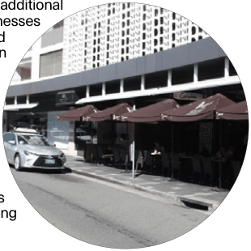

> [Picture on page 28: a picture, saved as a picture (images/public-domain-strategy-page-28-42.gif, 150 dpi).]

allow the planting of additional

street trees and businesses

are to be encouraged

to use planting, green

walls, wall mounted

planters and pots

and plants along

the street to soften

and green the urban

environment.

•	Encourage new

high quality awning

signage to properties

and businesses fronting

Knox Street.

Knox Street is the heart of Double Bay,

both geographically and socially. It is

the core of the Double Bay experience

with a vibrant and active street life.

Historically outdoor dining started on

Knox Street and is still a popular location

for outdoor dining from early in the

morning to well into the evening. There

are currently around 100 outdoor dining

seats on Knox Street and in locations

footpath space is limited with cluttered

and less than ideal seating arrangements

compromising footpath circulation

and Disability Discrimination Act 1992

compliance.

Opportunities and

#### Recommendations

•	Upgrade Knox Street with new 'Double

Bay Suite' stone paving and street

furniture elements.

•	Investigate the addition of two mid

block (north–south) crossing points

at Goldman Lane and an upgraded

median island with pedestrian refuge

points.

•	Use granite sett paving in the roadway

at the entrance to Knox Street from

New South Head Road to signify to

motorists a change in speed and

activity levels.

•	Give pedestrian priority at the exit of

Goldman Lane south.

•	Review on street parking and extend

footpaths to allow more space for

additional outdoor dining areas on

widened footpaths.

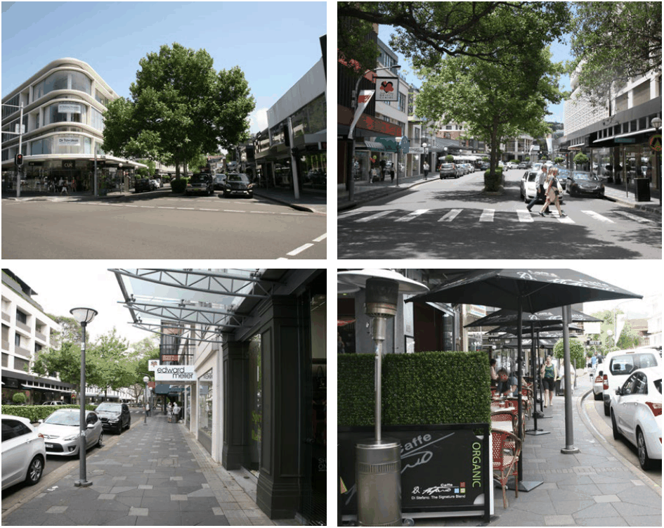

> [Picture on page 28: a picture, saved as a picture (images/public-domain-strategy-page-28-94.gif, 150 dpi).]

1

3

1	 Knox Street at New South Head Road 2	 Footpath and awning detail on Knox Street 3	 Pedestrian crossing at Bay Street and Knox Street 4	 Excessive and cluttered outdoor dining furniture and street furniture

2

4

#### THE CENTRE

### Knox Lane

### Upgrade

#### Conditions and Issues

Knox Lane is a 200 metre long service

lane with a limited amount of retail

frontage running between Cross Street

and Bay Street. It is on average 8.6 m

wide. There are a total of twelve existing

arcades and laneways that connect Knox

Lane through to Knox Street and Cross

Street, including Hunters Arcade and

Bay Village. These connections create

a great variety of types and scales of

stores and shop fronts in this precinct.

Knox Lane has some existing on street

parking, and is used by vehicles for

deliveries and access to a number of

properties. Of all the lanes in Double Bay,

Knox Lane has the best combination

of urban conditions to undertake a

major improvement providing more

retail, hospitality and shop frontages in

the centre. Knox Lane was previously

identified in the 2002 PDIP to become

‘Little Knox Street’. During the warmer

summer months the street has minimal

shade cover or green space and suffers

from being a hot and exposed space for

pedestrians and outdoor diners.

Opportunities and

#### Recommendations

•	Give pedestrians priority at the

crossing of Goldman Lane and

other key access points to arcades

on the north and south sides of

the lane.

•	Upgrade Knox Lane to the same

standard and detail as Kiaora

Place, encouraging new activities

and more active frontages on the

street (up to 80% active frontages).

•	Encourage existing frontages to be

opened up as new premises on the

lane way with new openings and

awnings.

•	Ensure new development considers

the Knox Lane frontages equally

with other street frontages.

•	Reduce through traffic at certain

times of the day and reduce car and

truck parking in front of businesses

that open to the lane.

•	Widen footpaths where possible.

•	Due to the built form scale of the

lane there is good access to sunlight

which would allow a variety of

trees, vines and plants to grow and

thrive. Encourage businesses to use

planting, green walls, wall mounted

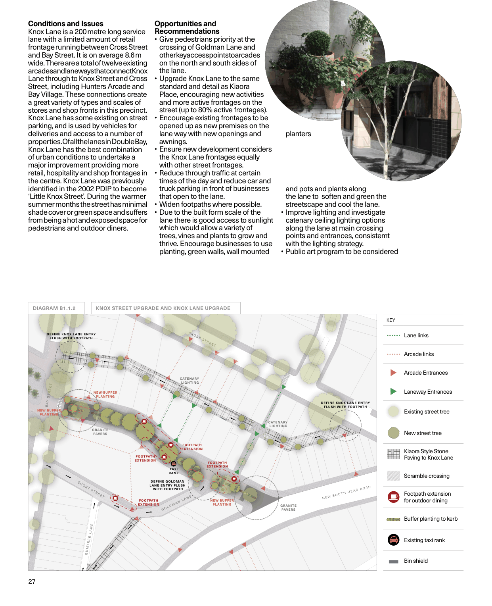

> [Picture on page 29: a picture, saved as a picture (images/public-domain-strategy-page-29-61.gif, 150 dpi).]
> Words printed on the picture (title and legend, copied from the PDF):
> planters

and pots and plants along

the lane to  soften and green the

streetscape and cool the lane.

•	Improve lighting and investigate

catenary ceiling lighting options

along the lane at main crossing

points and entrances, consistemt

> Words printed on the picture (title and legend, copied from the PDF):
> DIAGRAM B1.1.2 KNOX STREET UPGRADE AND KNOX LANE UPGRADE
> DEFINE KNOX LANE ENTRY
> FLUSH WITH FOOTPATH
> FOOT PAT H
> E X PA NSION
> NEW ‘ INROAD ’
> LANEW AY ROUTE
> DEFINE KNOX LANE ENTRY
> B AY STREET
> FLUSH WITH FOOTPATH
> Existing street tree
> New street tree
> SUITE PA VING
> Kiaora Style Stone
> Paving to Knox Lane
> LANE PA VING
> LANE ENTRY FLUSH
> for outdoor dining
> Buffer planting to kerb
> MAKE KNOX STREET MORE
> Existing taxi rank
> ADD GREATER PLANTING BY
> EXTENDING THE FOOTPATH &
> REMOVING / REDUCING
> ‘NO PARKING’ & ‘TAXI RANK’
> CONDITIONS, & PAVING THE
> ENTIRETY OF KNOX STREET.

with the lighting strategy.

•	Public art program to be considered

#### THE CENTRE

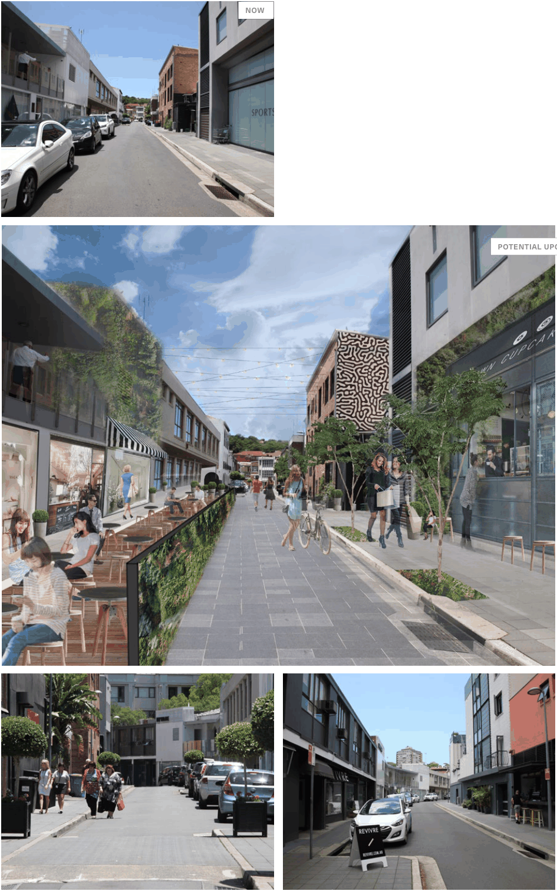

> [Picture on page 30: a picture, saved as a picture (images/public-domain-strategy-page-30-2.gif, 150 dpi).]
> Words printed on the picture (title and legend, copied from the PDF):
> NOW
> POTENTIAL UPGRADE

The upgrade of Knox

Lane as a Shared Zone

space with emphasis

on pedestrian and

cycle access to

businesses. Encourage

new businesses and

shop frontages to

open on to the lane,

with a strong emphasis

on greening of the

lane with new street

trees, pots, planters,

vines and green walls.

#### THE CENTRE

#### KEY CONCEPT

#### WHAT TO DO

### B1.02

### Guilfoyle Park Plaza Guilfoyle Park is a great urban asset

that should be upgraded to better ac-commodate civic events and farmers’ markets. It is also generally an impor-tant public square and green space for

#### Double Bay, as it is directly connected

to Knox Street and Knox Lane and also fronts residential areas.

1\.	Remove circular raised paved area.

2\.	Redesign and extend hard paved square with extra palm trees, new seat-ing and waterplay elements.

3\.	Upgrade market and event facilities.

4\.	Upgrade lawns, sculpture garden and park gardens to the western extent of the park.

#### Conditions and Issues

#### Guilfoyle Park is a long tapered

park surrounded by single lane

one way traffic lanes and parking

bays of Guilfoyle Avenue. It

provides around 2400m2 of open

space in the heart of Double

Bay Centre. The park provides a

complementary outdoor space

to the centre with seating and

temporary markets provided at the

#### Bay Street end. The park provides

green open space for lunch time

users and other during the day.

#### Towards Ocean Street the park

tapers down to a very narrow strip,

primarily functioning as a traffic

island divider.

Opportunities and

#### Recommendations

•	Remove and level the existing circular

paved platform and repave square with

new stone paving

•	Establish high quality facilities for

regular produce/food markets

•	Improve pedestrian priority at the

intersections of Bay Street and

Guilfoyle Avenue.

•	Remove some on street parking spaces

the eastern end adjacent the square

to minimise impacts of vehicles and

extend footpaths.

•	Provide additional seating, bubblers

and lighting.

•	Identify a location for water jet/water

play area within the upgraded plaza.

The park is in poor to moderate condi-

tion with broken and/or cracked Double

Bay Suite paving in the square at the

east end near Bay Street and poor lawn

coverage in the park area, from the

square up to Ocean Avenue. The park

has a number of large trees of a variety

of species. Planting generally lacks con-

sistency or appropriateness to the place

and activities. Previous reports have

recommended removal of some trees.

The shade from the tree canopy provides

a cool resting place in the centre, but is

contributing to a worn grassed surface

that is compacted and patchy. There are

issues with drainage in the area as it is

one of the lowest points in the centre.

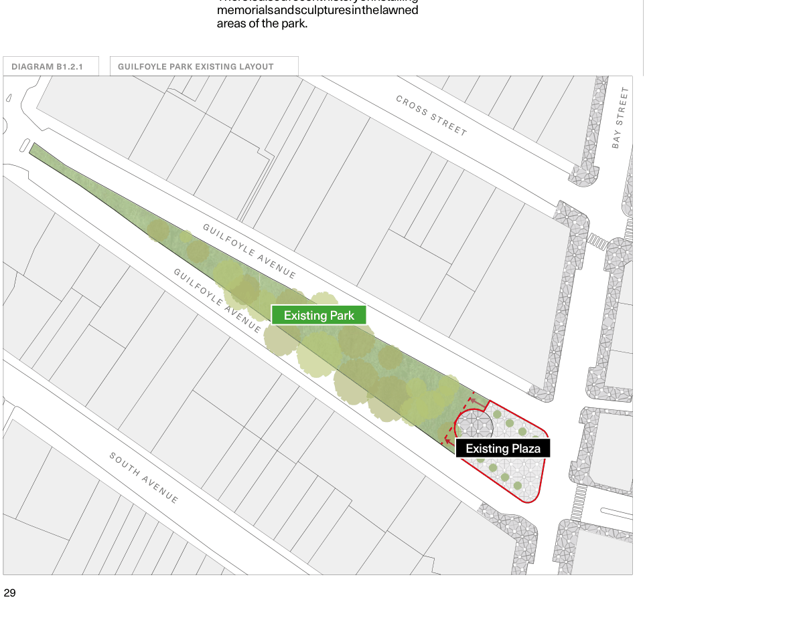

> [Picture on page 31: a picture, saved as a picture (images/public-domain-strategy-page-31-74.gif, 150 dpi).]
> Words printed on the picture (title and legend, copied from the PDF):
> DIAGRAM B1.2.1 GUILFOYLE PARK EXISTING LAYOUT
> CROSSSTREET
> GUILFOYLEAVENUE
> GUILFOYLEAVENUE
> SOUTHAVENUE
> B AY STREET
> AY STREET

There is also a recent history of installing

memorials and sculptures in the lawned

areas of the park.

#### Existing Park

#### Existing Plaza

1

2

3

4

5

6

| WOOLLAHRA COUNCIL | DOUBLE BAY CENTRE PUBLIC DOMAIN STRATEGY | JULY 2016 |
|---|---|---|
| PART B1 | THE CENTRE | FINAL |
| Time to revitalise | 1 Cracked and broken | 4 Raised paving area |
| Guilfoyle Park and the plaza at Bay | paving in the square | has access issues |
| Street is a very important and unique component of the Double Bay public domain, and should be revitalised to become the centrepiece of the neighbourhood. The condition of | 2 Temporary market structures 3 Drainage issues in the square after rain | and is not well suited to markets and other civic activities 5 Worn grass and pedestrian desire |
| the existing paving, kerbs, lawns and footpaths doesn’t reflect this significance. |  | line tracks along park edges 6 Poor grass coverage in the central park area |

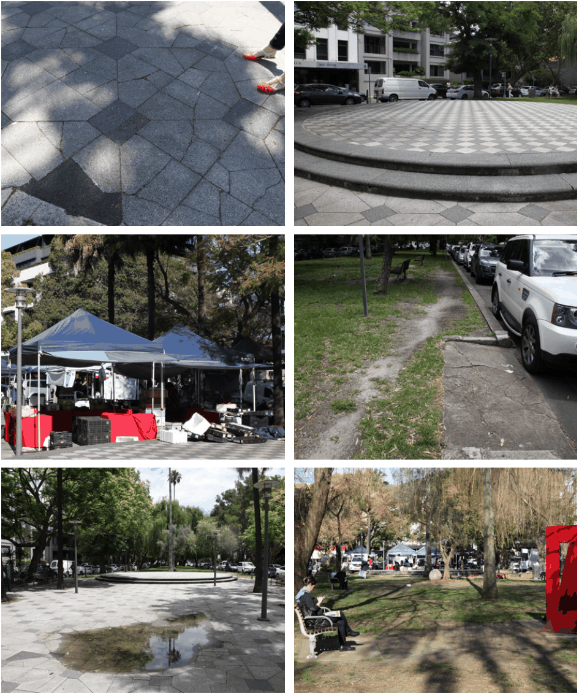

> [Picture on page 32: a picture, saved as a picture (images/public-domain-strategy-page-32-8.gif, 150 dpi).]

#### THE CENTRE

#### DIAGRAM B1.2.1 GUILFOYLE PARK PLAZA  POTENTIAL UPGRADE

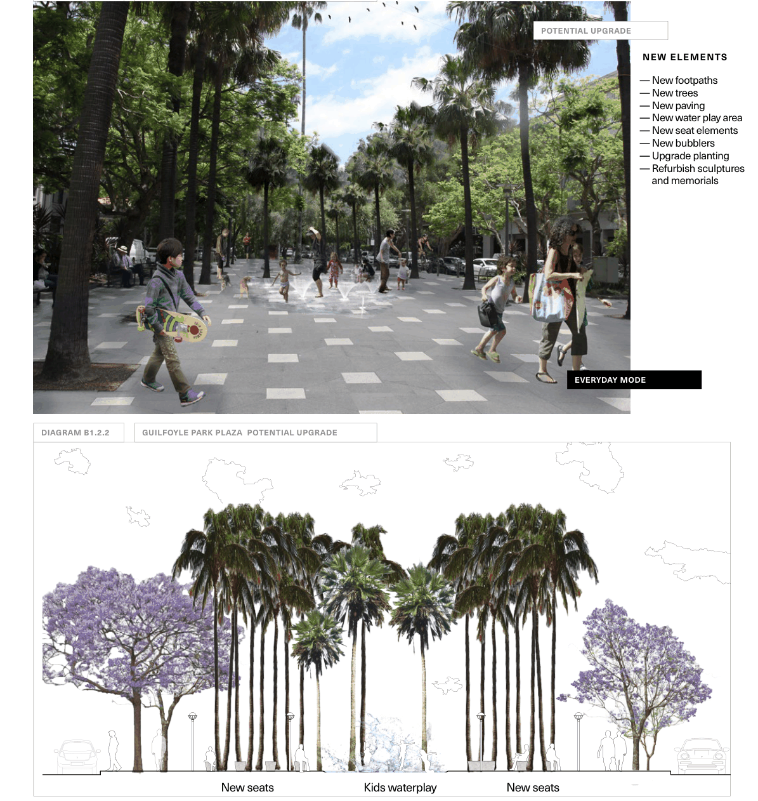

> [Picture on page 33: a picture, saved as a picture (images/public-domain-strategy-page-33-3.gif, 150 dpi).]
> Words printed on the picture (title and legend, copied from the PDF):
> POTENTIAL UPGRADE
> EVERYDAY MODE

#### NEW ELEMENTS

— New footpaths — New trees — New paving — New water play area — New seat elements — New bubblers — Upgrade planting — Refurbish sculptures and memorials

> Words printed on the picture (title and legend, copied from the PDF):
> DIAGRAM B1.2.2 GUILFOYLE PARK PLAZA  POTENTIAL UPGRADE

GUILFOYLE PLAZA

An outdoor place to sit and relax in

Guilfoyle is an Irish surname. It originates from the Gaelic ‘Mac Giolla Phŏil’, meaning ‘son (or descendant) of the follower of St Paul’

Providing additional dedicated seating areas and sitting

edges on walls allows more people to use the plaza and park

to watch the world go by, socialise, have a coffee, strike up a

conversation or just sit in the sun or shade. Additional palm

trees will be planted to wall the space.

#### THE CENTRE

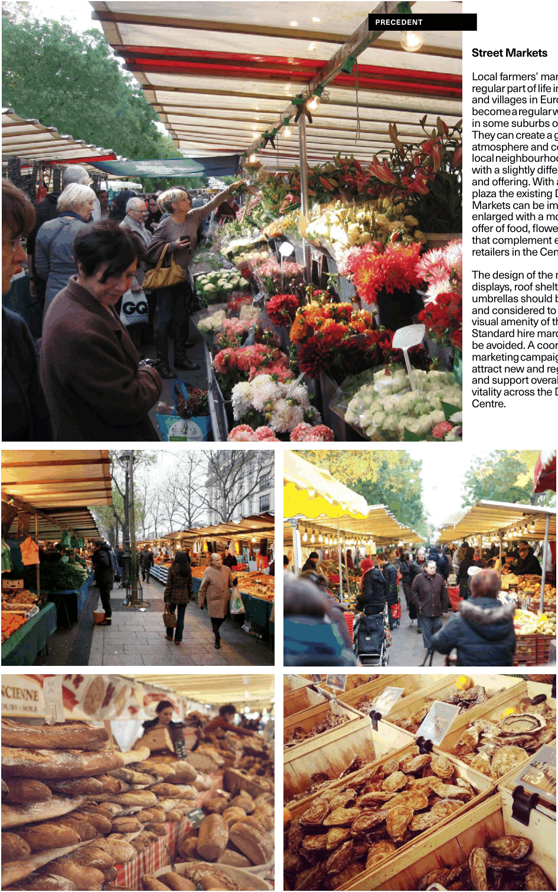

> [Picture on page 34: a picture, saved as a picture (images/public-domain-strategy-page-34-2.gif, 150 dpi).]
> Words printed on the picture (title and legend, copied from the PDF):
> PRECEDENT

#### Street Markets

Local farmers’ markets are a

regular part of life in many towns

and villages in Europe and have

become a regular weekly activity

in some suburbs of Sydney.

They can create a great sense of

atmosphere and community in

local neighbourhoods, each one

with a slightly different flavour

and offering. With an enhanced

plaza the existing Double Bay

Markets can be improved and

enlarged with a more diverse

offer of food, flowers and goods

that complement existing

retailers in the Centre. The design of the markets,

displays, roof shelters and

umbrellas should be designed

and considered to improve the

visual amenity of the space.

Standard hire marquees should

be avoided. A coordinated

marketing campaign would help

attract new and regular visitors

and support overall economic

vitality across the Double Bay

Centre.

#### THE CENTRE

#### A versatile town square for civic activities

As the landmark public space in the centre of the Double

Bay neighbourhood, the plaza should work on a number of

levels from everyday use to events,

such as concerts, outdoor films, fairs and markets.

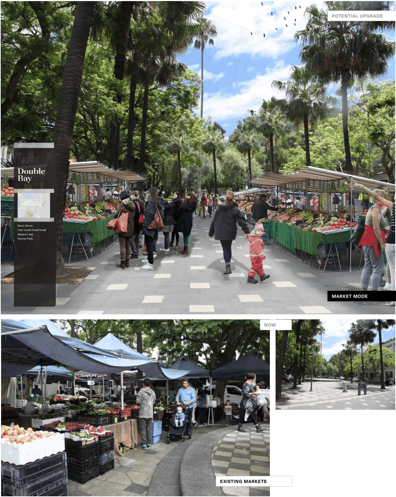

> [Picture on page 35: a picture, saved as a picture (images/public-domain-strategy-page-35-7.gif, 150 dpi).]
> Words printed on the picture (title and legend, copied from the PDF):
> POTENTIAL UPGRADE
> MARKET MODE
> NOW
> EXISTING MARKETS

#### THE CENTRE

#### KEY CONCEPT

#### WHAT TO DO

### B1.03

### Cross Street &

### Transvaal Avenue

Strengthen the Cross Street and

#### Transvaal Avenue corner with addi-

tional outdoor dining areas, new plant-ing and other urban design elements.

1\.	Upgrade paving with stone paving.

2\.	Increase outdoor dining areas using tables and chairs.

3\.	Increase shade with use of umbrellas and tree planting.

4\.	Install incidental public seating.

5\.	Install potted plants, vines, trellises and roof gardens to soften and cool the public domain.

#### One of the very unique urban

settings in Double Bay is the

outdoor dining area occupying

the island in the centre of the road

space on Transvaal Avenue near

Cross Street. The location is a

popular sunny location for meeting

and watching the activity on the

street and forms an identifiable

precinct in the northern part of the

#### Double Bay Centre.

Opportunities and

#### Recommendations

•	Upgrade and repave the open

public area of Double Bay Plaza in

cooperation with the owner.

•	Undertake a minor upgrade to median

outdoor dining area with new bollards,

tree lighting, paving.

•	Investigate temporary events, art and

street furniture that will stimulate

activity in the plaza and adjacent

streets and footpaths.

•	Improve the appearance, storage and

collection of commercial waste on

Transvaal Avenue.

#### Conditions and Issues

The intersection of Cross Street and

Transvaal Avenue is a well established

attractor in Double Bay. Cross Street is

paved in Double Bay Suite stone paving

between Bay Street and New South

Head Road with lighting and seating

along the length of the upgraded areas.

The existing pedestrian crossing at

Transvaal Avenue links to the laneway

network along Goldman Lane to Knox

Lane and Knox Street.

The median island on Transvaal Avenue

contains a number of large trees include

Brushbox and hedged areas on the

perimeter. The potential upgrade of the

Cross Street Car Park site will further

enhance the Cross Street and Transvaal

Precinct and should be planned in con-

sideration of the existing street life and

activity and network of urban spaces.

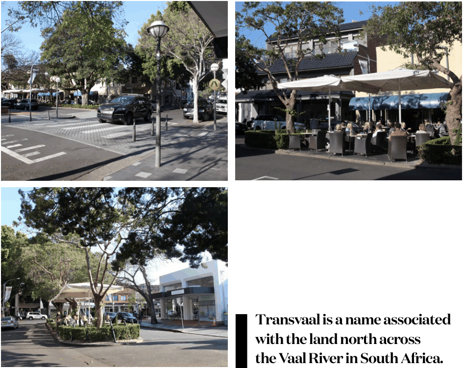

> [Picture on page 36: a picture, saved as a picture (images/public-domain-strategy-page-36-67.gif, 150 dpi).]

### Transvaal is a name associated with the land north across the Vaal River in South Africa.

#### THE CENTRE

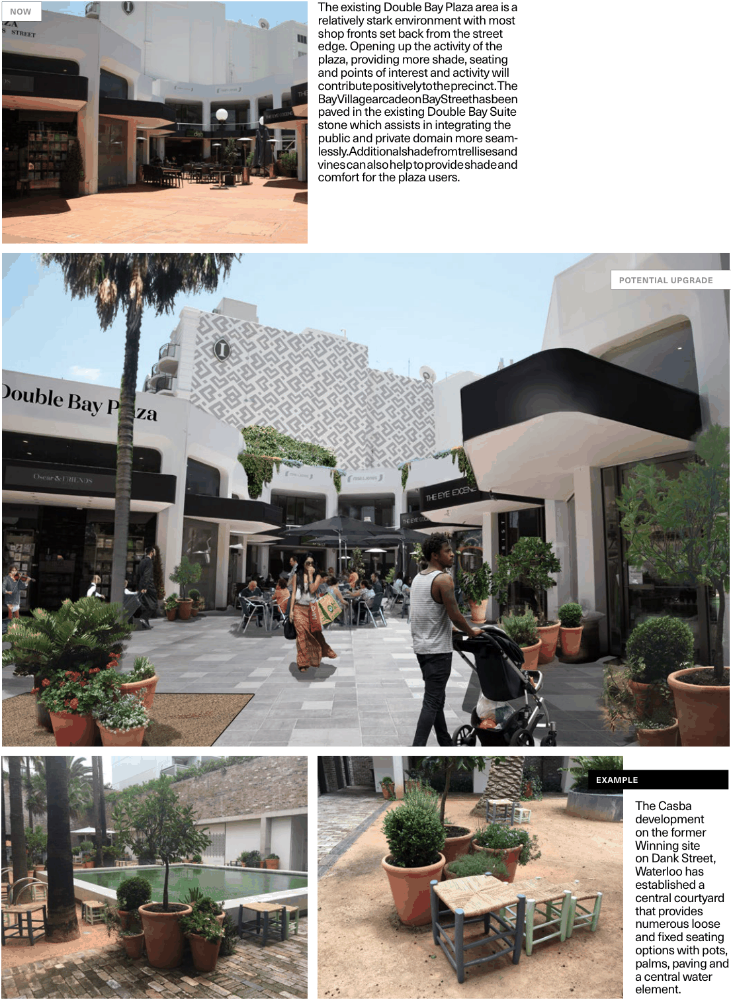

> [Picture on page 37: a map, saved as a picture (images/public-domain-strategy-page-37-2.gif, 150 dpi); the street names and other small labels are on the picture.]
> Words printed on the picture (title and legend, copied from the PDF):
> on the former
> on Dank Street,
> and fixed seating
> options with pots,
> palms, paving and
> a central water

The existing Double Bay Plaza area is a

relatively stark environment with most

shop fronts set back from the street

edge. Opening up the activity of the

plaza, providing more shade, seating

and points of interest and activity will

contribute positively to the precinct. The

Bay Village arcade on Bay Street has been

paved in the existing Double Bay Suite

stone which assists in integrating the

public and private domain more seam-

lessly. Additional shade from trellises and

vines can also help to provide shade and

comfort for the plaza users.

#### THE CENTRE

#### KEY CONCEPT

#### WHAT TO DO

### B1.04

Jamberoo Creek,

Jamberoo Lane and

### Cross Lane

Develop a vision to upgrade the

#### Jamberoo Creek area between

William Street and Cross Street, with improved pedestrian amenity, new public spaces and new environmental improvements  to the creek line.

1\.	Create a new public square and urban park at the intersection of Cross Street and Jamberoo Lane.

2\.	Rearrange traffic and laneway access to improve pedestrian and cycle amenity.

3\.	Upgrade lighting and footpaths.

#### A system of open and closed

concrete stormwater channels,

owned by Sydney Water, runs

from an upper catchment area

in Cooper Park to the Bay, along

the approximate line of the

former Jamberoo Creek, with the

infrastructure apparent in the

centre on  an easement along

#### Jamberoo Lane and Kiaora Road. Any redevelopment of the Cross

#### Street Car Park site with a long

frontage to Jamberoo Lane and

#### Cross Lane provides  opportunity

for this important environmental,

infrastructure and public domain

upgrade to become a new

gathering and meeting space in

the centre.

#### Conditions and Issues

A program of urban projects can

develop a preliminary conceptual

approaches to improving stormwater

quality and better integrating these

stormwater elements into existing

streets, squares and parks. The public

space between William Street and Cross

Street is currently in poor condition and

minimum of dedicated footpath space.

Lighting is also poor, which gives a

perception of the space being unsafe at

night. The creek line contains a number

of major trees including eucalyptus,

casuarinas and palms. The top of the

stormwater channel  is an exposed

concrete slab, with a second drainage

channel located under Jamberoo Lane

roadway. Cross Lane provides rear access

to 16 apartment buildings and two

commercial properties at the corner of

New South Head Road.

Opportunities and

#### Recommendations

•	Better utilise the existing infrastructure

corridor as a potential resource to

increase the quality of open space and

links available to the centre.

•	Create a new public urban square and

park at the intersection of Jamberoo

Lane and Cross Street.

•	Reroute traffic and minimise vehicle

movements on Jamberoo and Cross

Lanes.

•	Improve the urban amenity of the

corridor and combine landscape treat-

ment with water quality improvement

measures.

•	Meet all Sydney Water requirements

necessary to protect the structural

integrity of drains, ensure public safety

and minimise flooding.

•	Any design proposals are subject to

further detailed design and hydraulic

studies undertaken in conjunction with

Sydney Water.

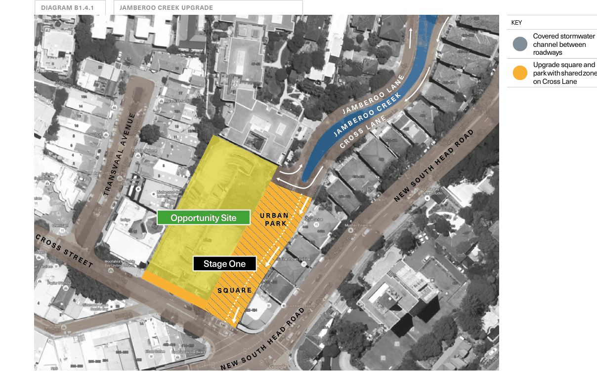

> [Picture on page 38: a map, saved as a picture (images/public-domain-strategy-page-38-85.gif, 150 dpi); the street names and other small labels are on the picture.]
> Words printed on the picture (title and legend, copied from the PDF):
> DIAGRAM B1.4.1 JAMBEROO CREEK UPGRADE
> Upgrade square and
> park with shared zone
> on Cross Lane
> R O E
> B E R
> M L A
> J A S
> CAR PA R K
> PA R K

#### Opportunity Site

#### Stage One

#### THE CENTRE

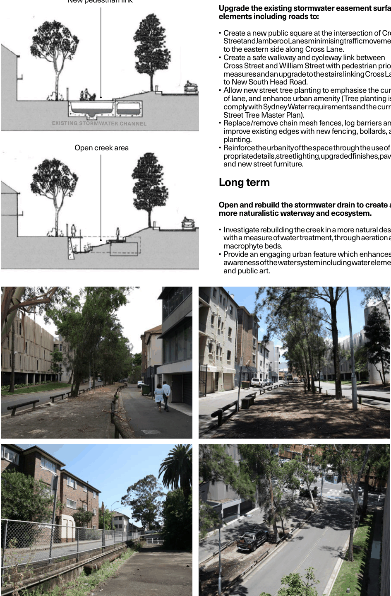

> [Picture on page 39: a picture, saved as a picture (images/public-domain-strategy-page-39-2.gif, 150 dpi).]
> Words printed on the picture (title and legend, copied from the PDF):
> EXISTING STORMWATER CHANNEL
> Open creek area

### Short term

New pedestrian link

#### Upgrade the existing stormwater easement surface

elements including roads to:

•	Create a new public square at the intersection of Cross

Street and Jamberoo Lanes minimising traffic movements

to the eastern side along Cross Lane.

•	Create a safe walkway and cycleway link between

Cross Street and William Street with pedestrian priority

measures and an upgrade to the stairs linking Cross Lane

to New South Head Road.

•	Allow new street tree planting to emphasise the curve

of lane, and enhance urban amenity (Tree planting is to

comply with Sydney Water requirements and the current

Street Tree Master Plan).

•	Replace/remove chain mesh fences, log barriers and

improve existing edges with new fencing, bollards, and

planting.

•	Reinforce the urbanity of the space through the use of ap-

propriate details, street lighting, upgraded finishes, paving

and new street furniture.

### Long term

Open and rebuild the stormwater drain to create a

more naturalistic waterway and ecosystem.

•	Investigate rebuilding the creek in a more natural design

with a measure of water treatment, through aeration and

macrophyte beds.

•	Provide an engaging urban feature which enhances

awareness of the water system including water elements

and public art.

1

3

2

4

1	 View north along exposed lid of the stormwater channel, flanked by log barriers. 2	 Towards William Street chain wire mesh fences surround the easement. 3	 View south towards Cross Street. 4	 View looking over the potential public square area at Cross Street.

#### LANEWAYS & SMALL STREETS

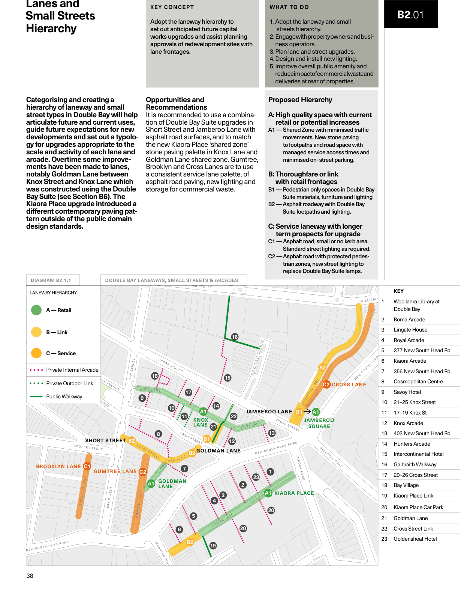

> [Picture on page 40: a map, saved as a picture (images/public-domain-strategy-page-40-2.gif, 150 dpi); the street names and other small labels are on the picture.]
> [Picture text on page 40 is stored in the PDF without readable letters (no character map), so it could not be copied; see the original PDF.]
> Words printed on the picture (title and legend, copied from the PDF):
> WHAT TO DO
> Adopt the laneway hierarchy to
> set out anticipated future capital
> works upgrades and assist planning
> approvals of redevelopment sites with
> 1\.	Adopt the laneway and small
> 2\.	Engage with property owners and busi-
> 3\.	Plan lane and street upgrades.
> 4\.	Design and install new lighting.
> 5\.	Improve overall public amenity and
> reduce impact of commercial waste and
> deliveries at rear of properties.
> A1 — Shared Zone with minimised traffic
> movements. New stone paving
> to footpaths and road space with
> managed service access times and
> minimised on–street parking.
> B1 — Pedestrian only spaces in Double Bay
> Suite materials, furniture and lighting
> B2 — Asphalt roadway with Double Bay
> Suite footpaths and lighting.
> C1 — Asphalt road, small or no kerb area.
> Standard street lighting as required.
> C2 — Asphalt road with protected pedes-
> trian zones, new street lighting to
> replace Double Bay Suite lamps.
> DIAGRAM B2.1.1 DOUBLE BAY LANEWAYS, SMALL STREETS & ARCADES
> 1 Woollahra Library at
> A — Retail
> 2 Roma Arcade
> A LEVEL: RET
> 3 Lingate House
> B — Link
> 4 Royal Arcade
> B LEVEL: LIN
> 5 377 New South Head Rd
> C — Service
> C LEVEL: SER
> 6 Kiaora Arcade
> Private Internal Arcade
> 7 356 New South Head Rd
> 8 Cosmopolitan Centre
> Private Outdoor Link
> 9 Savoy Hotel
> 10 21–25 Knox Street
> JAMBEROO LANE A1
> 11 17–19 Knox St
> 2 ROMA ARCAD
> 12 Knox Arcade 3 LINGATE HOU
> 13 402 New South Head Rd
> 5 377 N.S HEAD
> SHORT STREET B2
> 14 Hunters Arcade
> GOLDMAN LANE NEWSOUTHHEADROAD
> 15 Intercontinental Hotel
> 356 - 366
> N.S HEAD RO
> 16 Galbraith Walkway
> BROOKLYN LANE C1
> GUMTREE LANE C2
> 17 20–26 Cross Street
> 9 SAVOY HOTE
> 18 Bay Village 21 - 25 KNOX
> 17 - 19 KNOX
> 19 Kiaora Place Link
> BROOK LY NLANE
> B AY STREET
> B AY STREET
> 20 Kiaora Place Car Park
> 402 N.S HEAD
> 21 Goldman Lane
> 15 INTERCON. H
> 22 Cross Street Link
> 23 Goldensheaf Hotel
> 20 - 26 CROS

### B2.01

Lanes and

### Small Streets

### Hierarchy

#### Proposed Hierarchy

#### AHigh quality space with current

retail or potential increases

#### B: Thoroughfare or link

with retail frontages

Opportunities and

#### Recommendations

It is recommended to use a combina-

tion of Double Bay Suite upgrades in

Short Street and Jamberoo Lane with

asphalt road surfaces, and to match

the new Kiaora Place ‘shared zone’

stone paving palette in Knox Lane and

Goldman Lane shared zone. Gumtree,

Brooklyn and Cross Lanes are to use

a consistent service lane palette, of

asphalt road paving, new lighting and

storage for commercial waste.

#### C: Service laneway with longer

Categorising and creating a

hierarchy of laneway and small

street types in Double Bay will help

articulate future and current uses,

guide future expectations for new

developments and set out a typolo-

gy for upgrades appropriate to the

scale and activity of each lane and

arcade. Overtime some improve-

ments have been made to lanes,

notably Goldman Lane between

#### Knox Street and Knox Lane which

was constructed using the Double

#### Bay Suite (see Section B6). The

Kiaora Place upgrade introduced a

different contemporary paving pat-

tern outside of the public domain

design standards.

term prospects for upgrade

Laneways and

### Small Streets

### Typical Treatments

#### Laneways within Double Bay have

excellent potential for additional

retail and hospitality venues.

Standards for the design of paving,

awnings, signage and garbage

storage areas are critical to the

encouragement and success of

new businesses on lanes.

1

2

#### LANEWAYS & SMALL STREETS

#### KEY CONCEPT

#### WHAT TO DO

### B2.02

#### A palette of paving materials, lighting

and planting for laneways is to be

created to ensure continuity and

consistency in the public domain and

articulate the character of each lane-

way typology in the hierarchy.

1\.	Adopt standards for public domain materials and lighting design for each type of laneway or small street.

2\.	Improve pedestrian amenity in lanes, with bollards and protection measures where conflict may occur with vehicles, delivery areas and building entrances.

Opportunities and

#### Recommendations

Append the Double Bay Public Domain

manual with guidelines for laneway

refurbishment following the Laneway

and Small Streets Hierarchy established

(B4.01) for all elements including paving,

awnings, signage, lighting and garbage

storage.

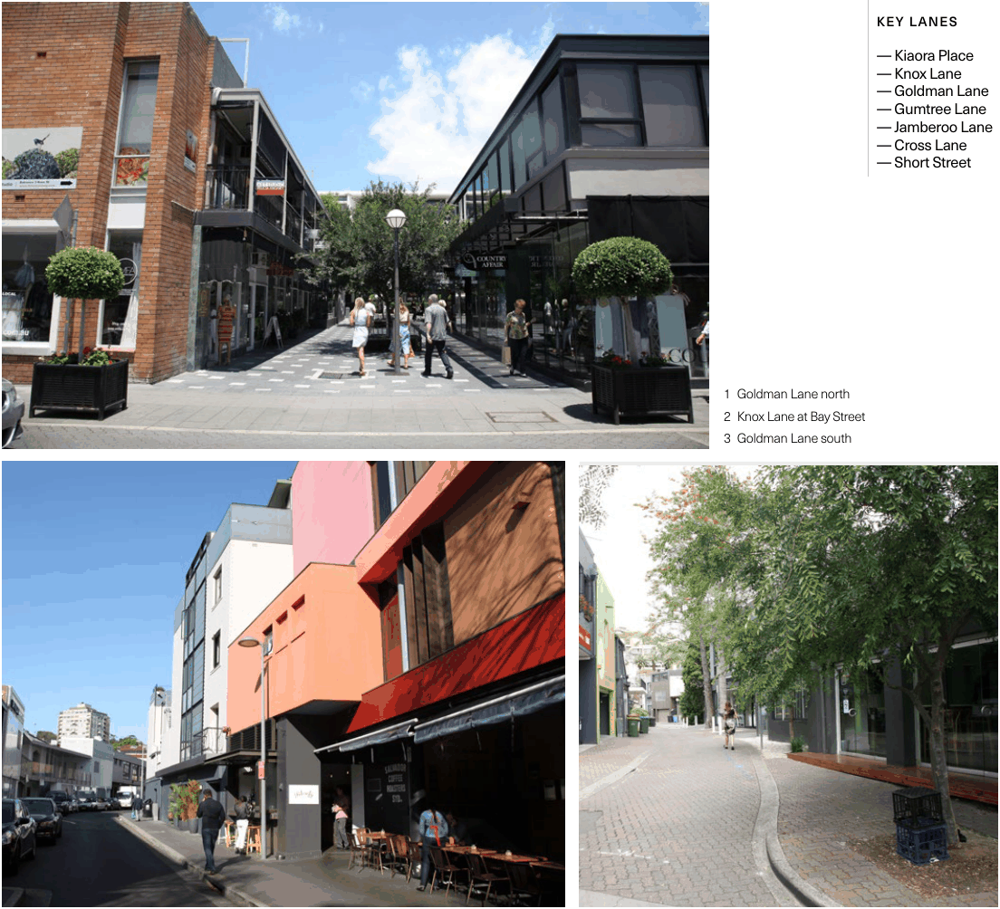

> [Picture on page 41: a picture, saved as a picture (images/public-domain-strategy-page-41-40.gif, 150 dpi).]
> Words printed on the picture (title and legend, copied from the PDF):
> KEY LANES
> — Kiaora Place
> — Knox Lane
> — Goldman Lane
> — Gumtree Lane
> — Jamberoo Lane
> ­— Cross Lane
> — Short Street
> 1	 Goldman Lane north
> 2 	Knox Lane at Bay Street
> 3	 Goldman Lane south

3

#### LANEWAYS & SMALL STREETS

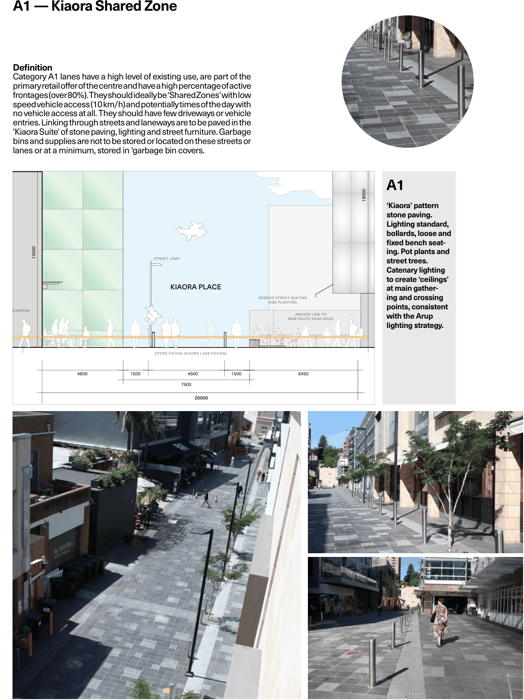

> [Picture on page 42: a map, saved as a picture (images/public-domain-strategy-page-42-2.gif, 150 dpi); the street names and other small labels are on the picture.]
> Words printed on the picture (title and legend, copied from the PDF):
> REMOVE STREET SEATING
> ARCADE LINK TO
> NEW SOUTH HEAD ROAD
> STONE PAVING (KIAORA LANE PAVING)
> bollards, loose and
> fixed bench seat-
> ing. Pot plants and
> to create ‘ceilings’
> at main gather-
> ing and crossing
> with the Arup
