### A1 — Kiaora Shared Zone

#### Definition

Category A1 lanes have a high level of existing use, are part of the

primary retail offer of the centre and have a high percentage of active

frontages (over 80%). They should ideally be ‘Shared Zones’ with low

speed vehicle access (10 km/h) and potentially times of the day with

no vehicle access at all. They should have few driveways or vehicle

entries. Linking through streets and laneways are to be paved in the

'Kiaora Suite' of stone paving, lighting and street furniture. Garbage

bins and supplies are not to be stored or located on these streets or

lanes or at a minimum, stored in 'garbage bin covers.

### A1

#### LANEWAYS & SMALL STREETS

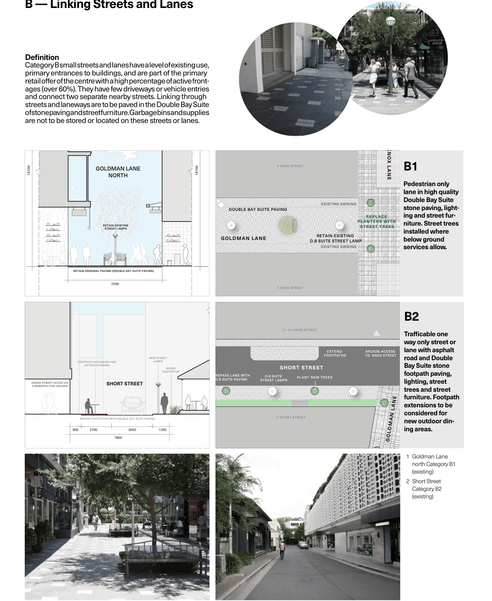

> [Picture on page 43: a map, saved as a picture (images/public-domain-strategy-page-43-2.gif, 150 dpi); the street names and other small labels are on the picture.]
> Words printed on the picture (title and legend, copied from the PDF):
> 5 KNOX STREET
> DOUBLE BAY SUITE PAVING
> D.B SUITE STREET LAMP
> lane in high quality
> Double Bay Suite
> stone paving, light-
> ing and street fur-
> niture. Street trees
> RETAIN ORIGINAL PAVING (DOUBLE BAY SUITE PAVING)
> 3 KNOX STREET
> 2—22 KNOX STREET
> TO  KNOX STREET
> FOOTPATH EXTENSION FOR
> REPAVE LANE WITH
> D.B SUITE PAVING
> PLANT NEW TREES
> CROSS STREET ACCES VIA
> 2 SHORT STREET
> REPAVE FOOTPATHS WITH DOUBLE BAY SUITE PAVING
> way only street or
> lane with asphalt
> road and Double
> Bay Suite stone
> trees and street
> extensions to be
> new outdoor din-
> 1	 Goldman Lane
> north Category B1
> 2	 Short Street

### B — Linking Streets and Lanes

#### Definition

Category B small streets and lanes have a level of existing use,

primary entrances to buildings, and are part of the primary

retail offer of the centre with a high percentage of active front-

ages (over 60%). They have few driveways or vehicle entries

and connect two separate nearby streets. Linking through

streets and laneways are to be paved in the Double Bay Suite

of stone paving and street furniture. Garbage bins and supplies

are not to be stored or located on these streets or lanes.

### B1

### B2

#### LANEWAYS & SMALL STREETS

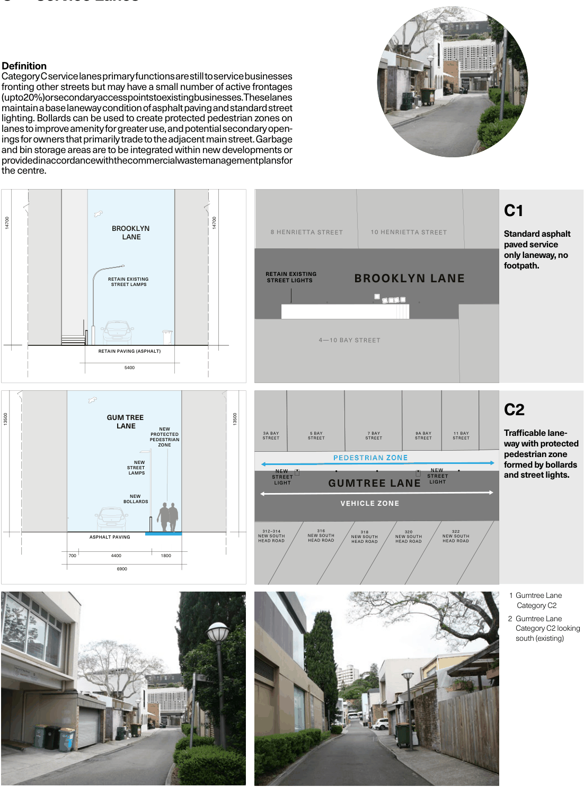

> [Picture on page 44: a map, saved as a picture (images/public-domain-strategy-page-44-2.gif, 150 dpi); the street names and other small labels are on the picture.]
> Words printed on the picture (title and legend, copied from the PDF):
> 8 HENRIETTA STREET 10 HENRIETTA STREET
> only laneway, no
> 4—10 BAY STREET
> RETAIN PAVING (ASPHALT)
> way with protected
> formed by bollards
> and street lights.
> 1	Gumtree Lane
> 2	 Gumtree Lane
> Category C2 looking

### C — Service Lanes

#### Definition

Category C service lanes primary functions are still to service businesses

fronting other streets but may have a small number of active frontages

(up to 20%) or secondary access points to existing businesses. These lanes

maintain a base laneway condition of asphalt paving and standard street

lighting. Bollards can be used to create protected pedestrian zones on

lanes to improve amenity for greater use, and potential secondary open-

ings for owners that primarily trade to the adjacent main street. Garbage

and bin storage areas are to be integrated within new developments or

provided in accordance with the commercial waste management plans for

the centre.

### C1

#### BROOKLYN LANE

### C2

#### GUMTREE LANE

#### LANEWAYS & SMALL STREETS

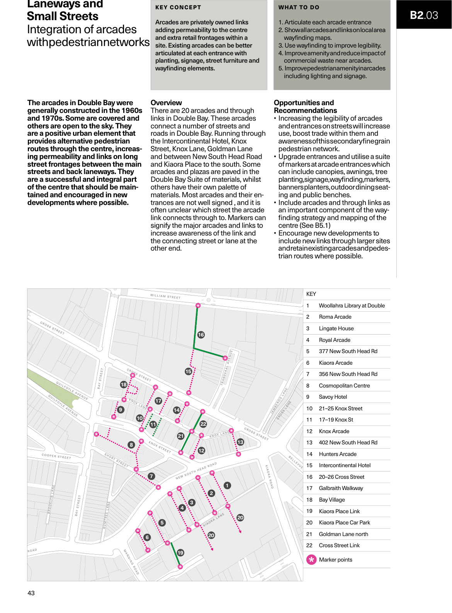

> [Picture on page 45: a map, saved as a picture (images/public-domain-strategy-page-45-2.gif, 150 dpi); the street names and other small labels are on the picture.]
> Words printed on the picture (title and legend, copied from the PDF):
> WHAT TO DO
> Arcades are privately owned links
> adding permeability to the centre
> and extra retail frontages within a
> site. Existing arcades can be better
> articulated at each entrance with
> planting, signage, street furniture and
> 1\. Articulate each arcade entrance
> 2\. Show all arcades and links on local area
> 3\. Use wayfinding to improve legibility.
> 4\. Improve amenity and reduce impact of
> commercial waste near arcades.
> 5\. Improve pedestrian amenity in arcades
> including lighting and signage.
> 1 Woollahra Library at Double
> 2 Roma Arcade
> 3 Lingate House
> A LEVEL: RETAIL
> 4 Royal Arcade
> 5 377 New South Head Rd B LEVEL: LINK
> 6 Kiaora Arcade
> C LEVEL: SERVICES
> 7 356 New South Head Rd
> 8 Cosmopolitan Centre
> 9 Savoy Hotel
> 10 21–25 Knox Street
> 11 17–19 Knox St
> 2 ROMA ARCADE
> 12 Knox Arcade
> 3 LINGATE HOUSE
> 13 402 New South Head Rd
> 5 377 N.S HEAD RD
> 14 Hunters Arcade
> 15 Intercontinental Hotel
> 356 - 366
> N.S HEAD ROAD
> 16 20–26 Cross Street
> 9 SAVOY HOTEL
> 17 Galbraith Walkway
> 10 21 - 25 KNOX ST
> 18 Bay Village
> 17 - 19 KNOX ST
> BROOK LY NLANE
> 19 Kiaora Place Link
> B AY STREET
> B AY STREET
> 402 N.S HEAD RD
> 20 Kiaora Place Car Park 14
> 21 Goldman Lane north
> 20 - 26 CROSS ST
> 22 Cross Street Link

### B2.03

### Small Streets

### Integration of arcades

### with pedestrian networks

#### The arcades in Double Bay were

generally constructed in the 1960s

and 1970s. Some are covered and

others are open to the sky. They

are a positive urban element that

provides alternative pedestrian

routes through the centre, increas-

ing permeability and links on long

street frontages between the main

streets and back laneways. They

are a successful and integral part

of the centre that should be main-

tained and encouraged in new

developments where possible.

#### Overview

There are 20 arcades and through

links in Double Bay. These arcades

connect a number of streets and

roads in Double Bay. Running through

the Intercontinental Hotel, Knox

Street, Knox Lane, Goldman Lane

and between New South Head Road

and Kiaora Place to the south. Some

arcades and plazas are paved in the

Double Bay Suite of materials, whilst

others have their own palette of

materials. Most arcades and their en-

trances are not well signed , and it is

often unclear which street the arcade

link connects through to. Markers can

signify the major arcades and links to

increase awareness of the link and

the connecting street or lane at the

other end.

Opportunities and

#### Recommendations

•	Increasing the legibility of arcades

and entrances on streets will increase

use, boost trade within them and

awareness of this secondary fine grain

pedestrian network.

•	Upgrade entrances and utilise a suite

of markers at arcade entrances which

can include canopies, awnings, tree

planting, signage, wayfinding, markers,

banners planters, outdoor dining seat-

ing and public benches.

•	Include arcades and through links as

an important component of the way-

finding strategy and mapping of the

centre (See B5.1)

•	Encourage new developments to

include new links through larger sites

and retain existing arcades and pedes-

trian routes where possible.

#### * 22

#### * 19

### *

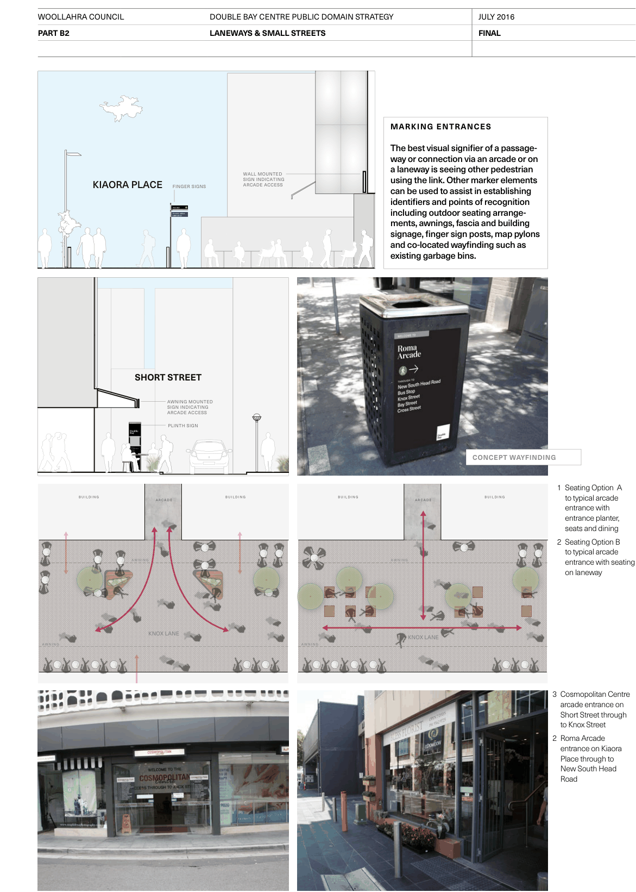

> [Picture on page 46: a map, saved as a picture (images/public-domain-strategy-page-46-1.gif, 150 dpi); the street names and other small labels are on the picture.]
> Words printed on the picture (title and legend, copied from the PDF):
> LANEWAYS & SMALL STREETS
> 1-20 DOUBLE BAY 2022
> The best visual signifier of a passage-
> way or connection via an arcade or on
> a laneway is seeing other pedestrian
> using the link. Other marker elements
> can be used to assist in establishing
> identifiers and points of recognition
> including outdoor seating arrange-
> ments, awnings, fascia and building
> signage, finger sign posts, map pylons
> and co-located wayfinding such as
> existing garbage bins.
> New South Head Road
> 1	 Seating Option  A
> to typical arcade
> seats and dining
> 2	 Seating Option B
> to typical arcade
> entrance with seating

#### KIAORA PLACE

3	 Cosmopolitan Centre arcade entrance on Short Street through to Knox Street 2	 Roma Arcade entrance on Kiaora Place through to New South Head Road

#### LANEWAYS & SMALL STREETS

#### KEY CONCEPT

#### WHAT TO DO

### B2.04

### Small Streets

### Kiaora Place

#### Kiaora Place has had a successful

upgrade with new development on the south side of the lane, and an upgraded public domain including paving. The integration of the existing commercial activities on the north side of the lane with some minor additions will enhance the precinct.

1\.	Retain shared zone and minimise vehi-cle movements.

2\.	Better articulate arcades on the lane.

3\.	Encourage owners and operators to open to lane and improve façades.

4\.	Install additional incidental seating.

5\.	Install additional planters.

6\.	Upgrade existing lighting and utilise public art in key locations.

#### As part of the Kiaora Lands

redevelopment Kiaora Place has

recently been upgraded from a

rear service lane and on grade

car park to a high amenity shared

street with new street fronting

retail, supermarket, cafés, outdoor

dining, paving and lighting.

#### Conditions and Issues

Kiaora Place is categorised A1—

Shared Zone Retail Lane, and is the

primary activity spine for the southern

section of Double Bay Centre. As is

the case with Knox Lane, there is a

comprehensive arcade and small lane

network connecting Kiaora Place to

adjacent streets, New South Head

Road and back into the retail and

car park to the south. A small but

appropriately scaled public space

exists where Kiaora Place widens as

place to gather, meet friends and ob-

serve the street life. Some tenancies

on New South Head Road connect

through to Kiaora Place, including

The Goldensheaf Hotel, which has es-

tablished a model for how to activate

their laneway frontage. The lane is a

shared zone for vehicles and pedes-

trians. The lane is around 1700m2 in

area.

Opportunities and

#### Recommendations

•	Consider Kiaora Place and Knox

Lane as similar types of active lanes,

by ensuring similar surface treat-

ment, design approach and activa-

tion strategies, to provide a strong

secondary layer of retail options and

structure to the centre.

•	Ensure Kiaora Place remains a

shared zone, at least during quieter

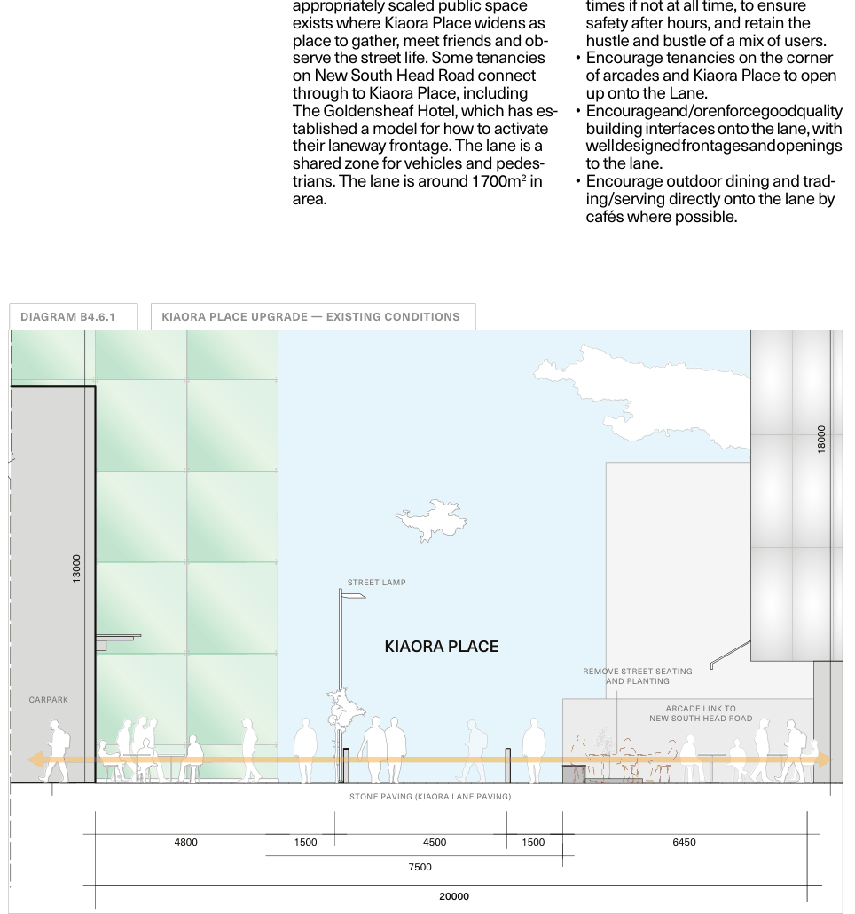

> [Picture on page 47: a picture, saved as a picture (images/public-domain-strategy-page-47-66.gif, 150 dpi).]
> Words printed on the picture (title and legend, copied from the PDF):
> cafés where possible.
> DIAGRAM B4.6.1 KIAORA PLACE UPGRADE — EXISTING CONDITIONS
> 18000
> 13000
> STREET LAMP
> REMOVE STREET SEATING
> AND PLANTING
> CARPARK
> ARCADE LINK TO
> NEW SOUTH HEAD ROAD
> STONE PAVING (KIAORA LANE PAVING)

times if not at all time, to ensure

safety after hours, and retain the

hustle and bustle of a mix of users.

•	Encourage tenancies on the corner

of arcades and Kiaora Place to open

up onto the Lane.

•	Encourage and/or enforce good quality

building interfaces onto the lane, with

well designed frontages and openings

to the lane.

•	Encourage outdoor dining and trad-

ing/serving directly onto the lane by

#### NEW ELEMENTS

— New kerb extensions — Tree planting — Wayfinding — Improved laneway con-nections and markers — Street lighting — Entrance canopies — Public art — Events

#### KIAORA PLACE

#### LANEWAYS & SMALL STREETS

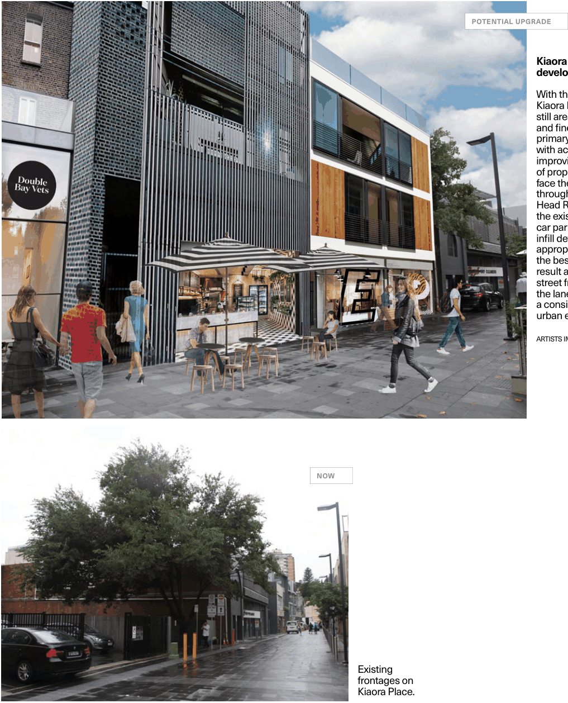

> [Picture on page 48: a picture, saved as a picture (images/public-domain-strategy-page-48-2.gif, 150 dpi).]
> Words printed on the picture (title and legend, copied from the PDF):
> NOW
> Existing
> frontages on
> Kiaora Place.
> POTENTIAL UPGRADE

#### Kiaora infill

development With the completion of

Kiaora Place there are

still areas to upgrade

and fine tune. The

primary concern is

with activating and

improving the rear

of properties that

face the lane and run

through to New South

Head Road, including

the existing open

car park areas. New

infill development of

appropriate scale is

the best long term

result adding active

street frontage to

the lane, creating

a consistent active

urban edge.

ARTISTS IMPRESSION ONLY

#### LANEWAYS & SMALL STREETS

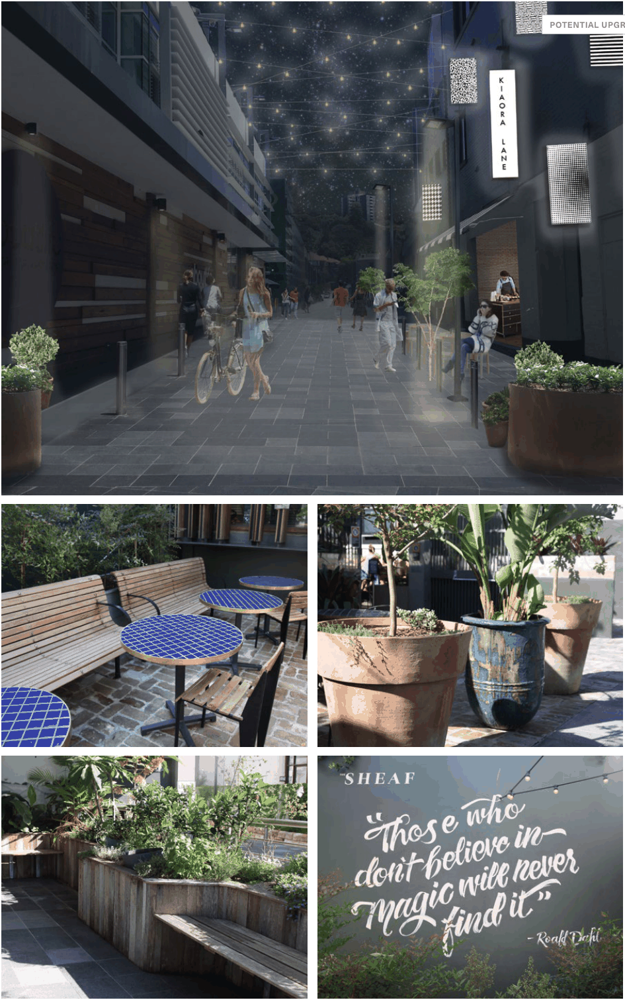

> [Picture on page 49: a picture, saved as a picture (images/public-domain-strategy-page-49-2.gif, 150 dpi).]
> Words printed on the picture (title and legend, copied from the PDF):
> POTENTIAL UPGRADE

#### Kiaora night

Consistent with

the lighting

strategy, a new

layer of lighting

is recommended

to create a vibrant

night time space

for evening

shopping and

hospitality.

A combination

of catenary, wall

mounted or in

bollard lighting

can be used to

add interest and

activity to the

laneway after

hours.

#### Kiaora casual

Around the edges

of Kiaora Place

there are new

design directions

appearing with a

softer and more

human sense

of habitation.

These elements

help to articulate

different types

of uses and

public domain

qualities that are

appropriate for

certain types of

businesses and

clientele. The

use of seating,

planters, artwork

and renovation

of frontages is

encouraged.

#### LANEWAYS & SMALL STREETS

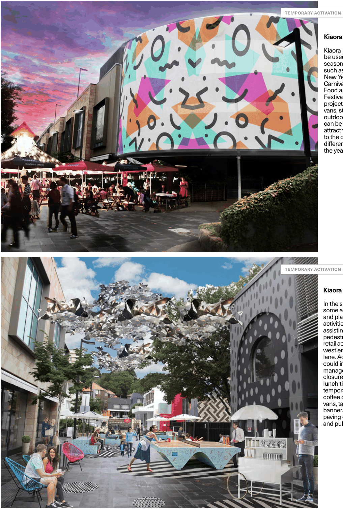

> [Picture on page 50: a picture, saved as a picture (images/public-domain-strategy-page-50-2.gif, 150 dpi).]
> Words printed on the picture (title and legend, copied from the PDF):
> TEMPORARY ACTIVATION
> the year.
> TEMPORARY ACTIVATION

#### Kiaora events

Kiaora Place can

be used for regular

seasonal events

such as Lunar

New Year, Spring

Carnival, Vivid and

Food and Wine

Festivals. Lighting,

projections, food

vans, stalls and

outdoor seating

can be used to

attract visitors

to the centre at

different times of

#### Kiaora activation

In the short term,

some activation

and place making

activities may

assist in generating

pedestrian and

retail activity at the

west end of the

lane. Activation

could include

managed street

closures during

lunch times,

temporary seating,

coffee carts, food

vans, table tennis,

banners, wall and

paving graphics

and public art.

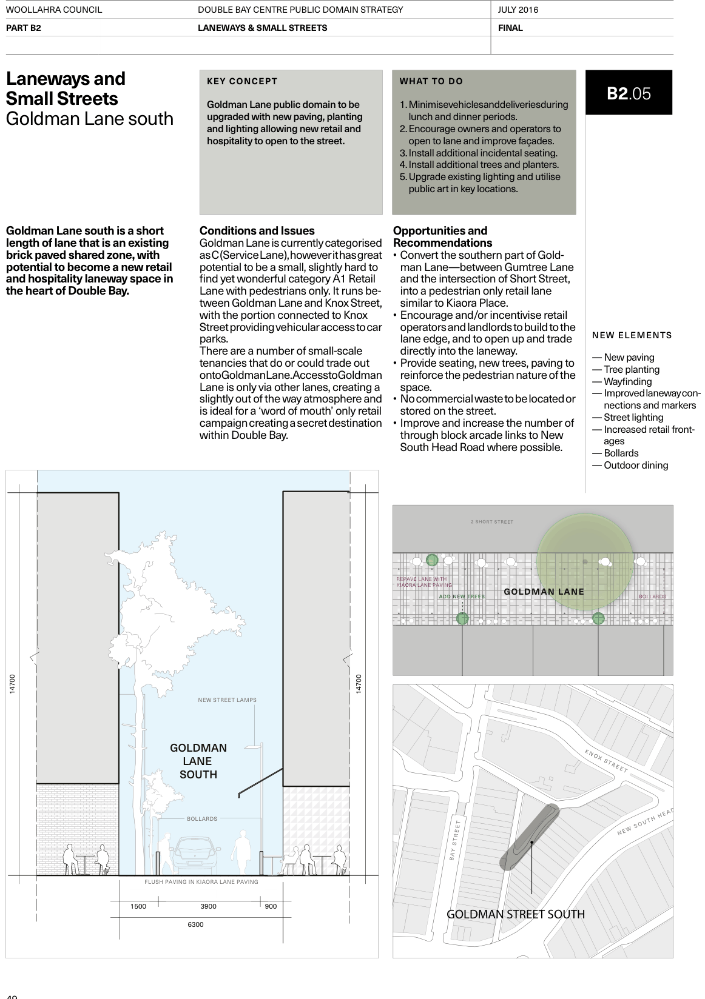

> [Picture on page 51: a map, saved as a picture (images/public-domain-strategy-page-51-1.gif, 150 dpi); the street names and other small labels are on the picture.]
> Words printed on the picture (title and legend, copied from the PDF):
> LANEWAYS & SMALL STREETS
> WHAT TO DO
> Goldman Lane public domain to be
> upgraded with new paving, planting
> and lighting allowing new retail and
> hospitality to open to the street.
> 1\.	Minimise vehicles and deliveries during
> lunch and dinner periods.
> 2\.	Encourage owners and operators to
> open to lane and improve façades.
> 3\.	Install additional incidental seating.
> 4\.	Install additional trees and planters.
> 5\.	Upgrade existing lighting and utilise
> public art in key locations.
> B AY STREET
> — New paving
> — Tree planting
> — Improved laneway con-
> nections and markers
> — Street lighting
> — Increased retail front-
> — Outdoor dining
> 2 SHORT STREET
> REPAVE LANE WITH
> KIAORA LANE PAVING
> GOLDMAN LANE BOLLARDS
> ADD NEW TREES
> NEW STREET LAMPS
> 352 NEW SOUTH
> 350 NEW SOUTH
> 348 NEW SOUTH
> 346 NEW SOUTH
> B AY STREET
> B AY STREET
> FLUSH PAVING IN KIAORA LANE PAVING
> GOLDMAN STREET SOUTH

### B2.05

### Small Streets

### Goldman Lane south

#### Goldman Lane south is a short

length of lane that is an existing

brick paved shared zone, with

potential to become a new retail

and hospitality laneway space in

the heart of Double Bay.

#### Conditions and Issues

Goldman Lane is currently categorised

as C (Service Lane), however it has great

potential to be a small, slightly hard to

find yet wonderful category A1 Retail

Lane with pedestrians only. It runs be-

tween Goldman Lane and Knox Street,

with the portion connected to Knox

Street providing vehicular access to car

parks.

There are a number of small-scale

tenancies that do or could trade out

onto Goldman Lane. Access to Goldman

Lane is only via other lanes, creating a

slightly out of the way atmosphere and

is ideal for a ‘word of mouth’ only retail

campaign creating a secret destination

within Double Bay.

Opportunities and

#### Recommendations

•	Convert the southern part of Gold-

man Lane—between Gumtree Lane

and the intersection of Short Street,

into a pedestrian only retail lane

similar to Kiaora Place.

•	Encourage and/or incentivise retail

operators and landlords to build to the

lane edge, and to open up and trade

directly into the laneway.

•	Provide seating, new trees, paving to

reinforce the pedestrian nature of the

space.

•	No commercial waste to be located or

stored on the street.

•	Improve and increase the number of

through block arcade links to New

South Head Road where possible.

C

#### GOLDMAN

#### LANE

#### SOUTH

HHEADROAD

#### LANEWAYS & SMALL STREETS

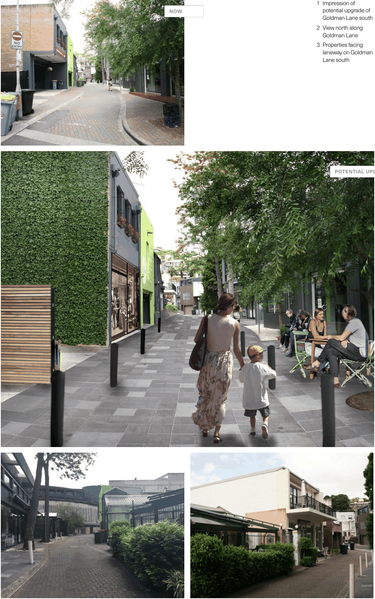

> [Picture on page 52: a picture, saved as a picture (images/public-domain-strategy-page-52-2.gif, 150 dpi).]
> Words printed on the picture (title and legend, copied from the PDF):
> NOW

1

2

1	 Impression of

potential upgrade of

Goldman Lane south

2	 View north along

Goldman Lane

3	 Properties facing

laneway on Goldman

Lane south

An upgraded

shared zone

environment

with pedestrian

zone protected

by bollards,

upgraded rear

access points

and over time

new shops and

developments

can contribute

to a calmer and

more inviting

public domain.

3

#### LANEWAYS & SMALL STREETS

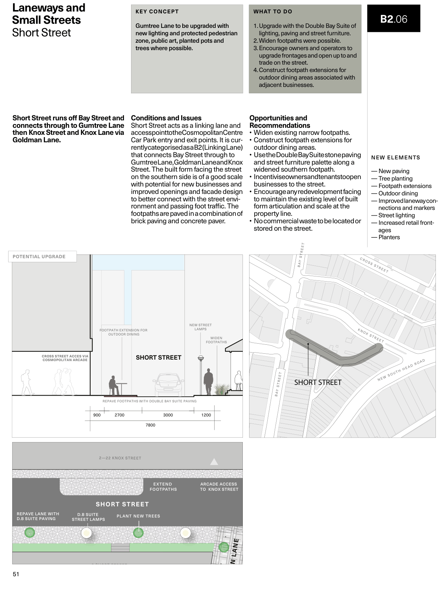

> [Picture on page 53: a map, saved as a picture (images/public-domain-strategy-page-53-2.gif, 150 dpi); the street names and other small labels are on the picture.]
> Words printed on the picture (title and legend, copied from the PDF):
> WHAT TO DO
> Gumtree Lane to be upgraded with
> new lighting and protected pedestrian
> zone, public art, planted pots and
> trees where possible.
> 1\.	Upgrade with the Double Bay Suite of
> lighting, paving and street furniture.
> 2\.	Widen footpaths were possible.
> 3\.	Encourage owners and operators to
> upgrade frontages and open up to and
> trade on the street.
> 4\.	Construct footpath extensions for
> outdoor dining areas associated with
> B AY STREET
> — New paving
> — Tree planting
> — Footpath extensions
> — Outdoor dining
> — Improved laneway con-
> nections and markers
> — Street lighting
> — Increased retail front-
> FOOTPATH EXTENSION FOR
> CROSS STREET ACCES VIA
> B AY STREET
> B AY STREET
> REPAVE FOOTPATHS WITH DOUBLE BAY SUITE PAVING
> 2—22 KNOX STREET
> TO  KNOX STREET
> REPAVE LANE WITH
> D.B SUITE PAVING
> PLANT NEW TREES
> 2 SHORT STREET

### B2.06

### Small Streets

### Short Street

Short Street runs off Bay Street and

connects through to Gumtree Lane

then Knox Street and Knox Lane via

#### Goldman Lane.

#### Conditions and Issues

Short Street acts as a linking lane and

access point to the Cosmopolitan Centre

Car Park entry and exit points. It is cur-

rently categorised as a B2 (Linking Lane)

that connects Bay Street through to

Gumtree Lane, Goldman Lane and Knox

Street. The built form facing the street

on the southern side is of a good scale

with potential for new businesses and

improved openings and facade design

to better connect with the street envi-

ronment and passing foot traffic. The

footpaths are paved in a combination of

brick paving and concrete paver.

Opportunities and

#### Recommendations

•	Widen existing narrow footpaths.

•	Construct footpath extensions for

outdoor dining areas.

•	Use the Double Bay Suite stone paving

and street furniture palette along a

widened southern footpath.

•	Incentivise owners and tenants to open

businesses to the street.

•	Encourage any redevelopment facing

to maintain the existing level of built

form articulation and scale at the

property line.

•	No commercial waste to be located or

stored on the street.

14700

#### LANEWAYS & SMALL STREETS

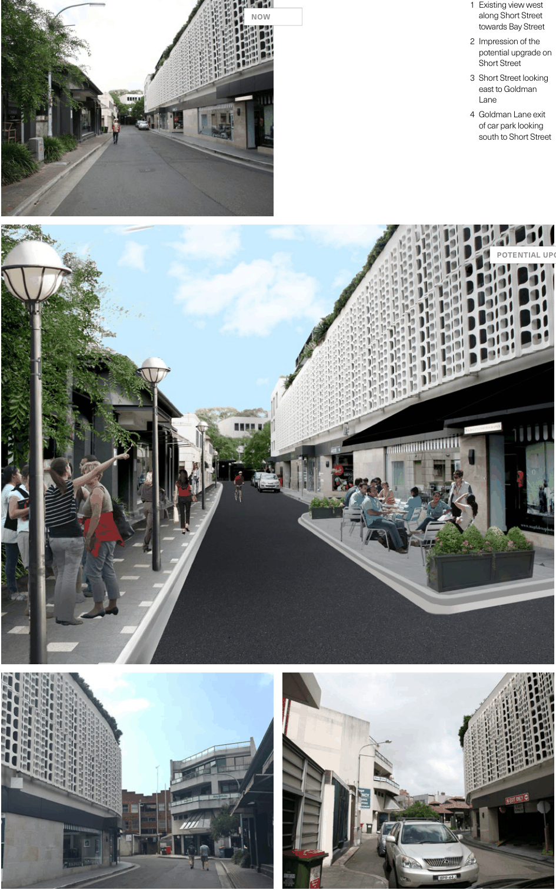

> [Picture on page 54: a picture, saved as a picture (images/public-domain-strategy-page-54-2.gif, 150 dpi).]
> Words printed on the picture (title and legend, copied from the PDF):
> NOW

2

3

1	 Existing view west

along Short Street

towards Bay Street

2	 Impression of the

potential upgrade on

Short Street

3	 Short Street looking

east to Goldman

Lane

4	 Goldman Lane exit

of car park looking

south to Short Street

Widening the

existing narrow

footpaths is a key

future project.

Upgrading the

footpath spaces

with the Double

Bay Suite of lights,

bollards and pav-

ing and replacing

some parking and

loading spaces will

increase activity

and options for the

street space.

4

DOUBLEB AY FERRYWHARF

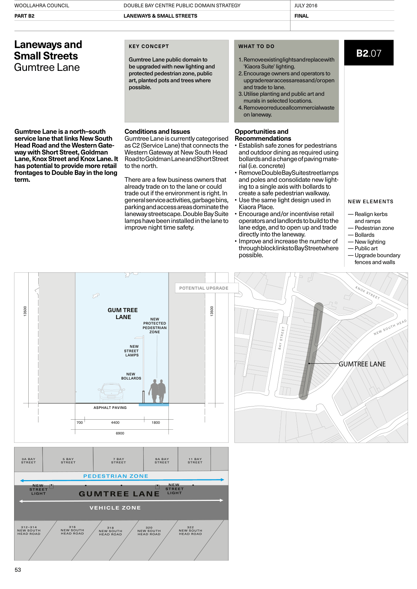

> [Picture on page 55: a map, saved as a picture (images/public-domain-strategy-page-55-3.gif, 150 dpi); the street names and other small labels are on the picture.]
> Words printed on the picture (title and legend, copied from the PDF):
> LANEWAYS & SMALL STREETS
> WHAT TO DO
> B AY STREET
> Gumtree Lane public domain to
> be upgraded with new lighting and
> protected pedestrian zone, public
> art, planted pots and trees where
> 1\.	Remove existing lights and replace with
> 'Kiaora Suite' lighting.
> 2\.	Encourage owners and operators to
> upgrade rear access areas and/or open
> and trade to lane.
> 3\.	Utilise planting and public art and
> murals in selected locations.
> 4\.	Remove or reduce all commercial waste
> — Realign kerbs
> — Pedestrian zone
> — New lighting
> — Public art
> — Upgrade boundary
> fences and walls
> B AY STREET
> B AY STREET

### B2.07

### Small Streets

### Gumtree Lane

#### Conditions and Issues

Gumtree Lane is currently categorised

as C2 (Service Lane) that connects the

Western Gateway at New South Head

Road to Goldman Lane and Short Street

to the north.

#### Gumtree Lane is a north–south

service lane that links New South

#### Head Road and the Western Gate-

way with Short Street, Goldman

#### Lane, Knox Street and Knox Lane. It

has potential to provide more retail

frontages to Double Bay in the long

term.

There are a few business owners that

already trade on to the lane or could

trade out if the environment is right. In

general service activities, garbage bins,

parking and access areas dominate the

laneway streetscape. Double Bay Suite

lamps have been installed in the lane to

improve night time safety.

Opportunities and

#### Recommendations

•	Establish safe zones for pedestrians

and outdoor dining as required using

bollards and a change of paving mate-

rial (i.e. concrete)

•	Remove Double Bay Suite street lamps

and poles and consolidate new light-

ing to a single axis with bollards to

create a safe pedestrian walkway.

•	Use the same light design used in

Kiaora Place.

•	Encourage and/or incentivise retail

operators and landlords to build to the

lane edge, and to open up and trade

directly into the laneway.

•	Improve and increase the number of

through block links to Bay Street where

OCEANAVENUE

#### GUMTREE LANE

#### LANEWAYS & SMALL STREETS

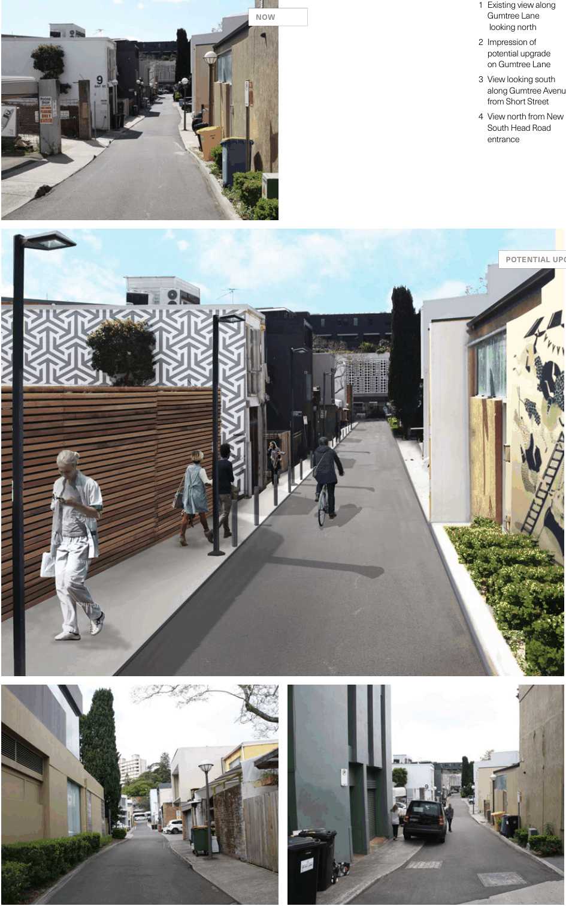

> [Picture on page 56: a picture, saved as a picture (images/public-domain-strategy-page-56-2.gif, 150 dpi).]
> Words printed on the picture (title and legend, copied from the PDF):
> NOW

2

3

1	 Existing view along Gumtree Lane

looking north

2	 Impression of

potential upgrade on Gumtree Lane 3	 View looking south along Gumtree Avenue from Short Street 4	 View north from New South Head Road entrance

4

#### GATEWAYS & APPROACHES

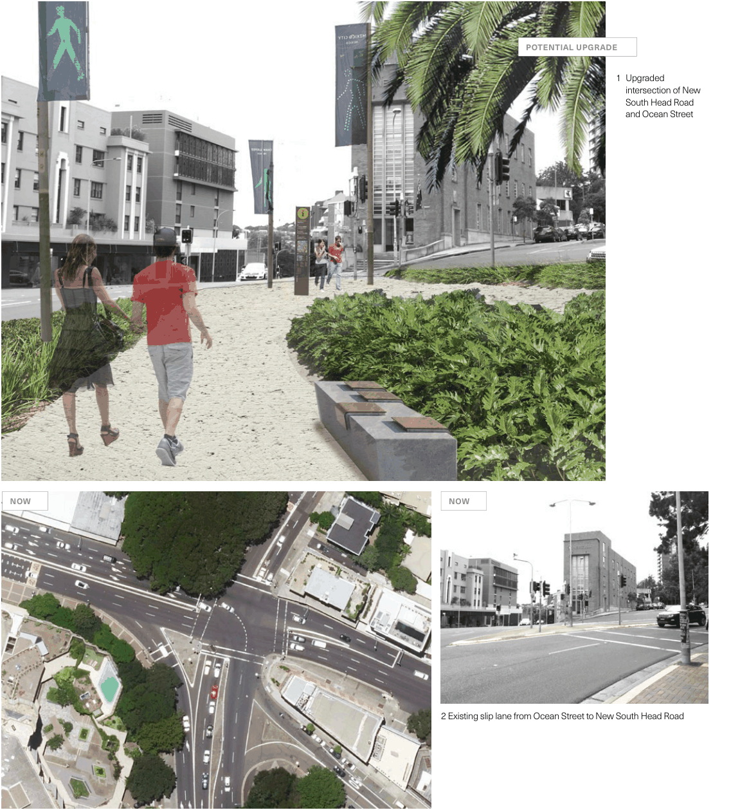

> [Picture on page 57: a picture, saved as a picture (images/public-domain-strategy-page-57-2.gif, 150 dpi).]
> Words printed on the picture (title and legend, copied from the PDF):
> NOW
> POTENTIAL UPGRADE
> 1	 Upgraded
> intersection of New
> South Head Road
> and Ocean Street
> NOW
> 2 Existing slip lane from Ocean Street to New South Head Road

#### GATEWAYS & APPROACHES

#### KEY CONCEPT

#### WHAT TO DO

### B3.01

### Edgecliff Gateway

### Edgecliff Station

### at Ocean Street

#### Upgrade the intersection of New

South Head Road, Ocean Street,

#### Ocean Avenue and Edgecliff Road

as the key arrival point to Double Bay from the west to improve pedestrian safety and improve amenity from a busy arterial road to a more pedestrian and cycle friendly place.

1\. Improve pedestrian priority and amen-ity at crossing points and reduce waiting times.

2\. Install benches, bubblers and wayfinding to increase amenity.

3\. Upgrade footpaths and use kerbside planting to create a buffer between traf-fic lanes and footpaths .

4\. Detailed Active Transport plan.

#### NEW ELEMENTS

•	Pedestrian priority

measures

•	Reduction in hard

paved areas to reduce

street heat

•	Additional planting

•	New trees

•	New lighting

•	Wayfinding

Arriving at Double Bay from the

city, via Edgecliff Station has a

number of challenges that include

busy roads with fast moving traffic,

poor quality pedestrian crossings,

lack of wayfinding legibility and

clear ‘address’. The Edgecliff Cen-

tre and Eastpoint is a large 1970s

train station development that has

a number of operational and public

domain amenity issues regarding

traffic management, pedestrians

and entering/exiting vehicles and

buses on surrounding streets.

#### Conditions and Issues

Pedestrian connections and general

amenity is compromised at this location

by multiple crossing points, interac-

tion with vehicles and generally poor

pavement condition. Walking and

cycling should be encouraged wherever

possible both for health benefits and

overall reduction in traffic generation,

pollution and the reduction in demand

for additional car parking spaces. The

current road design at Edgecliff is heavily

weighted towards maintaining high

speed vehicle movements and traffic

flow. To increase active transport levels

the streetscape needs redesign and

rebalance.

Opportunities and

recommendations

•	Pedestrian amenity to be improved

with shorter crossing times, slower traf-

fic and priority at driveways, entrances

and side streets.

•	Potential removal of the westbound

slip lane from Ocean Street to New

South Head Road.

•	Install new pedestrian and cycle way-

finding maps to Double Bay.

•	Install bubblers and seats.

•	Reduce ‘street heat’ generated by hard

paved areas by increasing the amount

of softscape planted areas and trees

•	Planting can also be used to guide

pedestrians and create a physical and

visual separation between traffic lanes

and pedestrian footpaths.

•	Upgrades to the gateway are to

consider other improvements to the

Edgecliff town centre area.

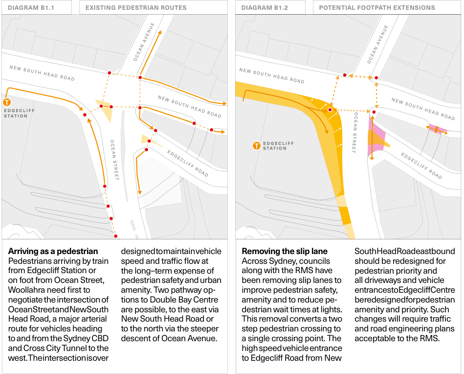

> [Picture on page 58: a map, saved as a picture (images/public-domain-strategy-page-58-88.gif, 150 dpi); the street names and other small labels are on the picture.]
> Words printed on the picture (title and legend, copied from the PDF):
> DIAGRAM B1.1 EXISTING PEDESTRIAN ROUTES
> DIAGRAM B1.2 POTENTIAL FOOTPATH EXTENSIONS KEY
> S TAT ION
> S TAT ION
> designed to maintain vehicle
> the long–term expense of
> pedestrian safety and urban
> amenity. Two pathway op-
> descent of Ocean Avenue.
> South Head Road eastbound
> should be redesigned for
> pedestrian priority and
> all driveways and vehicle
> entrances to Edgecliff Centre
> be redesigned for pedestrian
> amenity and priority. Such
> changes will require traffic
> and road engineering plans
> acceptable to the RMS.
> Pedestrians arriving by train
> from Edgecliff Station or
> Woollahra need first to
> negotiate the intersection of
> route for vehicles heading
> Across Sydney, councils
> improve pedestrian safety,
> step pedestrian crossing to
> high speed vehicle entrance

Upgrade crossings New footpath areas Existing footpath

speed and traffic flow at

tions to Double Bay Centre are possible, to the east via New South Head Road or to the north via the steeper

#### Arriving as a pedestrian

on foot from Ocean Street,

Ocean Street and New South Head Road, a major arterial

to and from the Sydney CBD and Cross City Tunnel to the

west. The intersection is over

#### Removing the slip lane

along with the RMS have been removing slip lanes to

amenity and to reduce pe-destrian wait times at lights. This removal converts a two

a single crossing point. The

to Edgecliff Road from New

#### GATEWAYS & APPROACHES

1	 Excessively wide and stark roadway and crossing point at Ocean Street and Edgecliff Road.

4	 Potential upgrade to traffic island and pedestrian crossing at the entrance to Edgecliff Road at Ocean Street.

2	 Existing intersection of New South Head Road at Ocean Street.

#### Existing Conditions

The existing footpaths and crossings

around Edgecliff Station and the Edge-

cliff Centre are in varying condition, use

various materials and are generally unin-

viting to pedestrians. There are a number

of wide crossings over side streets, car

park entries and bus interchange access

points that are poorly designed for pe-

destrians, giving much greater priority to

vehicle movements in most situations.

5	 Potential upgrade of footpath area at New South Head Road and Ocean Street with new planting, paving and trees.

#### Potential Improvements

•	Upgrade footpaths with new paving

and buffer gardens particularly in ‘No

Stopping’ areas and where pedestrian

crossings are best deterred and vehicle

access is not required.

•	Install new smartpoles with banners,

signage and new wayfinding to assist

pedestrians getting to

Double Bay.

•	Narrow side street and vehicle entry

points with better designed intersec-

tions that are safer for pedestrians and

cyclists.

3	 Ocean Street footpath with planted buffer garden to moderate traffic impacts and deter pedestrian crossing.

6 	New South Head Rd footpath with planted buffer verge garden.

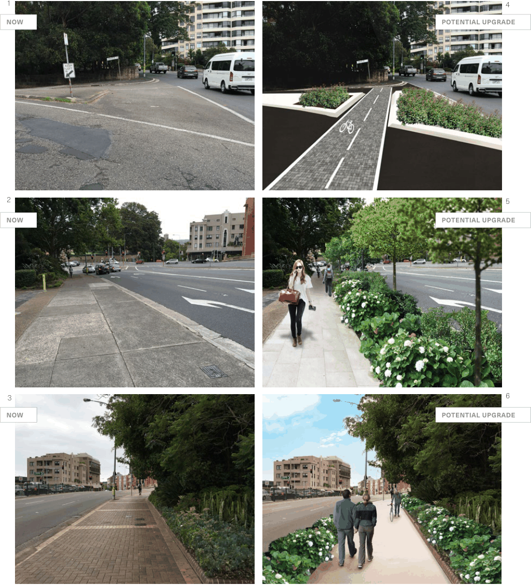

> [Picture on page 59: a picture, saved as a picture (images/public-domain-strategy-page-59-57.gif, 150 dpi).]
> Words printed on the picture (title and legend, copied from the PDF):
> 1
> 4
> NOW
> POTENTIAL UPGRADE

#### GATEWAYS & APPROACHES

#### KEY CONCEPT

#### WHAT TO DO

### B3.02

### Western Approach

Ocean Street to

### Bay Street along

### New South Head Road

#### Upgrade the streetscape to encourage

and better accommodate pedestrians and cyclists whilst moderating the impact of vehicle traffic on active transport. Facilitate cycling and walking on a shared path between the centre and Edgecliff Station on the southern footpath.

1\.	Widen footpaths where possible.

2\.	Improve crossing points and side street intersections.

3\.	Install smartpoles, benches, bubblers and wayfinding to increase amenity along the route.

4\.	Install new street trees.

5\.	Trial a shared path on the southern footpath for pedestrians and cyclists.

#### Conditions and Issues

The concrete footpaths between Ocean

Street in Edgecliff to Bay Street and Man-

ning Road in Double Bay are generally

in poor condition, with recent repaving

works undertaken in small sections.

#### Arriving at Double Bay from

#### Edgecliff Station and Sydney

#### CBD in the west has a number

of challenges that include busy

roads with fast moving traffic, poor

pedestrian crossings, a lack of

wayfinding legibility and ‘address’

along the approach route.

The bus tunnel entrance on New South

Head Road and other bus entrance

points do not provide pedestrian priority

and are not best practice footpath cross-

ing design. Particular issues along the

approach include the steep grade, lack

of shade and weather protection, poor

footpath conditions and poor safety and

amenity at vehicular crossing points and

side streets. Waiting times at crossing

points are also excessive.

Opportunities and

#### Recommendations

•	Reduce hard paved footpath areas with

additional planting, buffer strips, and

planted gardens where possible.

•	Install new street trees where space

allows in footpaths and review Street

Tree Master Plan for these areas.

•	Install new pedestrian lighting, bub-

blers and seats along the route to

increase amenity, ease and attractive-

ness of the route.

•	Provide wayfinding to Double Bay

Centre and Ferry Wharf at Bay Street

along the route. See (B5.02)

•	Council to investigate and trial the

potential for a marked shared path for

cyclists and pedestrians on the south-

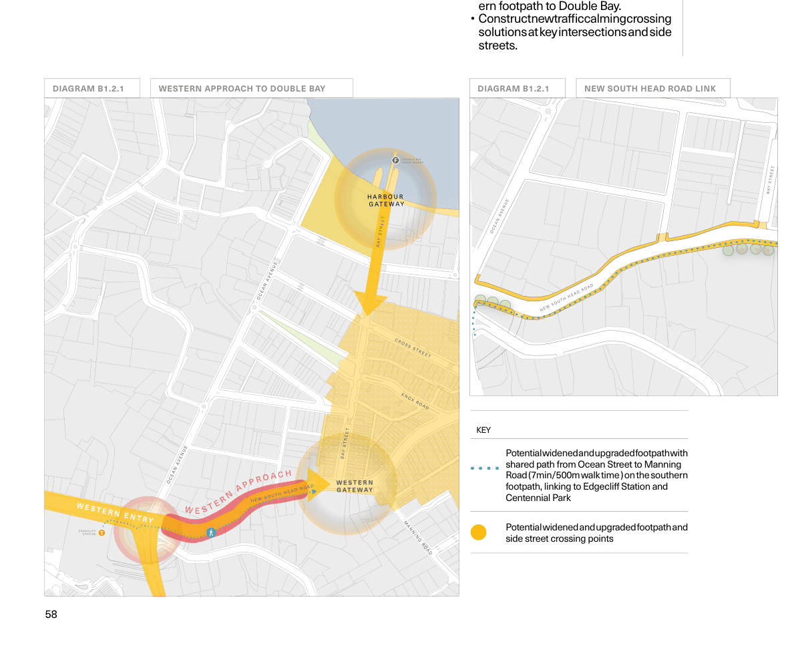

> [Picture on page 60: a picture, saved as a picture (images/public-domain-strategy-page-60-69.gif, 150 dpi).]
> Words printed on the picture (title and legend, copied from the PDF):
> streets.
> DIAGRAM B1.2.1 WESTERN APPROACH TO DOUBLE BAY
> DIAGRAM B1.2.1 NEW SOUTH HEAD ROAD LINK
> EASTERNENTRY
> DOUBLEB AY
> FERRYWHARF
> B AY STREET
> HARBOUR
> G AT E W AY
> OCEANAVENUE
> WILLIAMSTREET
> NEWSOUTHHEADROAD
> CROSSSTREET TRANSVAALAVE NEWSOUTHHEADROAD
> EASTERN
> G AT E W AY
> KNOXROAD
> KEY
> B AY STREET
> B AY STREET
> BELLEVUEROAD
> KIAORAROAD
> ACH
> O
> OCEANAVENUE
> OCEANAVENUE
> R
> P
> P
> WESTERN
> G AT E W AY
> A
> N
> Potential widened and upgraded footpath with
> shared path from Ocean Street to Manning
> Road (7min/500m walk time ) on the southern
> footpath, linking to Edgecliff Station and
> Centennial Park
> NEWSOUTHHEADROAD
> R
> E
> T
> S
> E
> W
> \* * * * * * * *
> \* * * * * * * *
> \* * * * * * * *
> \* * * * * * * *
> \* * * * * * * *
> \* * * * * * * *
> \* * * * * * * *
> \* * * * * * * *
> \* * * * * * * *
> \* * * * * * * *
> \* * * * * * * *
> WESTERNENTRY
> EDGECLIFF
> S TAT ION
> Potential widened and upgraded footpath and
> side street crossing points
> MANNINGROAD
> \* * * * * * * * * * * * * * * * * * * * * * * * * * * * * * * * * * * * * * * * * * * * * * * * * * * * * * * * *
> \* * * * * * * * * * * * * * * * * * * * * * * * * * * * * * * * * * * * * * * * * * * * * * * * * * * * * * * * *
> \* * * * * * * * * * * * * * * * * * * * * * * * * * * * * * * * * * * * * * * * * * * * * * * * * * * * * * * * *
> \* * * * * * * * * * * * * * * * * * * * * * * * * * * * * * * * * * * * * * * * * * * * * * * * * * * * * * * * *
> \* * * * * * * * * * * * * * * * * * * * * * * * * * * * * * * * * * * * * * * * * * * * * * * * * * * * * * * * *
> \* * * * * * * * * * * * * * * * * * * * * * * * * * * * * * * * * * * * * * * * * * * * * * * * * * * * * * * * *
> \* * * * * * * * * * * * * * * * * * * * * * * * * * * * * * * * * * * * * * * * * * * * * * * * * * * * * * * * *
> \* * * * * * * * * * * * * * * * * * * * * * * * * * * * * * * * * * * * * * * * * * * * * * * * * * * * * * * * *
> \* * * * * * * * * * * * * * * * * * * * * * * * * * * * * * * * * * * * * * * * * * * * * * * * * * * * * * * * *
> \* * * * * * * * * * * * * * * * * * * * * * * * * * * * * * * * * * * * * * * * * * * * * * * * * * * * * * * * *
> \* * * * * * * * * * * * * * * * * * * * * * * * * * * * * * * * * * * * * * * * * * * * * * * * * * * * * * * * *
> \* * * * * * * * * * * * * * * * * * * * * * * * * * * * * * * * * * * * * * * * * * * * * * * * * * * * * * * * *
> \* * * * * * * * * * * * * * * * * * * * * * * * * * * * * * * * * * * * * * * * * * * * * * * * * * * * * * * * *
> \* * * * * * * * * * * * * * * * * * * * * * * * * * * * * * * * * * * * * * * * * * * * * * * * * * * * * * * * *
> \* * * * * * * * * * * * * * * * * * * * * * * * * * * * * * * * * * * * * * * * * * * * * * * * * * * * * * * * *
> \* * * * * * * * * * * * * * * * * * * * * * * * * * * * * * * * * * * * * * * * * * * * * * * * * * * * * * * * *
> \* * * * * * * * * * * * * * * * * * * * * * * * * * * * * * * * * * * * * * * * * * * * * * * * * * * * * * * * *
> \* * * * * * * * * * * * * * * * * * * * * * * * * * * * * * * * * * * * * * * * * * * * * * * * * * * * * * * * *
> \* * * * * * * * * * * * * * * * * * * * * * * * * * * * * * * * * * * * * * * * * * * * * * * * * * * * * * * * *
> \* * * * * * * * * * * * * * * * * * * * * * * * * * * * * * * * * * * * * * * * * * * * * * * * * * * * * * * * *
> \* * * * * * * * * * * * * * * * * * * * * * * * * * * * * * * * * * * * * * * * * * * * * * * * * * * * * * * * *
> \* * * * * * * * * * * * * * * * * * * * * * * * * * * * * * * * * * * * * * * * * * * * * * * * * * * * * * * * *
> \* * * * * * * * * * * * * * * * * * * * * * * * * * * * * * * * * * * * * * * * * * * * * * * * * * * * * * * * *
> \* * * * * * * * * * * * * * * * * * * * * * * * * * * * * * * * * * * * * * * * * * * * * * * * * * * * * * * * *
> \* * * * * * * * * * * * * * * * * * * * * * * * * * * * * * * * * * * * * * * * * * * * * * * * * * * * * * * * *
> \* * * * * * * * * * * * * * * * * * * * * * * * * * * * * * * * * * * * * * * * * * * * * * * * * * * * * * * * *
> \* * * * * * * * * * * * * * * * * * * * * * * * * * * * * * * * * * * * * * * * * * * * * * * * * * * * * * * * *
> \* * * * * * * * * * * * * * * * * * * * * * * * * * * * * * * * * * * * * * * * * * * * * * * * * * * * * * * * *
> \* * * * * * * * * * * * * * * * * * * * * * * * * * * * * * * * * * * * * * * * * * * * * * * * * * * * * * * * *
> \* * * * * * * * * * * * * * * * * * * * * * * * * * * * * * * * * * * * * * * * * * * * * * * * * * * * * * * * *
> \* * * * * * * * * * * * * * * * * * * * * * * * * * * * * * * * * * * * * * * * * * * * * * * * * * * * * * * * *
> \* * * * * * * * * * * * * * * * * * * * * * * * * * * * * * * * * * * * * * * * * * * * * * * * * * * * * * * * *
> \* * * * * * * * * * * * * * * * * * * * * * * * * * * * * * * * * * * * * * * * * * * * * * * * * * * * * * * * *
> \* * * * * * * * * * * * * * * * * * * * * * * * * * * * * * * * * * * * * * * * * * * * * * * * * * * * * * * * *
> \* * * * * * * * * * * * * * * * * * * * * * * * * * * * * * * * * * * * * * * * * * * * * * * * * * * * * * * * *
> \* * * * * * * * * * * * * * * * * * * * * * * * * * * * * * * * * * * * * * * * * * * * * * * * * * * * * * * * *
> \* * * * * * * * * * * * * * * * * * * * * * * * * * * * * * * * * * * * * * * * * * * * * * * * * * * * * * * * *
> \* * * * * * * * * * * * * * * * * * * * * * * * * * * * * * * * * * * * * * * * * * * * * * * * * * * * * * * * *
> \* * * * * * * * * * * * * * * * * * * * * * * * * * * * * * * * * * * * * * * * * * * * * * * * * * * * * * * * *
> \* * * * * * * * * * * * * * * * * * * * * * * * * * * * * * * * * * * * * * * * * * * * * * * * * * * * * * * * *
> \* * * * * * * * * * * * * * * * * * * * * * * * * * * * * * * * * * * * * * * * * * * * * * * * * * * * * * * * *
> \* * * * * * * * * * * * * * * * * * * * * * * * * * * * * * * * * * * * * * * * * * * * * * * * * * * * * * * * *
> \* * * * * * * * * * * * * * * * * * * * * * * * * * * * * * * * * * * * * * * * * * * * * * * * * * * * * * * * *
> \* * * * * * * * * * * * * * * * * * * * * * * * * * * * * * * * * * * * * * * * * * * * * * * * * * * * * * * * *
> \* * * * * * * * * * * * * * * * * * * * * * * * * * * * * * * * * * * * * * * * * * * * * * * * * * * * * * * * *
> \* * * * * * * * * * * * * * * * * * * * * * * * * * * * * * * * * * * * * * * * * * * * * * * * * * * * * * * * *
> \* * * * * * * * * * * * * * * * * * * * * * * * * * * * * * * * * * * * * * * * * * * * * * * * * * * * * * * * *
> \* * * * * * * * * * * * * * * * * * * * * * * * * * * * * * * * * * * * * * * * * * * * * * * * * * * * * * * * *
> \* * * * * * * * * * * * * * * * * * * * * * * * * * * * * * * * * * * * * * * * * * * * * * * * * * * * * * * * *
> \* * * * * * * * * * * * * * * * * * * * * * * * * * * * * * * * * * * * * * * * * * * * * * * * * * * * * * * * *
> \* * * * * * * * * * * * * * * * * * * * * * * * * * * * * * * * * * * * * * * * * * * * * * * * * * * * * * * * *
> \* * * * * * * * * * * * * * * * * * * * * * * * * * * * * * * * * * * * * * * * * * * * * * * * * * * * * * * * *
> \* * * * * * * * * * * * * * * * * * * * * * * * * * * * * * * * * * * * * * * * * * * * * * * * * * * * * * * * *
> \* * * * * * * * * * * * * * * * * * * * * * * * * * * * * * * * * * * * * * * * * * * * * * * * * * * * * * * * *
> \* * * * * * * * * * * * * * * * * * * * * * * * * * * * * * * * * * * * * * * * * * * * * * * * * * * * * * * * *
> \* * * * * * * * * * * * * * * * * * * * * * * * * * * * * * * * * * * * * * * * * * * * * * * * * * * * * * * * *
> \* * * * * * * * * * * * * * * * * * * * * * * * * * * * * * * * * * * * * * * * * * * * * * * * * * * * * * * * *
> \* * * * * * * * * * * * * * * * * * * * * * * * * * * * * * * * * * * * * * * * * * * * * * * * * * * * * * * * *
> \* * * * * * * * * * * * * * * * * * * * * * * * * * * * * * * * * * * * * * * * * * * * * * * * * * * * * * * * *
> \* * * * * * * * * * * * * * * * * * * * * * * * * * * * * * * * * * * * * * * * * * * * * * * * * * * * * * * * *

ern footpath to Double Bay.

•	Construct new traffic calming crossing

solutions at key intersections and side

#### GATEWAYS & APPROACHES

1	 Existing wide concrete footpath at New South Head Road, Edgecliff

4	 Potential kerbside garden and tree planting on existing footpath area at New South Head Road and Ocean Street.

2	 Existing footpath along New South Head Road southern footpath.

5	 Potential footpath widening on south side of New South Head Road.

3	 Existing upgraded footpath along New South Head Road southern footpath.

6 	Potential footpath widening for a shared path on New South Head Road near Bay Street.

#### Existing Conditions

The existing walking route between

Double Bay and Edgecliff Station is a

400m walk on low quality concrete

footpaths of varying widths, with a high

level of exposure to traffic noise and pol-

lution particularly on the southern side

of the road. The poor urban amenity and

lack of active frontages along the route

contribute to low levels of pedestrian

use. Conflict points occur at crossings

and the bus tunnel entry point to Edge-

cliff Station approximately 50m east of

Ocean Street.

#### Potential Improvements

•	Moderate the impact of passing traffic

by using buffer planting and new street

trees to better separate vehicle and

pedestrian movements.

•	Potential for shared footpath conditions

to allow cyclists to use the southern

footpath.

•	Lighting and signage to be appropriate

to the pedestrian scale to encourage

increased usage by pedestrians.

•	Replace existing street poles with new

smartpoles between Bay and Ocean

Streets.

•	Bubblers and benches to be installed to

improve comfort along the route.

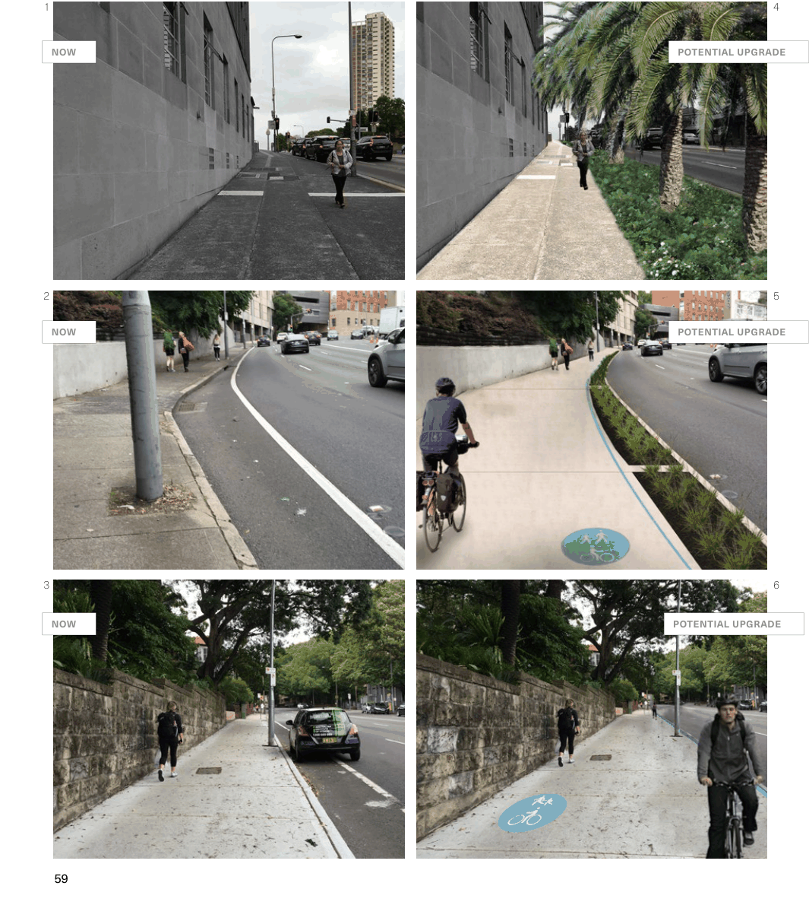

> [Picture on page 61: a map, saved as a picture (images/public-domain-strategy-page-61-59.gif, 150 dpi); the street names and other small labels are on the picture.]

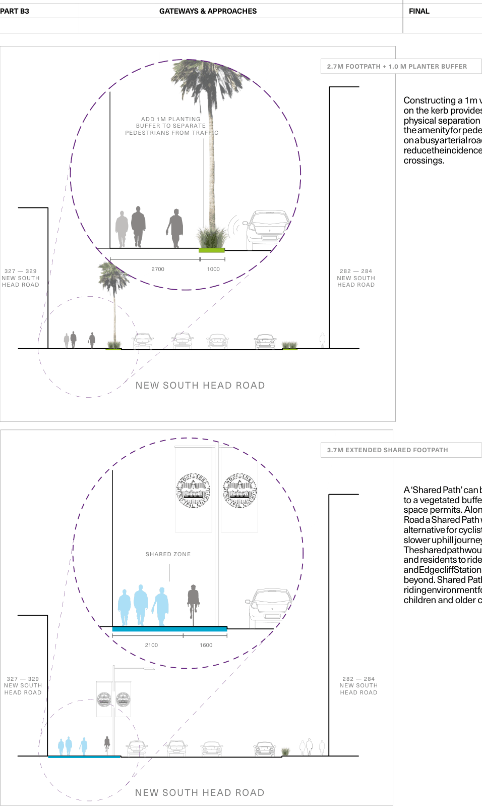

> [Picture on page 62: a map, saved as a picture (images/public-domain-strategy-page-62-1.gif, 150 dpi); the street names and other small labels are on the picture.]
> Words printed on the picture (title and legend, copied from the PDF):
> GATEWAYS & APPROACHES
> 2.7M FOOTPATH + 1.0 M PLANTER BUFFER
> ADD 1M PLANTING
> BUFFER TO SEPARATE
> PEDESTRIANS FROM TRAFFIC
> 282 — 284
> 327 — 329
> NEW SOUTH HEAD ROAD
> 3.7M EXTENDED SHARED FOOTPATH
> 327 — 329
> 282 — 284
> NEW SOUTH HEAD ROAD

Constructing a 1m vegetated buffer

on the kerb provides enough visual and

physical separation to greatly improve

the amenity for pedestrians on footpaths

on a busy arterial road. These buffers also

reduce the incidence of unsafe pedestrian

crossings.

A ‘Shared Path’ can be a good alternative

to a vegetated buffer on a footpath if

space permits. Along New South Head

Road a Shared Path would provide a safe

alternative for cyclists particularly on the

slower uphill journeys out of Double Bay.

The shared path would encourage visitors

and residents to ride between the centre

and Edgecliff Station, Centennial Park and

beyond. Shared Paths also create a safe

riding environment for parents riding with

children and older cyclists.

#### GATEWAYS & APPROACHES

4	 On road cyclist on New South Head Road, heading west to Edgecliff

1	 Pedestrian route on southern footpath, New South Head Road heading toward the centre

5	 Shared path footpath markings, Wattle Street, Ultimo

2	 Existing southern footpath, New South Head Road heading towards Edgecliff

6 	Example— Flush pedestrian crossing detail, Crown Street, Surry Hills

3	 Potential upgrade to crossing at  entrance of bus tunnel, New South Head Road

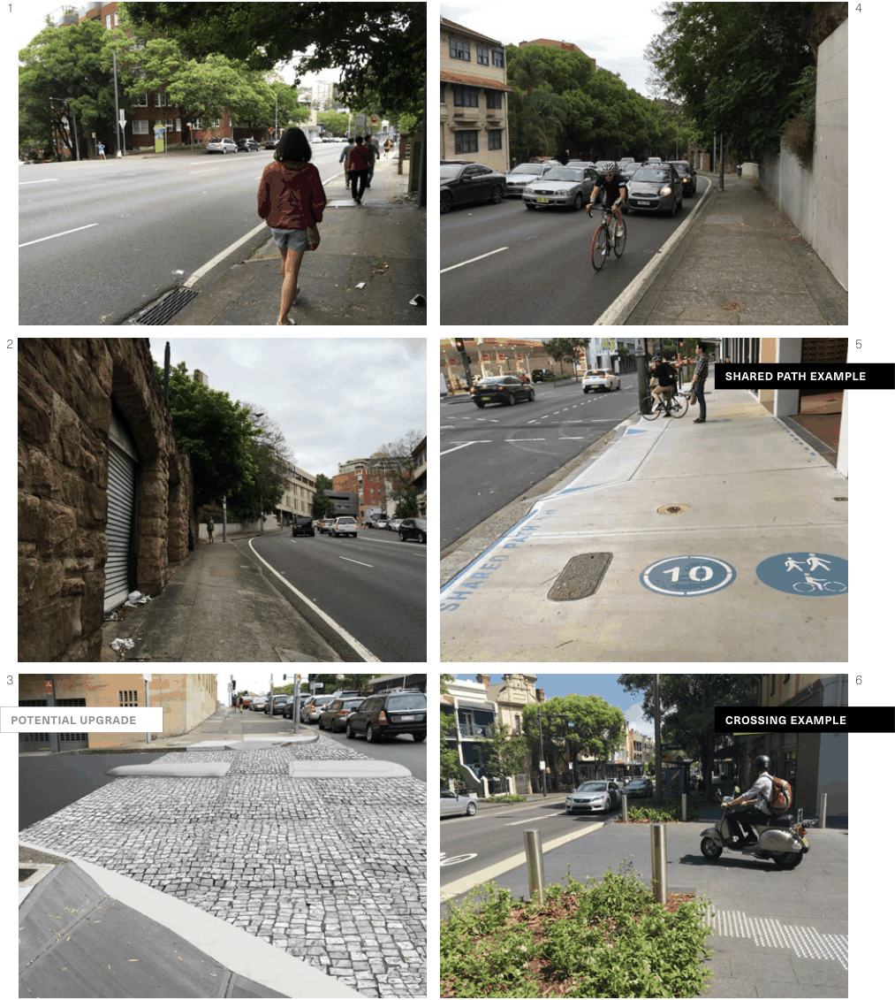

> [Picture on page 63: a picture, saved as a picture (images/public-domain-strategy-page-63-27.gif, 150 dpi).]

1

4

> Words printed on the picture (title and legend, copied from the PDF):
> SHARED PATH EXAMPLE

#### GATEWAYS & APPROACHES

#### KEY CONCEPT

#### WHAT TO DO

### B3.03

### Eastern Approach

Victoria Road to

### Bellevue Road and Cross

### Street along

### New South Head Road

#### Upgrade the streetscape to encourage

walking and cycling to the east of the centre. Improve wayfinding and connectivity between Redleaf Pool, Council offices, the centre and the

#### Ferry Wharf, and other pedestrian links

originating in the centre including the

#### Jamberoo Creek precinct.

1\.	Trial shared paths on approach foot-paths for pedestrians and cyclists.

2\.	Upgrade nature strips.

3\.	Install smartpoles, benches, bubblers and wayfinding to increase amenity along the route.

4\.	Improve stair links, crossing points and side street intersections.

#### Arriving at Double Bay from Rose

Bay in the east has a number of

challenges that include busy roads

with fast moving traffic, lack of

pedestrian crossing points, lack of

wayfinding legibility and ‘sense of

address’ or clear arrival point. This

route provides a link between the

civic functions of the Woollahra

#### Council Offices at Redleaf (Murray

#### Rose Pool) and destinations

further east including Rose Bay

and Watsons Bay with the Double

#### Bay Centre.

#### Conditions and Issues

The approach is a steady descent with

apartments on either side of the road,

with Foster Park and the Hugh Latimer

Centre at the corner of William Street

and New South Head Road. There are

areas with existing grassed nature strips

and significant street trees. Generally the

pedestrian experience is pleasant and

the existing tree canopy provides shade

cover along the route. Kerb side gardens

are generally in poor condition due

to shade from the eucalypt street tree

canopy. The concrete footpaths between

Victoria Road and Cross Street/Bellevue

Road are generally in average condition.

A new shared path for pedestrians and

cyclists is proposed from William Street

to Rose Bay.

Opportunities and

#### Recommendations

•	Upgrade footpaths and crossing points

and remove the eastbound slip lane

from William Street in to New South

Head Road.

•	Trial new shared paths for cyclists and

pedestrians.

•	Upgrade nature strips with new shade

resistant planting.

•	Upgrade the public stair link between

Jamberoo Creek/Cross Lane and New

South Head Road.

•	Replace existing street light poles with

smartpoles between Cross Street and

Victoria Road.

•	Widen and upgrade the central traffic

island with planting, trees and banner

poles to improve the visual amenity

and to encourage pedestrian crossing

at signalled crossings.

•	Investigate potential upgrade options

at Foster Park and Hugh Latimer Centre

that contribute to the approach route.

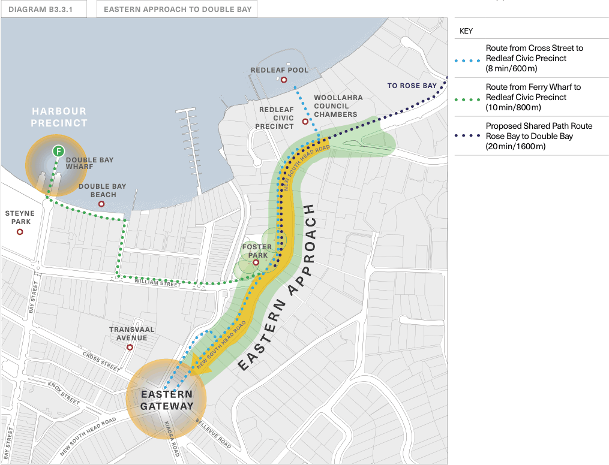

> [Picture on page 64: a map, saved as a picture (images/public-domain-strategy-page-64-83.gif, 150 dpi); the street names and other small labels are on the picture.]
> Words printed on the picture (title and legend, copied from the PDF):
> DIAGRAM B3.3.1 EASTERN APPROACH TO DOUBLE BAY
> Route from Cross Street to
> Redleaf Civic Precinct
> (8 min/600 m)
> TO ROSE BAY Route from Ferry Wharf to
> Redleaf Civic Precinct
> (10  min/800 m)
> Proposed Shared Path Route
> Rose Bay to Double Bay
> (20 min/1600 m)
> NEW SOUTH HEAD ROAD
> TH HEAD R

#### H C ROA

#### P

#### P

#### A

#### N

#### R

#### E

#### T

#### S

#### E A

#### GATEWAYS & APPROACHES

4	 Existing layered planting and gardens along footpath edges on Bellevue Road

1	 Existing high quality Double Bay Suite paving along New South Head Road with awnings overhead.

#### Existing Conditions

The existing walk between Double Bay

Centre and Redleaf Pool and Council

Offices is around a 400m walk on foot-

paths of varying widths and materials. In

general it is a pleasant route with shade

and some awning coverage.

5	 Stair link to be upgraded between New South Head Road and Cross Lane.

2	 View west towards shops and Cross Street intersection with New South Head Road

#### Potential Improvements

The use of layered gardens, nature strip,

pedestrian priority crossings on side

streets, upgrade stairs and links off New

South Head Road, widen footpath areas

and blisters where possible. Lighting,

signage, bike racks, seating and bubblers

to be installed along main pedestrian

routes between the centre, Ferry Wharf

and Redleaf Pool. Double Bay Suite pav-

ers to be used along with brushed in situ

concrete footpaths.

3	 View east along New South Head Road with planted median and banner poles.

6	 Western footpath, with potential planted nature strip and mature eucalypt trees creates a shaded canopy on New South Head Rd

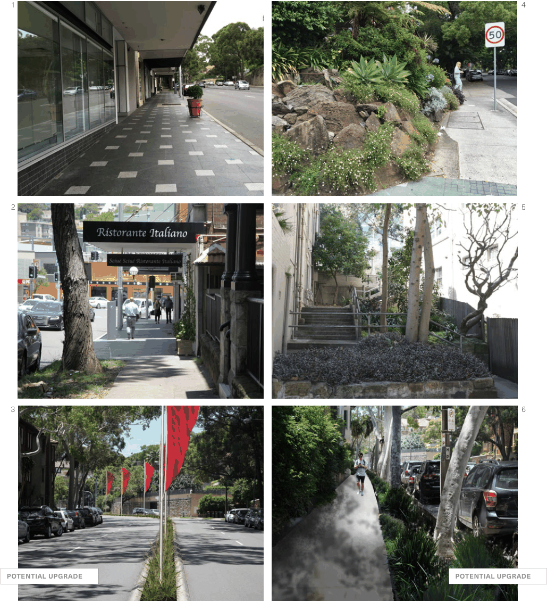

> [Picture on page 65: a picture, saved as a picture (images/public-domain-strategy-page-65-52.gif, 150 dpi).]
> Words printed on the picture (title and legend, copied from the PDF):
> 1
> 4
> 2
> 5
> 3
> 6
> POTENTIAL UPGRADE
> POTENTIAL UPGRADE

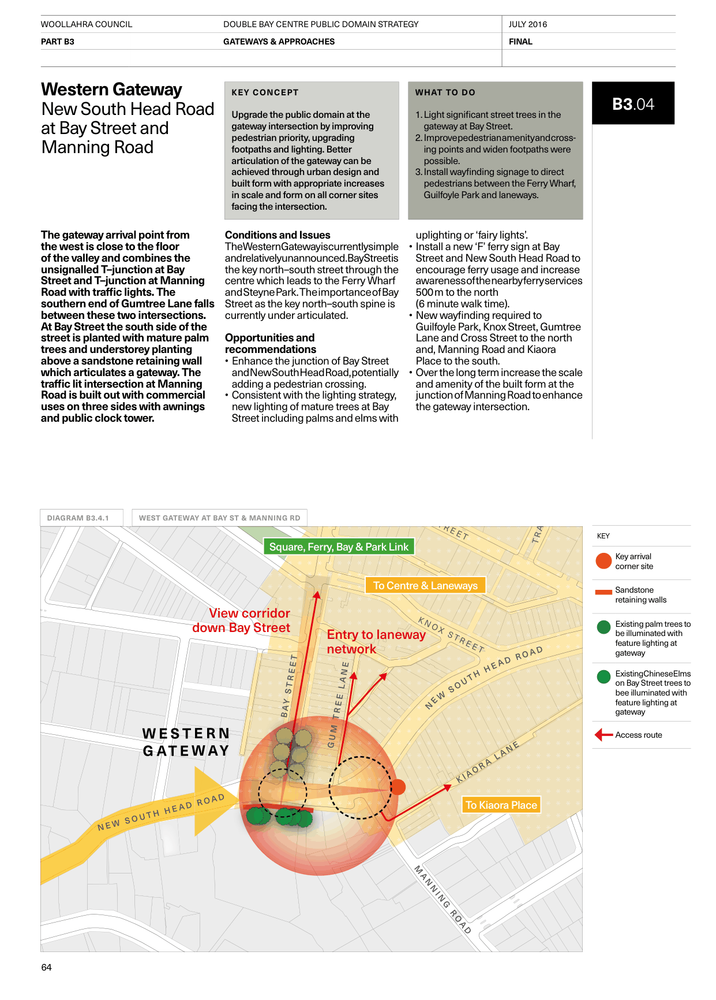

> [Picture on page 66: a picture, saved as a picture (images/public-domain-strategy-page-66-1.gif, 150 dpi).]
> Words printed on the picture (title and legend, copied from the PDF):
> GATEWAYS & APPROACHES
> KEY CONCEPT
> WHAT TO DO
> DOUBLEB AY
> FERRYWHARF
> 1\.	Light significant street trees in the
> gateway at Bay Street.
> 2\.	Improve pedestrian amenity and cross-
> ing points and widen footpaths were
> possible.
> 3\.	Install wayfinding signage to direct
> pedestrians between the Ferry Wharf,
> Guilfoyle Park and laneways.
> Upgrade the public domain at the
> gateway intersection by improving
> pedestrian priority, upgrading
> footpaths and lighting. Better
> articulation of the gateway can be
> achieved through urban design and
> built form with appropriate increases
> in scale and form on all corner sites
> facing the intersection.
> B AY STREET
> WILLIAMSTREET
> OCEANAVENUE
> DIAGRAM B3.4.1 WEST GATEWAY AT BAY ST & MANNING RD
> KEY
> CROSSSTREET
> TRANSVAALAVE
> NEWSOU
> Key arrival
> corner site
> Sandstone
> retaining walls
> KNOXSTREET
> Existing palm trees to
> be illuminated with
> feature lighting at
> gateway
> DROAD
> HHEA
> WSOUT
> N E
> Existing Chinese Elms
> on Bay Street trees to
> bee illuminated with
> feature lighting at
> gateway
> B AY STREET
> Access route
> GUMTREELANE
> KIAORALANE
> KIAORAROAD
> NEWSOUTHHEADROAD
> MANNINGROAD
> \* * * * * * * * * * * * * * * * * * * * * * * * * * * * * * * * * * * * * * * * * * * * * * * * * * * * *
> \* * * * * * * * * * * * * * * * * * * * * * * * * * * * * * * * * * * * * * * * * * * * * * * * * * * * *
> \* * * * * * * * * * * * * * * * * * * * * * * * * * * * * * * * * * * * * * * * * * * * * * * * * * * * *
> \* * * * * * * * * * * * * * * * * * * * * * * * * * * * * * * * * * * * * * * * * * * * * * * * * * * * *
> \* * * * * * * * * * * * * * * * * * * * * * * * * * * * * * * * * * * * * * * * * * * * * * * * * * * * *
> \* * * * * * * * * * * * * * * * * * * * * * * * * * * * * * * * * * * * * * * * * * * * * * * * * * * * *
> \* * * * * * * * * * * * * * * * * * * * * * * * * * * * * * * * * * * * * * * * * * * * * * * * * * * * *
> \* * * * * * * * * * * * * * * * * * * * * * * * * * * * * * * * * * * * * * * * * * * * * * * * * * * * *
> \* * * * * * * * * * * * * * * * * * * * * * * * * * * * * * * * * * * * * * * * * * * * * * * * * * * * *
> \* * * * * * * * * * * * * * * * * * * * * * * * * * * * * * * * * * * * * * * * * * * * * * * * * * * * *
> \* * * * * * * * * * * * * * * * * * * * * * * * * * * * * * * * * * * * * * * * * * * * * * * * * * * * *
> \* * * * * * * * * * * * * * * * * * * * * * * * * * * * * * * * * * * * * * * * * * * * * * * * * * * * *
> \* * * * * * * * * * * * * * * * * * * * * * * * * * * * * * * * * * * * * * * * * * * * * * * * * * * * *
> \* * * * * * * * * * * * * * * * * * * * * * * * * * * * * * * * * * * * * * * * * * * * * * * * * * * * *
> \* * * * * * * * * * * * * * * * * * * * * * * * * * * * * * * * * * * * * * * * * * * * * * * * * * * * *
> \* * * * * * * * * * * * * * * * * * * * * * * * * * * * * * * * * * * * * * * * * * * * * * * * * * * * *
> \* * * * * * * * * * * * * * * * * * * * * * * * * * * * * * * * * * * * * * * * * * * * * * * * * * * * *
> \* * * * * * * * * * * * * * * * * * * * * * * * * * * * * * * * * * * * * * * * * * * * * * * * * * * * *
> \* * * * * * * * * * * * * * * * * * * * * * * * * * * * * * * * * * * * * * * * * * * * * * * * * * * * *
> \* * * * * * * * * * * * * * * * * * * * * * * * * * * * * * * * * * * * * * * * * * * * * * * * * * * * *
> \* * * * * * * * * * * * * * * * * * * * * * * * * * * * * * * * * * * * * * * * * * * * * * * * * * * * *
> \* * * * * * * * * * * * * * * * * * * * * * * * * * * * * * * * * * * * * * * * * * * * * * * * * * * * *
> \* * * * * * * * * * * * * * * * * * * * * * * * * * * * * * * * * * * * * * * * * * * * * * * * * * * * *
> \* * * * * * * * * * * * * * * * * * * * * * * * * * * * * * * * * * * * * * * * * * * * * * * * * * * * *
> \* * * * * * * * * * * * * * * * * * * * * * * * * * * * * * * * * * * * * * * * * * * * * * * * * * * * *
> \* * * * * * * * * * * * * * * * * * * * * * * * * * * * * * * * * * * * * * * * * * * * * * * * * * * * *
> \* * * * * * * * * * * * * * * * * * * * * * * * * * * * * * * * * * * * * * * * * * * * * * * * * * * * *
> \* * * * * * * * * * * * * * * * * * * * * * * * * * * * * * * * * * * * * * * * * * * * * * * * * * * * *
> \* * * * * * * * * * * * * * * * * * * * * * * * * * * * * * * * * * * * * * * * * * * * * * * * * * * * *
> \* * * * * * * * * * * * * * * * * * * * * * * * * * * * * * * * * * * * * * * * * * * * * * * * * * * * *
> \* * * * * * * * * * * * * * * * * * * * * * * * * * * * * * * * * * * * * * * * * * * * * * * * * * * * *
> \* * * * * * * * * * * * * * * * * * * * * * * * * * * * * * * * * * * * * * * * * * * * * * * * * * * * *
> \* * * * * * * * * * * * * * * * * * * * * * * * * * * * * * * * * * * * * * * * * * * * * * * * * * * * *
> \* * * * * * * * * * * * * * * * * * * * * * * * * * * * * * * * * * * * * * * * * * * * * * * * * * * * *
> \* * * * * * * * * * * * * * * * * * * * * * * * * * * * * * * * * * * * * * * * * * * * * * * * * * * * *
> \* * * * * * * * * * * * * * * * * * * * * * * * * * * * * * * * * * * * * * * * * * * * * * * * * * * * *
> \* * * * * * * * * * * * * * * * * * * * * * * * * * * * * * * * * * * * * * * * * * * * * * * * * * * * *
> \* * * * * * * * * * * * * * * * * * * * * * * * * * * * * * * * * * * * * * * * * * * * * * * * * * * * *
> \* * * * * * * * * * * * * * * * * * * * * * * * * * * * * * * * * * * * * * * * * * * * * * * * * * * * *
> \* * * * * * * * * * * * * * * * * * * * * * * * * * * * * * * * * * * * * * * * * * * * * * * * * * * * *
> \* * * * * * * * * * * * * * * * * * * * * * * * * * * * * * * * * * * * * * * * * * * * * * * * * * * * *
> \* * * * * * * * * * * * * * * * * * * * * * * * * * * * * * * * * * * * * * * * * * * * * * * * * * * * *
> \* * * * * * * * * * * * * * * * * * * * * * * * * * * * * * * * * * * * * * * * * * * * * * * * * * * * *
> \* * * * * * * * * * * * * * * * * * * * * * * * * * * * * * * * * * * * * * * * * * * * * * * * * * * * *
> \* * * * * * * * * * * * * * * * * * * * * * * * * * * * * * * * * * * * * * * * * * * * * * * * * * * * *
> \* * * * * * * * * * * * * * * * * * * * * * * * * * * * * * * * * * * * * * * * * * * * * * * * * * * * *
> \* * * * * * * * * * * * * * * * * * * * * * * * * * * * * * * * * * * * * * * * * * * * * * * * * * * * *
> \* * * * * * * * * * * * * * * * * * * * * * * * * * * * * * * * * * * * * * * * * * * * * * * * * * * * *
> \* * * * * * * * * * * * * * * * * * * * * * * * * * * * * * * * * * * * * * * * * * * * * * * * * * * * *
> \* * * * * * * * * * * * * * * * * * * * * * * * * * * * * * * * * * * * * * * * * * * * * * * * * * * * *
> \* * * * * * * * * * * * * * * * * * * * * * * * * * * * * * * * * * * * * * * * * * * * * * * * * * * * *
> \* * * * * * * * * * * * * * * * * * * * * * * * * * * * * * * * * * * * * * * * * * * * * * * * * * * * *
> \* * * * * * * * * * * * * * * * * * * * * * * * * * * * * * * * * * * * * * * * * * * * * * * * * * * * *
> \* * * * * * * * * * * * * * * * * * * * * * * * * * * * * * * * * * * * * * * * * * * * * * * * * * * * *
> \* * * * * * * * * * * * * * * * * * * * * * * * * * * * * * * * * * * * * * * * * * * * * * * * * * * * *
> \* * * * * * * * * * * * * * * * * * * * * * * * * * * * * * * * * * * * * * * * * * * * * * * * * * * * *
> \* * * * * * * * * * * * * * * * * * * * * * * * * * * * * * * * * * * * * * * * * * * * * * * * * * * * *
> \* * * * * * * * * * * * * * * * * * * * * * * * * * * * * * * * * * * * * * * * * * * * * * * * * * * * *
> \* * * * * * * * * * * * * * * * * * * * * * * * * * * * * * * * * * * * * * * * * * * * * * * * * * * * *
> \* * * * * * * * * * * * * * * * * * * * * * * * * * * * * * * * * * * * * * * * * * * * * * * * * * * * *

### B3.04

### Western Gateway

### New South Head Road

at Bay Street and

### Manning Road

#### HARBOUR

#### G AT E W AY

#### Conditions and Issues

The Western Gateway is currently simple

and relatively unannounced. Bay Street is

the key north–south street through the

centre which leads to the Ferry Wharf

and Steyne Park. The importance of Bay

Street as the key north–south spine is

currently under articulated.

uplighting or ‘fairy lights’.

•	Install a new ‘F’ ferry sign at Bay

Street and New South Head Road to

encourage ferry usage and increase

awareness of the nearby ferry services

500 m to the north

(6 minute walk time).

•	New wayfinding required to

Guilfoyle Park, Knox Street, Gumtree

Lane and Cross Street to the north

and, Manning Road and Kiaora

Place to the south.

•	Over the long term increase the scale

and amenity of the built form at the

junction of Manning Road to enhance

the gateway intersection.

Opportunities and

recommendations

•	Enhance the junction of Bay Street

and New South Head Road, potentially

adding a pedestrian crossing.

•	Consistent with the lighting strategy,

new lighting of mature trees at Bay

Street including palms and elms with

#### The gateway arrival point from

the west is close to the floor

of the valley and combines the

unsignalled T–junction at Bay

#### Street and T–junction at Manning

#### Road with traffic lights. The

southern end of Gumtree Lane falls

between these two intersections.

At Bay Street the south side of the

street is planted with mature palm

trees and understorey planting

above a sandstone retaining wall

which articulates a gateway. The

traffic lit intersection at Manning

#### Road is built out with commercial

uses on three sides with awnings

and public clock tower.

#### Square, Ferry, Bay & Park Link

#### EASTER

#### G AT EWA

#### To Centre & Laneways

#### View corridor

#### down Bay Street

#### Entry to laneway

#### network

#### WESTERN

#### G AT E W AY

#### To Kiaora Place

#### GATEWAYS & APPROACHES

4	 Existing layered planting and gardens along footpath edges on New South Head Road

1	 New South Head Road southern footpath with sandstone walls and tree canopy overhead.

5	 New South Head Road and Bay Street intersection, northern footpath.

2	 Intersection of Manning Road and New South Head Road 3	 View north along Bay Street of Chinese Elm tree canopy

6 	Mature canariensis palms and under planting on New South Head Road at the Bay Street intersection

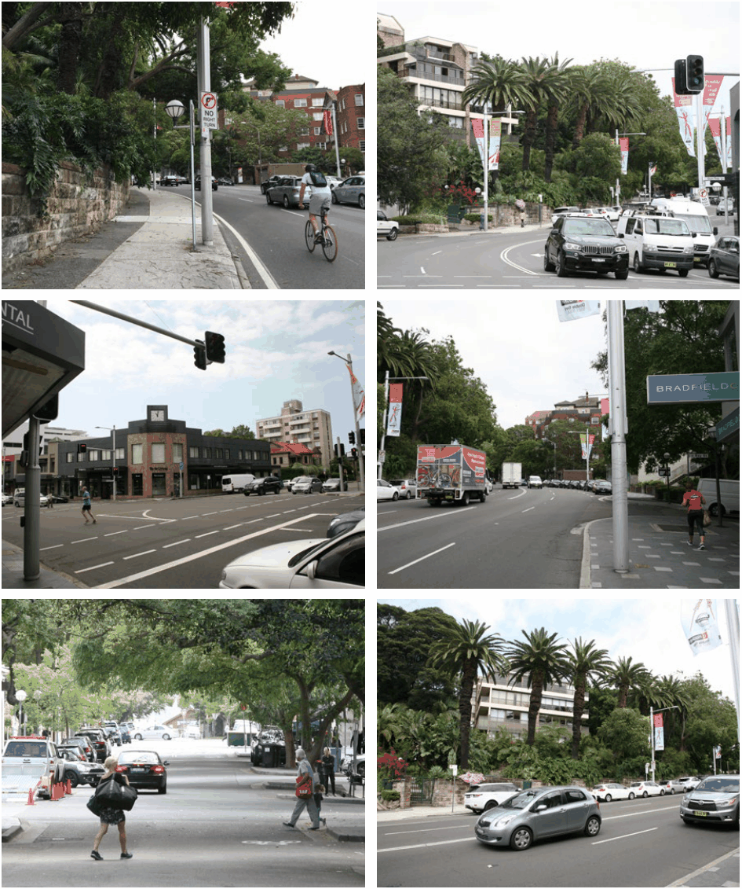

> [Picture on page 67: a picture, saved as a picture (images/public-domain-strategy-page-67-30.gif, 150 dpi).]

1

4

2

5

3

6

#### GATEWAYS & APPROACHES

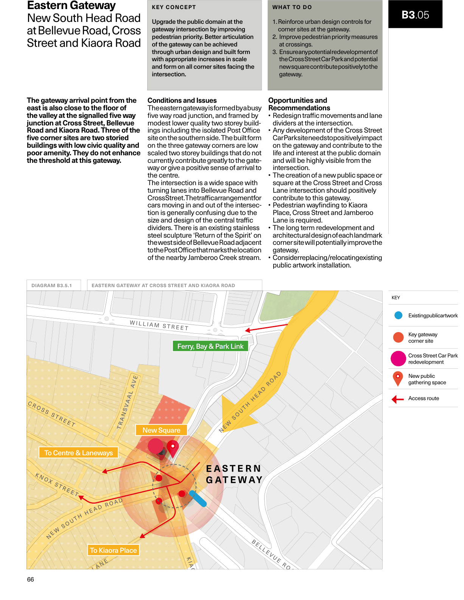

> [Picture on page 68: a picture, saved as a picture (images/public-domain-strategy-page-68-2.gif, 150 dpi).]
> Words printed on the picture (title and legend, copied from the PDF):
> KEY CONCEPT
> WHAT TO DO
> Upgrade the public domain at the
> gateway intersection by improving
> pedestrian priority. Better articulation
> of the gateway can be achieved
> through urban design and built form
> with appropriate increases in scale
> and form on all corner sites facing the
> intersection.
> 1\.	Reinforce urban design controls for
> corner sites at the gateway.
> 2\.	 Improve pedestrian priority measures
> at crossings.
> 3\.	 Ensure any potential redevelopment of
> the Cross Street Car Park and potential
> new square contribute positively to the
> gateway.
> DOUBLEB AY
> FERRYWHARF
> Lane intersection should positively
> •	Consider replacing/relocating existing
> B AY STREET
> DIAGRAM B3.5.1 EASTERN GATEWAY AT CROSS STREET AND KIAORA ROAD
> KEY
> Existing public artwork
> WILLIAMSTREET
> Key gateway
> corner site
> Cross Street Car Park
> redevelopment
> New public
> gathering space
> Access route
> CROSSSTREET
> TRANSVAALAVE
> NEWSOUTHHEADROAD
> KNOXSTREET
> DROAD
> HHEA
> WSOUT
> N E
> BELLEVUEROAD
> KIAORALANE
> KIAORAROAD
> \* * * * * * * * * * * * * * * * * * * * * * * * * * * * * * * * * * * * * * * * *
> \* * * * * * * * * * * * * * * * * * * * * * * * * * * * * * * * * * * * * * * * *
> \* * * * * * * * * * * * * * * * * * * * * * * * * * * * * * * * * * * * * * * * *
> \* * * * * * * * * * * * * * * * * * * * * * * * * * * * * * * * * * * * * * * * *
> \* * * * * * * * * * * * * * * * * * * * * * * * * * * * * * * * * * * * * * * * *
> \* * * * * * * * * * * * * * * * * * * * * * * * * * * * * * * * * * * * * * * * *
> \* * * * * * * * * * * * * * * * * * * * * * * * * * * * * * * * * * * * * * * * *
> \* * * * * * * * * * * * * * * * * * * * * * * * * * * * * * * * * * * * * * * * *
> \* * * * * * * * * * * * * * * * * * * * * * * * * * * * * * * * * * * * * * * * *
> \* * * * * * * * * * * * * * * * * * * * * * * * * * * * * * * * * * * * * * * * *
> \* * * * * * * * * * * * * * * * * * * * * * * * * * * * * * * * * * * * * * * * *
> \* * * * * * * * * * * * * * * * * * * * * * * * * * * * * * * * * * * * * * * * *
> \* * * * * * * * * * * * * * * * * * * * * * * * * * * * * * * * * * * * * * * * *
> \* * * * * * * * * * * * * * * * * * * * * * * * * * * * * * * * * * * * * * * * *
> \* * * * * * * * * * * * * * * * * * * * * * * * * * * * * * * * * * * * * * * * *
> \* * * * * * * * * * * * * * * * * * * * * * * * * * * * * * * * * * * * * * * * *
> \* * * * * * * * * * * * * * * * * * * * * * * * * * * * * * * * * * * * * * * * *
> \* * * * * * * * * * * * * * * * * * * * * * * * * * * * * * * * * * * * * * * * *
> \* * * * * * * * * * * * * * * * * * * * * * * * * * * * * * * * * * * * * * * * *
> \* * * * * * * * * * * * * * * * * * * * * * * * * * * * * * * * * * * * * * * * *
> \* * * * * * * * * * * * * * * * * * * * * * * * * * * * * * * * * * * * * * * * *
> \* * * * * * * * * * * * * * * * * * * * * * * * * * * * * * * * * * * * * * * * *
> \* * * * * * * * * * * * * * * * * * * * * * * * * * * * * * * * * * * * * * * * *
> \* * * * * * * * * * * * * * * * * * * * * * * * * * * * * * * * * * * * * * * * *
> \* * * * * * * * * * * * * * * * * * * * * * * * * * * * * * * * * * * * * * * * *
> \* * * * * * * * * * * * * * * * * * * * * * * * * * * * * * * * * * * * * * * * *
> \* * * * * * * * * * * * * * * * * * * * * * * * * * * * * * * * * * * * * * * * *
> \* * * * * * * * * * * * * * * * * * * * * * * * * * * * * * * * * * * * * * * * *
> \* * * * * * * * * * * * * * * * * * * * * * * * * * * * * * * * * * * * * * * * *
> \* * * * * * * * * * * * * * * * * * * * * * * * * * * * * * * * * * * * * * * * *
> \* * * * * * * * * * * * * * * * * * * * * * * * * * * * * * * * * * * * * * * * *
> \* * * * * * * * * * * * * * * * * * * * * * * * * * * * * * * * * * * * * * * * *
> \* * * * * * * * * * * * * * * * * * * * * * * * * * * * * * * * * * * * * * * * *
> \* * * * * * * * * * * * * * * * * * * * * * * * * * * * * * * * * * * * * * * * *
> \* * * * * * * * * * * * * * * * * * * * * * * * * * * * * * * * * * * * * * * * *
> \* * * * * * * * * * * * * * * * * * * * * * * * * * * * * * * * * * * * * * * * *
> \* * * * * * * * * * * * * * * * * * * * * * * * * * * * * * * * * * * * * * * * *
> \* * * * * * * * * * * * * * * * * * * * * * * * * * * * * * * * * * * * * * * * *
> \* * * * * * * * * * * * * * * * * * * * * * * * * * * * * * * * * * * * * * * * *
> \* * * * * * * * * * * * * * * * * * * * * * * * * * * * * * * * * * * * * * * * *
> \* * * * * * * * * * * * * * * * * * * * * * * * * * * * * * * * * * * * * * * * *
> \* * * * * * * * * * * * * * * * * * * * * * * * * * * * * * * * * * * * * * * * *
> \* * * * * * * * * * * * * * * * * * * * * * * * * * * * * * * * * * * * * * * * *
> \* * * * * * * * * * * * * * * * * * * * * * * * * * * * * * * * * * * * * * * * *
> \* * * * * * * * * * * * * * * * * * * * * * * * * * * * * * * * * * * * * * * * *
> \* * * * * * * * * * * * * * * * * * * * * * * * * * * * * * * * * * * * * * * * *

### B3.05

### Eastern Gateway

### New South Head Road

### at Bellevue Road, Cross

### Street and Kiaora Road

#### EASTERNEN

The gateway arrival point from the

east is also close to the floor of

the valley at the signalled five way

junction at Cross Street, Bellevue

Road and Kiaora Road. Three of the

five corner sites are two storied

buildings with low civic quality and

poor amenity. They do not enhance

the threshold at this gateway.

#### HARBOUR

#### G AT E W AY

#### Conditions and Issues

The eastern gateway is formed by a busy

five way road junction, and framed by

modest lower quality two storey build-

ings including the isolated Post Office

site on the southern side. The built form

on the three gateway corners are low

scaled two storey buildings that do not

currently contribute greatly to the gate-

way or give a positive sense of arrival to

the centre.

The intersection is a wide space with

turning lanes into Bellevue Road and

Cross Street. The traffic arrangement for

cars moving in and out of the intersec-

tion is generally confusing due to the

size and design of the central traffic

dividers. There is an existing stainless

steel sculpture ‘Return of the Spirit’ on

the west side of Bellevue Road adjacent

to the Post Office that marks the location

of the nearby Jamberoo Creek stream.

Opportunities and

#### Recommendations

•	Redesign traffic movements and lane

dividers at the intersection.

•	Any development of the Cross Street

Car Park site needs to positively impact

on the gateway and contribute to the

life and interest at the public domain

and will be highly visible from the

intersection.

•	The creation of a new public space or

square at the Cross Street and Cross contribute to this gateway.

•	Pedestrian wayfinding to Kiaora

Place, Cross Street and Jamberoo

Lane is required.

•	The long term redevelopment and

architectural design of each landmark

corner site will potentially improve the

gateway. public artwork installation.

#### Ferry, Bay & Park Link

#### New Square

#### To Centre & Laneways

#### EASTERN

#### G AT E W AY

#### To Kiaora Place

\* * * * * * * * * * * * * * * * * * * * * * * * * * * * * * * * * * * * * * * * *

1	 View corridor to Cross Street Car Park Site and potential new Jamberoo Square

2	 Post office site between Bellevue Road and Kiaora Road

1

2

#### GATEWAYS & APPROACHES

3	 Existing interpretive public artwork ‘Return of the Spirit’ on Bellevue Hill Road and New South Head Road to be relocated to Jamberoo Creek. 4	 Corner site at Kiaora Road and New South Head Road.

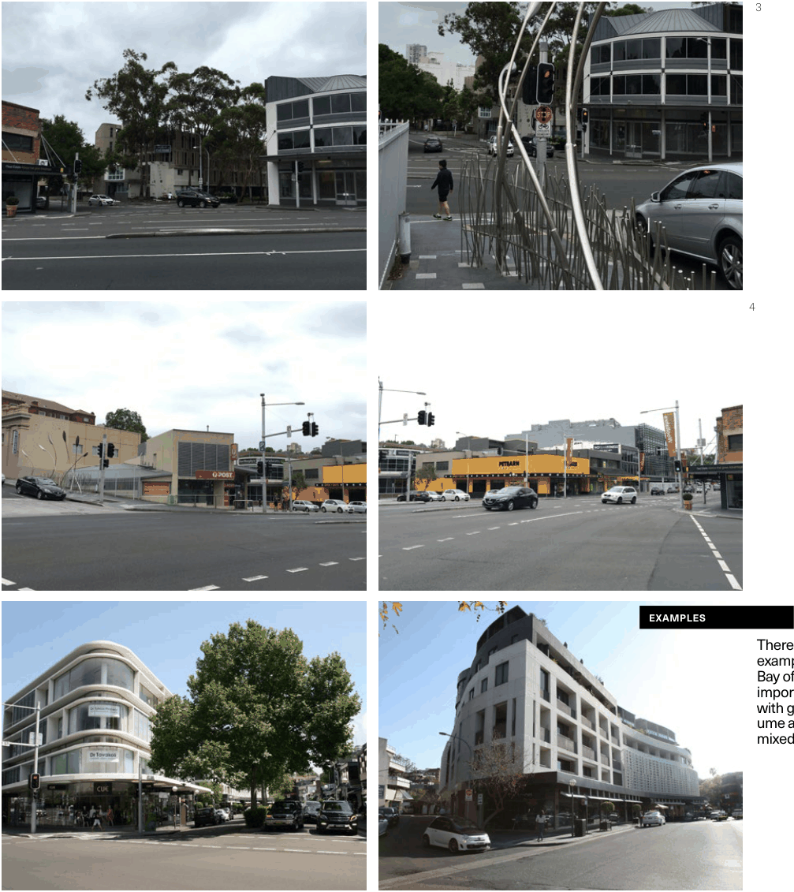

> [Picture on page 69: a picture, saved as a picture (images/public-domain-strategy-page-69-24.gif, 150 dpi).]
> Words printed on the picture (title and legend, copied from the PDF):
> EXAMPLES
> 3
> 4

There are number of

examples in Double

Bay of built form on

important corner sites

with good scale, vol-

ume and materiality in

mixed use buildings.

#### GATEWAYS & APPROACHES

#### KEY CONCEPT

#### WHAT TO DO

### B3.06

### Harbour Gateway

### Ferry Wharf, Steyne Park

### and Double Bay Beach at

### Bay Street

1\.	Strengthen the pedestrian link to the centre along Bay Street. (B4.01)

2\.	Upgrade Steyne Park. (B4.02)

3\.	Upgrade park foreshore and boating activity areas. (B4.03)

4\.	Upgrade beach foreshore. (B4.04)

#### Upgrade the Harbour Precinct

Gateway including the wharf, beach, park, playground and consider additional retail or hospitality offerings to create a significant and unique urban space and ‘harbour front door’ for locals, visitors, members of the school and sailing communities and other local stakeholders.

This harbour precinct gateway is

a unique and stunning approach

to the centre that needs some

upgrading to improve amenity for

commuters, locals, tourists and

park and beach users.

#### Conditions and Issues

The gateway is formed by the Ferry

Wharf, timber sailing club buildings,

beach and park. The gateway is at the

northern terminus of Bay Street, and

is flanked by the large open spaces of

Steyne Park, War Memorial and foreshore

to the west of the wharf and Double

Bay Beach to the east. The precinct is

a picturesque and leafy arrival point

although with poor visual connectivity

to the centre of Double Bay even though

it is only two blocks south (400 m/5

minute walk).

The gateway arrival point to the

north of the centre is reached via

ferry, water taxi or private boat

on Sydney Harbour. Public ferry

services arrive via the timetabled

F7 Ferry from Circular Quay,

Darling Point, Watsons Bay and

#### Rose Bay.

Opportunities and

#### Recommendations

•	Upgrade harbour precinct, wharf,

beach, park, foreshores and play-

ground area.

•	Upgrade pick and drop off and turning

area and construct a covered waiting

area near the north end of Bay Street at

the cul–de–sac.

•	Construct an integrated café, bicycle

parking, storage and change rooms

adjacent the Ferry Wharf.

•	Investigate the creation of a new

waterfront area to the northern extent

of Steyne Park along the sea wall. (See

B4.03)

•	Better integrate the boating activities

of the 18 Footer and Double Bay Sail-

ing Club sites, and provide additional

food and beverage opportunities at

the gateway.

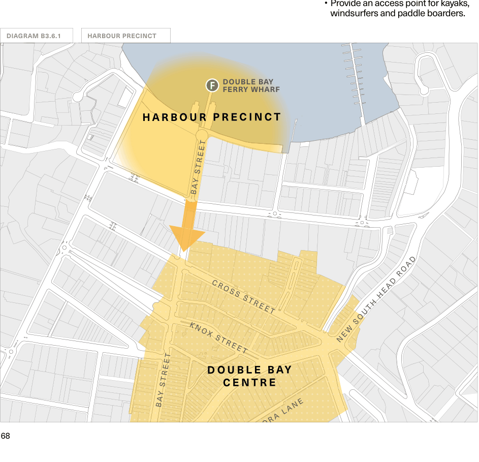

> [Picture on page 70: a picture, saved as a picture (images/public-domain-strategy-page-70-73.gif, 150 dpi).]
> Words printed on the picture (title and legend, copied from the PDF):
> DIAGRAM B3.6.1 HARBOUR PRECINCT
> DOUBLE BAY
> FERRY WHARF
> CROSSSTREET
> NEWSOUTHHEADROAD
> KNOXSTREET
> B AY STREET
> B AY STREET
> KIAORALANE
> \* * * * * * * * * * * * * * * * * * * * * * * * * * * * * * * * * * * * * * * * * * * * * * * * * * * * * * * * *
> \* * * * * * * * * * * * * * * * * * * * * * * * * * * * * * * * * * * * * * * * * * * * * * * * * * * * * * * * *
> \* * * * * * * * * * * * * * * * * * * * * * * * * * * * * * * * * * * * * * * * * * * * * * * * * * * * * * * * *
> \* * * * * * * * * * * * * * * * * * * * * * * * * * * * * * * * * * * * * * * * * * * * * * * * * * * * * * * * *
> \* * * * * * * * * * * * * * * * * * * * * * * * * * * * * * * * * * * * * * * * * * * * * * * * * * * * * * * * *
> \* * * * * * * * * * * * * * * * * * * * * * * * * * * * * * * * * * * * * * * * * * * * * * * * * * * * * * * * *
> \* * * * * * * * * * * * * * * * * * * * * * * * * * * * * * * * * * * * * * * * * * * * * * * * * * * * * * * * *
> \* * * * * * * * * * * * * * * * * * * * * * * * * * * * * * * * * * * * * * * * * * * * * * * * * * * * * * * * *
> \* * * * * * * * * * * * * * * * * * * * * * * * * * * * * * * * * * * * * * * * * * * * * * * * * * * * * * * * *
> \* * * * * * * * * * * * * * * * * * * * * * * * * * * * * * * * * * * * * * * * * * * * * * * * * * * * * * * * *
> \* * * * * * * * * * * * * * * * * * * * * * * * * * * * * * * * * * * * * * * * * * * * * * * * * * * * * * * * *
> \* * * * * * * * * * * * * * * * * * * * * * * * * * * * * * * * * * * * * * * * * * * * * * * * * * * * * * * * *
> \* * * * * * * * * * * * * * * * * * * * * * * * * * * * * * * * * * * * * * * * * * * * * * * * * * * * * * * * *
> \* * * * * * * * * * * * * * * * * * * * * * * * * * * * * * * * * * * * * * * * * * * * * * * * * * * * * * * * *
> \* * * * * * * * * * * * * * * * * * * * * * * * * * * * * * * * * * * * * * * * * * * * * * * * * * * * * * * * *
> \* * * * * * * * * * * * * * * * * * * * * * * * * * * * * * * * * * * * * * * * * * * * * * * * * * * * * * * * *
> \* * * * * * * * * * * * * * * * * * * * * * * * * * * * * * * * * * * * * * * * * * * * * * * * * * * * * * * * *
> \* * * * * * * * * * * * * * * * * * * * * * * * * * * * * * * * * * * * * * * * * * * * * * * * * * * * * * * * *
> \* * * * * * * * * * * * * * * * * * * * * * * * * * * * * * * * * * * * * * * * * * * * * * * * * * * * * * * * *
> \* * * * * * * * * * * * * * * * * * * * * * * * * * * * * * * * * * * * * * * * * * * * * * * * * * * * * * * * *
> \* * * * * * * * * * * * * * * * * * * * * * * * * * * * * * * * * * * * * * * * * * * * * * * * * * * * * * * * *
> \* * * * * * * * * * * * * * * * * * * * * * * * * * * * * * * * * * * * * * * * * * * * * * * * * * * * * * * * *
> \* * * * * * * * * * * * * * * * * * * * * * * * * * * * * * * * * * * * * * * * * * * * * * * * * * * * * * * * *
> \* * * * * * * * * * * * * * * * * * * * * * * * * * * * * * * * * * * * * * * * * * * * * * * * * * * * * * * * *
> \* * * * * * * * * * * * * * * * * * * * * * * * * * * * * * * * * * * * * * * * * * * * * * * * * * * * * * * * *
> \* * * * * * * * * * * * * * * * * * * * * * * * * * * * * * * * * * * * * * * * * * * * * * * * * * * * * * * * *
> \* * * * * * * * * * * * * * * * * * * * * * * * * * * * * * * * * * * * * * * * * * * * * * * * * * * * * * * * *
> \* * * * * * * * * * * * * * * * * * * * * * * * * * * * * * * * * * * * * * * * * * * * * * * * * * * * * * * * *
> \* * * * * * * * * * * * * * * * * * * * * * * * * * * * * * * * * * * * * * * * * * * * * * * * * * * * * * * * *
> \* * * * * * * * * * * * * * * * * * * * * * * * * * * * * * * * * * * * * * * * * * * * * * * * * * * * * * * * *
> \* * * * * * * * * * * * * * * * * * * * * * * * * * * * * * * * * * * * * * * * * * * * * * * * * * * * * * * * *
> \* * * * * * * * * * * * * * * * * * * * * * * * * * * * * * * * * * * * * * * * * * * * * * * * * * * * * * * * *
> \* * * * * * * * * * * * * * * * * * * * * * * * * * * * * * * * * * * * * * * * * * * * * * * * * * * * * * * * *
> \* * * * * * * * * * * * * * * * * * * * * * * * * * * * * * * * * * * * * * * * * * * * * * * * * * * * * * * * *
> \* * * * * * * * * * * * * * * * * * * * * * * * * * * * * * * * * * * * * * * * * * * * * * * * * * * * * * * * *
> \* * * * * * * * * * * * * * * * * * * * * * * * * * * * * * * * * * * * * * * * * * * * * * * * * * * * * * * * *
> \* * * * * * * * * * * * * * * * * * * * * * * * * * * * * * * * * * * * * * * * * * * * * * * * * * * * * * * * *
> \* * * * * * * * * * * * * * * * * * * * * * * * * * * * * * * * * * * * * * * * * * * * * * * * * * * * * * * * *
> \* * * * * * * * * * * * * * * * * * * * * * * * * * * * * * * * * * * * * * * * * * * * * * * * * * * * * * * * *
> \* * * * * * * * * * * * * * * * * * * * * * * * * * * * * * * * * * * * * * * * * * * * * * * * * * * * * * * * *
> \* * * * * * * * * * * * * * * * * * * * * * * * * * * * * * * * * * * * * * * * * * * * * * * * * * * * * * * * *
> \* * * * * * * * * * * * * * * * * * * * * * * * * * * * * * * * * * * * * * * * * * * * * * * * * * * * * * * * *
> \* * * * * * * * * * * * * * * * * * * * * * * * * * * * * * * * * * * * * * * * * * * * * * * * * * * * * * * * *
> \* * * * * * * * * * * * * * * * * * * * * * * * * * * * * * * * * * * * * * * * * * * * * * * * * * * * * * * * *
> \* * * * * * * * * * * * * * * * * * * * * * * * * * * * * * * * * * * * * * * * * * * * * * * * * * * * * * * * *
> \* * * * * * * * * * * * * * * * * * * * * * * * * * * * * * * * * * * * * * * * * * * * * * * * * * * * * * * * *
> \* * * * * * * * * * * * * * * * * * * * * * * * * * * * * * * * * * * * * * * * * * * * * * * * * * * * * * * * *
> \* * * * * * * * * * * * * * * * * * * * * * * * * * * * * * * * * * * * * * * * * * * * * * * * * * * * * * * * *
> \* * * * * * * * * * * * * * * * * * * * * * * * * * * * * * * * * * * * * * * * * * * * * * * * * * * * * * * * *
> \* * * * * * * * * * * * * * * * * * * * * * * * * * * * * * * * * * * * * * * * * * * * * * * * * * * * * * * * *

•	Provide an access point for kayaks,

windsurfers and paddle boarders.

#### NEW ELEMENTS

— Improved link to cen-tre along Bay Street — New lighting — Covered pick up waiting

#### HARBOURPRECINCT

area at ferry — New wayfinding — Extra seating — Free wifi — Benches and tables — Better integrate boating activities — Retail services — Upgrade wharf build-ings — Public art

#### DOUBLEB AY

#### CENTRE

\* * * * * * * * * * * * * * * * * * * * * * * * * * * * * * * * * * * * * * * * * * * * * * * * * * * * * * * * *

1

2

3

#### GATEWAYS & APPROACHES

1	 Double Bay Sailing Club 2	 Arrival point from ferry service 3	 Dinghy stands adjacent the Ferry Wharf

4	 Stone sea wall to the northern foreshore at Steyne Park

5	 Double Bay Beach 6 	View west across Steyne Park to Darling Point

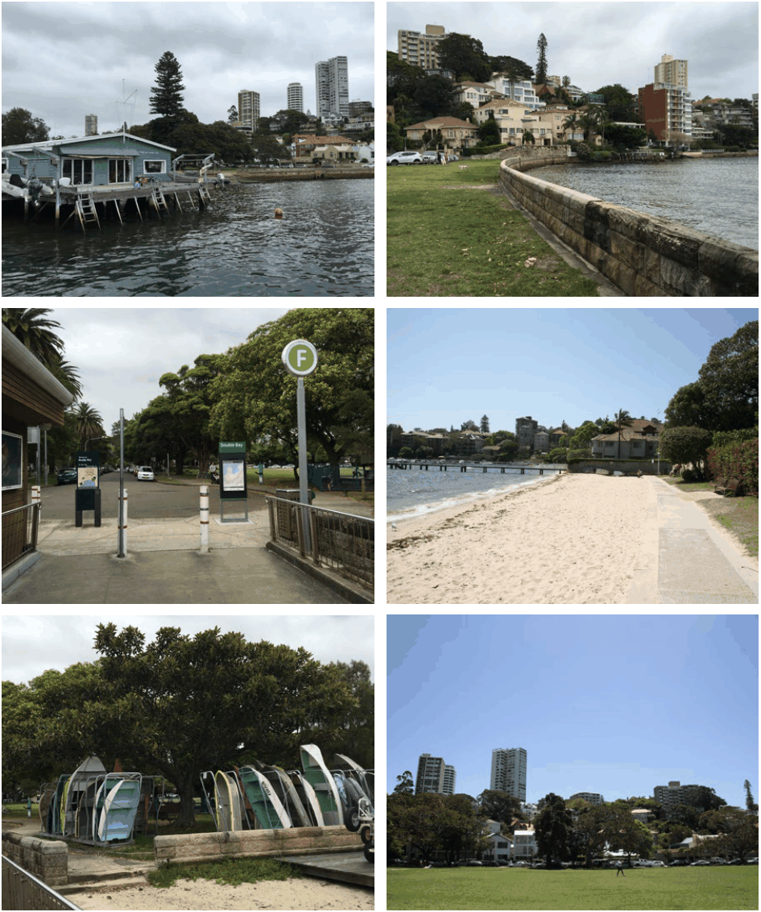

> [Picture on page 71: a picture, saved as a picture (images/public-domain-strategy-page-71-19.gif, 150 dpi).]

4

5

6

#### HARBOUR PRECINCT

#### KEY CONCEPT

#### WHAT TO DO

### B3.07

### Ferry Wharf

### improvements

### Activating

### the gateway

#### Develop options for improving waiting

areas, drop off and pick up areas, existing structures and providing space for additional retail services such as kiosks, cafés and additional toilets, coordinated with the future upgrade of the Double Bay Wharf to be undertaken by RMS.

1\. Coordinate with RMS prior to wharf upgrade and coordinate customer service improvements.

2\. Investigate opening up the southern end of the 18 Footer Club.

3\. Redesign and relocate cul–de–sac drop off area to provide more pedestrian space and a covered waiting area.

#### Second to Manly, Double Bay

is one of the few urban centres

located on the harbour serviced

by regular ferries. Double Bay

has larger retail, hospitality and

entertainment offer within a

shorter walk from the ferry than

#### Watsons Bay, Rose Bay, Milsons

Point, Kirribilli, Mosman or

#### Balmain. There is the potential

to increase visitation rates from

tourists and other Sydneysiders

via ferry arrivals. Upgrading of the

wharf to provide more amenity that

supports the park, beach and ferry

users will increase ferry patronage

and overall use of the park.

Opportunities and

#### Recommendations

•	Council to maximise improvements

and level of service provided on the

landside of the wharf in coordination

with the RMS Ferry Wharf upgrade.

•	Investigate the addition of a covered

kiss–and–ride area at a redesigned and

calmed shared zone vehicular drop off

‘ferry plaza’ in Bay Street.

•	Investigate the redesign and upgrade

the southern facade of the wharf build-

ing to include food, kiosk and/or coffee

service and public toilets for commut-

ers and beach and park users.

•	Work with the 18 Footer Club and

DBSC to improve the visual amenity of

foreshore and wharf structures as part

of the arrival experience to Double Bay.

#### Conditions and Issues

The existing wharf is a simple timber

structure that also accommodates the

18 Foot Sailing Club with a floor area

of 500 m2. The club building presents a

blank facade on the southern eleva-

tion, with deliveries and some storage

occurring near the roadway. The wharf

currently lacks a covered waiting area for

passengers, ticket sales and has limited

tourist information about Double Bay. In

general the level of service provided is

minimal. A Transport for NSW wayfind-

ing map has recently been installed at

the entrance to the wharf, Transport ‘F’

Pylon Sign and a Double Bay map has

also been installed by council. The future

RMS upgrade of the Ferry Wharf with a

‘floating pontoon’ structure with covered

roof, seating, timetable screens and

signage will improve the level of service

for ferry passengers.

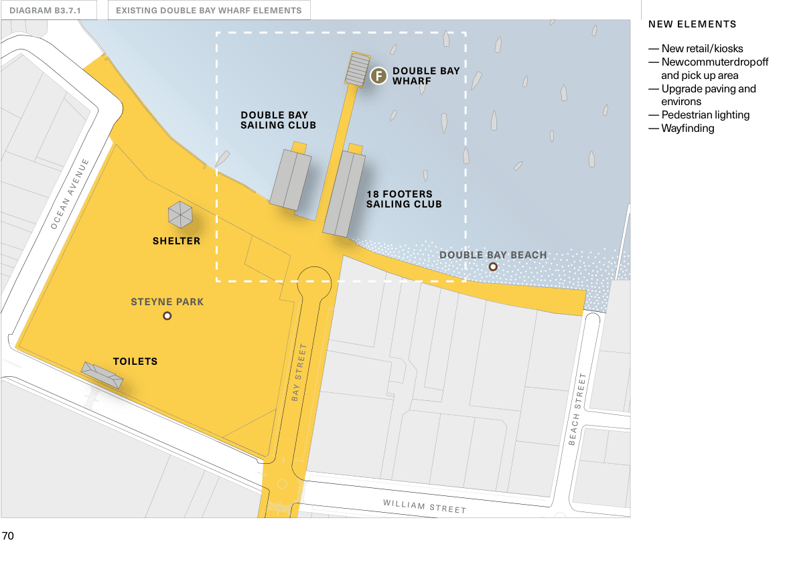

> [Picture on page 72: a map, saved as a picture (images/public-domain-strategy-page-72-83.gif, 150 dpi); the street names and other small labels are on the picture.]
> Words printed on the picture (title and legend, copied from the PDF):
> DIAGRAM B3.7.1 EXISTING DOUBLE BAY WHARF ELEMENTS
> — New retail/kiosks
> — New commuter drop off
> and pick up area
> — Upgrade paving and
> — Pedestrian lighting
> DOUBLE BAY BEACH
> B AY STREET

#### HARBOUR PRECINCT

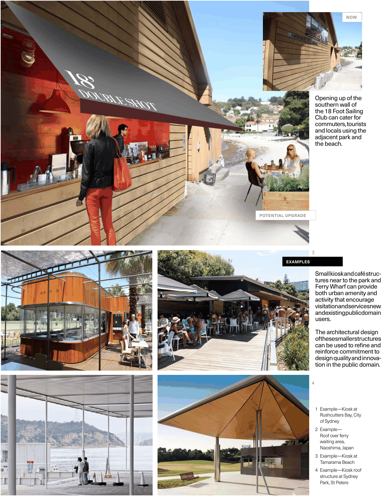

> [Picture on page 73: a map, saved as a picture (images/public-domain-strategy-page-73-2.gif, 150 dpi); the street names and other small labels are on the picture.]
> Words printed on the picture (title and legend, copied from the PDF):
> Opening up of the
> southern wall of
> the 18 Foot Sailing
> Club can cater for
> and locals using the
> adjacent park and
> 1	 Example—Kiosk at
> Rushcutters Bay, City
> Roof over ferry
> 3	 Example—Kiosk at
> 4	 Example—Kiosk roof
> structure at Sydney
> Park, St Peters

1

Small kiosk and café struc-

tures near to the park and

Ferry Wharf can provide

both urban amenity and

activity that encourage

visitation and services new

and existing public domain

users. The architectural design

of these smaller structures

can be used to refine and

reinforce commitment to

design quality and innova-

tion in the public domain.

2

#### HARBOUR PRECINCT

#### KEY CONCEPT

#### WHAT TO DO

### B4.01

### Bay Street Link

#### Bay Street is the key north–south

spine that connects the Double Bay centre and New South Head Road to the wharf and Sydney Harbour.

#### Using the Double Bay Suite from

#### Cross Street to the wharf will enhance

the link and improve amenity and pedestrian priority along the route.

1\.	Remove/replace existing street trees in poor condition.

2\.	Pave footpaths with Double Bay Suite paving.

3\.	Install new lighting, wayfinding and seating using the Double Bay Suite.

4\.	Improve crossing points.

5\.	Plant new trees in the road space be-tween William and Cross Street.

Arriving ferry passengers and

#### Steyne Park visitors at the north

end of Bay Street are roughly

around 400 m ­— a very easy five

minute walk — to the centre of

#### Double Bay at Knox Street. The

current link to the centre is poorly

articulated and in poor condition.

#### The block between William Street

and Cross Street is most in need

of improvement as it is the critical

missing link between the park and

foreshore and the commercial

activity of the centre.

#### Conditions and Issues

Existing concrete footpaths, nature

strips, street trees and roads are

generally not in good condition and

require upgrading and repaving.

Existing lighting is of minimum

standard and quality. Some street

trees require removal and/or

replacing. The existing fences to the

War Memorial and park playground

require upgrading with a more

complementary fence design. The

need for the completion of the link

between the centre and the harbour

has been identified for over 15 years

and was outlined in the 2002 Public

Domain Improvement Plan (Part 3.4).

This extension is well overdue.

Opportunities and

#### Recommendations

•	Provide an upgraded, attractive and

safe link along Bay Street to improve

urban amenity and public transport

accessibility to the centre.

•	Extending the existing ‘Double Bay

Suite’ of paving, lighting and furniture

elements along Bay Street from Cross

Street north to the wharf to connect

the harbour precinct, park, wharf and

foreshore to the centre.

•	Redesign the turning circle at north

end of Bay Street and move it 50 me-

tres south to improve the pedestrian

priority at the arrival area and move-

ments between the park and beach.

•	Upgrade the beach, park and play-

ground area to attract extra users from

the Double Bay centre.

•	Upgrade War Memorial and play-

ground fences sympathetic to the

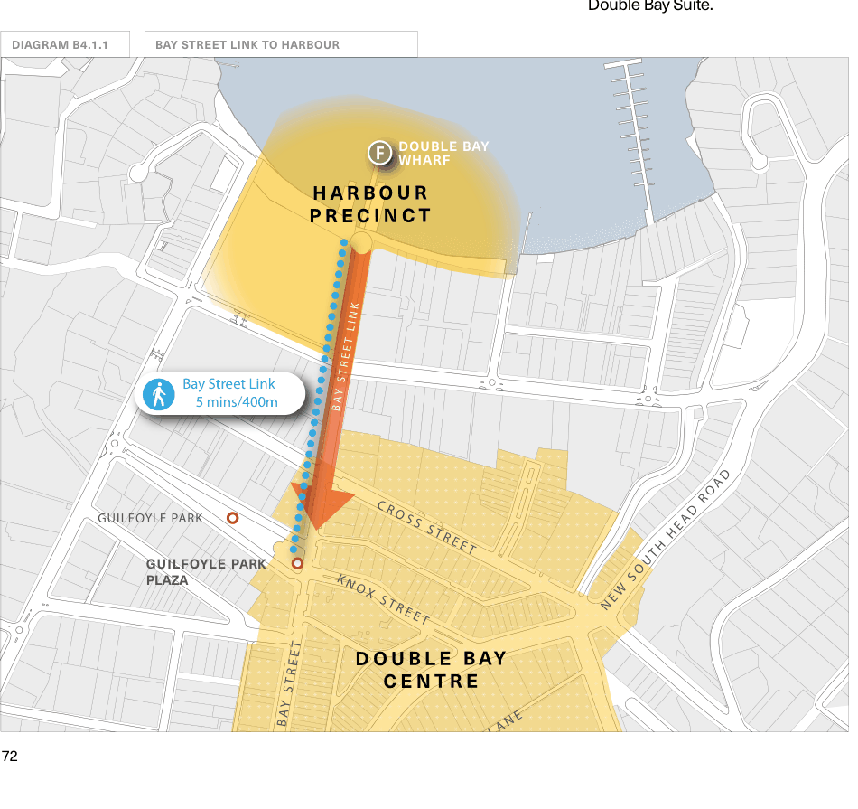

> [Picture on page 74: a picture, saved as a picture (images/public-domain-strategy-page-74-77.gif, 150 dpi).]
> Words printed on the picture (title and legend, copied from the PDF):
> Double Bay Suite.
> DIAGRAM B4.1.1 BAY STREET LINK TO HARBOUR
> DOUBLE BAY
> WHARF
> Bay Street Link
> 5 mins/400m
> GUILFOYLE PARK
> CROSSSTREET
> GUILFOYLE PARK
> PLAZA
> NEWSOUTHHEADROAD
> KNOXSTREET
> B AY STREET
> B AY STREETLINK
> KIAORALANE
> \* * * * * * * * * * * * * * * * * * * * * * * * * * * * * * * * * * * * * * * * * * * * * * * * * * * * * * * * *
> \* * * * * * * * * * * * * * * * * * * * * * * * * * * * * * * * * * * * * * * * * * * * * * * * * * * * * * * * *
> \* * * * * * * * * * * * * * * * * * * * * * * * * * * * * * * * * * * * * * * * * * * * * * * * * * * * * * * * *
> \* * * * * * * * * * * * * * * * * * * * * * * * * * * * * * * * * * * * * * * * * * * * * * * * * * * * * * * * *
> \* * * * * * * * * * * * * * * * * * * * * * * * * * * * * * * * * * * * * * * * * * * * * * * * * * * * * * * * *
> \* * * * * * * * * * * * * * * * * * * * * * * * * * * * * * * * * * * * * * * * * * * * * * * * * * * * * * * * *
> \* * * * * * * * * * * * * * * * * * * * * * * * * * * * * * * * * * * * * * * * * * * * * * * * * * * * * * * * *
> \* * * * * * * * * * * * * * * * * * * * * * * * * * * * * * * * * * * * * * * * * * * * * * * * * * * * * * * * *
> \* * * * * * * * * * * * * * * * * * * * * * * * * * * * * * * * * * * * * * * * * * * * * * * * * * * * * * * * *
> \* * * * * * * * * * * * * * * * * * * * * * * * * * * * * * * * * * * * * * * * * * * * * * * * * * * * * * * * *
> \* * * * * * * * * * * * * * * * * * * * * * * * * * * * * * * * * * * * * * * * * * * * * * * * * * * * * * * * *
> \* * * * * * * * * * * * * * * * * * * * * * * * * * * * * * * * * * * * * * * * * * * * * * * * * * * * * * * * *
> \* * * * * * * * * * * * * * * * * * * * * * * * * * * * * * * * * * * * * * * * * * * * * * * * * * * * * * * * *
> \* * * * * * * * * * * * * * * * * * * * * * * * * * * * * * * * * * * * * * * * * * * * * * * * * * * * * * * * *
> \* * * * * * * * * * * * * * * * * * * * * * * * * * * * * * * * * * * * * * * * * * * * * * * * * * * * * * * * *
> \* * * * * * * * * * * * * * * * * * * * * * * * * * * * * * * * * * * * * * * * * * * * * * * * * * * * * * * * *
> \* * * * * * * * * * * * * * * * * * * * * * * * * * * * * * * * * * * * * * * * * * * * * * * * * * * * * * * * *
> \* * * * * * * * * * * * * * * * * * * * * * * * * * * * * * * * * * * * * * * * * * * * * * * * * * * * * * * * *
> \* * * * * * * * * * * * * * * * * * * * * * * * * * * * * * * * * * * * * * * * * * * * * * * * * * * * * * * * *
> \* * * * * * * * * * * * * * * * * * * * * * * * * * * * * * * * * * * * * * * * * * * * * * * * * * * * * * * * *
> \* * * * * * * * * * * * * * * * * * * * * * * * * * * * * * * * * * * * * * * * * * * * * * * * * * * * * * * * *
> \* * * * * * * * * * * * * * * * * * * * * * * * * * * * * * * * * * * * * * * * * * * * * * * * * * * * * * * * *
> \* * * * * * * * * * * * * * * * * * * * * * * * * * * * * * * * * * * * * * * * * * * * * * * * * * * * * * * * *
> \* * * * * * * * * * * * * * * * * * * * * * * * * * * * * * * * * * * * * * * * * * * * * * * * * * * * * * * * *
> \* * * * * * * * * * * * * * * * * * * * * * * * * * * * * * * * * * * * * * * * * * * * * * * * * * * * * * * * *
> \* * * * * * * * * * * * * * * * * * * * * * * * * * * * * * * * * * * * * * * * * * * * * * * * * * * * * * * * *
> \* * * * * * * * * * * * * * * * * * * * * * * * * * * * * * * * * * * * * * * * * * * * * * * * * * * * * * * * *
> \* * * * * * * * * * * * * * * * * * * * * * * * * * * * * * * * * * * * * * * * * * * * * * * * * * * * * * * * *
> \* * * * * * * * * * * * * * * * * * * * * * * * * * * * * * * * * * * * * * * * * * * * * * * * * * * * * * * * *
> \* * * * * * * * * * * * * * * * * * * * * * * * * * * * * * * * * * * * * * * * * * * * * * * * * * * * * * * * *
> \* * * * * * * * * * * * * * * * * * * * * * * * * * * * * * * * * * * * * * * * * * * * * * * * * * * * * * * * *
> \* * * * * * * * * * * * * * * * * * * * * * * * * * * * * * * * * * * * * * * * * * * * * * * * * * * * * * * * *
> \* * * * * * * * * * * * * * * * * * * * * * * * * * * * * * * * * * * * * * * * * * * * * * * * * * * * * * * * *
> \* * * * * * * * * * * * * * * * * * * * * * * * * * * * * * * * * * * * * * * * * * * * * * * * * * * * * * * * *
> \* * * * * * * * * * * * * * * * * * * * * * * * * * * * * * * * * * * * * * * * * * * * * * * * * * * * * * * * *
> \* * * * * * * * * * * * * * * * * * * * * * * * * * * * * * * * * * * * * * * * * * * * * * * * * * * * * * * * *
> \* * * * * * * * * * * * * * * * * * * * * * * * * * * * * * * * * * * * * * * * * * * * * * * * * * * * * * * * *
> \* * * * * * * * * * * * * * * * * * * * * * * * * * * * * * * * * * * * * * * * * * * * * * * * * * * * * * * * *
> \* * * * * * * * * * * * * * * * * * * * * * * * * * * * * * * * * * * * * * * * * * * * * * * * * * * * * * * * *
> \* * * * * * * * * * * * * * * * * * * * * * * * * * * * * * * * * * * * * * * * * * * * * * * * * * * * * * * * *
> \* * * * * * * * * * * * * * * * * * * * * * * * * * * * * * * * * * * * * * * * * * * * * * * * * * * * * * * * *
> \* * * * * * * * * * * * * * * * * * * * * * * * * * * * * * * * * * * * * * * * * * * * * * * * * * * * * * * * *
> \* * * * * * * * * * * * * * * * * * * * * * * * * * * * * * * * * * * * * * * * * * * * * * * * * * * * * * * * *
> \* * * * * * * * * * * * * * * * * * * * * * * * * * * * * * * * * * * * * * * * * * * * * * * * * * * * * * * * *
> \* * * * * * * * * * * * * * * * * * * * * * * * * * * * * * * * * * * * * * * * * * * * * * * * * * * * * * * * *
> \* * * * * * * * * * * * * * * * * * * * * * * * * * * * * * * * * * * * * * * * * * * * * * * * * * * * * * * * *
> \* * * * * * * * * * * * * * * * * * * * * * * * * * * * * * * * * * * * * * * * * * * * * * * * * * * * * * * * *
> \* * * * * * * * * * * * * * * * * * * * * * * * * * * * * * * * * * * * * * * * * * * * * * * * * * * * * * * * *

#### NEW ELEMENTS

— Extend paving south to Cross St — New street trees — Improve crossings — Upgrade park and

#### HARBOUR

#### PRECINCT

picnic areas — New planting — New lighting — New wayfinding — Retail services — Extra seating — Upgrade War Memorial fences

#### DOUBLEB AY

#### CENTRE

BELLEVUEROAD

\* * * * * * * * * * * * * * * * * * * * * * * * * * * * * * * * * * * * * * * * * * * * * * * * * * * * * * * * *

1

2

3

#### HARBOUR PRECINCT

1	 North end of Bay Street from wharf looking towards Steyne Park 2	 William Street and Bay Street roundabout 3	 Bay Street between William Street and Cross Street

4	 Canopy created by mature Chinese Elms along the southern section of Bay Street

5	 Bay Street at Cooper Street intersection 6 	Bay Street at

Guilfoyle Park Plaza

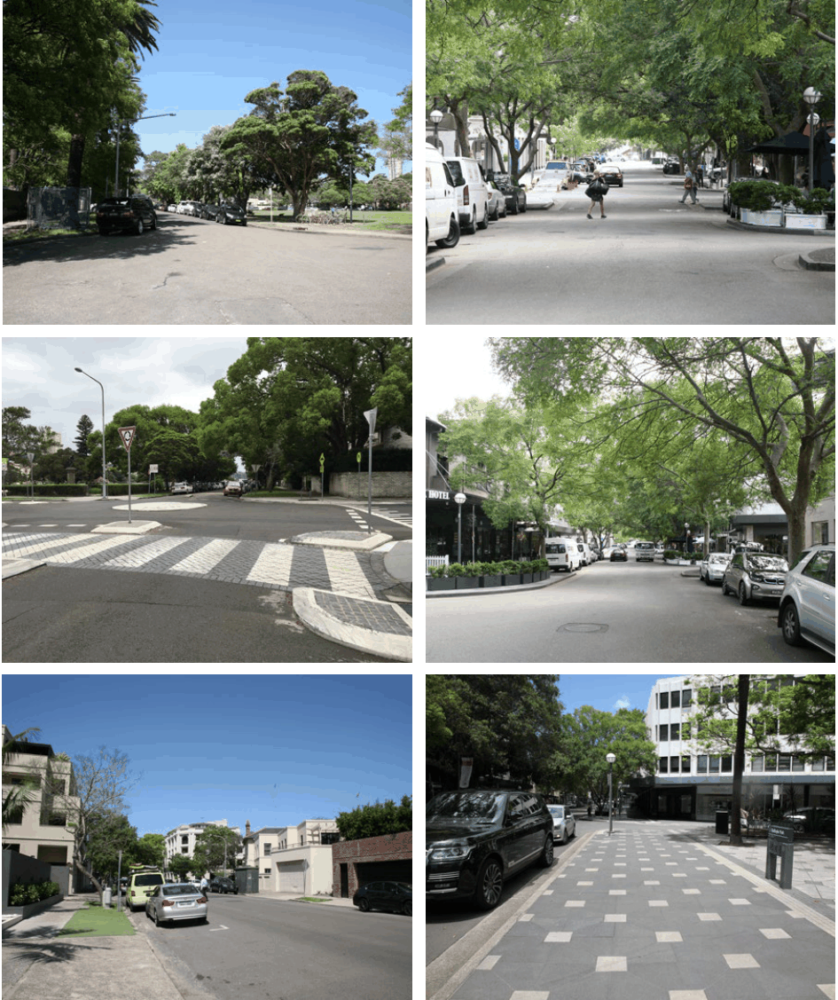

> [Picture on page 75: a picture, saved as a picture (images/public-domain-strategy-page-75-24.gif, 150 dpi).]

4

5

6

#### HARBOUR PRECINCT

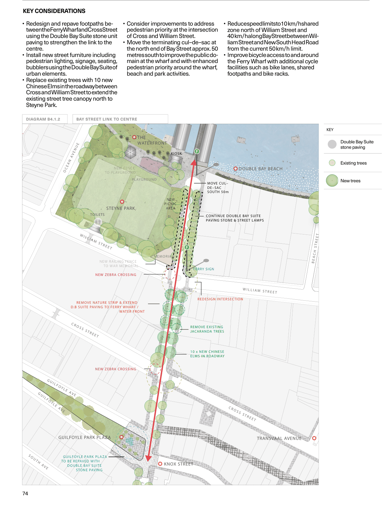

> [Picture on page 76: a map, saved as a picture (images/public-domain-strategy-page-76-2.gif, 150 dpi); the street names and other small labels are on the picture.]
> Words printed on the picture (title and legend, copied from the PDF):
> DIAGRAM B4.1.2 BAY STREET LINK TO CENTRE
> Double Bay Suite
> DOUBLE BAY BEACH
> CONTINUE DOUBLE BAY SUITE
> PAVING STONE & STREET LAMPS
> B AY STREET
> NEW RAILING FENCE
> TO WAR MEMORIAL
> NEW ZEBRA CROSSING
> REMOVE NATURE STRIP & EXTEND
> D.B SUITE PAVING TO FERRY WHARF /
> B AY STREET
> 10 x NEW CHINESE
> ELMS IN ROADWAY
> NEW ZEBRA CROSSING
> GUILFOYLE PARK PLAZA
> GUILFOYLE PARK PLAZA
> TO BE REPAVED WITH
> DOUBLE BAY SUITE
> SOUTHAVE STONE PAVING
> B AY STREET

#### KEY CONSIDERATIONS

•	Consider improvements to address

pedestrian priority at the intersection

of Cross and William Street.

•	Move the terminating cul–de–sac at

the north end of Bay Street approx. 50

metres south to improve the public do-

main at the wharf and with enhanced

pedestrian priority around the wharf,

beach and park activities.

•	Reduce speed limits to 10 km/h shared

zone north of William Street and

40 km/h along Bay Street between Wil-

liam Street and New South Head Road

from the current 50 km/h limit.

•	Improve bicycle access to and around

the Ferry Wharf with additional cycle

facilities such as bike lanes, shared

footpaths and bike racks.

•	Redesign and repave footpaths be-

tween the Ferry Wharf and Cross Street

using the Double Bay Suite stone unit

paving to strengthen the link to the

centre.

•	Install new street furniture including

pedestrian lighting, signage, seating,

bubblers using the Double Bay Suite of

urban elements.

•	Replace existing trees with 10 new

Chinese Elms in the roadway between

Cross and William Street to extend the

existing street tree canopy north to

Steyne Park.

#### HARBOUR PRECINCT

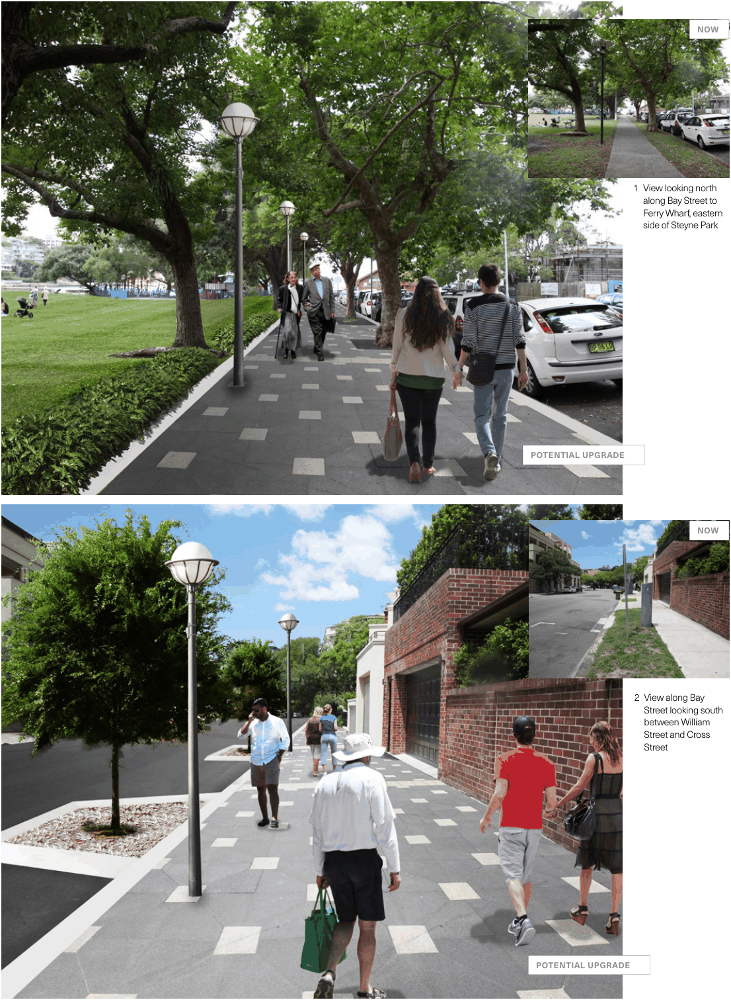

> [Picture on page 77: a map, saved as a picture (images/public-domain-strategy-page-77-2.gif, 150 dpi); the street names and other small labels are on the picture.]
> Words printed on the picture (title and legend, copied from the PDF):
> 1	 View looking north
> along Bay Street to
> Ferry Wharf, eastern
> side of Steyne Park
> 2	 View along Bay
> Street looking south
> Street and Cross

#### HARBOUR PRECINCT

#### KEY CONCEPT

#### WHAT TO DO

### B4.02

Steyne Park upgrade Upgrade Steyne Park to improve the

level of service provided, to create a local attractor that provides activities, spaces and opportunities for all ages and all types of stakeholders.

1\.	Update the Plan of Management.

2\.	Enlarge playground with water play elements and extra seating.

3\.	Upgrade picnic seating areas on the eastern side of the park.

4\.	Provide more incidental seating.

5\.	Upgrade War Memorial perimeter and pathways.

6\.	Establish new garden areas.

#### Steyne Park is a large local

foreshore park with significant

trees, open lawns, playing fields,

upgraded public toilets, a fenced

playground and a local War

#### Memorial. The park provides

spectacular open views to Sydney

#### Harbour and boating activities.

#### Conditions and Issues

Steyne Park is a well used park that

serves a number of purposes and is

the largest park in the area. Double Bay

Public School makes regular use of the

park, playing fields and the oval. There

is a small enclosed playground in the

north east corner of the park, close to

the Ferry Wharf. Upgraded public toilets

are provided on William Street. Standard

park bench seating in the park are well

used but not versatile for other inciden-

tal uses and do not contribute to the

overall park design. The park provides

a complementary green and shaded

alternative open space for Double Bay

Centre. The harbour is not well incorpo-

rated in the park design and gathering

spaces, with limited views to the water

and little interpretive acknowledgement

of the location.

Opportunities and

#### Recommendations

•	Update the Plan of Management for

Steyne Park to include a larger play-

ground, including additional water play

elements, public art and interpretive

concepts.

•	Revise planting garden beds around

the perimeter of the park, retain sports

fields in the central area of the park.

•	Upgrade seating and picnic table furni-

ture, and better integrate seating and

paths within the park design.

•	Update lighting and provide feature

lighting of large trees and the

War Memorial.

•	Replace existing fences to the play-

ground and War Memorial sympathetic

to the Double Bay Suite.

•	Identify additional facilities to be

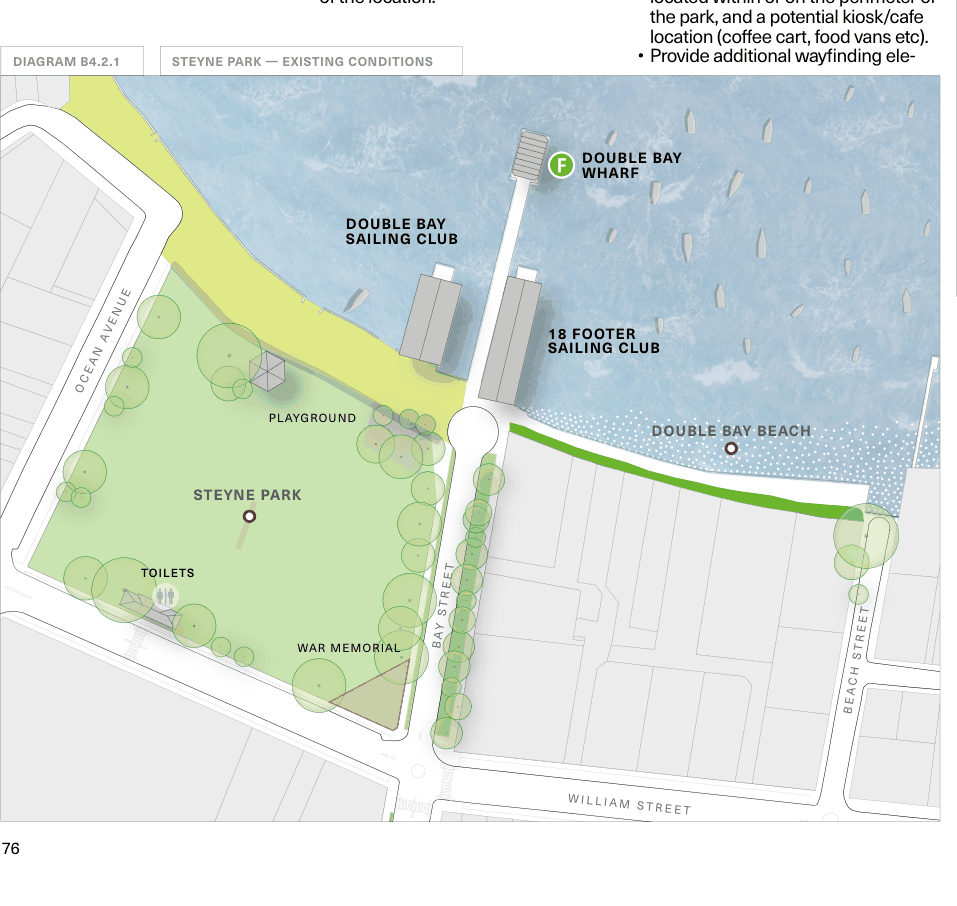

> [Picture on page 78: a map, saved as a picture (images/public-domain-strategy-page-78-68.gif, 150 dpi); the street names and other small labels are on the picture.]
> Words printed on the picture (title and legend, copied from the PDF):
> DIAGRAM B4.2.1 STEYNE PARK — EXISTING CONDITIONS
> DOUBLE BAY BEACH
> B AY STREET

located within or on the perimeter of

the park, and a potential kiosk/cafe

location (coffee cart, food vans etc).

•	Provide additional wayfinding ele-

#### NEW ELEMENTS

— Food kiosk/café — Expanded playground — New garden areas — Upgraded paths — New seating areas — Extra picnic tables and seating arrangements — Wayfinding — Free wifi

KEY

Steyne Park

Steyne Park Waterfront

Double Bay Beach grassed area

E T

#### HARBOUR PRECINCT

#### KEY CONSIDERATIONS

•	Enlarge the existing playground with

sand play and water play areas and har-

bour related public art and interpretive

design concepts.

•	Upgrade gardens and planted areas

around the perimeter of the park.

•	Increase the number of public seats

and introduce a variety of seating op-

tions and picnic table areas.

•	Integrate foreshore park design and

'Waterfront' concept to the north of the

park along the sea wall.

#### DOUBLE BAY

#### WHARF

#### THE WATERFRONT

#### STEYNE PARK

1	 Existing playground in Steyne Park 2	 Existing picnic area in Steyne Park eastern area near Bay Street 3 	War Memorial on Bay Street and William Street

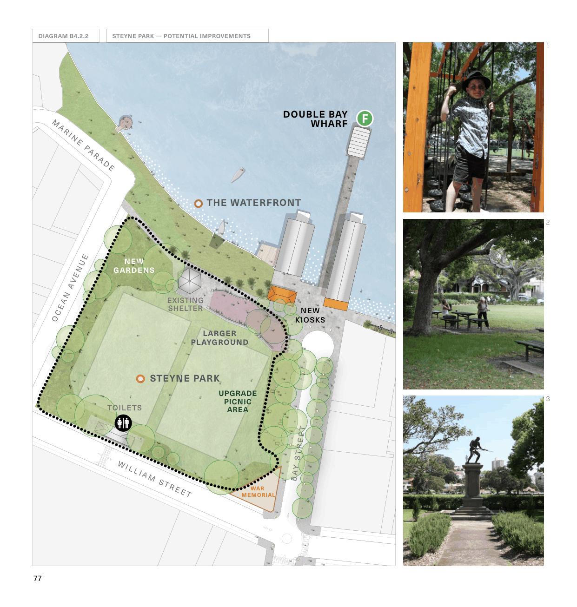

> [Picture on page 79: a map, saved as a picture (images/public-domain-strategy-page-79-28.gif, 150 dpi); the street names and other small labels are on the picture.]
> Words printed on the picture (title and legend, copied from the PDF):
> DIAGRAM B4.2.2 STEYNE PARK — POTENTIAL IMPROVEMENTS
> MARINE PA RADE
> B AY STREET

#### DOUBLE BAY BEACH

#### HARBOUR PRECINCT

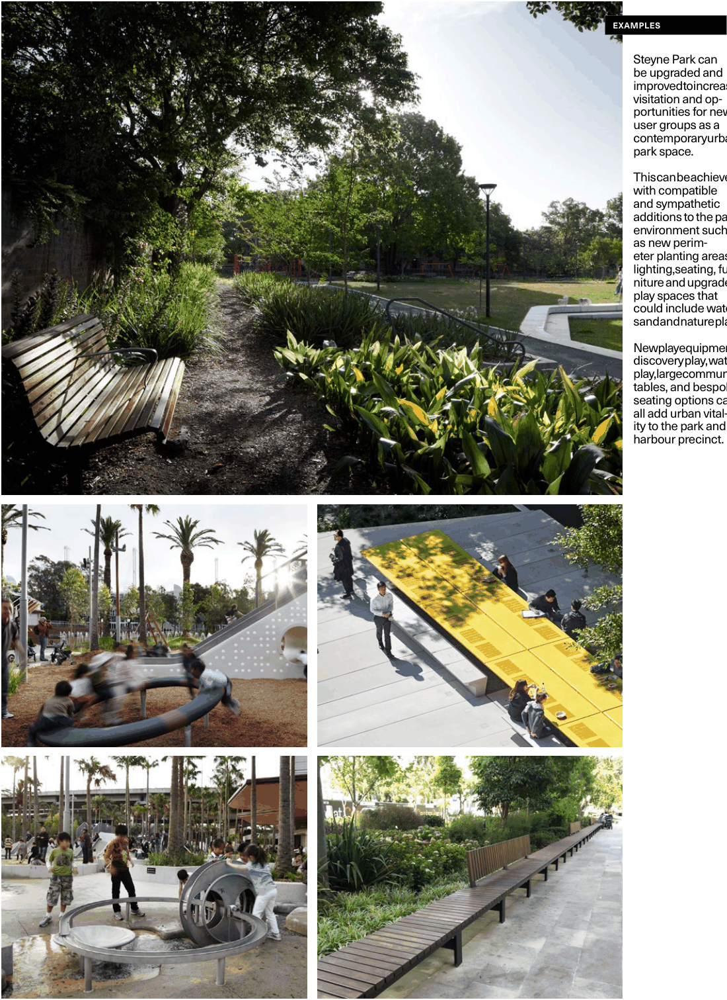

> [Picture on page 80: a map, saved as a picture (images/public-domain-strategy-page-80-2.gif, 150 dpi); the street names and other small labels are on the picture.]
> Words printed on the picture (title and legend, copied from the PDF):
> Steyne Park can
> be upgraded and
> improved to increase
> visitation and op-
> portunities for new
> user groups as a
> This can be achieved
> eter planting areas,
> niture and upgraded
> could include water,
> discovery play, water
> tables, and bespoke
> all add urban vital-

with compatible additions to the park as new perim-lighting,seating, fur-play spaces that sand and nature play. New play equipment, play, large communal seating options can ity to the park and

#### HARBOUR PRECINCT

#### KEY CONCEPT

#### WHAT TO DO

### B4.03

### The Waterfront

### ‘Bay to Ocean’

Upgrade the waterfront area west of the ferry wharf to better accommodate sailing and boating activities, and provide a waterfront area that is more suitable for the community outside of race event times, that also improves access to the harbour. Design the public domain to suit multiple users.

1\.	Construct a new multi-purpose water-front area.

2\.	Reconfigure dinghy storage area and access around boat clubs and wharf.

3\.	Preserve sandstone sea wall.

4\.	Encourage new activities, seating and picnic areas along the waterfront for year round use.

#### Conditions and Issues

The area north of Steyne Park along

the waterfront is in poor condition with

sparse grass cover due to high pedes-

trian traffic, boating use and exposure

to salt water. Concrete paths are also in

poor condition. The area is currently an

off–leash dog area north of the path.

There are a number of existing drainage

issues, potholes and cracked pavements

along the Steyne Park waterfront.

#### The waterfront between Bay Street

cul-de-sac and Ocean Avenue

is large area of public domain

#### 125 m in length (approx 2000  m2)

protected from the harbour by a
