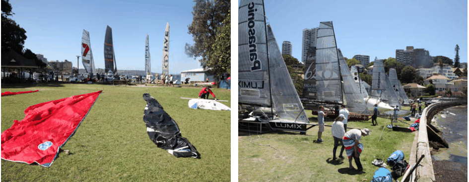
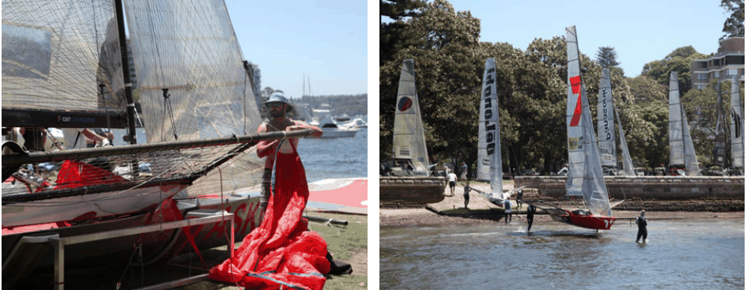

#### 1.5 m high sandstone wall. The

area is primarily used for access to

a boat ramp and preparation area

for the18 footer skiff boats and

associated vehicles and trailers

and as an off–leash area for dogs at

other times.

#### NEW ELEMENTS

— Upgraded boat launch area — Seating and benches — New boat stands — Kayak and paddle board

Opportunities and

#### Recommendations

The 18 foot skiff racing over the summer

period and uses by other sailing and

boating groups is an important activity

that can be built on as a key attractor

at the Double Bay Harbour Precinct.

Improved facilities and positioning of

Double Bay as first class sailing centre

and racing precinct should be a priority.

access — New jetty — Open up Ocean Ave vista to harbour

•	Review and/or relocate off–leash dog

areas within Steyne Park or to the

western end of the waterfront

•	Prepare a new masterplan to accomo-

date a variety of sailing and maritime

activities along the waterfront.

•	Review and/or relocate dinghy storage

near Ferry Wharf.

•	Provide a location for kayak, wind

surfer and paddle board access to the

harbour.

•	Upgrade the foreshore park with new

paving, lawns, seating, tables and gar-

dens to the perimeter. Possible surface

materials could include a combination

of concrete, decking, artificial turf or a

more appropriate natural turf.

•	Investigate options for penetrating

parts of the sea wall to allow new

places to connect to the water and

encourage new activities and jetty

structures on the waterside.

•	Identify areas for additional trees to be

planted along the waterfront.

> [Picture on page 81: a picture, saved as a picture (images/public-domain-strategy-page-81-90.gif, 150 dpi).]

> [Picture on page 81: a picture, saved as a picture (images/public-domain-strategy-page-81-91.gif, 150 dpi).]

1

2

1	 18 footer spinnakers drying in Steyne Park after racing 2	 Setting up and rigging boats in Steyne Park foreshore area

3

4

3	 Setting up and rigging boats 4	 Concrete boat ramp launch area west of the Ferry Wharf and Sailing Club

#### HARBOUR PRECINCT

#### Existing Conditions
