## 18 Footer Season

1	 Poor quality paths, edges, lawns and fencing to northern edge of park. 2	 Degraded grass surface near boat launch area 3	 Existing opening in sea wall near Ocean Avenue

Each Sunday over the summer months

the 18 Footer Skiffs set off from Double

Bay for high speed yacht racing on

Sydney Harbour creating a harbour front

hub of activity and colour. A spectator

ferry follows the race up and down the

central harbour setting off from and

returning to Double Bay.

The Steyne Park waterfront area is

currently in poor condition. The sandy

soil, lack of trees, poor grass coverage,

erosion and high levels of regular vehicle

and pedestrian traffic and exposure to

the marine environment of the harbour

have contributed to current levels of

deterioration. The variety of concrete

pathways are of varying qualities and

ages and require upgrading. The sand-

stone sea wall is in excellent condition

and is a strong urban element to be

considered and incorporated with any

future upgrade.

4	 Degraded grass surface and timber railings along path 5	 Dinghy storage at southern end of sailing club

6 	Existing concrete boat ramp and sailing club

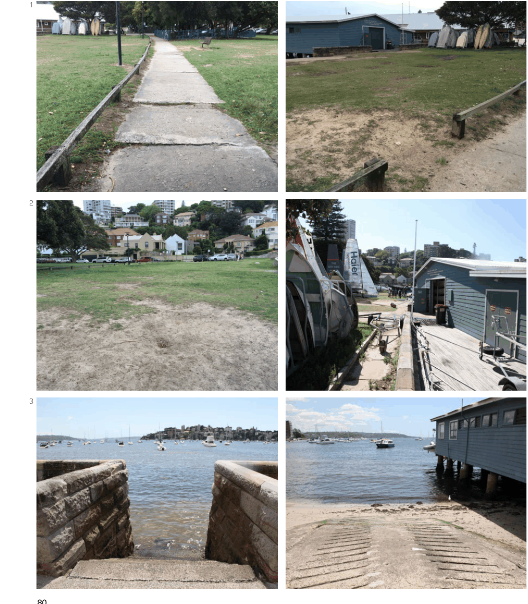

> [Picture on page 82: a picture, saved as a picture (images/public-domain-strategy-page-82-45.gif, 150 dpi).]
> Words printed on the picture (title and legend, copied from the PDF):
> 1
> 2
> 3

4

5

6

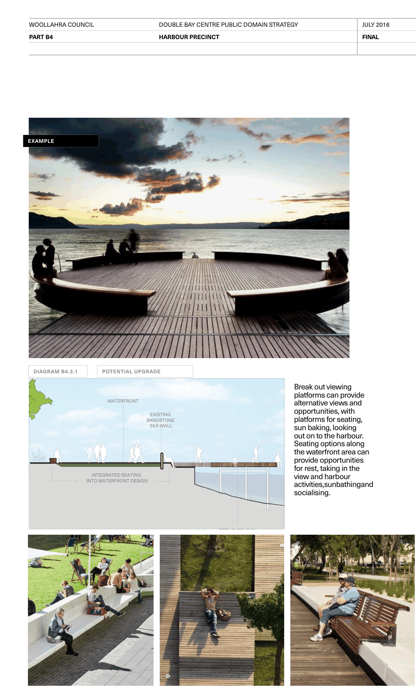

> [Picture on page 83: a map, saved as a picture (images/public-domain-strategy-page-83-1.gif, 150 dpi); the street names and other small labels are on the picture.]
> Words printed on the picture (title and legend, copied from the PDF):
> DIAGRAM B4.3.1 POTENTIAL UPGRADE
> INTO WATERFRONT DESIGN
> platforms can provide
> sun baking, looking
> Seating options along
> view and harbour
> STEYNE PARK WATER FRONT SECTION

Break out viewing alternative views and platforms for seating, out on to the harbour. the waterfront area can for rest, taking in the activities, sunbathing and

#### HARBOUR PRECINCT

#### KEY CONCEPT

#### WHAT TO DO

### B4.04

### Double Bay Beach

### ‘Bay to Beach’

Upgrade waterfront area east of the

#### Ferry Wharf to better accommodate

swimming, sunbathing and seating options with new shade, bubblers, paved areas and swimming pontoons.

1\.	Redesign foreshore and pathway be-tween Bay Street and Beach Street.

2\.	Investigate new kiosk or cafe nearby to service beach area.

3\.	Install new signage and wayfinding

4\.	Install new shade structures and plant additional trees for shade.

5\.	Install a swimming pontoon.

#### Conditions and Issues

The Double Bay Beach is a short north

facing harbour beach of around 125m

with sandy shore, and grassed area

beyond a 1.2m concrete path running

between from the Ferry Wharf on Bay

Street and Beach Street to the east. There

are some existing park benches installed

along the foreshore and a small garden

strip.

#### The 125 metre long Double Bay

#### Beach between the Bay Street cul-

de-sac and Beach Avenue is a well

formed natural sandy beach with

a single concrete footpath, and

turfed areas garden areas between

the path and the property boundary

(total area approx 1000m2). The

beach is a pleasant area to enjoy

the northerly views of the harbour,

moored boats and ferry activity at

the wharf.

•	Install new swimming pontoons similar

to the pontoons at Redleaf Pool.

•	Create a number of seating combina-

tions to allow for different sized groups,

activities and ages.

•	Allow for new trees and/or shade

structures and/or permanent umbrellas

along the beach.

•	Use landform and concrete steps to

provide a reformed foreshore edge.

•	Improve bike parking facilities near the

beach to be increased with new bike

racks and signage.

Opportunities and

#### Recommendations

•	Update the Plan of Management as

required for the beach area, as part of

the Steyne Park master plan.

•	Improve the grassed area with a

combination of land forms, hard seat-

ing edges, paving, furniture and new

elements to provide shade.

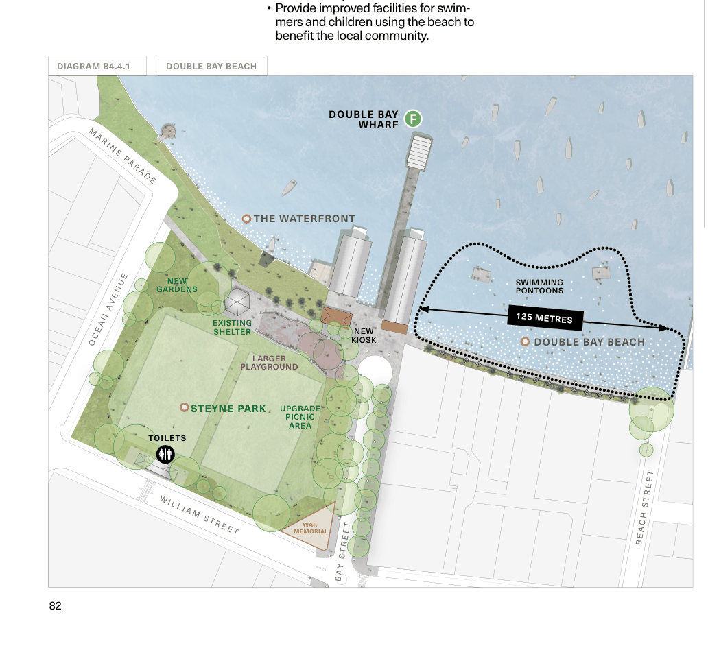

> [Picture on page 84: a map, saved as a picture (images/public-domain-strategy-page-84-64.gif, 150 dpi); the street names and other small labels are on the picture.]
> Words printed on the picture (title and legend, copied from the PDF):
> benefit the local community.
> DIAGRAM B4.4.1 DOUBLE BAY BEACH
> MARINE PA RADE
> DOUBLE BAY BEACH
> B AY STREET

•	Provide improved facilities for swim-

mers and children using the beach to

#### NEW ELEMENTS

— Upgrade waterfront — New seating — New benches — Umbrellas/shade — Additional trees — New planting — Swimming pontoons

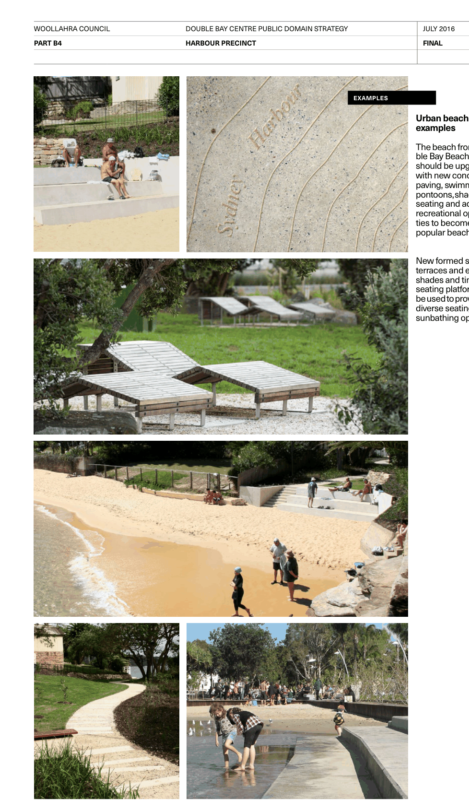

> [Picture on page 85: a picture, saved as a picture (images/public-domain-strategy-page-85-1.gif, 150 dpi).]
> Words printed on the picture (title and legend, copied from the PDF):
> HARBOUR PRECINCT
> EXAMPLES
> ble Bay Beach
> with new concrete
> recreational opportuni-
> popular beach.
> terraces and edges,
> seating platforms can
> diverse seating and

#### Urban beach

examples

The beach front at Dou-should be upgraded paving, swimming

pontoons, shading, new

seating and additional ties to become a more

New formed seating shades and timber be used to provide more sunbathing options.

1

#### HARBOUR PRECINCT

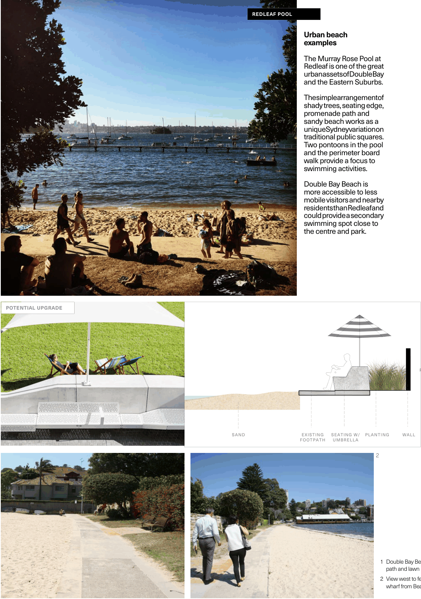

> [Picture on page 86: a map, saved as a picture (images/public-domain-strategy-page-86-3.gif, 150 dpi); the street names and other small labels are on the picture.]
> Words printed on the picture (title and legend, copied from the PDF):
> more accessible to less
> residents than Redleaf and
> swimming spot close to
> SEATING W/ PLANTING WALL
> 1	 Double Bay Beach
> path and lawn
> 2 	View west to ferry
> wharf from Beach St

#### Urban beach

examples

The Murray Rose Pool at

Redleaf is one of the great

urban assets of Double Bay

and the Eastern Suburbs.

The simple arrangement of

shady trees, seating edge,

promenade path and

sandy beach works as a

unique Sydney variation on

traditional public squares.

Two pontoons in the pool

and the perimeter board

walk provide a focus to

swimming activities.

Double Bay Beach is

mobile visitors and nearby

could provide a secondary

the centre and park.

PRIVATE RESIDENC

#### PUBLIC DOMAIN DETAILS

#### KEY CONCEPT

#### WHAT TO DO

### B5.01

### Public Domain Details

### Double Bay Suite

#### Maintain and extend the existing

Double Bay Suite of paving and furniture for main streets within the centre. Extend and develop the suite options for gateways, laneways and foreshore areas.

1\.	Review and update the existing manual to include elements and new guidelines for laneways including the Kiaora Suite.

2\.	Maintain the existing paving and furniture suite and use in new public spaces as appropriate, in a comprehen-sive manner in accordance with the guidelines.

#### Conditions and Issues

The palette of greys, whites and stone

and aggregate materials is a strong and

memorable component of the Double

Bay street character.

#### Double Bay has a strong existing

palette of public domain materials,

designs and furniture that have

reinforced public domain of

the centre. The palette can

be extended to include new

lighting options and elements

for gateways, foreshores, linking

streets and laneways.

The original ‘Urbanstone’ paving suite

pavers have not weathered well over

time and have been replaced with

granite in most locations. Replacement

of these older pavers with stone should

continue. Where the suite is used all elements

must be used in a clear and consistent

manner, and not be mixed between

laneway and street typologies or alterna-

tives used without approval.

#### The Public Domain Lighting

#### Strategy 2016 (prepared by Arup)

was adopted by Council on 27

June 2016. This strategy should be

read in conjunction with the Public

Domain Lighting Strategy 2016,

and any recommendations relating

to lighting design and installation

must be consistent with the Arup

lighting strategy.

Opportunities and

#### Recommendations

•	Identify new areas that the Double Bay

Suite and Kiaora Suite palettes are to

be used.

•	The full suite of elements; paving, light

standards, seats, bollards and bins

should always be used together — and

not used in an ad hoc manner as has

been the case in some laneways and

pedestrian links.

•	Add the Kiaora Suite to an updated

Double Bay Centre design manual.

•	Opportunities exist to improve on the

existing standard lamp and develop

a new pedestrian street lamp that

increases luminance and pedestrian

amenity.

•	Updated public seats and benches

may also be developed to suit both the

laneway and street designs.

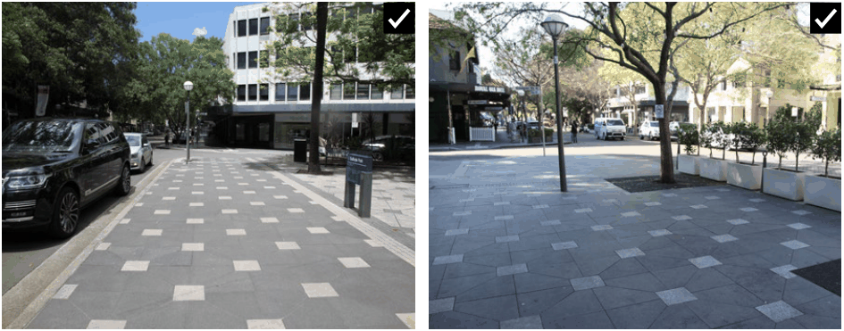

> [Picture on page 87: a picture, saved as a picture (images/public-domain-strategy-page-87-77.gif, 150 dpi).]

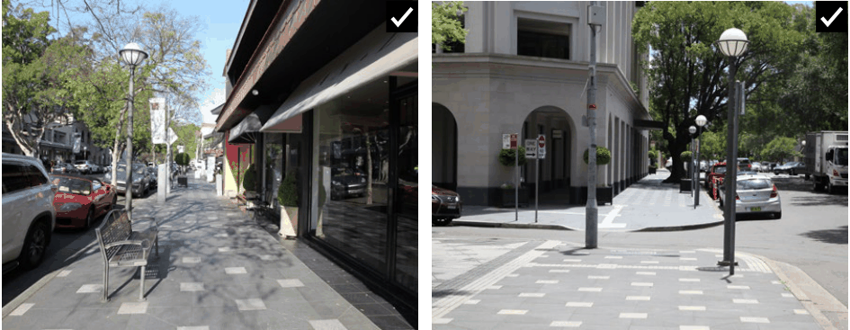

> [Picture on page 87: a picture, saved as a picture (images/public-domain-strategy-page-87-78.gif, 150 dpi).]

1	 Double Bay Suite stone paving at Guilfoyle Park on Bay Street 2	 View east along Cross Street showing paving, street lights and seating. 3	 Bay Street footpath extension, 4	 View north along Bay Street towards the harbour precinct.

#### PUBLIC DOMAIN DETAILS

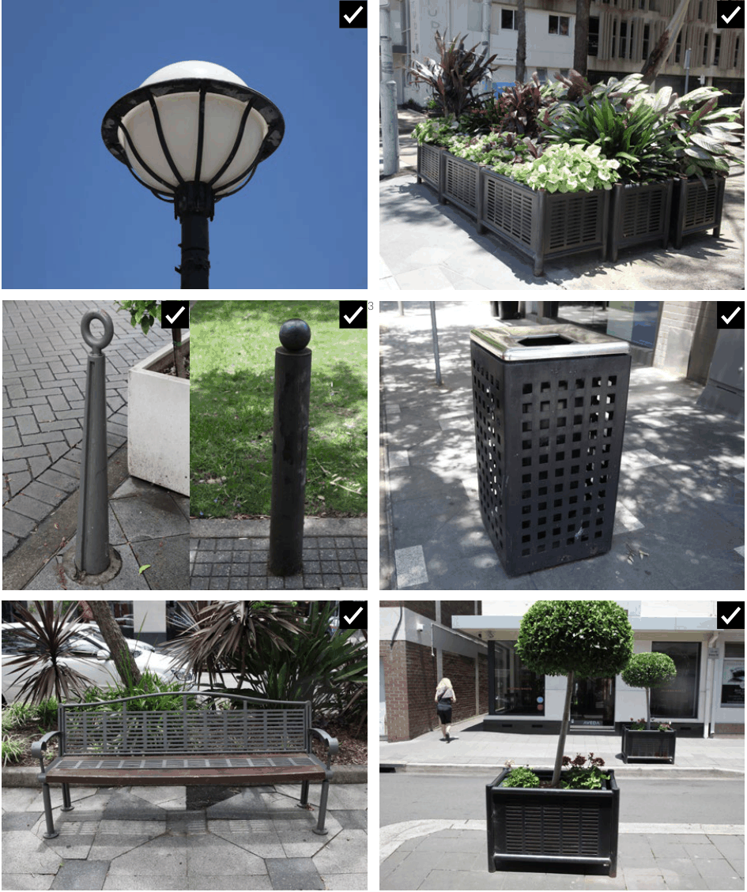

> [Picture on page 88: a picture, saved as a picture (images/public-domain-strategy-page-88-2.gif, 150 dpi).]
> Words printed on the picture (title and legend, copied from the PDF):
> 3

1

2

3

1	 Double Bay Suite standard lamp (potentially upgraded) 2	 Double Bay standard bollards 3	 Double Bay standard bench seat at Guilfoyle Park 4	 Planters on Cross Street 5	 Standard garbage bin cover 6 	Double Bay standard tree planter boxes

4

5

6

1

4

2

5

3

| WOOLLAHRA COUNCIL | DOUBLE BAY CENTRE PUBLIC DOMAIN STRATEGY | JULY 2016 |
|---|---|---|
| PART B5 | PUBLIC DOMAIN DETAILS | FINAL |
| There are elements of the Double Bay | 1 Galvanised street | 4 Double Bay Suite |
| Suite that require updating and ap- | poles and standard | lights on |
| plications of some elements that do not contribute to a consistent and legible public domain. The use of the Double | signage is not preferred within the centre | Gumtree Lane 5 Double Bay Suite lights on Galbraith |
| Bay Suite elements in laneways and | 2 Asphalt back fill to be | Walk |
| pedestrian links is not recommended. A | replaced with stone |  |
| new set of update streetscape manual | 3 Street light |  |
| details for laneways (Kiaora Suite) needs | attachment to smart |  |
| to be developed. | pole on New South Head Road |  |

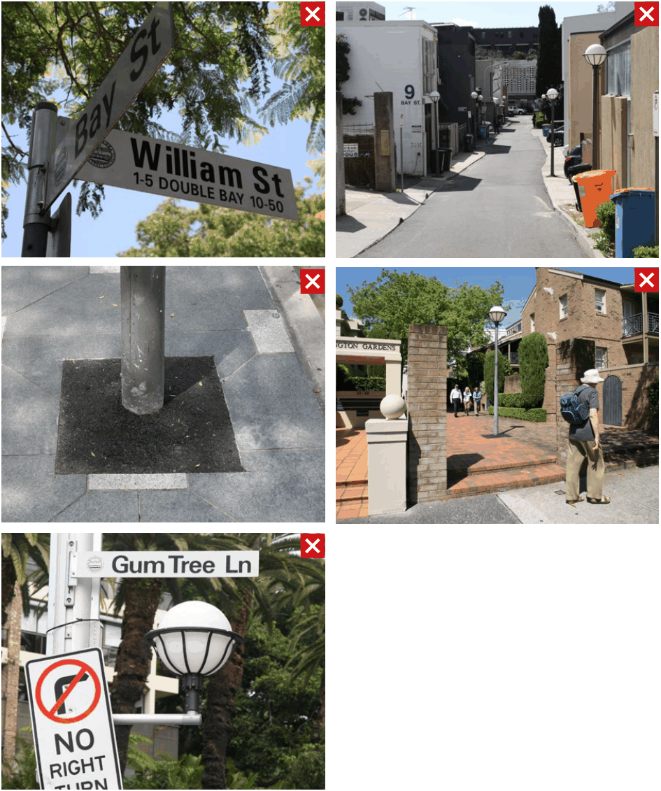

> [Picture on page 89: a picture, saved as a picture (images/public-domain-strategy-page-89-7.gif, 150 dpi).]

#### PUBLIC DOMAIN DETAILS

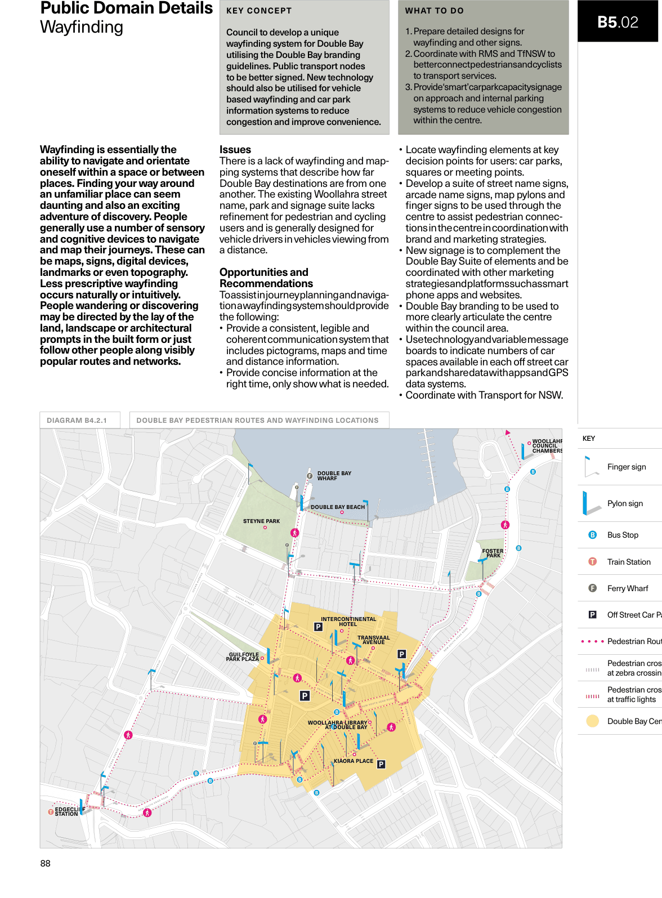

> [Picture on page 90: a map, saved as a picture (images/public-domain-strategy-page-90-2.gif, 150 dpi); the street names and other small labels are on the picture.]
> Words printed on the picture (title and legend, copied from the PDF):
> WHAT TO DO
> 1\.	Prepare detailed designs for
> wayfinding and other signs.
> 2\.	Coordinate with RMS and TfNSW to
> better connect pedestrians and cyclists
> to transport services.
> 3\.	Provide ‘smart’ car park capacity signage
> on approach and internal parking
> systems to reduce vehicle congestion
> within the centre.
> Council to develop a unique
> wayfinding system for Double Bay
> utilising the Double Bay branding
> guidelines. Public transport nodes
> to be better signed. New technology
> should also be utilised for vehicle
> based wayfinding and car park
> information systems to reduce
> congestion and improve convenience.
> DIAGRAM B4.2.1 DOUBLE BAY PEDESTRIAN ROUTES AND WAYFINDING LOCATIONS
> TO REDLEAF POOL
> DOUBLE BAY BEACH
> B AY STREET
> Off Street Car Park
> at zebra crossings
> at traffic lights
> TRAINS TAT ION
> Double Bay Centre
> AT DOUBLE BAY
> B AY STREET
> B AY STREET
> B AY LOCAL

### B5.02

### Wayfinding

#### Issues

There is a lack of wayfinding and map-

ping systems that describe how far

Double Bay destinations are from one

another. The existing Woollahra street

name, park and signage suite lacks

refinement for pedestrian and cycling

users and is generally designed for

vehicle drivers in vehicles viewing from

a distance.

Wayfinding is essentially the

ability to navigate and orientate

oneself within a space or between

places. Finding your way around

an unfamiliar place can seem

daunting and also an exciting

adventure of discovery. People

generally use a number of sensory

and cognitive devices to navigate

and map their journeys. These can

be maps, signs, digital devices,

landmarks or even topography.

#### Less prescriptive wayfinding

occurs naturally or intuitively.

#### People wandering or discovering

may be directed by the lay of the

land, landscape or architectural

prompts in the built form or just

follow other people along visibly

popular routes and networks.

Opportunities and

#### Recommendations

To assist in journey planning and naviga-

tion a wayfinding system should provide

the following:

•	Provide a consistent, legible and

coherent communication system that

includes pictograms, maps and time

and distance information.

•	Provide concise information at the

right time, only show what is needed.

•	Locate wayfinding elements at key

decision points for users: car parks,

squares or meeting points.

•	Develop a suite of street name signs,

arcade name signs, map pylons and

finger signs to be used through the

centre to assist pedestrian connec-

tions in the centre in coordination with

brand and marketing strategies.

•	New signage is to complement the

Double Bay Suite of elements and be

coordinated with other marketing

strategies and platforms such as smart

phone apps and websites.

•	Double Bay branding to be used to

more clearly articulate the centre

within the council area.

•	Use technology and variable message

boards to indicate numbers of car

spaces available in each off street car

park and share data with apps and GPS

data systems.

•	Coordinate with Transport for NSW.

#### PUBLIC DOMAIN DETAILS

1	 Ferry Wharf roundel signage 2	 Woollahra Suite at Double Bay wharf 3	 Existing street name signage

Transport for NSW’s city wide ‘TBFL’ signage system is a positive im-

provement for increasing awareness of the location of services that

should benefit the centre as it is rolled out. Ferry ‘F’ marker signs

and new ‘B’ bus stop signs will improve the level of service provided

for public transport users.

1

2

3

4	 Sydney Ferries information and timetable panels 5	 Doubled up signage installed by Council and TfNSW

6	 Poor combined signage on the Bay Street Link to Ferry Wharf

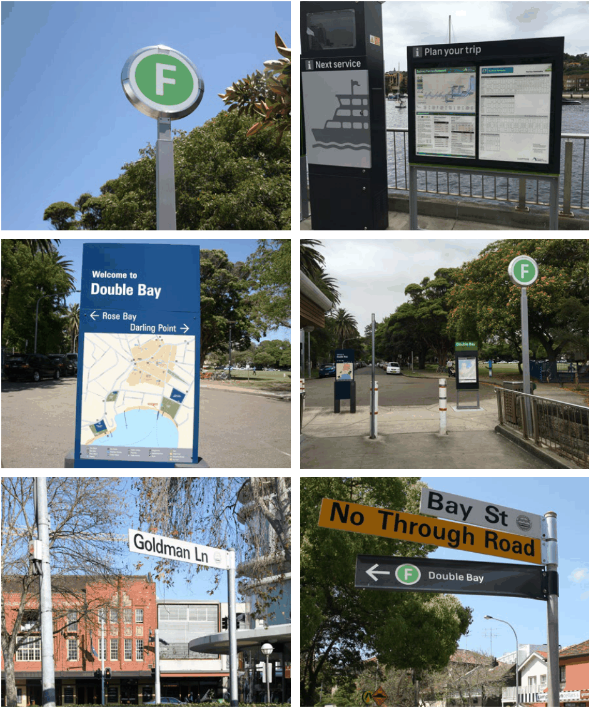

> [Picture on page 91: a picture, saved as a picture (images/public-domain-strategy-page-91-26.gif, 150 dpi).]

4

5

6

#### PUBLIC DOMAIN DETAILS

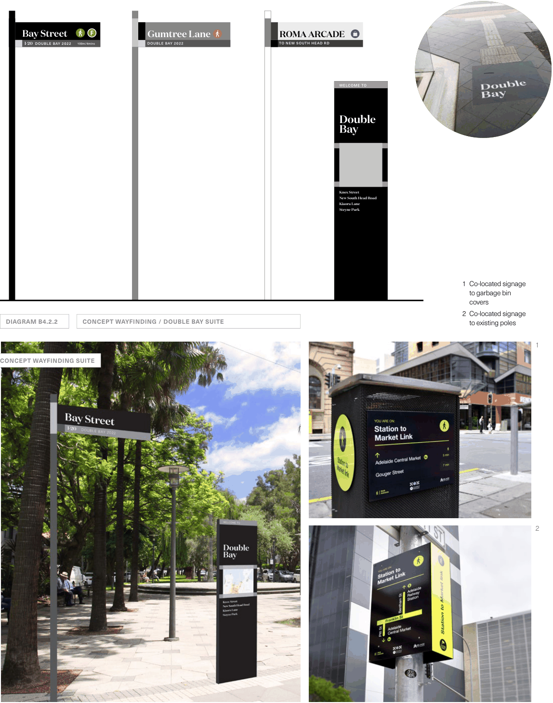

> [Picture on page 92: a picture, saved as a picture (images/public-domain-strategy-page-92-2.gif, 150 dpi).]
> Words printed on the picture (title and legend, copied from the PDF):
> 1-20 DOUBLE BAY 2022 100m/4mins

> Words printed on the picture (title and legend, copied from the PDF):
> DOUBLE BAY 2022

#### Bay Street

> Words printed on the picture (title and legend, copied from the PDF):
> TO NEW SOUTH HEAD RD
> New South Head Road

#### ROMA ARCADE

#### Gumtree Lane

#### Double

#### Bay

#### DIAGRAM B4.2.2 CONCEPT WAYFINDING / DOUBLE BAY SUITE

> Words printed on the picture (title and legend, copied from the PDF):
> CONCEPT WAYFINDING SUITE

1	 Co-located signage to garbage bin covers 2	 Co-located signage to existing poles

1

2

#### PUBLIC DOMAIN DETAILS

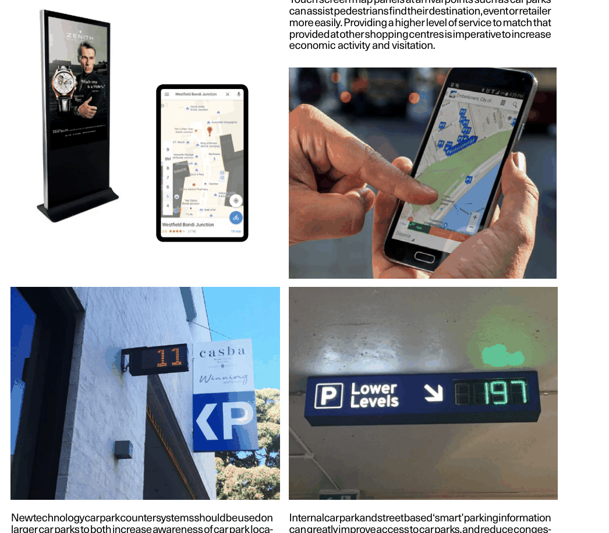

> [Picture on page 93: a picture, saved as a picture (images/public-domain-strategy-page-93-2.gif, 150 dpi).]

Touch screen map panels at arrival points such as car parks

can assist pedestrians find their destination, event or retailer

more easily. Providing a higher level of service to match that

provided at other shopping centres is imperative to increase

economic activity and visitation.

New technology car park counter systems should be used on

larger car parks to both increase awareness of car park loca-

tions, entrance points and the availability of parking within

each car parking station.

Internal car park and street based ‘smart’ parking information

can greatly improve access to car parks, and reduce conges-

tion and pollution by reducing the amount of time spent

searching for a car space.

#### PUBLIC DOMAIN DETAILS

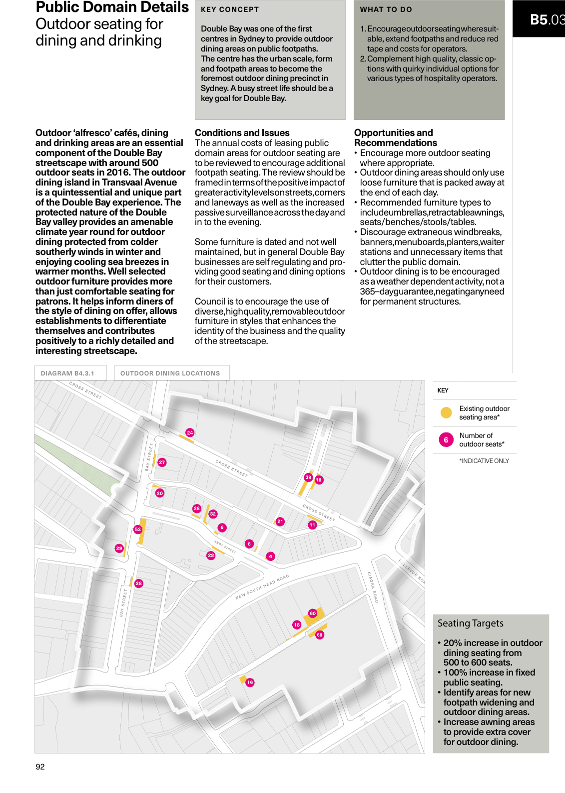

> [Picture on page 94: a map, saved as a picture (images/public-domain-strategy-page-94-2.gif, 150 dpi); the street names and other small labels are on the picture.]
> Words printed on the picture (title and legend, copied from the PDF):
> WHAT TO DO
> 1\.	Encourage outdoor seating where suit-
> able, extend footpaths and reduce red
> tape and costs for operators.
> 2\.	Complement high quality, classic op-
> tions with quirky individual options for
> various types of hospitality operators.
> Double Bay was one of the first
> centres in Sydney to provide outdoor
> dining areas on public footpaths.
> The centre has the urban scale, form
> and footpath areas to become the
> foremost outdoor dining precinct in
> Sydney. A busy street life should be a
> key goal for Double Bay.
> B AY STREET
> •	Discourage extraneous windbreaks,
> DIAGRAM B4.3.1 OUTDOOR DINING LOCATIONS
> B AY STREET
> B AY STREET

### B5.03

Outdoor seating for

### dining and drinking

#### Conditions and Issues

The annual costs of leasing public

domain areas for outdoor seating are

to be reviewed to encourage additional

footpath seating. The review should be

framed in terms of the positive impact of

greater activity levels on streets, corners

and laneways as well as the increased

passive surveillance across the day and

in to the evening. Some furniture is dated and not well

maintained, but in general Double Bay

businesses are self regulating and pro-

viding good seating and dining options

for their customers.

Opportunities and

#### Recommendations

•	Encourage more outdoor seating

where appropriate.

•	Outdoor dining areas should only use

loose furniture that is packed away at

the end of each day.

•	Recommended furniture types to

include umbrellas, retractable awnings,

seats/benches/stools/tables. banners, menu boards, planters, waiter

stations and unnecessary items that

clutter the public domain.

•	Outdoor dining is to be encouraged

as a weather dependent activity, not a

365–day guarantee, negating any need

for permanent structures.

Council is to encourage the use of

diverse, high quality, removable outdoor

furniture in styles that enhances the

identity of the business and the quality

of the streetscape.

#### Outdoor ‘alfresco’ cafés, dining

and drinking areas are an essential

component of the Double Bay

streetscape with around 500

outdoor seats in 2016. The outdoor

dining island in Transvaal Avenue

is a quintessential and unique part

of the Double Bay experience. The

protected nature of the Double

#### Bay valley provides an amenable

climate year round for outdoor

dining protected from colder

southerly winds in winter and

enjoying cooling sea breezes in

warmer months. Well selected

outdoor furniture provides more

than just comfortable seating for

patrons. It helps inform diners of

the style of dining on offer, allows

establishments to differentiate

themselves and contributes

positively to a richly detailed and

interesting streetscape.

•	20% increase in outdoor

dining seating from

#### 500 to 600 seats.

•	100% increase in fixed

public seating.

•	Identify areas for new

footpath widening and

outdoor dining areas.

•	Increase awning areas

to provide extra cover

for outdoor dining.

#### PUBLIC DOMAIN DETAILS

1	 Loose outdoor tables and chairs, Bay Street

4	 Loose outdoor tables, umbrellas and chairs, Bay Street

2	 Island dining area, Transvaal Avenue

5	 Loose outdoor tables and chairs, Knox Street

3	 Indoor/outdoor dining area on Kiaora Place

6	 Stools to bench opening to street on Knox Lane

Opportunities and

#### Recommendations

•	Encourage a selection of removable

outdoor dining furniture that works

with the entire suite of removable

outdoor elements and adjacent build-

ing to create a coherent identity for the

establishment.

•	Encourage businesses to select furni-

ture that is best suited to the style of

dining and, where appropriate, offers a

variety of seating options and combi-

nations for patrons.

•	Encourage a consistent furniture

approach over individual and idi-

osyncratic choices. Dining furniture

that is appropriate to the type/style

of the establishment helps to inform

potential diners and enhance their

experience. For example, cafés and

takeaway/fast food businesses can

use smaller tables with stools, suited

to the informal nature of the place,

suitable for smaller or single groups of

patrons and the limited time diners are

expected to linger.

•	Casual dining venues that are suited

to groups and sharing of dishes may

use bench style tables and seating, or

rectilinear tables to allow flexibility in

table arrangements.

•	Larger venues in can benefit from of-

fering patrons a variety of seating and

table options inside and out, including

bench tables, stools at a counter or

window and bar seating.

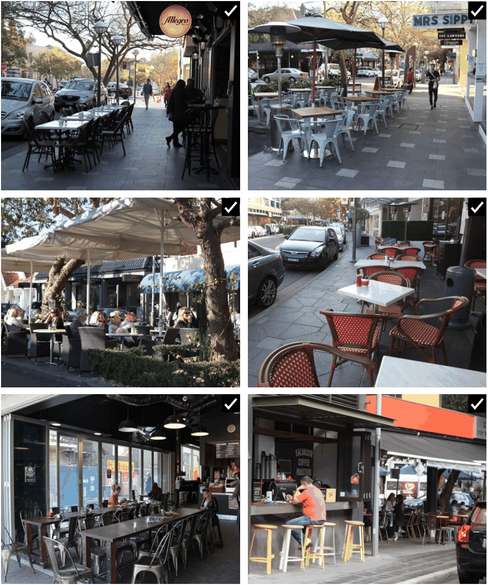

> [Picture on page 95: a picture, saved as a picture (images/public-domain-strategy-page-95-55.gif, 150 dpi).]

1

4

2

5

3

6

#### PUBLIC DOMAIN DETAILS

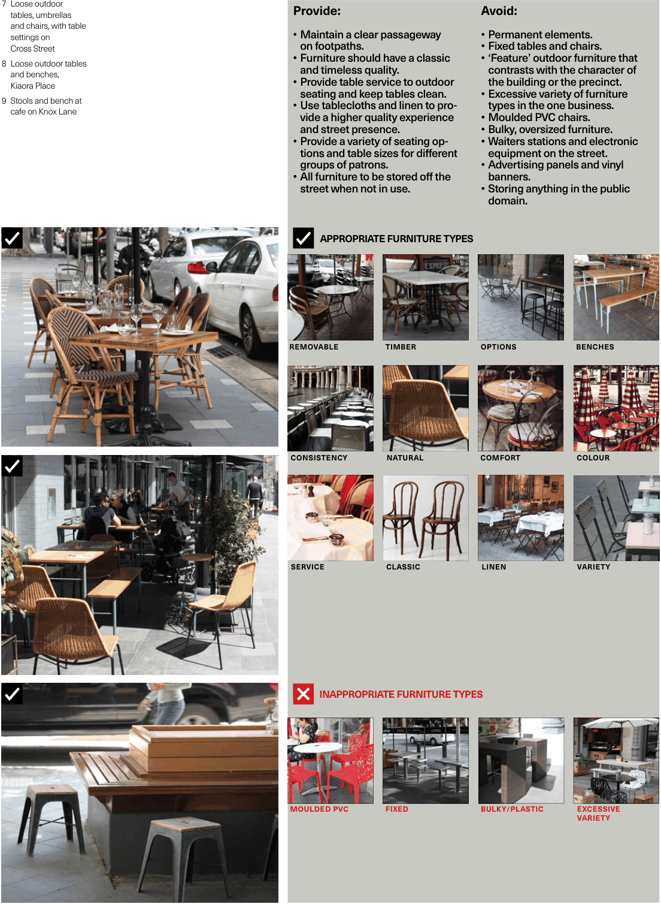

> [Picture on page 96: a map, saved as a picture (images/public-domain-strategy-page-96-2.gif, 150 dpi); the street names and other small labels are on the picture.]
> Words printed on the picture (title and legend, copied from the PDF):
> 7	 Loose outdoor
> and chairs, with table
> 8	 Loose outdoor tables
> 9	 Stools and bench at
> cafe on Knox Lane
> APPROPRIATE FURNITURE TYPES
> INAPPROPRIATE FURNITURE TYPES
> MOULDED PVC FIXED

#### Provide:

#### Avoid:

•	Maintain a clear passageway

on footpaths.

•	Furniture should have a classic

and timeless quality.

•	Provide table service to outdoor

seating and keep tables clean.

•	Use tablecloths and linen to pro-

vide a higher quality experience

and street presence.

•	Provide a variety of seating op-

tions and table sizes for different

groups of patrons.

•	All furniture to be stored off the

street when not in use.

•	Permanent elements.

•	Fixed tables and chairs.

•	‘Feature’ outdoor furniture that

contrasts with the character of

the building or the precinct.

•	Excessive variety of furniture

types in the one business.

•	Moulded PVC chairs.

•	Bulky, oversized furniture.

•	Waiters stations and electronic

equipment on the street.

•	Advertising panels and vinyl

banners.

•	Storing anything in the public

domain.

7

8

9

#### PUBLIC DOMAIN DETAILS

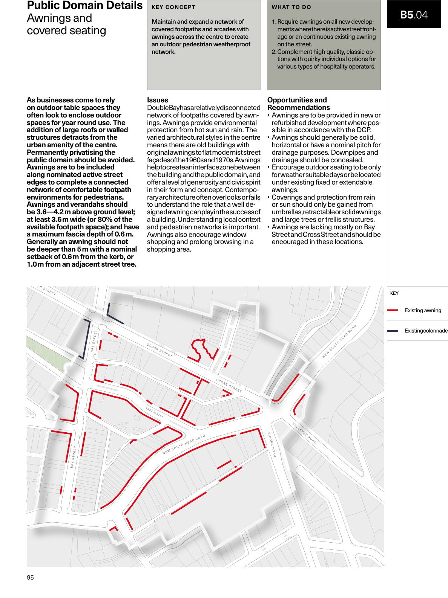

> [Picture on page 97: a map, saved as a picture (images/public-domain-strategy-page-97-2.gif, 150 dpi); the street names and other small labels are on the picture.]
> Words printed on the picture (title and legend, copied from the PDF):
> WHAT TO DO
> Maintain and expand a network of
> covered footpaths and arcades with
> awnings across the centre to create
> an outdoor pedestrian weatherproof
> 1\.	Require awnings on all new develop-
> ments where there is active street front-
> age or an continuous existing awning
> on the street.
> 2\.	Complement high quality, classic op-
> tions with quirky individual options for
> various types of hospitality operators.
> B AY STREET
> refurbished development where pos-
> drainage purposes. Downpipes and
> encouraged in these locations.
> B AY STREET
> B AY STREET

### B5.04

Awnings and

### covered seating

Opportunities and

#### Recommendations

•	Awnings are to be provided in new or sible in accordance with the DCP.

•	Awnings should generally be solid,

horizontal or have a nominal pitch for drainage should be concealed.

•	Encourage outdoor seating to be only

for weather suitable days or be located

under existing fixed or extendable

awnings.

•	Coverings and protection from rain

or sun should only be gained from

umbrellas, retractable or solid awnings

and large trees or trellis structures.

•	Awnings are lacking mostly on Bay

Street and Cross Street and should be

#### Issues

Double Bay has a relatively disconnected

network of footpaths covered by awn-

ings. Awnings provide environmental

protection from hot sun and rain. The

varied architectural styles in the centre

means there are old buildings with

original awnings to flat modernist street

façades of the 1960s and 1970s. Awnings

help to create an interface zone between

the building and the public domain, and

offer a level of generosity and civic spirit

in their form and concept. Contempo-

rary architecture often overlooks or fails

to understand the role that a well de-

signed awning can play in the success of

a building. Understanding local context

and pedestrian networks is important.

Awnings also encourage window

shopping and prolong browsing in a

shopping area.

#### As businesses come to rely

on outdoor table spaces they

often look to enclose outdoor

spaces for year round use. The

addition of large roofs or walled

structures detracts from the

urban amenity of the centre.

Permanently privatising the

public domain should be avoided.

#### Awnings are to be included

along nominated active street

edges to complete a connected

network of comfortable footpath

environments for pedestrians.

#### Awnings and verandahs should

be 3.6—4.2 m above ground level;

at least 3.6 m wide (or 80% of the

available footpath space); and have

a maximum fascia depth of 0.6 m.

#### Generally an awning should not

be deeper than 5 m with a nominal

setback of 0.6 m from the kerb, or
