#### 1.0 m from an adjacent street tree.

#### PUBLIC DOMAIN DETAILS

### Solid

### awnings

### Partly glazed

### awnings

Awnings using a combination of glass

and solid materials may be appropriate in

some locations, to increase natural light

to a facade, especially on south facing

elevations.

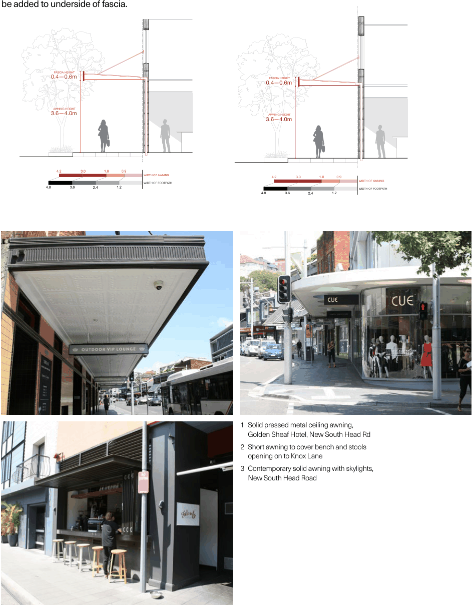

> [Picture on page 98: a picture, saved as a picture (images/public-domain-strategy-page-98-11.gif, 150 dpi).]
> Words printed on the picture (title and legend, copied from the PDF):
> FASCIA HEIGHT
> 0.4—0.6m
> AWNING HEIGHT
> 3.6—4.0m

Solid awnings are the preferred model

in most situations as they reinforce the

predominant typology on local streets.

They are effective in shading hot sunny

footpaths and allow the concealment

of drainage plumbing and electrical

conduits. Awnings may be internally

cantilevered or use traditional suspen-

sion rod systems. Fascias provide an area

for signage to the tenants of the ground

floor areas. Canvas roll down blinds may

be added to underside of fascia.

0.9

1.8

3.0

4.2

WIDTH OF AWNING

0.9

1.8

3.0

4.2

WIDTH OF AWNING

WIDTH OF FOOTPATH

1.2

2.4

3.6

4.8

WIDTH OF FOOTPATH

1.2

2.4

3.6

4.8

> Words printed on the picture (title and legend, copied from the PDF):
> 1	 Solid pressed metal ceiling awning,
> Golden Sheaf Hotel, New South Head Rd
> 2	 Short awning to cover bench and stools
> opening on to Knox Lane
> 3	 Contemporary solid awning with skylights,
> New South Head Road

1

3

2

#### PUBLIC DOMAIN DETAILS

### Glazed

### awnings

Canvas and

### extendable awnings

In general fully glazed awnings are not

preferred. Whilst providing rain shelter

they provide little shade or environmen-

tal cooling effect on the interior spaces

and appear dirty. The lack of a solid

street facing fascia means that signage is

often difficult to attach which can have a

negative effect on retail trade within the

building or business. Glazed awnings are

more suited to shorter lengths and some

heritage buildings — preferably on ma-

sonry façades as a counterpoint to the

architectural language of the building.

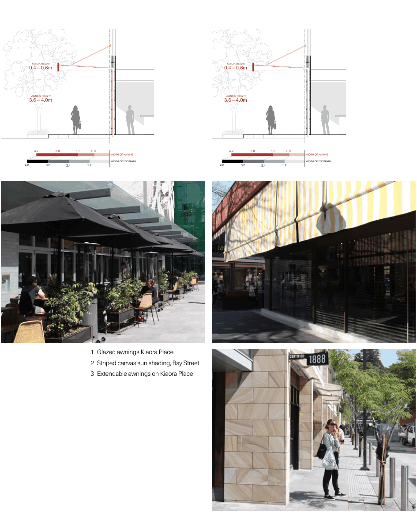

> [Picture on page 99: a picture, saved as a picture (images/public-domain-strategy-page-99-19.gif, 150 dpi).]
> Words printed on the picture (title and legend, copied from the PDF):
> FASCIA HEIGHT
> 0.4—0.6m
> AWNING HEIGHT
> 3.6—4.0m

Fixed and extendable canvas awnings

can provide protection to entrances

and shop windows or outdoor dining

areas. In general they can be mounted

lower than fixed awnings. Extendable

awnings should generally be respon-

sive to the activities that occur within

the building and are usually retracted

after hours — thus not providing a

permanent covered footpath space.

Roll down canvas awnings are also

appropriate to provide sunshade to

glazed shop fronts.

0.9

1.8

3.0

4.2

WIDTH OF AWNING

0.9

1.8

3.0

4.2

WIDTH OF AWNING

WIDTH OF FOOTPATH

WIDTH OF FOOTPATH

1.2

2.4

3.6

4.8

1.2

2.4

3.6

4.8

> Words printed on the picture (title and legend, copied from the PDF):
> 1	 Glazed awnings Kiaora Place
> 2	 Striped canvas sun shading, Bay Street
> 3	 Extendable awnings on Kiaora Place

1

2

3

#### PUBLIC DOMAIN DETAILS

#### KEY CONCEPT

#### WHAT TO DO

### B5.05

### Opening to the street

1\.	Establish design controls and a list of examples for best practice examples of shop front design opening to the street.

2\.	Allow for innovation in materials and design in shop fronts and openings.

#### Businesses that open to the street

invite people in, animate façades and create connectivity to passers-by.

#### Openings facilitate trade and create

open air spaces that can adapt to climate and time of day.

A street needs variation and

interest along its entirety. Opening

doors, windows and walls improve

the connection between inside

and out, allowing commerce to

spill out and contribute positively

to the activity of the street. Places

to sit inside looking out through

an open window connect people

with the street. Openings can also

create a sense of outdoor dining

for indoor tables without adding

furniture or clutter to the street

where there is limited space on a

street or lane.

Opportunities and

#### Recommendations

Building owners should be encouraged

to open particular uses to the street

wherever possible. Increasingly hospital-

ity operators like to blur the boundary

between indoors and outdoors, with

the threshold being an appealing place

to sit. Operable walls/sliding doors can

help expand a retail/hospitality space to

maximise the location and engage with

activities on the street. Cafés prefer to

serve directly onto the street, which also

activates the street or lane with move-

ment and brings servers to the front of a

tenancy, creating local ‘eyes on the street’

which helps community building and

improves safety outcomes.

#### Conditions and Issues

Large areas of fixed standard shop front

glazing units can create dull and unap-

pealing street edges. Furthermore, the

interesting sights, smells and sounds of

indoor activities become limited in their

ability to contribute to the liveliness of

the street and enjoyment of pedestrians.

Entirely fixed façades are less likely to in-

vite people to congregate and meet on

either side of the threshold, and thus fail

to capitalise on the natural dynamism

and protection offered at this point, as

well as failing to contribute to passive

surveillance of the street. Double Bay

has a number of businesses that open

directly to the street and potential for

additional premises to also open to the

adjacent street, lane or public space.

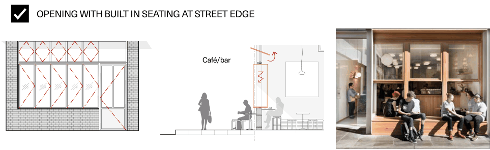

> [Picture on page 100: a picture, saved as a picture (images/public-domain-strategy-page-100-69.gif, 150 dpi).]
> Words printed on the picture (title and legend, copied from the PDF):
> Café/bar

OPENING WITH BUILT IN SEATING AT STREET EDGE

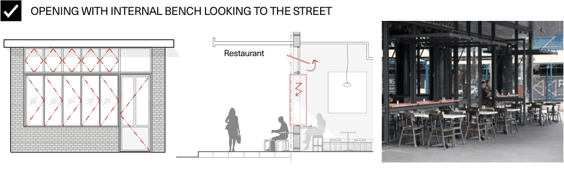

> [Picture on page 100: a picture, saved as a picture (images/public-domain-strategy-page-100-71.gif, 150 dpi).]
> Words printed on the picture (title and legend, copied from the PDF):
> Restaurant

OPENING WITH INTERNAL BENCH LOOKING TO THE STREET

#### PUBLIC DOMAIN DETAILS

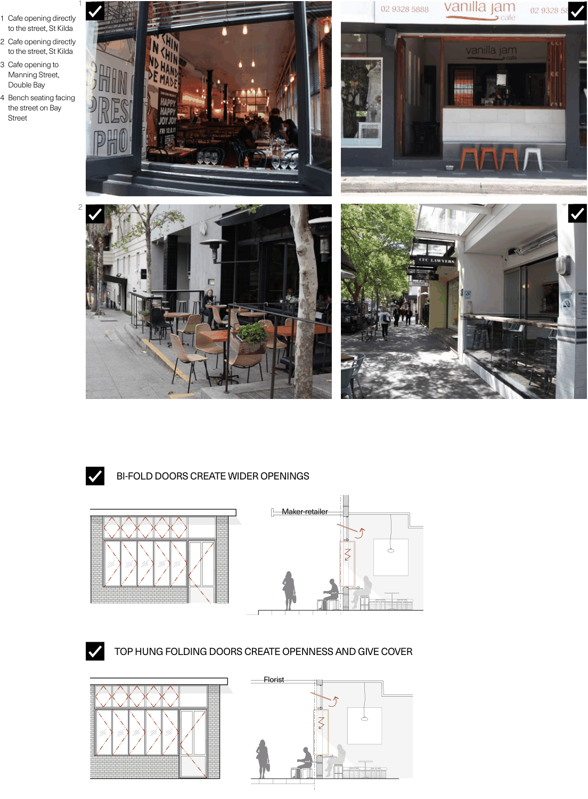

> [Picture on page 101: a picture, saved as a picture (images/public-domain-strategy-page-101-2.gif, 150 dpi).]

1	 Cafe opening directly to the street, St Kilda 2	 Cafe opening directly to the street, St Kilda 3	 Cafe opening to Manning Street, Double Bay 4 	Bench seating facing the street on Bay Street

2

4

BI-FOLD DOORS CREATE WIDER OPENINGS

TOP HUNG FOLDING DOORS CREATE OPENNESS AND GIVE COVER

#### PUBLIC DOMAIN DETAILS

#### KEY CONCEPT

#### WHAT TO DO

### B5.06

### On street

### trading display

1\.	Establish guidelines for street display.

2\.	Council to consider a one metre inter-face zone to allow ‘retail spill’ on to the footpath.

#### Allow shops to use the footpath

for the display and sale of goods where suitable to create stimulating interesting streets that reflect the businesses that are located on them.

The sale and display of goods on

the footpath can be an attractive

addition to a retail area, helping to

activate and enliven frontages.

Opportunities and

#### Recommendations

Establish simple controls for retail spill

and trading on footpaths immediately

adjacent to a trading premise. Council

to consider allowing a blanket one

metre interface zone along the property

boundary to be used for retail spill on

the footpath, maintaining a clear pe-

destrian path. Approvals may be sought

for trading areas outside this allocated

space.

#### Issues

There is currently only a small amount

of on street trading display areas within

Double Bay. To date cafés, restaurants

and pubs have been the main business-

es to utilise adjacent footpaths for com-

mercial purposes, helping to activate

the street and make the street a social,

meeting and ‘hanging out’ space. Other

types of traders can also make a positive

contribution to the street by having

displays of products on the footpath.

Protection for outdoor trading from rain

or sun can be gained from umbrellas,

retractable awnings or existing awn-

ings, large trees or trellis structures over

footpath areas.

Suitable businesses can include

— Flowers and fresh produce

— Garden supplies

— Homewares/dry goods

— Book Shops

— Music Shops

— Hardware

— Clothing

— Shoe shops

— Delicatessens

— Supermarkets

— Newsagents

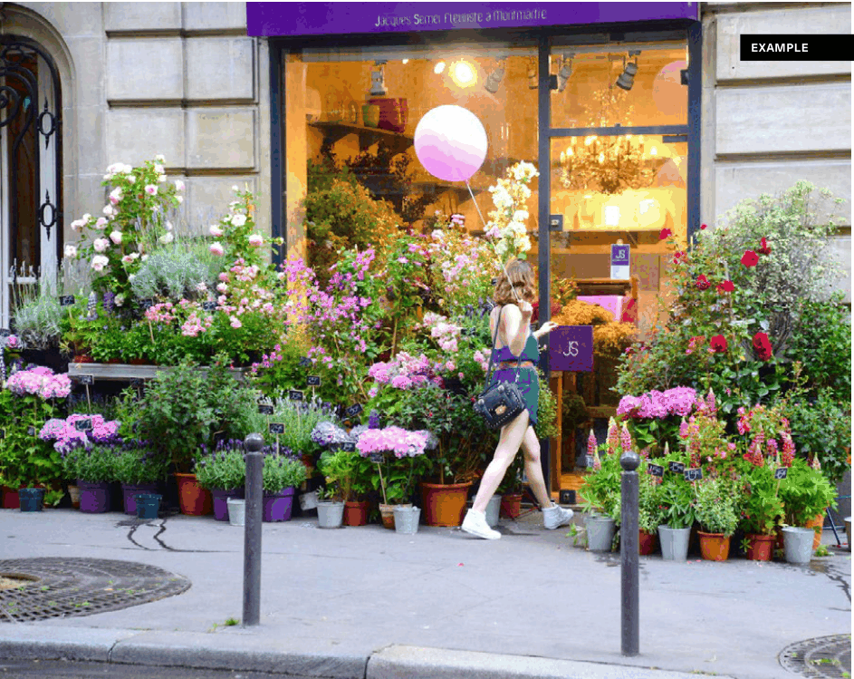

> [Picture on page 102: a picture, saved as a picture (images/public-domain-strategy-page-102-61.gif, 150 dpi).]
> Words printed on the picture (title and legend, copied from the PDF):
> EXAMPLE

#### PUBLIC DOMAIN DETAILS

4	 Display tubs on wheels

1	 Fruit and vegetable shop trading to street, Rozelle

5	 Coffee cart extending into the street, Adelaide

2	 Flower shops provide colour and activity to a street

6	 Bookseller display, Gleebooks, Glebe

3	 Small baskets on the front step at Cyrils, Haymarket

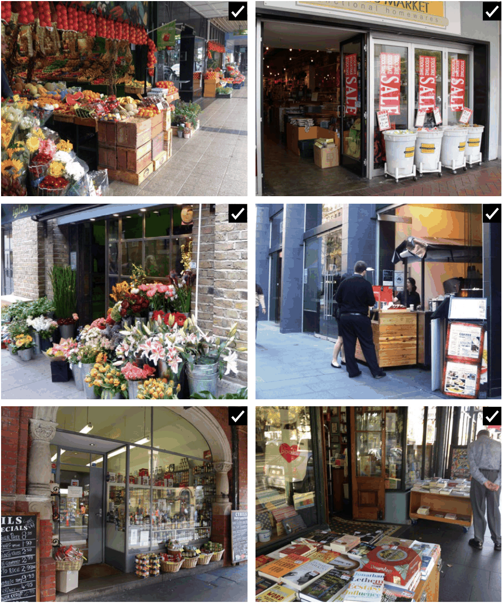

> [Picture on page 103: a picture, saved as a picture (images/public-domain-strategy-page-103-18.gif, 150 dpi).]

1

1

4

2

5

3

6

#### PUBLIC DOMAIN DETAILS

#### KEY CONCEPT

#### WHAT TO DO

### B5.07

### Commercial waste

### management

#### Minimise the impact of commercial

waste on streets and laneways to improve the amenity of the public domain — allowing better activation of street

1\.	Audit all existing waste management controls, standards and key locations were waste storage is an issue.

2\.	Design new bin storage units that bet-ter conceal the visual impact of bins on lanes and streets.

3\.	Designate streets, lanes and other loca-tions were bin storage is restricted.

4\.	Use a commercial waste manager.

DOUBLEB AY FERRYWHARF

#### The increase in businesses

seeking to use laneways as

primary or secondary addresses

has created issues around

the management and location

of commercial waste bins on

laneways.

OCEANAVENUE

#### Laneways were originally

designed as an access point to

back–of–house areas for storage

of materials and removing waste

generated on site which is now

creating conflict where existing

businesses are looking to trade on

to these lanes and small streets.

B AY STREET

#### Conditions and Issues

Different businesses have differing

requirements for waste storage and

different types of waste generated

as part of their business operations.

Hospitality and food related businesses

usually generate larger volumes of food

waste that can generate odours, and

recycling waste such as bottles, cans and

other items such as gas bottles and food

storage items like milk crates, oil cans

etc. Clothing and dry good sales gener-

ate more cardboard and paper waste.

Private waste collection can mean there

is always waste waiting to be collected

on streets, rather than at a regular time

or regular day. The lack of adequate on

site storage of bins is significant issue on

laneways. Noise from the collection of

bottles can also be an issue for residents

and some businesses.

WILLIAMSTREET

Opportunities and

#### Recommendations

•	Review existing waste volumes, col-

lection patterns and existing locations

where waste is problematic.

•	Employ a waste management officer to

help businesses better deal with ongo-

ing waste issues.

•	Review times and regularity of com-

mercial waste collections.

•	Address private storage area issues.

•	Design new communal wheelie bin

storage areas for Knox Lane, Gumtree

Lane and other locations as required.

•	Review existing waste management

controls and review effectiveness in

implementation at the DA stage.

•	Establish consistent design and service-

ability controls for waste storage areas

and access points in new develop-

ments.

•	Remove/relocate all waste storage

that is permanently located on public

footpaths.

WILLIAMSTREET

#### DIAGRAM 5.7.1 DOUBLE BAY WASTE LOCATION PLAN

#### KEY

Large exposed wheelie bin

Small exposed wheelie bins

CROSSSTREET

CROSSSTREET

Wheelie bin shield

#### TRANSVAAL AVE

NEWSOUTHHEADROAD

Loose waste and storage is an issue

#### KNOX LANE

Key areas where waste is an issue

CROSSSTREET

KNOXSTREET

#### BROOKLYN LANE

NEWSOUTHHEADROAD

BELLEVUEROAD

KIAORAROAD

#### GOLDMAN LANE

B AY STREET

B AY STREET

#### GUMTREE LANE

#### KIAORA PLACE

1

2

3

#### PUBLIC DOMAIN DETAILS

1	 Bins, storage, milk crates on Gumtree Lane 2	 Large commercial waste bins on the north end of Gumtree Lane 3	 Large bins on Transvaal Avenue

4	 Existing bin covers on Knox Lane 5	 Wheelie bins on Gumtree Lane 6	 Large commercial bins visible from the street on Goldman Lane

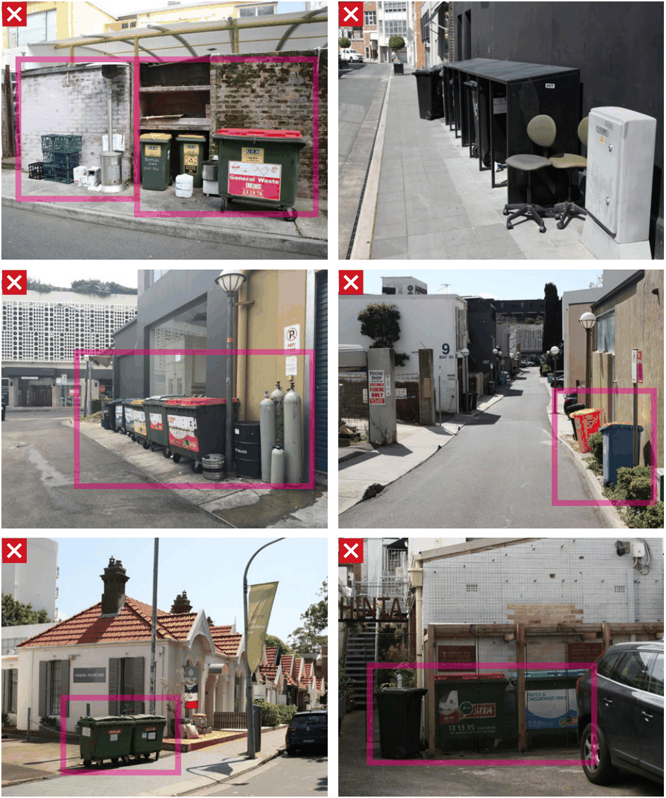

> [Picture on page 105: a picture, saved as a picture (images/public-domain-strategy-page-105-22.gif, 150 dpi).]

4

5

6

#### PUBLIC DOMAIN DETAILS

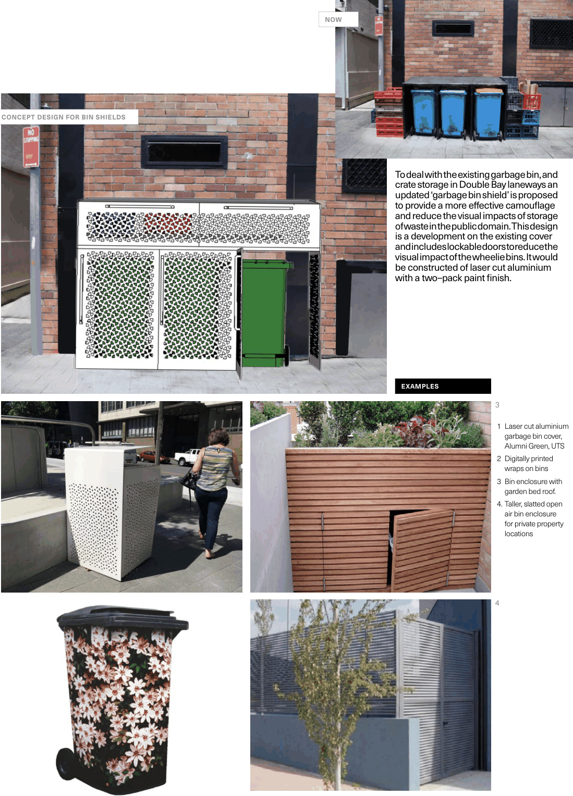

> [Picture on page 106: a map, saved as a picture (images/public-domain-strategy-page-106-2.gif, 150 dpi); the street names and other small labels are on the picture.]
> Words printed on the picture (title and legend, copied from the PDF):
> CONCEPT DESIGN FOR BIN SHIELDS
> 1	 Laser cut aluminium
> garbage bin cover,
> Alumni Green, UTS
> 2	 Digitally printed
> wraps on bins
> 3	 Bin enclosure with
> garden bed roof.
> 4\.	Taller, slatted open
> air bin enclosure
> for private property

1

2

To deal with the existing garbage bin, and

crate storage in Double Bay laneways an

updated ‘garbage bin shield’ is proposed

to provide a more effective camouflage

and reduce the visual impacts of storage

of waste in the public domain. This design

is a development on the existing cover

and includes lockable doors to reduce the

visual impact of the wheelie bins. It would

be constructed of laser cut aluminium

with a two–pack paint finish.

#### PUBLIC DOMAIN DETAILS

#### KEY CONCEPT

#### WHAT TO DO

### B5.09

### Pedestrian priority

### measures

1\.	Reduce vehicle speeds in the centre, especially in laneways and at intersec-tions and crossing points.

2\.	Extend footpaths across entrances to smaller side streets and laneways to increase pedestrian amenity.

#### Improve all crossings and areas

of conflict between vehicles and pedestrians to encourage a walkable neighbourhood. Increased pedestrian measures also assist to calm traffic speeds in high pedestrian areas by creating thresholds.

#### Conditions and Issues

There are streets and intersections that

are difficult to cross in places through-

out Double Bay. There are other places

where some effort has been made to

improve pedestrian amenity which have

been later modified or changed. The low

lying level of some streets in the centre

and flooding issues need to be consid-

ered when removing gutters or drainage

points.

#### Pedestrian priority shifts busy

urban areas from the historical

hierarchies of movement once

defined by traffic management

that gave high priority to vehicles

and the free flow of traffic,

often at the expense of town

centres, pedestrians and cyclists.

#### Correcting this imbalance has

been undertaken in recent times

across Sydney and in urbanised

areas around the world.

Opportunities and

#### Recommendations

•	Reduce traffic speeds on all streets

the centre and create shared zones in

designated lanes and small streets.

•	Undertake a safety and accessibility

audit for existing streets and crossing

locations and identify issues and prob-

lem areas. (Disability Discrimination Act

1992 compliance)

•	Remove traffic slip lanes where pos-

sible (coordinate with RMS).

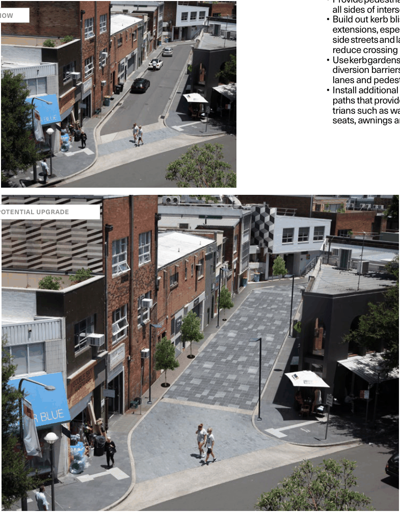

> [Picture on page 107: a picture, saved as a picture (images/public-domain-strategy-page-107-55.gif, 150 dpi).]
> Words printed on the picture (title and legend, copied from the PDF):
> NOW
> POTENTIAL UPGRADE

•	Provide pedestrian crossing points on

all sides of intersections.

•	Build out kerb blisters and kerb

extensions, especially across smaller

side streets and laneway entrances to

reduce crossing distances.

•	Use kerb gardens to create buffers and

diversion barriers between vehicle

lanes and pedestrians.

•	Install additional elements on foot-

paths that provide comfort for pedes-

trians such as wayfinding, bubblers,

seats, awnings and shade.

1	 Proposed upgrade crossing at the entry to Knox Lane from Cross Street.

#### PUBLIC DOMAIN DETAILS

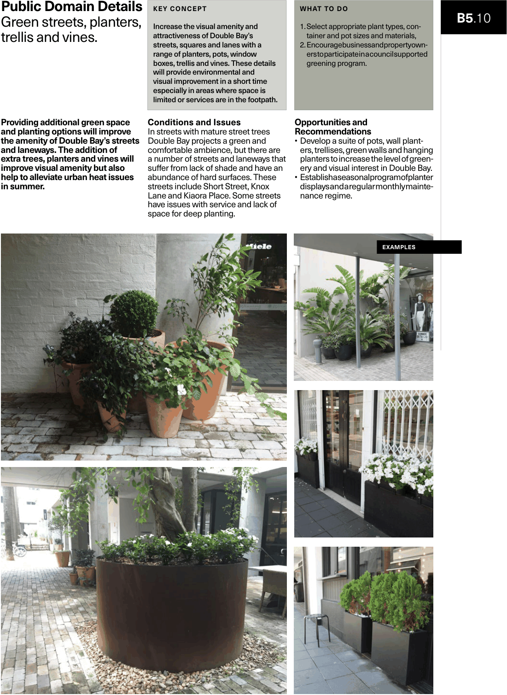

> [Picture on page 108: a picture, saved as a picture (images/public-domain-strategy-page-108-2.gif, 150 dpi).]
> Words printed on the picture (title and legend, copied from the PDF):
> KEY CONCEPT
> WHAT TO DO
> 1\.	Select appropriate plant types, con-
> tainer and pot sizes and materials,
> 2\.	Encourage business and property own-
> ers to participate in a council supported
> greening program.
> Increase the visual amenity and
> attractiveness of Double Bay’s
> streets, squares and lanes with a
> range of planters, pots, window
> boxes, trellis and vines. These details
> will provide environmental and
> visual improvement in a short time
> especially in areas where space is
> limited or services are in the footpath.
> nance regime.
> EXAMPLES

### B5.10

Green streets, planters,

### trellis and vines.

#### Providing additional green space

and planting options will improve

the amenity of Double Bay’s streets

and laneways. The addition of

extra trees, planters and vines will

improve visual amenity but also

help to alleviate urban heat issues

in summer.

Opportunities and

#### Recommendations

•	Develop a suite of pots, wall plant-

ers, trellises, green walls and hanging

planters to increase the level of green-

ery and visual interest in Double Bay.

•	Establish a seasonal program of planter

displays and a regular monthly mainte-

#### Conditions and Issues

In streets with mature street trees

Double Bay projects a green and

comfortable ambience, but there are

a number of streets and laneways that

suffer from lack of shade and have an

abundance of hard surfaces. These

streets include Short Street, Knox

Lane and Kiaora Place. Some streets

have issues with service and lack of

space for deep planting.

#### PART C1

#### IMPLEMENTATION

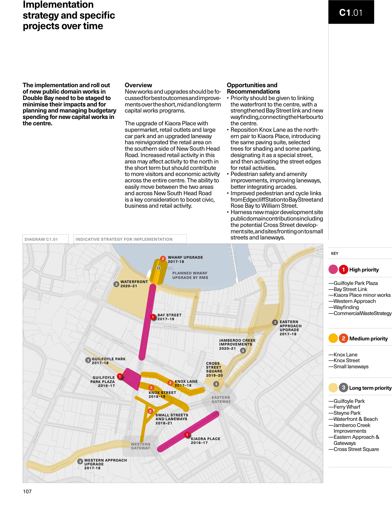

> [Picture on page 109: a map, saved as a picture (images/public-domain-strategy-page-109-3.gif, 150 dpi); the street names and other small labels are on the picture.]
> Words printed on the picture (title and legend, copied from the PDF):
> DIAGRAM C1.01 INDICATIVE STRATEGY FOR IMPLEMENTATION
> 2 WHARF UPGRADE
> UPGRADE BY RMS
> B AY STREET
> —Guilfoyle Park Plaza
> —Bay Street Link
> —Kiaora Place minor works
> —Commercial Waste Strategy
> 3 GUILFOYLE PARK
> —Waterfront & Beach
> B AY STREET
> B AY STREET
> —Eastern Approach &
> —Cross Street Square
> 3 WESTERN APPROACH

### C1.01

### Implementation

### strategy and specific

### projects over time

#### Overview

New works and upgrades should be fo-

cussed for best outcomes and improve-

ments over the short, mid and long term

capital works programs.

#### The implementation and roll out

of new public domain works in

Double Bay need to be staged to

minimise their impacts and for

planning and managing budgetary

spending for new capital works in

the centre.

The upgrade of Kiaora Place with

supermarket, retail outlets and large

car park and an upgraded laneway

has reinvigorated the retail area on

the southern side of New South Head

Road. Increased retail activity in this

area may affect activity to the north in

the short term but should contribute

to more visitors and economic activity

across the entire centre. The ability to

easily move between the two areas

and across New South Head Road

is a key consideration to boost civic,

business and retail activity.

Opportunities and

#### Recommendations

•	Priority should be given to linking

the waterfront to the centre, with a

strengthened Bay Street link and new

wayfinding, connecting the Harbour to

the centre.

•	Reposition Knox Lane as the north-

ern pair to Kiaora Place, introducing

the same paving suite, selected

trees for shading and some parking,

designating it as a special street,

and then activating the street edges

for retail activities.

•	Pedestrian safety and amenity

improvements, improving laneways,

better integrating arcades.

•	Improved pedestrian and cycle links

from Edgecliff Station to Bay Street and

Rose Bay to William Street.

•	Harness new major development site

public domain contributions including

the potential Cross Street develop-

ment site, and sites fronting on to small

streets and laneways.
