## 1 High priority

## 2 Medium priority

## 3 Long term priority

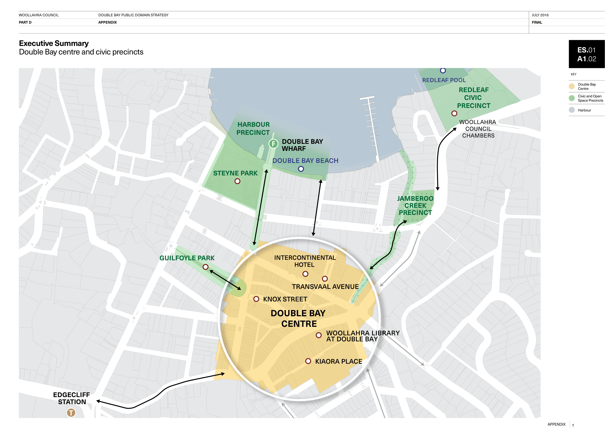

> [Picture on page 110: a picture, saved as a picture (images/public-domain-strategy-page-110-1.gif, 150 dpi).]
> Words printed on the picture (title and legend, copied from the PDF):
> DOUBLE BAY PUBLIC DOMAIN STRATEGY
> PART D
> APPENDIX
> KEY
> Double Bay
> Centre
> Civic and Open
> Space Precincts
> Harbour
> APPENDIX

### Double Bay centre and civic precincts

### ES.01

### A1.02

#### REDLEAF POOL

#### REDLEAF

#### CIVIC

#### PRECINCT

#### WOOLLAHRA

#### HARBOUR

#### PRECINCT

#### COUNCIL

#### CHAMBERS

#### DOUBLE BAY

#### WHARF DOUBLE BAY BEACH

#### STEYNE PARK

#### JAMBEROO

#### CREEK

#### PRECINCT

#### * * * * * * * * * * * *

#### * * * * * * * * * * * *

#### * * * * * * * * * * * *

#### * * * * * * * * * * * *

#### * * * * * * * * * * * *

#### * * * * * * * * * * * *

#### * * * * * * * * * * * *

#### * * * * * * * * * * * *

#### * * * * * * * * * * * *

#### * * * * * * * * * * * *

#### * * * * * * * * * * * *

#### * * * * * * * * * * * *

#### * * * * * * * * * * * *

#### * * * * * * * * * * * *

#### * * * * * * * * * * * *

#### * * * * * * * * * * * *

#### * * * * * * * * * * * *

#### INTERCONTINENTAL

#### GUILFOYLE PARK

#### HOTEL

#### TRANSVAAL AVENUE

#### KNOX STREET

#### * * * * * * * * * * * *

#### * * * * * * * * * * * *

#### * * * * * * * * * * * *

#### * * * * * * * * * * * *

#### * * * * * * * * * * * *

#### * * * * * * * * * * * *

#### * * * * * * * * * * * *

#### * * * * * * * * * * * *

#### * * * * * * * * * * * *

#### * * * * * * * * * * * *

#### * * * * * * * * * * * *

#### * * * * * * * * * * * *

#### * * * * * * * * * * * *

#### * * * * * * * * * * * *

#### * * * * * * * * * * * *

#### * * * * * * * * * * * *

#### * * * * * * * * * * * *

### DOUBLE BAY

### CENTRE

#### WOOLLAHRA LIBRARY

#### AT DOUBLE BAY

#### KIAORA PLACE

#### EDGECLIFF

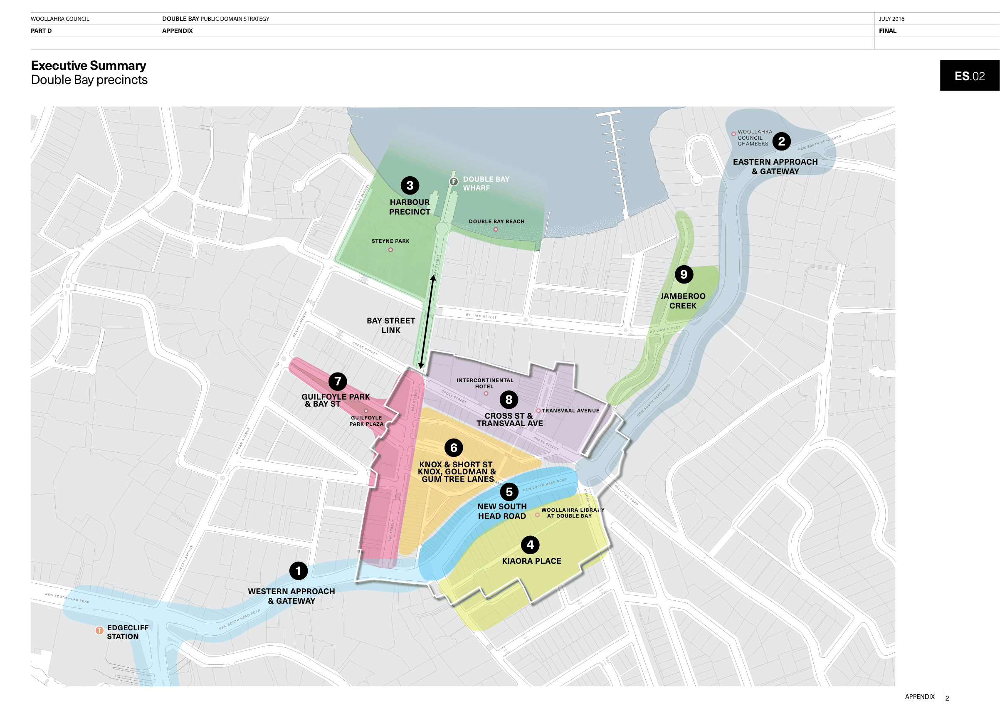

> [Picture on page 111: a map, saved as a picture (images/public-domain-strategy-page-111-1.gif, 150 dpi); the street names and other small labels are on the picture.]
> Words printed on the picture (title and legend, copied from the PDF):
> DOUBLE BAY PUBLIC DOMAIN STRATEGY
> DOUBLE BAY BEACH
> B AY STREET
> AT DOUBLE BAY
> B AY STREET
> B AY STREET

### Double Bay precincts

#### EDGECLIFF

#### STATION

#### DOUBLE BAY

#### WHARF

### 3

#### HARBOUR

#### PRECINCT

### 9

#### JAMBEROO

#### CREEK

#### BAY STREET

#### LINK

#### GUILFOYLE PARK

### 8

### 7

#### & BAY ST

#### CROSS ST &

#### TRANSVAAL AVE

### 6

#### KNOX & SHORT ST

#### KNOX, GOLDMAN &

#### GUM TREE LANES

### 5

#### NEW SOUTH WOOLLAHRA LIBRARY

#### HEAD ROAD

### 4

#### KIAORA PLACE

### 1

#### WESTERN APPROACH

#### & GATEWAY

### CHAMBERS 2

#### EASTERN APPROACH

#### & GATEWAY

### ES.02

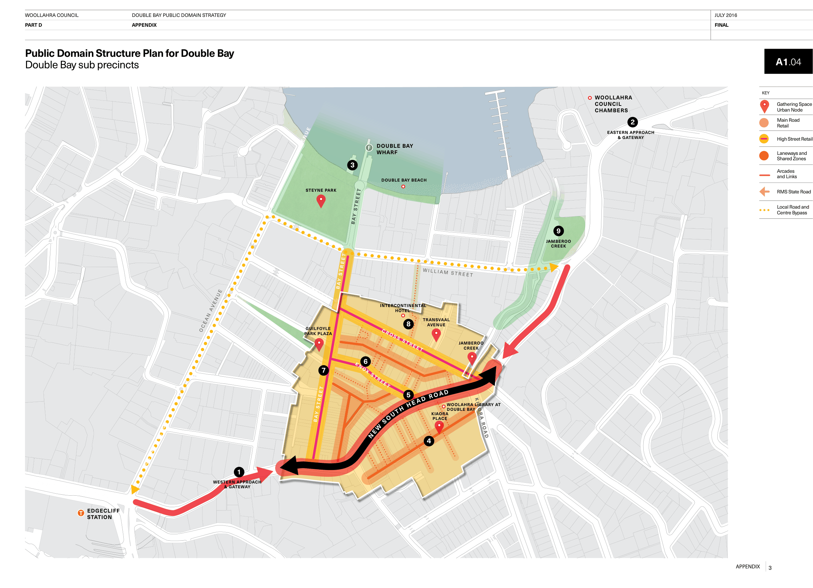

> [Picture on page 112: a map, saved as a picture (images/public-domain-strategy-page-112-1.gif, 150 dpi); the street names and other small labels are on the picture.]
> Words printed on the picture (title and legend, copied from the PDF):
> DOUBLE BAY PUBLIC DOMAIN STRATEGY
> DOUBLE BAY BEACH
> WOOLAHRA LIBRARY AT
> B AY STREET
> B AY STREET
> B AY STREET
> High Street Retail
> RMS State Road
> Local Road and

### Public Domain Structure Plan for Double Bay

### Double Bay sub precincts

### A1.04

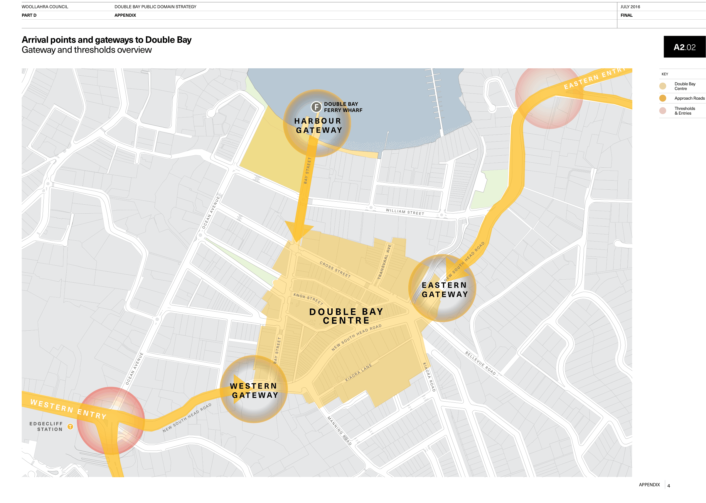

> [Picture on page 113: a map, saved as a picture (images/public-domain-strategy-page-113-1.gif, 150 dpi); the street names and other small labels are on the picture.]
> Words printed on the picture (title and legend, copied from the PDF):
> DOUBLE BAY PUBLIC DOMAIN STRATEGY
> B AY STREET
> \* * * * *
> \* * * * *
> \* * * * *
> \* * * * *
> \* * * * *
> \* * * * *
> \* * * * *
> \* * * * *
> \* * * * *
> \* * * * *
> \* * * * *
> S TAT ION
> B AY STREET

### Arrival points and gateways to Double Bay

### Gateway and thresholds overview

#### WESTERN

#### G AT E W AY

#### WESTERNENTRY

#### DOUBLE BAY

#### FERRY WHARF

#### HARBOUR

#### G AT E W AY

#### EASTERN

#### G AT E W AY

### DOUBLEB AY

### CENTRE

### A2.02

#### EASTERNENTRY

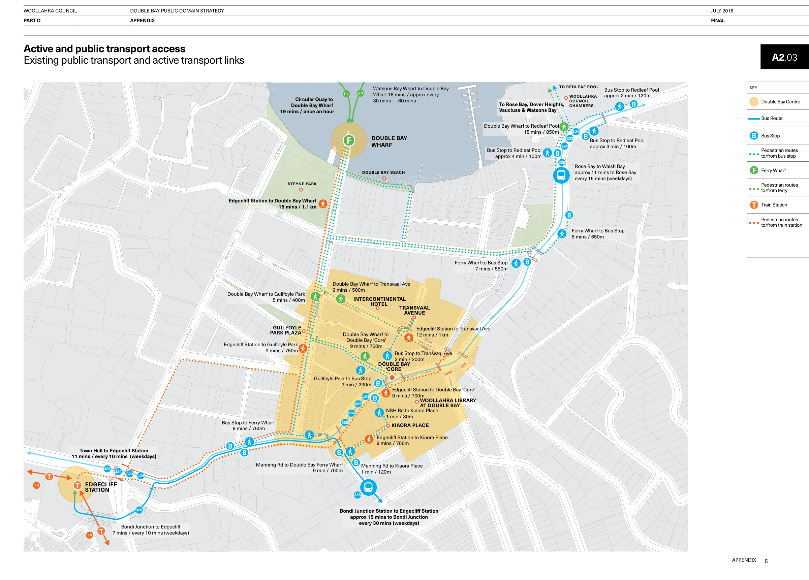

> [Picture on page 114: a map, saved as a picture (images/public-domain-strategy-page-114-1.gif, 150 dpi); the street names and other small labels are on the picture.]
> Words printed on the picture (title and legend, copied from the PDF):
> DOUBLE BAY PUBLIC DOMAIN STRATEGY
> TO REDLEAF POOL
> Bus Stop to Redleaf Pool
> approx 2 min / 120m
> Watsons Bay Wharf to Double Bay
> Wharf 16 mins / approx every
> 30 mins — 60 mins
> Double Bay Centre
> To Rose Bay, Dover Heights,
> Vaucluse & Watsons Bay
> Circular Quay to
> Double Bay Wharf
> 19 mins / once an hour
> Double Bay Wharf to Redleaf Pool
> 15 mins / 850m
> Bus Stop to Redleaf Pool
> approx 4 min / 100m
> Bus Stop to Redleaf Pool
> to/from bus stop
> approx 4 min / 100m
> DOUBLE BAY BEACH
> Rose Bay to Walsh Bay
> approx 11 mins to Rose Bay
> every 15 mins (weekdays)
> Edgecliff Station to Double Bay Wharf
> 15 mins / 1.1km
> B AY STREET
> to/from train station
> Ferry Wharf to Bus Stop
> 8 mins / 650m
> Ferry Wharf to Bus Stop
> 7 mins / 550m
> Double Bay Wharf to Transvaal Ave
> 6 mins / 500m
> Double Bay Wharf to Guilfoyle Park
> 5 mins / 400m
> Double Bay Wharf to
> Edgecliff Station to Transvaal Ave
> 12 mins / 1km
> Double Bay ‘Core’
> Edgecliff Station to Guilfoyle Park
> 9 mins / 700m
> 9 mins / 750m
> Bus Stop to Transvaal Ave
> 3 min / 200m
> KNOXSTREET DOUBLE BAY
> Guilfoyle Park to Bus Stop
> 3 min / 230m
> Edgecliff Station to Double Bay ‘Core’
> 9 mins / 700m
> AT DOUBLE BAY
> B AY STREET
> B AY STREET
> NSH Rd to Kiaora Place
> 1 min / 80m
> Bus Stop to Ferry Wharf
> 9 mins / 750m
> Edgecliff Station to Kiaora Place
> 9 mins / 750m
> Town Hall to Edgecliff Station
> 11 mins / every 10 mins  (weekdays)
> 9 min / 700m
> Manning Rd to Kiaora Place
> 1 min / 120m
> Manning Rd to Double Bay Ferry Wharf
> Bondi Junction Station to Edgecliff Station
> approx 15 mins to Bondi Junction
> every 30 mins (weekdays)
> Bondi Junction to Edgecliff
> 7 mins / every 10 mins (weekdays)

### A2.03

### Active and public transport access

### Existing public transport and active transport links

#### EASTERNENTRY

#### WESTERNENTRY

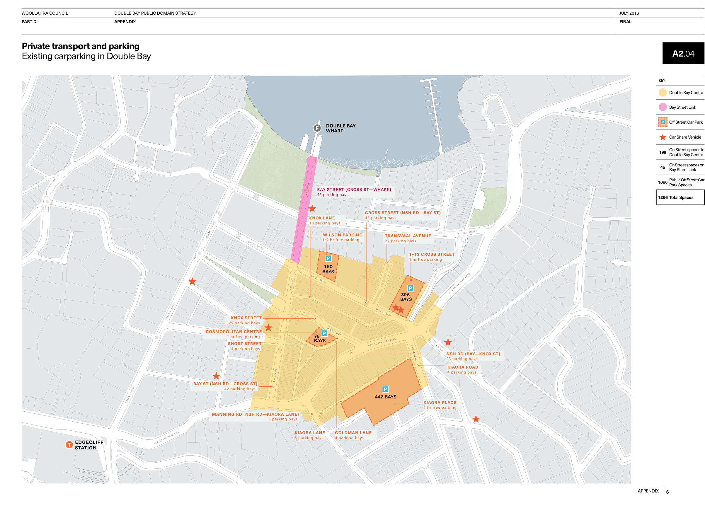

> [Picture on page 115: a map, saved as a picture (images/public-domain-strategy-page-115-1.gif, 150 dpi); the street names and other small labels are on the picture.]
> Words printed on the picture (title and legend, copied from the PDF):
> DOUBLE BAY PUBLIC DOMAIN STRATEGY
> B AY STREET
> BAY STREET (CROSS ST—WHARF)
> 45 parking bays
> CROSS STREET (NSH RD—BAY ST)
> 45 parking bays
> 18 parking bays
> 1/2 hr free parking
> 22 parking bays
> 1–13 CROSS STREET
> 1 hr free parking
> 29 parking bays
> 1 hr free parking
> 4 parking bays
> NSH RD (BAY—KNOX ST)
> 23 parking bays
> 4 parking bays
> B AY STREET
> B AY STREET
> BAY ST (NSH RD—CROSS ST)
> 42 parking bays
> 1 hr free parking
> MANNING RD (NSH RD—KIAORA LANE)
> 3 parking bays
> 5 parking bays
> 4 parking bays
> Double Bay Centre
> Bay Street Link
> P Off Street Car Park
> Car Share Vehicle
> 199 On Street spaces in
> Double Bay Centre
> On Street spaces on
> Bay Street Link
> 1066 Public Off Street Car
> 1266 Total Spaces

### Private transport and parking

### Existing carparking in Double Bay

#### WESTERNENTRY

### A2.04

#### EASTERNENTRY

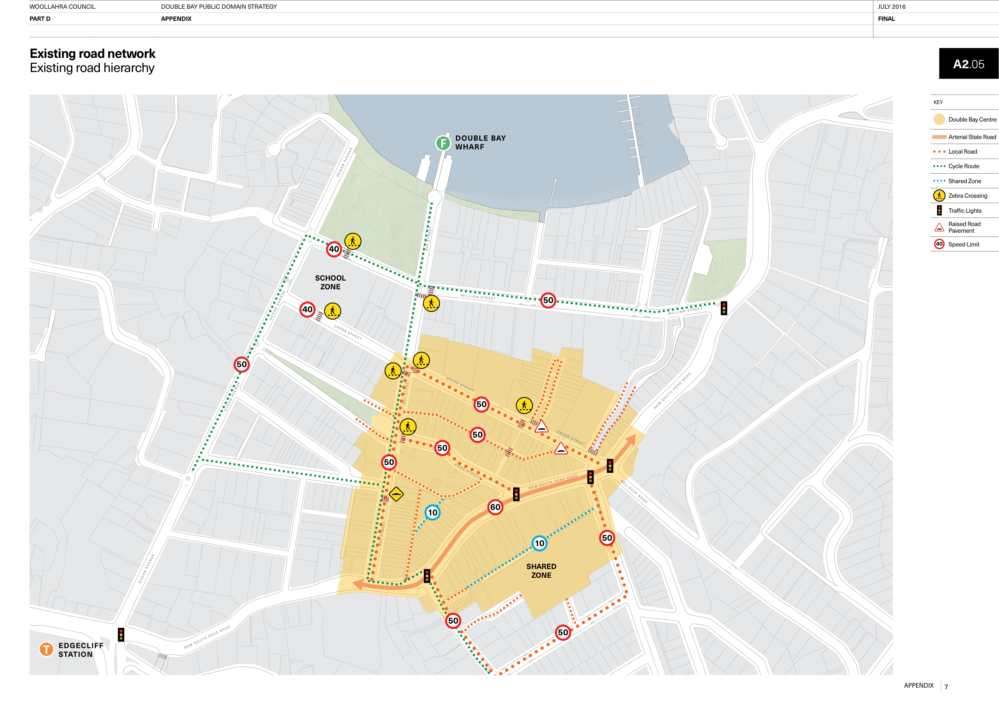

> [Picture on page 116: a map, saved as a picture (images/public-domain-strategy-page-116-1.gif, 150 dpi); the street names and other small labels are on the picture.]
> Words printed on the picture (title and legend, copied from the PDF):
> DOUBLE BAY PUBLIC DOMAIN STRATEGY
> B AY STREET
> B AY STREET
> B AY STREET
> Double Bay Centre
> Arterial State Road
> 40 Speed Limit

### Existing road network

### Existing road hierarchy

#### ESTERNENTRY

#### EDGECLIFF

#### STATION

#### SCHOOL

#### ZONE

#### DOUBLE BAY

#### WHARF

#### SHARED

#### ZONE

### A2.05

#### EASTERNENTRY

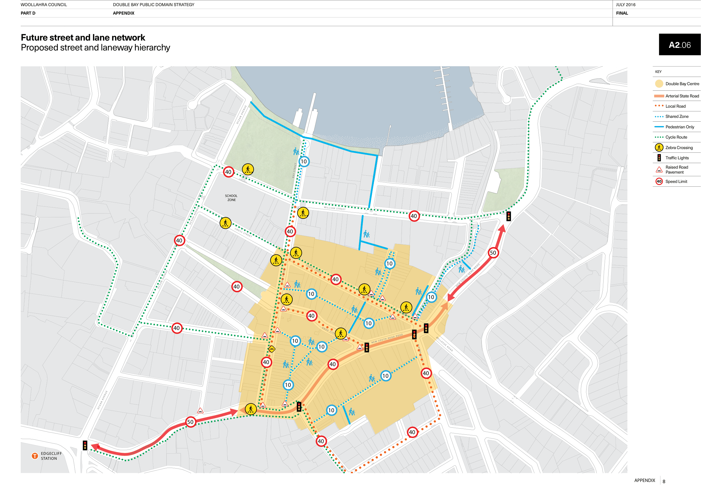

> [Picture on page 117: a map, saved as a picture (images/public-domain-strategy-page-117-1.gif, 150 dpi); the street names and other small labels are on the picture.]
> Words printed on the picture (title and legend, copied from the PDF):
> DOUBLE BAY PUBLIC DOMAIN STRATEGY
> B AY STREET
> B AY STREET
> B AY STREET
> Double Bay Centre
> Arterial State Road
> 40 Speed Limit

### Future street and lane network

### Proposed street and laneway hierarchy

#### ESTERNENTRY

### A2.06

#### EASTERNENTRY

DOUBLE BAY PUBLIC DOMAIN STRATEGY

#### PART D

#### APPENDIX

### Knox Street and Knox Lane core upgrade

### Knox Street existing conditions

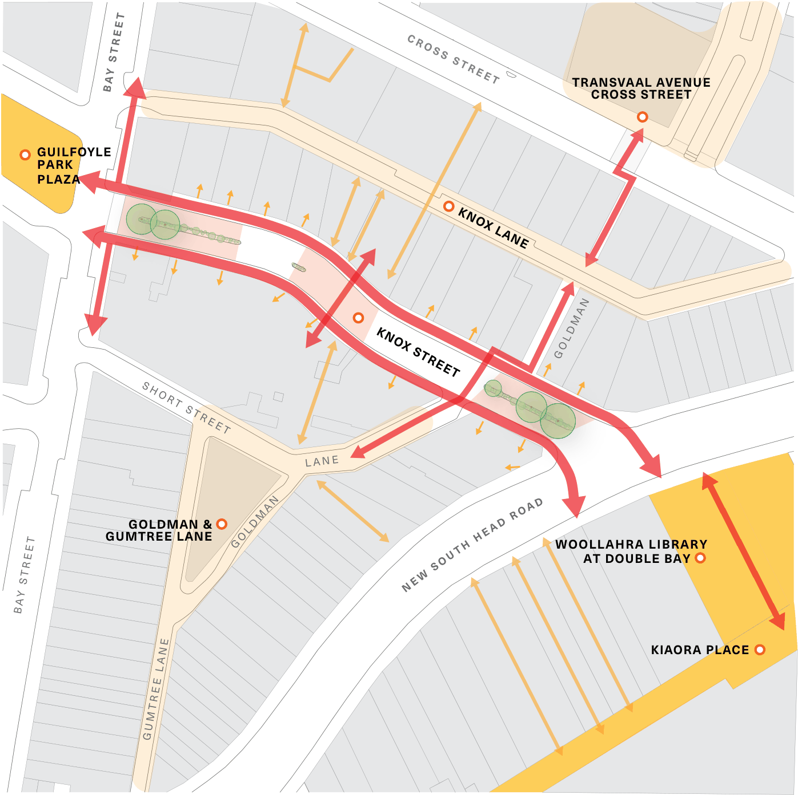

> [Picture on page 118: a picture, saved as a picture (images/public-domain-strategy-page-118-6.gif, 150 dpi).]
> Words printed on the picture (title and legend, copied from the PDF):
> SHORTSTREET
> LANE
> GOLDMAN
> B AY STREET
> GUMTREELANE
> GOLDMAN
> D
> ROA
> EAD

#### GUILFOYLE

#### PARK

#### PLAZA

#### GOLDMAN &

#### GUMTREE LANE

#### B AY STREET

#### CROSSSTREET

#### TRANSVAAL AVENUE

#### CROSS STREET

#### KNOX LANE

#### KNOX STREET

#### WOOLLAHRA LIBRARY

#### UTHH

#### AT DOUBLE BAY

#### NEWSO

#### KIAORA PLACE

KEY

APPENDIX

### B1.01

Primary link

Secondary link

Retail Entrances

Arcade Links

Existing Trees

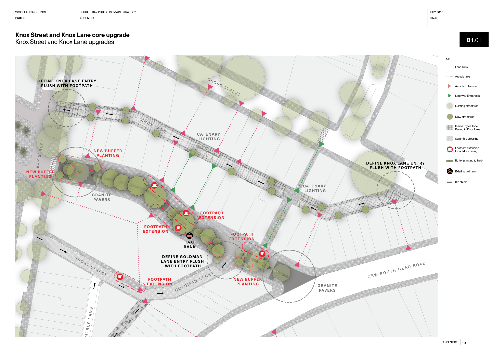

> [Picture on page 119: a map, saved as a picture (images/public-domain-strategy-page-119-1.gif, 150 dpi); the street names and other small labels are on the picture.]
> Words printed on the picture (title and legend, copied from the PDF):
> DOUBLE BAY PUBLIC DOMAIN STRATEGY
> B AY STREET
> FOOT PAT H
> E X PA NSION
> Existing street tree
> NEW ‘ INROA
> New street tree
> Kiaroa Style Stone
> Paving to Knox Lane
> LANEW AY R O
> for outdoor dining
> Buffer planting to kerb
> Existing taxi rank
> SUITE PA VIN
> LANE PA VIN

### Knox Street and Knox Lane core upgrade

### Knox Street and Knox Lane upgrades

#### DEFINE KNOX LANE ENTRY

#### FLUSH WITH FOOTPATH

#### NEW BUFFER

#### PLANTING

#### NEW BUFFER

#### PLANTING

#### GRANITE

#### PAVERS

#### CATENARY

#### LIGHTING

#### FOOTPATH

#### EXTENSION

#### FOOTPATH

#### EXTENSION

#### FOOTPATH

#### EXTENSION

#### TAXI

#### RANK

#### DEFINE GOLDMAN

#### LANE ENTRY FLUSH

#### WITH FOOTPATH

#### NEW BUFFER

#### FOOTPATH

#### EXTENSION

#### PLANTING

#### CATENARY

#### LIGHTING

#### GRANITE

#### PAVERS

#### DEFINE KNOX LANE ENTRY

#### FLUSH WITH FOOTPATH

### B1.01

#### OBJECTIVES:

#### MAKE KNOX STREET MO

#### ‘PEDESTRIAN FRIENDLY METHODOLOGY:

#### ADD GREATER PLANTIN

#### EXTENDING THE FOOTP

#### REMOVING / REDUCING

#### ‘NO PARKING’ & ‘TAXI R

#### CONDITIONS, & PAVING

#### ENTIRETY OF KNOX STR

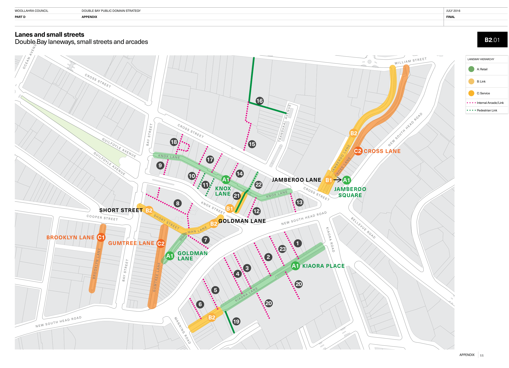

> [Picture on page 120: a map, saved as a picture (images/public-domain-strategy-page-120-1.gif, 150 dpi); the street names and other small labels are on the picture.]
> Words printed on the picture (title and legend, copied from the PDF):
> DOUBLE BAY PUBLIC DOMAIN STRATEGY
> A LEVEL: RETAIL
> B LEVEL: LINK
> C LEVEL: SERVICES
> 2 ROMA ARCADE
> 3 LINGATE HOUSE
> 356 - 366
> N.S HEAD ROAD
> 9 SAVOY HOTEL
> BROOK LY NLANE
> B AY STREET
> B AY STREET
> 15 INTERCON. HOTEL

### B2.01

### Lanes and small streets

### Double Bay laneways, small streets and arcades

#### LANEWAY HEIRARCHY

### 16

### B2

### 18

### 15

#### CROSS LANE

### C2

### 17

#### ARCADES

### 9

### 14

### 10

### A1

#### JAMBEROO LANE

### A1

### B1

### 22

### 11

#### JAMBEROO

#### KNOX

#### LANE

#### SQUARE

### 21

#### 4

### 13

### 8

### B1

5 377 N.S HEAD RD

### SHORT STREET B2

### 12

#### GOLDMAN LANE

### B2

### BROOKLYN LANE C1

### 7

### GUMTREE LANE C2

### A1

### 1

### 23 2

10 21 - 25 KNOX ST

#### GOLDMAN

#### LANE

17 - 19 KNOX ST

#### 11

#### KIAORA PLACE

### A1

KNOX ARCADE

### 3

### 4

402 N.S HEAD RD

### 5

### 20

HUNTER’S

### 20

### 6

TRANVAAL AVE 20 - 26 CROSS ST

### B2

### 19

BAY VILLAGE KIAORA LANE KIAORA LANE

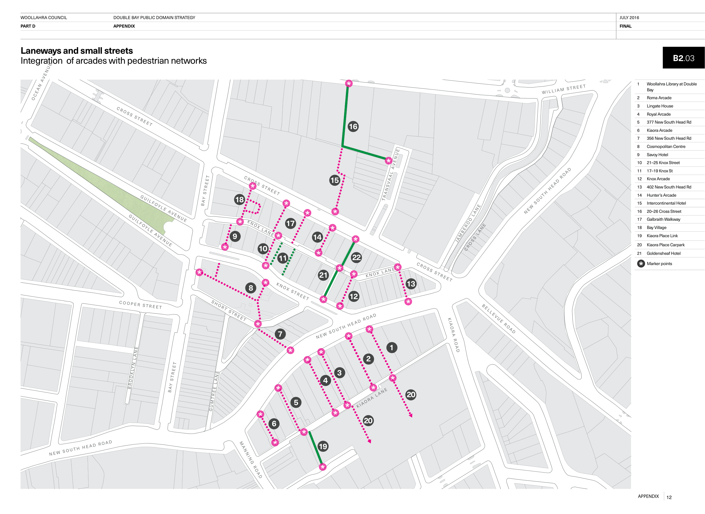

> [Picture on page 121: a map, saved as a picture (images/public-domain-strategy-page-121-1.gif, 150 dpi); the street names and other small labels are on the picture.]
> Words printed on the picture (title and legend, copied from the PDF):
> DOUBLE BAY PUBLIC DOMAIN STRATEGY
> BROOK LY NLANE
> B AY STREET
> B AY STREET
> 1 Woollahra Library at Double
> 2 Roma Arcade
> 3 Lingate House
> 4 Royal Arcade
> 5 377 New South Head Rd
> 6 Kiaora Arcade
> A LEVEL: RETAIL
> 7 356 New South Head Rd
> 8 Cosmopolitan Centre
> 9 Savoy Hotel
> B LEVEL: LINK
> 10 21–25 Knox Street
> 11 17–19 Knox St
> C LEVEL: SERVICES
> 12 Knox Arcade
> 13 402 New South Head Rd
> 14 Hunter’s Arcade
> 15 Intercontinental Hotel
> 16 20–26 Cross Street
> 17 Galbraith Walkway
> 18 Bay Village
> 19 Kiaora Place Link
> 20 Kiaora Place Carpark
> 2 ROMA ARCADE
> 21 Goldensheaf Hotel
> 3 LINGATE HOUSE
> 7 356 - 366
> N.S HEAD ROAD
> 9 SAVOY HOTEL
> 15 INTERCON. HOTEL

### Laneways and small streets

### Integration  of arcades with pedestrian networks

### *

#### 16

### *

#### 15

### *

#### 18

### *

### *

#### 17

### *

### *

### *

#### 9

#### 14

### *

#### 10

### *

### *

### *

#### 22

#### 11

### *

#### 21

### *

### *

### *

### *

#### 13

### *

#### 8

#### 12

### *

### *

### *

### *

#### 7

### *

### *

### *

#### 1 2

### *

### *

#### 3

#### 4

### *

### *

### *

#### 5

#### 20

### *

### *

### *

#### 20

#### 6

### *

### *

#### 19

### *

### B2.03

#### LANEWAY HEIRARCHY

#### ARCADES

### *

5 377 N.S HEAD RD

10 21 - 25 KNOX ST 17 - 19 KNOX ST KNOX ARCADE 402 N.S HEAD RD

TRANVAAL AVE 20 - 26 CROSS ST BAY VILLAGE KIAORA LANE KIAORA LANE

DOUBLE BAY PUBLIC DOMAIN STRATEGY

#### PART D

#### APPENDIX

### Eastern Approach

### Eastern approach to Double Bay

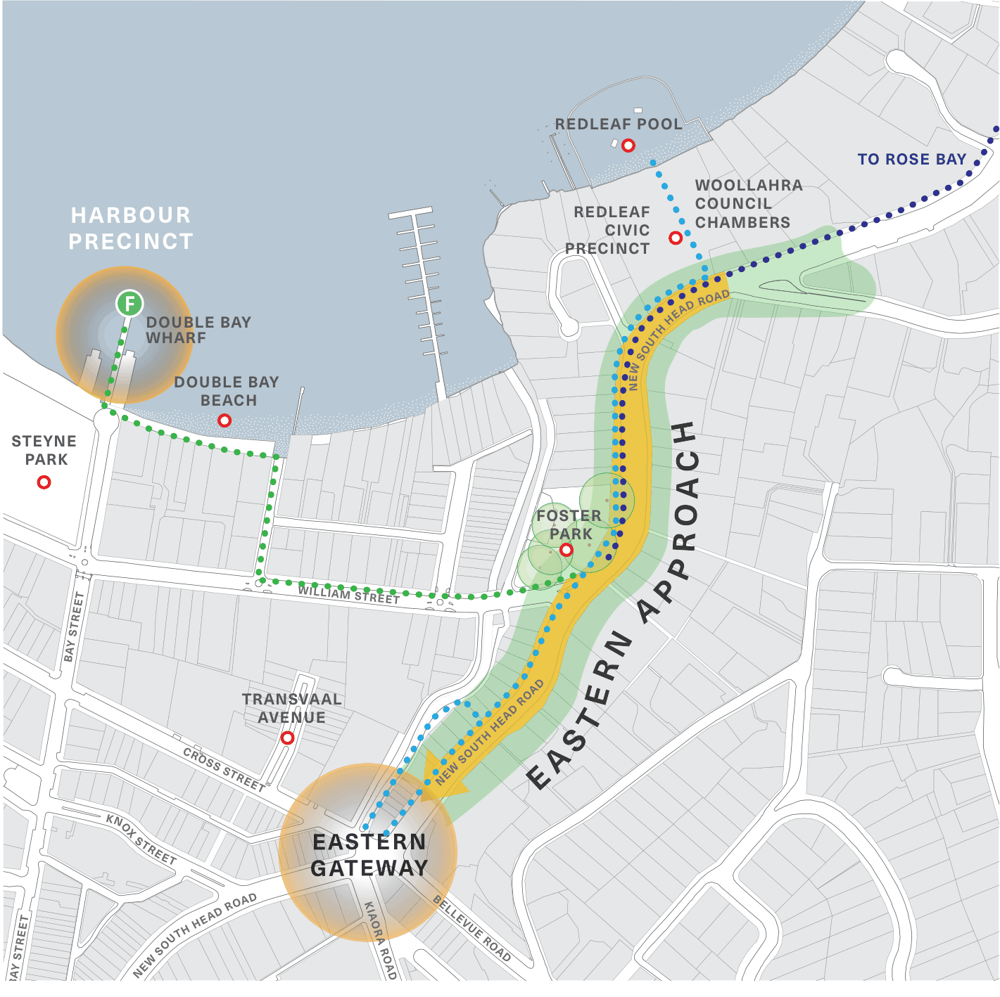

> [Picture on page 122: a map, saved as a picture (images/public-domain-strategy-page-122-6.gif, 150 dpi); the street names and other small labels are on the picture.]
> Words printed on the picture (title and legend, copied from the PDF):
> NEW SOUTH HEAD ROAD
> TH HEAD R

#### REDLEAF POOL

#### WOOLLAHRA

#### COUNCIL

#### CHAMBERS

#### REDLEAF

### HARBOUR

### PRECINCT

#### CIVIC

#### PRECINCT

#### DOUBLE BAY

#### WHARF

#### DOUBLE BAY

#### BEACH

### H

#### STEYNE

#### PARK

### C

#### FOSTER

#### PARK

### ROA

### P

### P

### A

### N

### R

#### TRANSVAAL

### E

#### AVENUE

### T

### S

### E A

### EASTERN

### GATEWAY

### B3.03

KEY

Route from Cross Street to Redleaf Civic Precinct (8 min/600m)

Route from Ferry Wharf to Redleaf Civic Precinct (10min/800m)

Proposed Shared Path Route Rose Bay to Double Bay (20min/1600m)

#### TO ROSE BAY

APPENDIX

### Western Gateway

### New South Head Road at Bay Street and Manning Road

### B3.04

#### Ferry, Bay & Park Link

### EASTERN

### G AT E W AY

#### To Centre & Laneways

### View corridor

### down Bay Street

### Entry to laneway

### network

#### DROAD

#### HHEA

#### WSOUT

#### B AY STREET

B

### WESTERN

#### GUMTREELANE

#### To Kiaora Place

### G AT E W AY

#### KIAORALANE

#### NEWSOUTHHEADROAD

### TERNENTRY

#### MANNINGROAD

\* * * * * * * * * * * * * * * * * * * * * * * * * * * * * * * * * * * * * * * * * * * * * * * * * * * * * * *

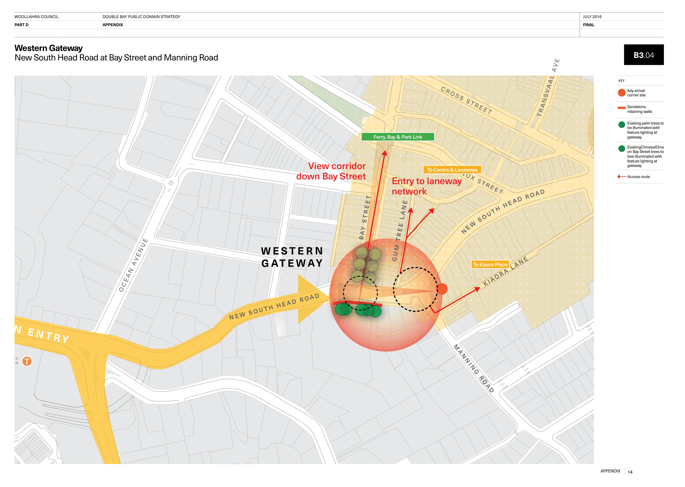

> [Picture on page 123: a map, saved as a picture (images/public-domain-strategy-page-123-26.gif, 150 dpi); the street names and other small labels are on the picture.]
> Words printed on the picture (title and legend, copied from the PDF):
> DOUBLE BAY PUBLIC DOMAIN STRATEGY
> Existing palm trees to
> be illuminated with
> feature lighting at
> Existing Chinese Elms
> on Bay Street trees to
> bee illuminated with
> feature lighting at
> S TAT ION

\* * * * * * * * * * * * * * * * * * * * * * * * * * * * * * * * * * * * * * * * * * * * * * * * * * * * * * *

\* * * * * * * * * * * * * * * * * * * * * * * * * * * * * * * * * * * * * * * * * * * * * * * * * * * * * * *

\* * * * * * * * * * * * * * * * * * * * * * * * * * * * * * * * * * * * * * * * * * * * * * * * * * * * * * *

\* * * * * * * * * * * * * * * * * * * * * * * * * * * * * * * * * * * * * * * * * * * * * * * * * * * * * * *

\* * * * * * * * * * * * * * * * * * * * * * * * * * * * * * * * * * * * * * * * * * * * * * * * * * * * * * *

\* * * * * * * * * * * * * * * * * * * * * * * * * * * * * * * * * * * * * * * * * * * * * * * * * * * * * * *

\* * * * * * * * * * * * * * * * * * * * * * * * * * * * * * * * * * * * * * * * * * * * * * * * * * * * * * *

\* * * * * * * * * * * * * * * * * * * * * * * * * * * * * * * * * * * * * * * * * * * * * * * * * * * * * * *

\* * * * * * * * * * * * * * * * * * * * * * * * * * * * * * * * * * * * * * * * * * * * * * * * * * * * * * *

\* * * * * * * * * * * * * * * * * * * * * * * * * * * * * * * * * * * * * * * * * * * * * * * * * * * * * * *

\* * * * * * * * * * * * * * * * * * * * * * * * * * * * * * * * * * * * * * * * * * * * * * * * * * * * * * *

\* * * * * * * * * * * * * * * * * * * * * * * * * * * * * * * * * * * * * * * * * * * * * * * * * * * * * * *

\* * * * * * * * * * * * * * * * * * * * * * * * * * * * * * * * * * * * * * * * * * * * * * * * * * * * * * *

\* * * * * * * * * * * * * * * * * * * * * * * * * * * * * * * * * * * * * * * * * * * * * * * * * * * * * * *

\* * * * * * * * * * * * * * * * * * * * * * * * * * * * * * * * * * * * * * * * * * * * * * * * * * * * * * *

\* * * * * * * * * * * * * * * * * * * * * * * * * * * * * * * * * * * * * * * * * * * * * * * * * * * * * * *

\* * * * * * * * * * * * * * * * * * * * * * * * * * * * * * * * * * * * * * * * * * * * * * * * * * * * * * *

\* * * * * * * * * * * * * * * * * * * * * * * * * * * * * * * * * * * * * * * * * * * * * * * * * * * * * * *

\* * * * * * * * * * * * * * * * * * * * * * * * * * * * * * * * * * * * * * * * * * * * * * * * * * * * * * *

\* * * * * * * * * * * * * * * * * * * * * * * * * * * * * * * * * * * * * * * * * * * * * * * * * * * * * * *

\* * * * * * * * * * * * * * * * * * * * * * * * * * * * * * * * * * * * * * * * * * * * * * * * * * * * * * *

\* * * * * * * * * * * * * * * * * * * * * * * * * * * * * * * * * * * * * * * * * * * * * * * * * * * * * * *

\* * * * * * * * * * * * * * * * * * * * * * * * * * * * * * * * * * * * * * * * * * * * * * * * * * * * * * *

\* * * * * * * * * * * * * * * * * * * * * * * * * * * * * * * * * * * * * * * * * * * * * * * * * * * * * * *

\* * * * * * * * * * * * * * * * * * * * * * * * * * * * * * * * * * * * * * * * * * * * * * * * * * * * * * *

\* * * * * * * * * * * * * * * * * * * * * * * * * * * * * * * * * * * * * * * * * * * * * * * * * * * * * * *

\* * * * * * * * * * * * * * * * * * * * * * * * * * * * * * * * * * * * * * * * * * * * * * * * * * * * * * *

\* * * * * * * * * * * * * * * * * * * * * * * * * * * * * * * * * * * * * * * * * * * * * * * * * * * * * * *

\* * * * * * * * * * * * * * * * * * * * * * * * * * * * * * * * * * * * * * * * * * * * * * * * * * * * * * *

\* * * * * * * * * * * * * * * * * * * * * * * * * * * * * * * * * * * * * * * * * * * * * * * * * * * * * * *

\* * * * * * * * * * * * * * * * * * * * * * * * * * * * * * * * * * * * * * * * * * * * * * * * * * * * * * *

\* * * * * * * * * * * * * * * * * * * * * * * * * * * * * * * * * * * * * * * * * * * * * * * * * * * * * * *

\* * * * * * * * * * * * * * * * * * * * * * * * * * * * * * * * * * * * * * * * * * * * * * * * * * * * * * *

\* * * * * * * * * * * * * * * * * * * * * * * * * * * * * * * * * * * * * * * * * * * * * * * * * * * * * * *

\* * * * * * * * * * * * * * * * * * * * * * * * * * * * * * * * * * * * * * * * * * * * * * * * * * * * * * *

\* * * * * * * * * * * * * * * * * * * * * * * * * * * * * * * * * * * * * * * * * * * * * * * * * * * * * * *

\* * * * * * * * * * * * * * * * * * * * * * * * * * * * * * * * * * * * * * * * * * * * * * * * * * * * * * *

\* * * * * * * * * * * * * * * * * * * * * * * * * * * * * * * * * * * * * * * * * * * * * * * * * * * * * * *

\* * * * * * * * * * * * * * * * * * * * * * * * * * * * * * * * * * * * * * * * * * * * * * * * * * * * * * *

\* * * * * * * * * * * * * * * * * * * * * * * * * * * * * * * * * * * * * * * * * * * * * * * * * * * * * * *

\* * * * * * * * * * * * * * * * * * * * * * * * * * * * * * * * * * * * * * * * * * * * * * * * * * * * * * *

\* * * * * * * * * * * * * * * * * * * * * * * * * * * * * * * * * * * * * * * * * * * * * * * * * * * * * * *

\* * * * * * * * * * * * * * * * * * * * * * * * * * * * * * * * * * * * * * * * * * * * * * * * * * * * * * *

\* * * * * * * * * * * * * * * * * * * * * * * * * * * * * * * * * * * * * * * * * * * * * * * * * * * * * * *

\* * * * * * * * * * * * * * * * * * * * * * * * * * * * * * * * * * * * * * * * * * * * * * * * * * * * * * *

\* * * * * * * * * * * * * * * * * * * * * * * * * * * * * * * * * * * * * * * * * * * * * * * * * * * * * * *

\* * * * * * * * * * * * * * * * * * * * * * * * * * * * * * * * * * * * * * * * * * * * * * * * * * * * * * *

\* * * * * * * * * * * * * * * * * * * * * * * * * * * * * * * * * * * * * * * * * * * * * * * * * * * * * * *

\* * * * * * * * * * * * * * * * * * * * * * * * * * * * * * * * * * * * * * * * * * * * * * * * * * * * * * *

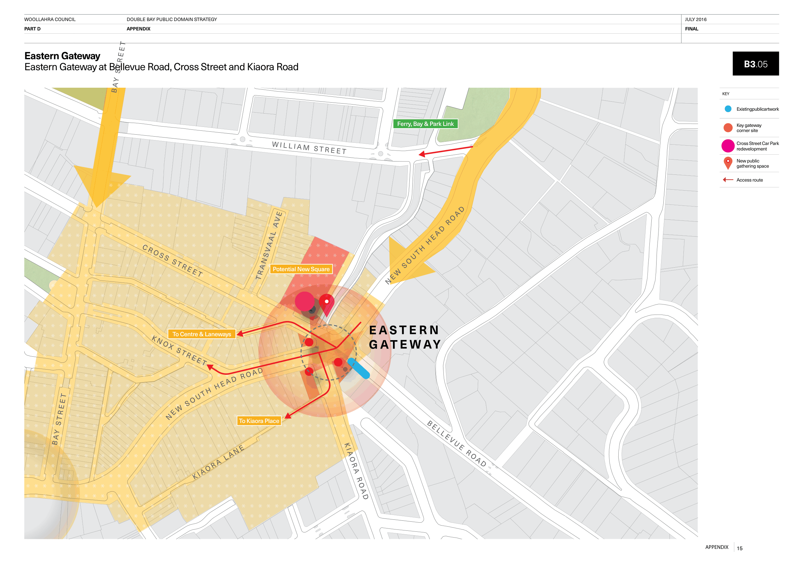

> [Picture on page 124: a map, saved as a picture (images/public-domain-strategy-page-124-1.gif, 150 dpi); the street names and other small labels are on the picture.]
> Words printed on the picture (title and legend, copied from the PDF):
> DOUBLE BAY PUBLIC DOMAIN STRATEGY
> Existing public artwork
> Cross Street Car Park

### B3.05

### Eastern Gateway

### Eastern Gateway at Bellevue Road, Cross Street and Kiaora Road

#### Ferry, Bay & Park Link

#### WILLIAMSTREET

#### Potential New Square

#### CROSSSTREET

#### TRANSVAALAVE

#### NEWSOUTHHEADROAD

#### To Centre & Laneways

### EASTERN

### G AT E W AY

#### KNOXSTREET

#### DROAD

#### HHEA

#### WSOUT

#### N E

#### To Kiaora Place

#### B AY STREET

#### B AY STREET

#### BELLEVUEROAD

#### KIAORALANE

#### KIAORAROAD

\* * * * * * * * * * * * * * * * * * * * * * * * * * * * * * * * * * * * * * * * * * * * * * * * * * * * * *

\* * * * * * * * * * * * * * * * * * * * * * * * * * * * * * * * * * * * * * * * * * * * * * * * * * * * * *

\* * * * * * * * * * * * * * * * * * * * * * * * * * * * * * * * * * * * * * * * * * * * * * * * * * * * * *

\* * * * * * * * * * * * * * * * * * * * * * * * * * * * * * * * * * * * * * * * * * * * * * * * * * * * * *

\* * * * * * * * * * * * * * * * * * * * * * * * * * * * * * * * * * * * * * * * * * * * * * * * * * * * * *

\* * * * * * * * * * * * * * * * * * * * * * * * * * * * * * * * * * * * * * * * * * * * * * * * * * * * * *

\* * * * * * * * * * * * * * * * * * * * * * * * * * * * * * * * * * * * * * * * * * * * * * * * * * * * * *

\* * * * * * * * * * * * * * * * * * * * * * * * * * * * * * * * * * * * * * * * * * * * * * * * * * * * * *

\* * * * * * * * * * * * * * * * * * * * * * * * * * * * * * * * * * * * * * * * * * * * * * * * * * * * * *

\* * * * * * * * * * * * * * * * * * * * * * * * * * * * * * * * * * * * * * * * * * * * * * * * * * * * * *

\* * * * * * * * * * * * * * * * * * * * * * * * * * * * * * * * * * * * * * * * * * * * * * * * * * * * * *

\* * * * * * * * * * * * * * * * * * * * * * * * * * * * * * * * * * * * * * * * * * * * * * * * * * * * * *

\* * * * * * * * * * * * * * * * * * * * * * * * * * * * * * * * * * * * * * * * * * * * * * * * * * * * * *

\* * * * * * * * * * * * * * * * * * * * * * * * * * * * * * * * * * * * * * * * * * * * * * * * * * * * * *

\* * * * * * * * * * * * * * * * * * * * * * * * * * * * * * * * * * * * * * * * * * * * * * * * * * * * * *

\* * * * * * * * * * * * * * * * * * * * * * * * * * * * * * * * * * * * * * * * * * * * * * * * * * * * * *

\* * * * * * * * * * * * * * * * * * * * * * * * * * * * * * * * * * * * * * * * * * * * * * * * * * * * * *

\* * * * * * * * * * * * * * * * * * * * * * * * * * * * * * * * * * * * * * * * * * * * * * * * * * * * * *

\* * * * * * * * * * * * * * * * * * * * * * * * * * * * * * * * * * * * * * * * * * * * * * * * * * * * * *

\* * * * * * * * * * * * * * * * * * * * * * * * * * * * * * * * * * * * * * * * * * * * * * * * * * * * * *

\* * * * * * * * * * * * * * * * * * * * * * * * * * * * * * * * * * * * * * * * * * * * * * * * * * * * * *

\* * * * * * * * * * * * * * * * * * * * * * * * * * * * * * * * * * * * * * * * * * * * * * * * * * * * * *

\* * * * * * * * * * * * * * * * * * * * * * * * * * * * * * * * * * * * * * * * * * * * * * * * * * * * * *

\* * * * * * * * * * * * * * * * * * * * * * * * * * * * * * * * * * * * * * * * * * * * * * * * * * * * * *

\* * * * * * * * * * * * * * * * * * * * * * * * * * * * * * * * * * * * * * * * * * * * * * * * * * * * * *

\* * * * * * * * * * * * * * * * * * * * * * * * * * * * * * * * * * * * * * * * * * * * * * * * * * * * * *

\* * * * * * * * * * * * * * * * * * * * * * * * * * * * * * * * * * * * * * * * * * * * * * * * * * * * * *

\* * * * * * * * * * * * * * * * * * * * * * * * * * * * * * * * * * * * * * * * * * * * * * * * * * * * * *

\* * * * * * * * * * * * * * * * * * * * * * * * * * * * * * * * * * * * * * * * * * * * * * * * * * * * * *

\* * * * * * * * * * * * * * * * * * * * * * * * * * * * * * * * * * * * * * * * * * * * * * * * * * * * * *

\* * * * * * * * * * * * * * * * * * * * * * * * * * * * * * * * * * * * * * * * * * * * * * * * * * * * * *

\* * * * * * * * * * * * * * * * * * * * * * * * * * * * * * * * * * * * * * * * * * * * * * * * * * * * * *

\* * * * * * * * * * * * * * * * * * * * * * * * * * * * * * * * * * * * * * * * * * * * * * * * * * * * * *

\* * * * * * * * * * * * * * * * * * * * * * * * * * * * * * * * * * * * * * * * * * * * * * * * * * * * * *

\* * * * * * * * * * * * * * * * * * * * * * * * * * * * * * * * * * * * * * * * * * * * * * * * * * * * * *

\* * * * * * * * * * * * * * * * * * * * * * * * * * * * * * * * * * * * * * * * * * * * * * * * * * * * * *

\* * * * * * * * * * * * * * * * * * * * * * * * * * * * * * * * * * * * * * * * * * * * * * * * * * * * * *

\* * * * * * * * * * * * * * * * * * * * * * * * * * * * * * * * * * * * * * * * * * * * * * * * * * * * * *

\* * * * * * * * * * * * * * * * * * * * * * * * * * * * * * * * * * * * * * * * * * * * * * * * * * * * * *

\* * * * * * * * * * * * * * * * * * * * * * * * * * * * * * * * * * * * * * * * * * * * * * * * * * * * * *

\* * * * * * * * * * * * * * * * * * * * * * * * * * * * * * * * * * * * * * * * * * * * * * * * * * * * * *

\* * * * * * * * * * * * * * * * * * * * * * * * * * * * * * * * * * * * * * * * * * * * * * * * * * * * * *

\* * * * * * * * * * * * * * * * * * * * * * * * * * * * * * * * * * * * * * * * * * * * * * * * * * * * * *

\* * * * * * * * * * * * * * * * * * * * * * * * * * * * * * * * * * * * * * * * * * * * * * * * * * * * * *

\* * * * * * * * * * * * * * * * * * * * * * * * * * * * * * * * * * * * * * * * * * * * * * * * * * * * * *

\* * * * * * * * * * * * * * * * * * * * * * * * * * * * * * * * * * * * * * * * * * * * * * * * * * * * * *

\* * * * * * * * * * * * * * * * * * * * * * * * * * * * * * * * * * * * * * * * * * * * * * * * * * * * * *

\* * * * * * * * * * * * * * * * * * * * * * * * * * * * * * * * * * * * * * * * * * * * * * * * * * * * * *

\* * * * * * * * * * * * * * * * * * * * * * * * * * * * * * * * * * * * * * * * * * * * * * * * * * * * * *

\* * * * * * * * * * * * * * * * * * * * * * * * * * * * * * * * * * * * * * * * * * * * * * * * * * * * * *

\* * * * * * * * * * * * * * * * * * * * * * * * * * * * * * * * * * * * * * * * * * * * * * * * * * * * * *

\* * * * * * * * * * * * * * * * * * * * * * * * * * * * * * * * * * * * * * * * * * * * * * * * * * * * * *

\* * * * * * * * * * * * * * * * * * * * * * * * * * * * * * * * * * * * * * * * * * * * * * * * * * * * * *

\* * * * * * * * * * * * * * * * * * * * * * * * * * * * * * * * * * * * * * * * * * * * * * * * * * * * * *

#### MANNI

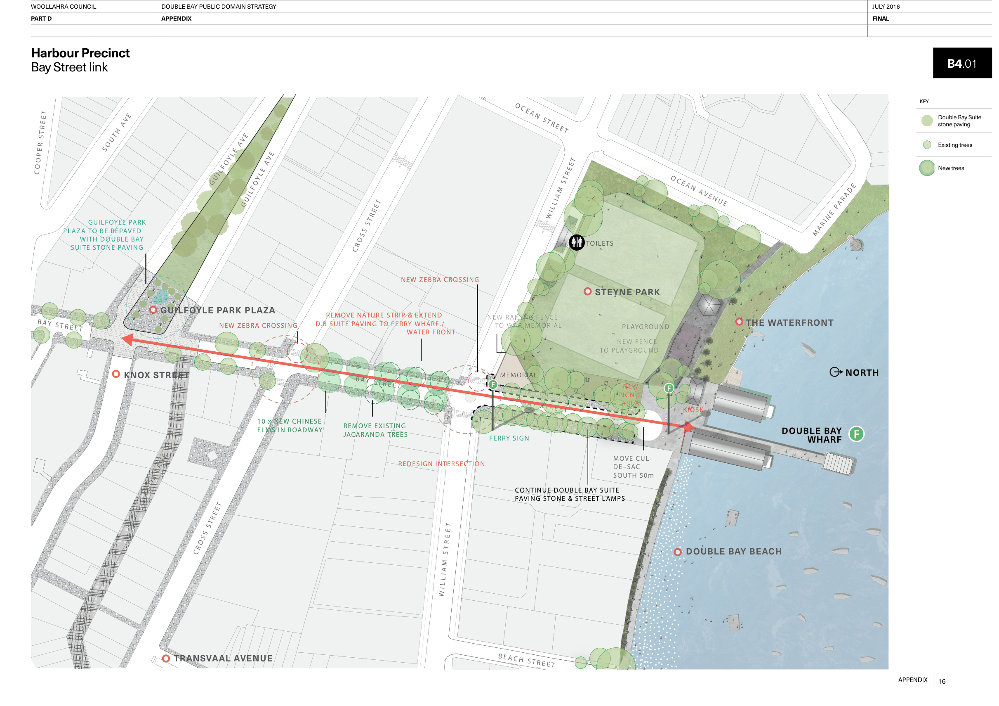

> [Picture on page 125: a map, saved as a picture (images/public-domain-strategy-page-125-1.gif, 150 dpi); the street names and other small labels are on the picture.]
> Words printed on the picture (title and legend, copied from the PDF):
> DOUBLE BAY PUBLIC DOMAIN STRATEGY
> Double Bay Suite
> PLAZA TO BE REPAVED
> MARINE PA RADE
> WITH DOUBLE BAY
> SUITE STONE PAVING
> NEW ZEBRA CROSSING
> NEW RAILING FENCE
> REMOVE NATURE STRIP & EXTEND
> D.B SUITE PAVING TO FERRY WHARF /
> TO WAR MEMORIAL
> NEW ZEBRA CROSSING
> B AY STREET
> B AY STREET
> B AY STREET
> 10 x NEW CHINESE
> ELMS IN ROADWAY
> CONTINUE DOUBLE BAY SUITE
> PAVING STONE & STREET LAMPS

### B4.01

### Bay Street link

#### STEYNE PARK

#### GUILFOYLE PARK PLAZA

#### THE WATERFRONT

#### NORTH

#### KNOX STREET

#### DOUBLE BAY

#### WHARF

#### DOUBLE BAY BEACH

#### TRANSVAAL AVENUE

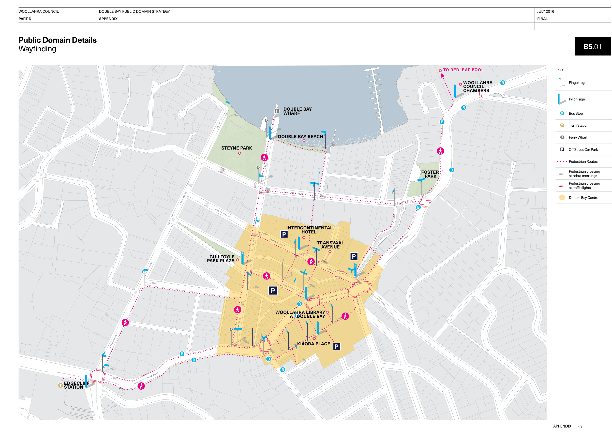

> [Picture on page 126: a map, saved as a picture (images/public-domain-strategy-page-126-1.gif, 150 dpi); the street names and other small labels are on the picture.]
> Words printed on the picture (title and legend, copied from the PDF):
> DOUBLE BAY PUBLIC DOMAIN STRATEGY
> B AY STREET
> B AY STREET
> B AY STREET
> TO REDLEAF POOL
> Off Street Car Park
> at zebra crossings
> at traffic lights
> Double Bay Centre

### Wayfinding

#### EDGECLIFF

#### STATION

#### STEYNE PARK

#### GUILFOYLE

#### PARK PLAZA

#### DOUBLE BAY

#### WHARF

#### DOUBLE BAY BEACH

#### INTERCONTINENTAL

#### HOTEL

#### P

#### TRANSVAAL

#### AVENUE

#### P

#### WOOLLAHRA LIBRARY

#### AT DOUBLE BAY

#### KIAORA PLACE

#### P

### B5.01

#### WOOLLAHRA

#### COUNCIL

#### CHAMBERS

#### EASTERNENTRY

#### FOSTER

#### PARK

### Outdoor dining location map

O

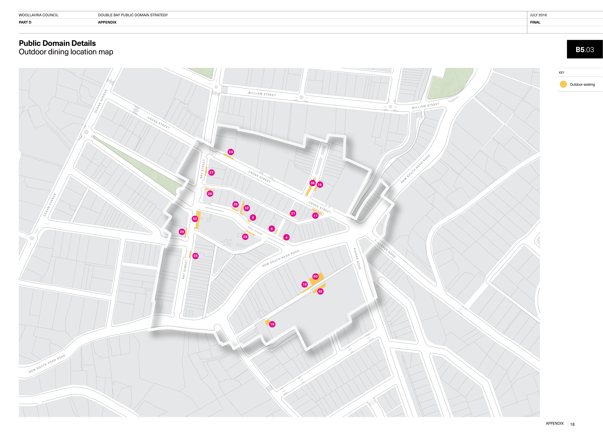

> [Picture on page 127: a map, saved as a picture (images/public-domain-strategy-page-127-3.gif, 150 dpi); the street names and other small labels are on the picture.]
> Words printed on the picture (title and legend, copied from the PDF):
> DOUBLE BAY PUBLIC DOMAIN STRATEGY
> B AY STREET
> B AY STREET
> B AY STREET

### B5.03

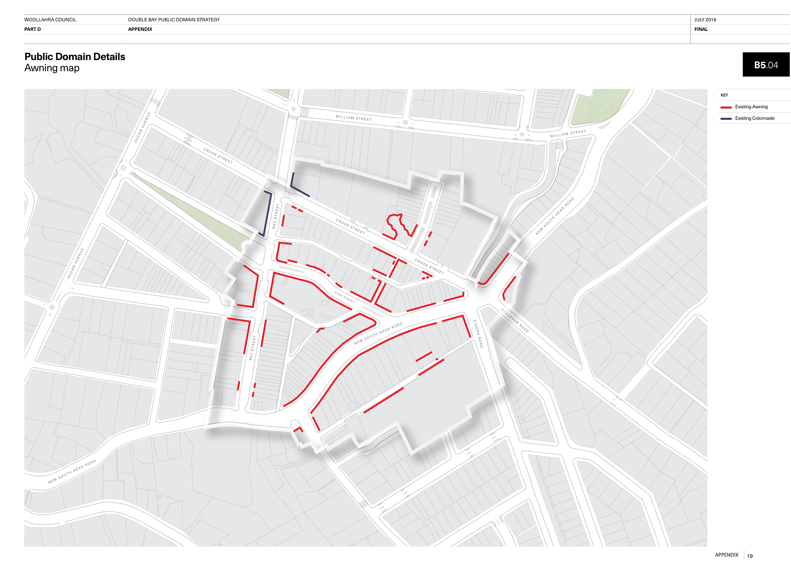

> [Picture on page 128: a map, saved as a picture (images/public-domain-strategy-page-128-1.gif, 150 dpi); the street names and other small labels are on the picture.]
> Words printed on the picture (title and legend, copied from the PDF):
> DOUBLE BAY PUBLIC DOMAIN STRATEGY
> B AY STREET
> B AY STREET
> B AY STREET

### Awning map

### B5.04

### Double Bay waste location plan

#### BROOKLYN LANE

OCEA

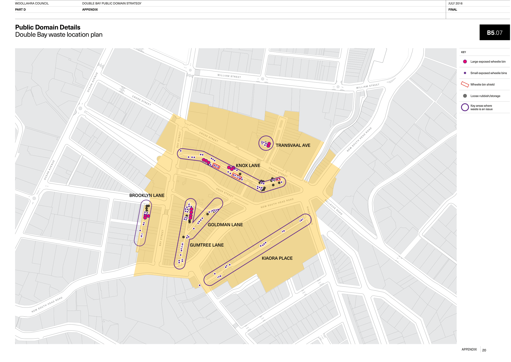

> [Picture on page 129: a map, saved as a picture (images/public-domain-strategy-page-129-4.gif, 150 dpi); the street names and other small labels are on the picture.]
> Words printed on the picture (title and legend, copied from the PDF):
> DOUBLE BAY PUBLIC DOMAIN STRATEGY
> B AY STREET
> B AY STREET
> B AY STREET
> Large exposed wheelie bin
> Small exposed wheelie bins
> Wheelie bin shield
> Key areas where
> waste is an issue

#### TRANSVAAL AVE

#### KNOX LANE

#### GOLDMAN LANE

#### GUMTREE LANE

#### KIAORA PLACE

### B5.07

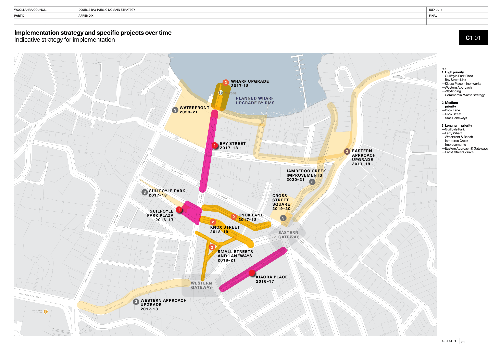

> [Picture on page 130: a map, saved as a picture (images/public-domain-strategy-page-130-1.gif, 150 dpi); the street names and other small labels are on the picture.]
> Words printed on the picture (title and legend, copied from the PDF):
> DOUBLE BAY PUBLIC DOMAIN STRATEGY
> B AY STREET
> B AY STREET
> B AY STREET
> S TAT ION
> 1\. High priority
> ­—Guilfoyle Park Plaza
> —Bay Street Link
> —Kiaora Place minor works
> —Commercial Waste Strategy
> 3\. Long term priority
> —Waterfront & Beach
> —Eastern Approach & Gateways
> —Cross Street Square

### Implementation strategy and specific projects over time

### Indicative strategy for implementation

#### WHARF UPGRADE

#### 2017-18

#### PLANNED WHARF

#### UPGRADE BY RMS

#### WATERFRONT

#### 2020–21

#### BAY STREET

#### 2017–18

#### EASTERN

#### APPROACH

#### UPGRADE

#### 2017–18

#### JAMBEROO CREEK

#### IMPROVEMENTS

#### 2020–21

#### GUILFOYLE PARK

#### 2017–18

#### CROSS

#### STREET

#### SQUARE

#### 2019–20

#### GUILFOYLE

#### PARK PLAZA

#### KNOX LANE

#### 2017–18

#### 2016–17

#### KNOX STREET

#### 2018–19

#### EASTERN

#### GATEWAY

#### SMALL STREETS

#### AND LANEWAYS

#### 2018–21

#### KIAORA PLACE

#### 2016–17

#### WESTERN

#### GATEWAY

#### WESTERN APPROACH

#### UPGRADE

#### 2017-18

### C1.01
