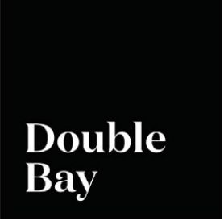

# Woollahra Development Control Plan 2015 - Public Domain Strategy

> This chapter is split into 6 section file(s), one per numbered heading, in the order they appear in the PDF.

Source PDF: [double_bay_centre_-_public_domain_strategy_-_aspect_report_2016.pdf](https://planfortomorrow.sharepoint.com/sites/Planfortomorrow/Shared%20Documents/00%20NSW-Planning-Resources/dcp/woollahra-development-control-plan-2015/supporting-guides/public-domain-strategy/double_bay_centre_-_public_domain_strategy_-_aspect_report_2016.pdf)

### Double Bay Centre

### Public Domain

### Strategy

#### ADOPTED BY COUNCIL 8 AUGUST 2016

ASPECT Studios | Urban&Public

> [Picture on page 1: a picture, saved as a picture (images/public-domain-strategy-page-1-6.gif, 150 dpi).]

### Acknowledgements

#### ASPECT Studios | Urban&Public

Simeon King

Sacha Coles

Ian Rooney

Liz Herbert

Joanna Tanus

Henry King

#### Six Degrees Urban

Craig Allchin

#### Woollahra Council

#### Strategic Planning

Anne White

Tom Jones

Jorge Alvarez

Peter Kauter

Chris Bluett

### This report

This Public Domain Strategy for the Double Bay Centre

and surrounds aims to identify the current strengths and

weaknesses of the centre. It provides an overarching

framework to guide future policies and capital works projects

that will address these challenges across the short, medium

and longer term. The report is structured in two parts: —Part A provides an overview of the visions, and describes the

background to help understand the

key issues facing the centre. —Part B sets out a series of individual urban projects and

directions that will enable the majority of the vision to be

delivered across time and to suit the specific priorities and

budgets of Council over time.

#### PART A — OVERVIEW & BACKGROUND

### Contents

#### PART B — URBAN PROJECTS & DETAILS

| Executive Summary |  | 2 | B1 | The Centre | 25 |
|---|---|---|---|---|---|
| Introduction |  | 4 | B1.01 | Knox Street and Knox Lane Core Upgrade | 25 |
| A1 | Overview & Background | 7 | B1.02 B1.03 | Guilfoyle Park and Bay Street Square Upgrade Cross Street & Transvaal Avenue | 29 34 |
| A1.01 | A great harbourside village in a valley | 8 | B1.04 | Jamberoo Creek, Jamberoo Lane | 36 |
| A1.02 | Current status of Double Bay | 9 |  | and Cross Lane |  |
| A1.03 | Double Bay and its role in the Eastern Suburbs of Sydney | 11 | B2 | Laneways and Small Streets | 38 |
| A1.04 | Public Domain Structure Plan for Double Bay | 12 | B2.01 | Hierarchy | 38 |
| A1.05 | Review of existing documents relating to Double Bay | 13 | B2.02 B2.03 | Typical treatments Integration of arcades with pedestrian networks | 39 43 |
| A2 | Transport and Movement | 14 | B2.04 B2.05 | Kiaora Place Goldman Lane South | 45 49 |
| A2.01 | Arriving and moving through Double Bay | 14 | B2.06 B2.07 | Short Street Gumtree Lane | 51 53 |
| A2.02 | Arrival points and gateways to Double Bay | 16 |  |  |  |
| A2.03 | Active and public transport access | 18 | B3 | Gateways and Approaches | 55 |
| A2.04 | Private transport and parking | 20 | B3.01 | Edgecliff Gateway | 56 |
| A2.05 | Existing road network | 21 | B3.02 | Western Approach | 58 |
| A2.06 | Future streets and laneways network | 22 | B3.03 B3.04 B3.05 B3.06 B3.07 | Eastern Approach Western Gateway Eastern Gateway Harbour Gateway Ferry Wharf Improvements | 62 64 66 68 70 |
|  |  |  | B4 | Harbour Precinct | 72 |
|  |  |  | B4.01 | Bay Street Link | 72 |
|  |  |  | B4.02 | Steyne Park upgrade | 76 |
|  |  |  | B4.03 | The Waterfront | 79 |
|  |  |  | B4.04 | Double Bay Beach | 82 |
|  |  |  | B5 | Public Domain Details | 85 |
|  |  |  | B5.01 | Double Bay Suite | 85 |
|  |  |  | B5.02 | Wayfinding | 89 |
|  |  |  | B5.03 | Outdoor seating for dining and drinking | 92 |
|  |  |  | B5.04 | Awnings and covered seating | 96 |
|  |  |  | B5.05 | Opening to the street | 98 |
|  |  |  | B5.06 | On street trading display | 100 |
|  |  |  | B5.07 | Commercial waste management | 102 |
|  |  |  | B5.08 | Pedestrian priority measures | 105 |
|  |  |  | B5.09 | Green streets, planters, trellis and vines | 106 |

#### PART C — IMPLEMENTATION

<!-- sections -->
## Sections

1. [C1 Implementation Strategy 107](01-c1-implementation-strategy-107.md)
2. [A1 — Kiaora Shared Zone](02-a1-kiaora-shared-zone.md)
3. [1.5 m high sandstone wall. The](03-1-5-m-high-sandstone-wall-the.md)
4. [18 Footer Season](04-18-footer-season.md)
5. [1.0 m from an adjacent street tree.](05-1-0-m-from-an-adjacent-street-tree.md)
6. [3 Long term priority](06-3-long-term-priority.md)
